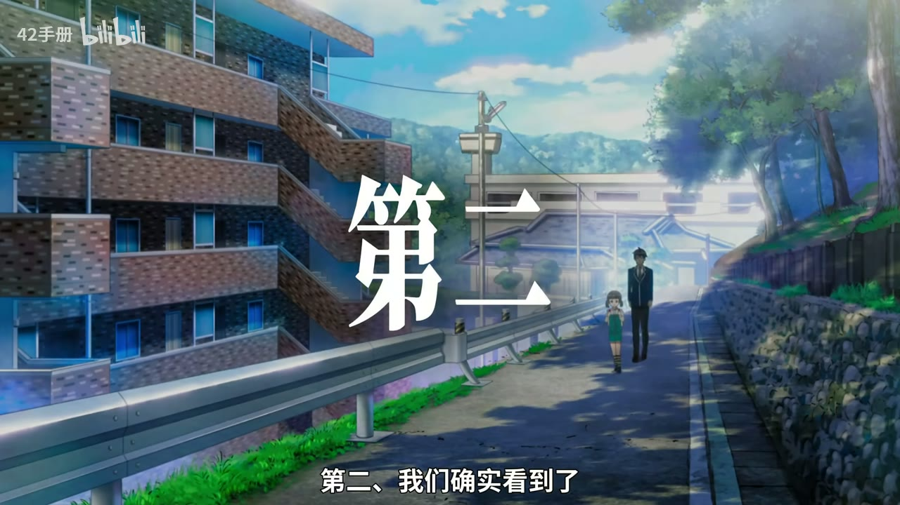
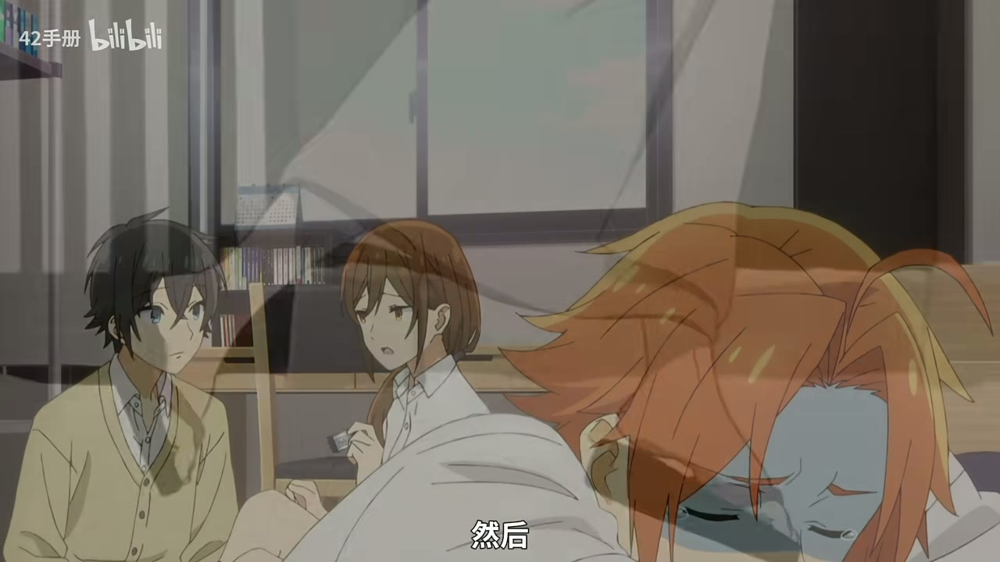
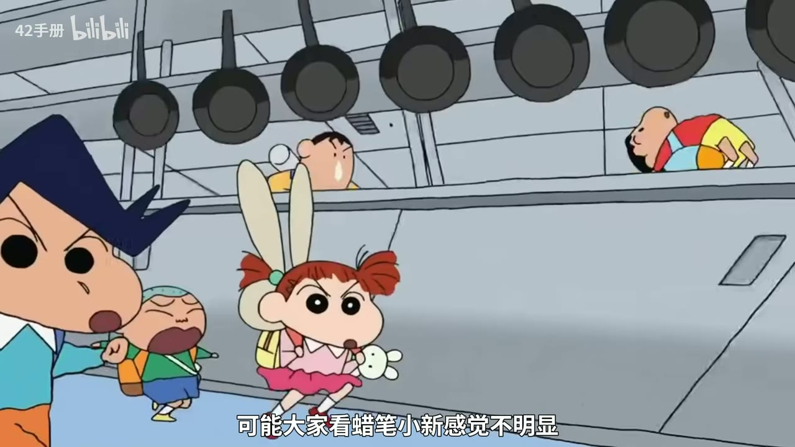
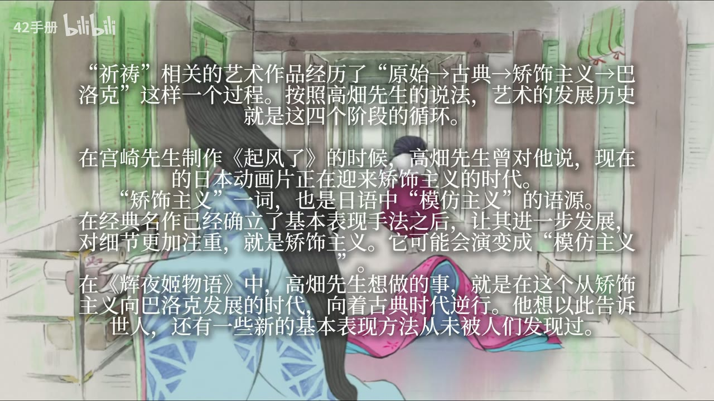
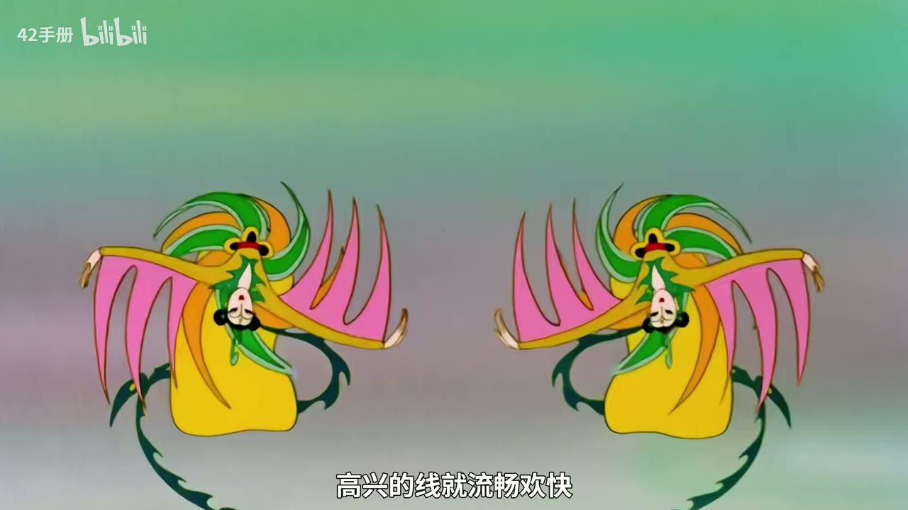
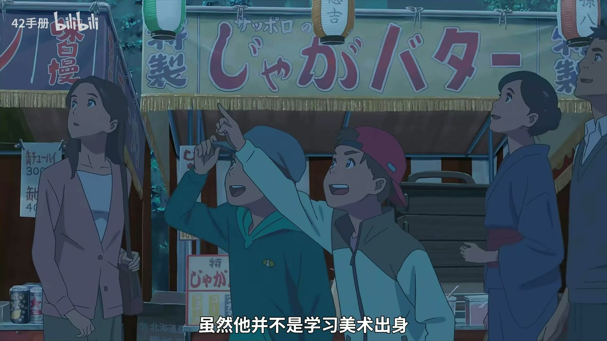
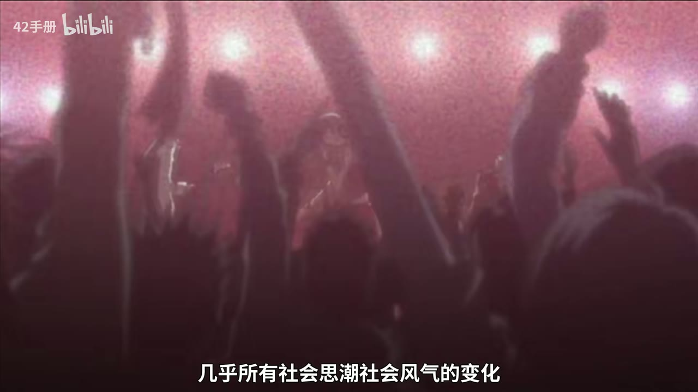
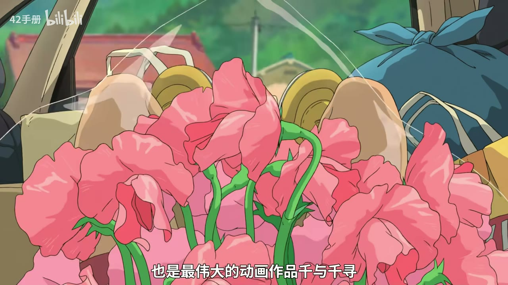

# 细线条，光污染，新动画画风真的在集体“审美降级”吗？

> **UP 主**：42手册 
> **时长**：28:28 
> **视频 ID**：BV17uuM6rEwJ 
> **来源**：[Bilibili 原视频](https://www.bilibili.com/video/BV17uuM6rEwJ/) 
> **总结强度**：standard 
> **证据**：本地逐字稿（faster-whisper 中文识别，1145 段）+ 12 张时间戳画面。逐字稿存在少量专名、同音词与断句误识，涉及作品名和术语时以下以可确认的论证关系为主。

## 一句话抓住核心

视频的结论很明确：细线条、强滤镜和“光污染”并不天然低级；真正该问的是，它们是否服务于作品的叙事、角色与世界，以及它们是否由高效却粗糙的数字化生产流程催生。

## 时间戳导航

- [00:00:00] 提问：“新动画质感变差”究竟是审美降级，还是观察方式过于简单？
- [00:01:45] 线条先是边界：它划分角色、物体、空间，也决定主体的存在感。
- [00:03:33] 线条变细后，角色与场景的边界被弱化，画面可以走向梦境感与流动感。
- [00:05:31] 动态线条的两极：准确、重量感，与夸张变形、能量感。
- [00:07:08] 线条还可以直接成为笔触和作品的表达主体。
- [00:08:20] 《辉夜姬物语》被用作“线条与留白本身就是追求”的案例。
- [00:09:00] 《鬼灭之刃》的水之呼吸：传统绘画感、色彩和数字特效可以协同。
- [00:10:14] 中国传统线描的可读性与情绪信息。
- [00:11:48] 粗细、动态、打光都没有放之四海皆准的优劣，要看作品匹配度。
- [00:13:00] 从技术史切入：赛璐璐与数字制作改变了线条和上色的工作逻辑。
- [00:17:12] “闭合区域自动填色”如何推动均匀细线，并将更多工作交给后期。
- [00:18:10] 观众厌恶的重点是粗制滥造；细线条常因生产条件而与此绑定。
- [00:20:10] 老动画与新动画各有工艺短板、优势，也会经历复古回潮。
- [00:21:20] 审美偏好与童年经验、代际更替及“谁拥有定义权”有关。
- [00:23:35] 批评和解构之后，更重要的是创作、建设与接受实践检验。
- [00:25:53] 以《千与千寻》的锅炉爷爷说明赛璐璐工艺记忆如何被藏进数码时代作品。

## 核心问题与推理主线

视频先拒绝把“粗线条=高级、细线条=廉价”当作结论。若线粗、颗粒和低清天然保证质感，那么所有作品都该往更粗、更糙、更低清的方向走；实际观看经验显然不支持这种推论。

主讲人的推理可以压缩成四层：

1. 线条并非只是一圈轮廓，它同时组织人物与背景的关系、空间感、运动的力度和情绪的方向。
2. 细线条与复杂打光能够做出成熟作品，前提是它们与主题、场景、角色位置及整体美术语言一致。
3. 数码制作的上色、闭合、后期合成和流水线协作，确实会把行业推向更均匀、更容易处理的线条；由此产生的粗糙成品容易被观众概括为“细线条+光污染”。
4. 审美争论还混入了代际记忆与文化资本：人们常把自己成长时最熟悉的版本误当成普遍尺度。

因此，“审美降级”在视频中被拆成几个应分别判断的问题：做工是否到位、风格是否匹配、生产流程是否挤压表达，以及观看者是否被自己的时代经验牵引。

## 一、线条先决定“谁更重要”

[00:01:52] 线条最直接的功能是确定轮廓、边界和空间关系。线越粗，角色往往越像被从背景中切出来：外轮廓强，体积和力量也更容易被强调。视频以《JoJo 的奇妙冒险》式的强轮廓为例，说明线条可让角色取得近似雕塑的重量和主导地位，背景相应退后。

[00:02:38] 线条也可以走向平面化、装饰化。头发、衣褶、花朵等曲线彼此交织时，线自身构成视觉节奏；角色像圣像或神话人物，现实空间感被降低。主讲人借此解释：某些带有厚重、平面气质的作品，需要承载主体分量的线，未必适合直接套用透明细线与复杂打光。

*图 01 · 00:01:11：画面把建筑、道路、人物和远处树林同时置于景深中，前景护栏与人物的清晰轮廓共同分隔了角色和环境。*

[00:03:33] 当线条细到几乎不被察觉，角色和场景仍可被辨认，却少了强势的边界；画面更容易呈现真实、梦境和转场般的连续性。视频将这种效果联系到今敏作品的梦境感：观众不再总被轮廓提醒“这里有一个固定实体”，变化本身可以成为体验的一部分。

*图 02 · 00:03:33：叠加的人物与室内画面让多个时空层同时可见，人物边缘并未以强烈粗线将每层画面彻底切开。*

## 二、线条还会画出运动、能量与笔触人格

[00:05:31] 主讲人把动态中的线条概括为两个极端。一端追求动作、机械和重量的准确性，《阿基拉》的都市与摩托车镜头被用来说明这种“可信的真实”；另一端以汤浅政明为代表，允许身体拉伸、扭曲、甚至越出人物既定边界。后者重视的不是动作轨迹是否正确，而是动作是否带出了能量、情绪和精神状态。

*图 03 · 00:05:55：蜡笔小新式人物以简化外形和粗黑轮廓呈现，角色在画面中依靠姿势、表情和线条弹性传递动作。*

[00:07:08] 视频进一步提出：线条完全可以成为作品的理念本身。以《悬崖上的金鱼姬》为例，歪斜、膨胀、涌动的房屋、草地和环境线，不只描述物体形状，也把风、海和不稳定的情绪带进画面。它们像有温度的笔触，形状不必完全服从严谨透视。

[00:08:20] 对《辉夜姬物语》的概括更激进：线条与留白本身就是作品的主要追求。画面中引用的文字将其放在“原始—古典—矫饰主义—巴洛克”的艺术发展循环里，并将其解释为：在矫饰主义走向巴洛克的阶段，反向寻找尚未被发现的基本表现方式。

*图 04 · 00:08:18：手绘感很强的室内场景上覆盖了关于《辉夜姬物语》、矫饰主义与基本表现方式的大段引文。*

## 三、关键不在粗细，而在风格是否与内容合拍

[00:08:39] 视频以《鬼灭之刃》的水之呼吸说明，商业作品同样能把“笔触感”做得有意识：浪花借鉴传统绘画的表现，颜色与夜景形成明确搭配，粒子特效补足飞溅感。主讲人特别指出，这并不等于回到传统粗线，而是在线、色、特效之间建立了同一套视觉语言。

[00:10:00] 随后转向中国动画与传统绘画。传统国画线描具有很高的信息密度：它能传达平静、硬挺、欢快、焦虑、华丽或简约等感受，远超过“勾外轮廓”这一项功能。视频提到高古游丝描的流畅连绵、折芦描的方折硬挺，以及铁线描等线法，强调它们本就可被转化为现代动画语言。

*图 05 · 00:10:40：画面中两位对称舞者的长袖、飘带与衣褶以连续曲线展开，线条的流向直接组织了舞姿与节奏。*

[00:11:48] 回到总判断：粗线、细线、强打光、少打光、静态和动态都谈不上绝对高下。“没有最好的，只有最合适的”是这一段的原话核心。视频用《葬送的芙莉莲》《你的颜色》《蓦然回首》等例子说明，细线在轻盈、回望、未散的情绪中可以是加分项；争议经常来自风格与题材、原作气质或叙事重心的错配。

*图 06 · 00:13:03：画面几乎被白色高亮吞没，仅留下淡色人物轮廓和字幕，直观呈现视频所讨论的细线与强光效观感。*

## 四、为什么细线条和“光污染”会频繁一起出现

[00:13:00] 视频把答案放回生产技术。赛璐璐时代，上色位置可以由人直接判断，线条即使没有完全闭合也能继续处理；数码制作普及后，自动填色依赖闭合区域。为了便于上色、减少漏色与后期问题，主线会被要求更细、更均匀、更易处理。

[00:17:12] 这条技术逻辑会改变工艺目标：新人更容易被训练成画“好后期处理的线”，而不是优先画“有质感的线”。当线条和体积感被削弱，后期再以光效、滤镜和特效补偿；后期权重上升，又进一步要求前期线条单一、规整，形成循环。

视频的限定很重要：观众不喜欢的对象并非所有细线条，而是粗制滥造的成品。只是当生产流程压缩时间、追求统一可处理性时，粗糙更容易以“细线+重后期”的形态被看见。

*图 07 · 00:15:25：夜市画面以低饱和蓝色环境光统一人物、招牌和摊位，人物轮廓在暗部中仍保持可读。*

[00:18:25] 旧工艺也有自身限制：老动画可能崩坏、经费不足，或缺少现代叙事规范；但人力相对可投入时，构图、调度、表演等环节有机会被细抠。数码时代借助建模等工具减少了离奇崩坏，表面更工业化精致，同时也可能让镜头语言、线条表达被生产便利性挤压。

[00:20:10] 视频还提醒，今天被怀念的“老动画构图与质感”，在更早的时候也曾被批评为停滞或落后。审美回潮往往是一个循环：当观众看惯某种均匀细线与后期光效，仿旧、颗粒、粗粝笔触就会重新成为制造记忆点的资源。

*图 08 · 00:22:32：粉紫色强光、雾化颗粒与人群剪影叠在一起，画面展示了高密度后期光效如何主导整体氛围。*

## 五、审美争论背后还有代际经验

[00:21:20] 主讲人借布尔迪厄的“区隔”讨论审美：偏好具有主观性，品味也与群体所处的位置、拥有的文化经验相关。一个人童年看过哪一版作品，会显著影响其后来对“正确画风”的判断。

[00:22:00] 代际更替会改变谁拥有审美定义权。曾经的少年成长为消费主体、创作者和评论者后，会把童年对象推向经典；再过一代，新的童年文本也会被重新评价。视频因此主张，在“审美变差”的争论中保留对不同代际经验的包容。

## 六、批评之后，要回到创作与实践

[00:23:35] 最后一层从动画讨论转到创作观。视频承认“看穿结构”的快感：它能帮助人反抗既有权威、拆解固有解释；但若只停在否定，旧道路被拆掉，新道路却没有被建起，人会落入迷茫。

主讲人的落点是“实践是检验真理的唯一标准”，并把创作视为最具体的建设。一个美术判断、一种风格理论、一次行业批评，最终都该接受作品效果的反馈：是否真的带来更好的表达、更多理解或更具体的幸福。若实践不断失败，也应允许自己修正判断。

[00:25:53] 锅炉爷爷被用作结尾彩蛋。《千与千寻》中看似烧锅炉的工作台，被视频解读为赛璐璐摄影工作台的转写：过去的手工合片、移动赛璐璐、制作烟雾和特效，后来进入数字时代后转化为摄影监督、后期与特效等职责。旧工艺没有从文化记忆中消失，它可以被新的作品重新编码。

*图 09 · 00:27:17：车后备箱塞满粉色花束、草帽和布包，前景花朵遮挡人物与车辆，展示了传统手绘色块、轮廓和前后景层次的组合。*

## 具体案例与原话细节

- **《阿基拉》与汤浅政明**：前者强调准确、结构与重量，后者通过夸张变形表现能量。两者都在使用线条，只是线条承担的任务不同。
- **《悬崖上的金鱼姬》**：环境的歪斜、涌动线条使“风”仿佛可见，说明线条可以超出描边，成为情绪性物质。
- **《辉夜姬物语》**：视频将其视为把线条、留白和基本表现方法放在中心的艺术宣言。
- **《鬼灭之刃》**：传统绘画式浪花、浓郁色彩和数字粒子特效共同服务于招式的厚重与灵力感。
- **中国动画与线描**：视频强调传统线法本身就携带情绪、材质和身份信息，可成为当代动画美术资源。
- **赛璐璐到数码**：从人工判断上色位置，转向闭合区域自动填色，是理解“均匀细线为何成为生产偏好”的关键工艺变化。
- **《千与千寻》锅炉爷爷**：角色与场景设计保留了赛璐璐摄影工艺的隐喻，让数码时代作品仍能携带旧技术的影子。

## 边界、疑点与时效性

- 本视频是美术与行业观察的评论性论述，提出的“生产流程—线条风格—后期补偿”链条具有解释力，不能替代对每部作品预算、工期、制作委员会和具体团队的逐案调查。
- “审美降级”含有价值判断。视频给出的更稳妥方法是拆开看：风格匹配、画面完成度、工艺限制、题材需求与观看者代际经验。
- 逐字稿中有部分作品名及术语识别不稳定；本笔记保留可由上下文和画面共同支持的核心论点，未将难以确认的专名作为独立事实扩展。

## 复习与行动清单

- [ ] 评价一张动画截图时，先看线条在分离角色与背景，还是在让两者融合。
- [ ] 分辨画面里的“光”承担什么任务：空间、情绪、招式、叙事重点，还是单纯遮盖线条与体积问题。
- [ ] 判断细线条时，问“它与题材和角色位置相配吗”，避免只按粗细打分。
- [ ] 观看不同年代作品时，留意上色、闭合、合成与镜头语言如何受工艺条件影响。
- [ ] 面对审美争论，区分个人童年滤镜、作品本身完成度和行业生产结构。
- [ ] 批评一种风格后，进一步提出可实践的替代方案；用作品与反馈校正判断。
