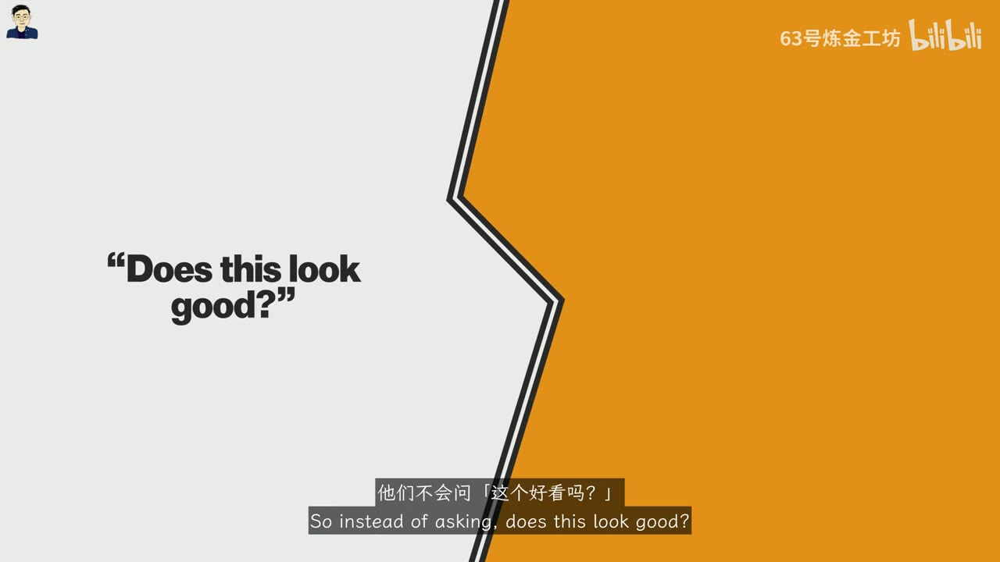
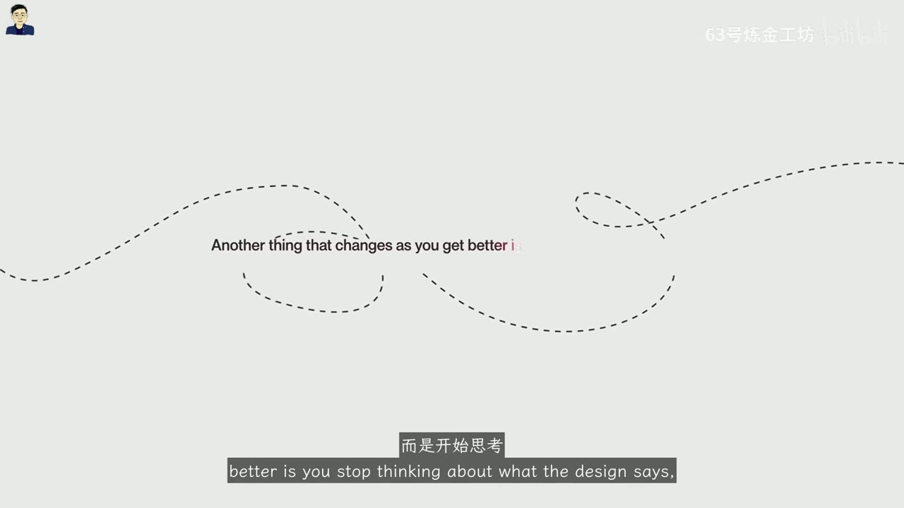
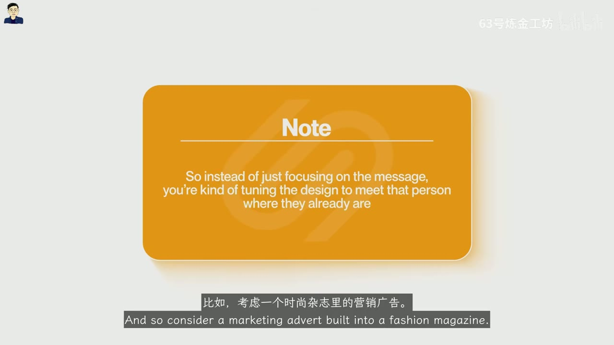
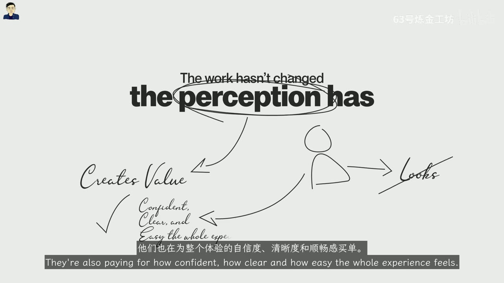
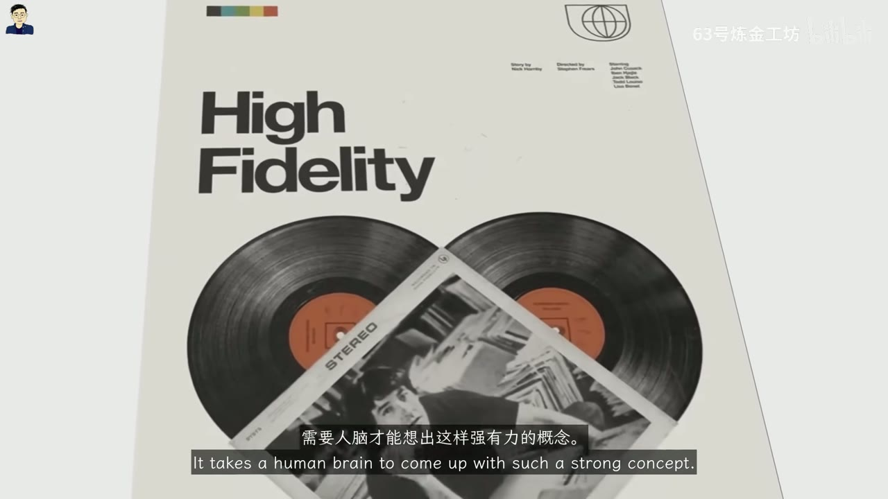
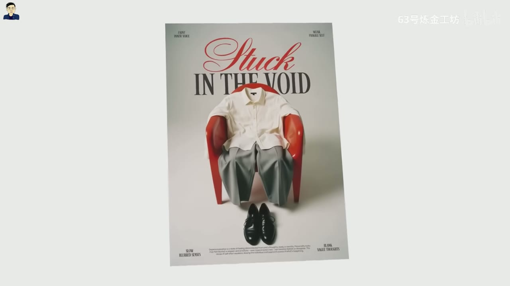
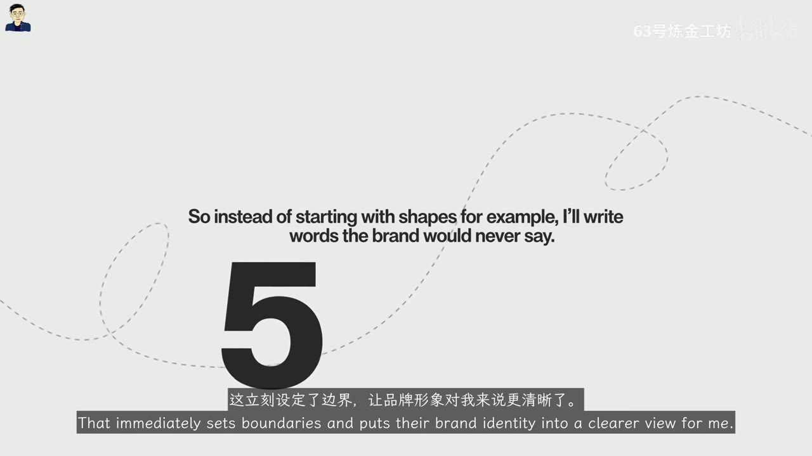
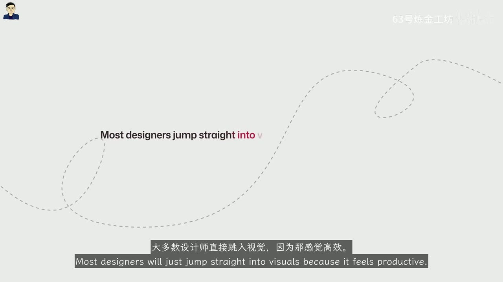

# Satori Graphics｜学高阶设计思维，看这一部就够了

> **UP 主：**63号炼金工坊 
> **视频时长：**约 10 分 08 秒 
> **视频 ID：**BV1s43z67Ezv 
> **来源：**[Bilibili 原视频](https://www.bilibili.com/video/BV1s43z67Ezv/) 
> **总结强度：**deep 
> **证据来源：**英文音频的 faster-whisper 机器逐字稿、SRT 时间轴及 12 张时间戳画面。审计记录显示共 102 个语音片段、无相邻重复；以下内容以讲述为主，画面只用于还原案例和版面细节。

## “这个好看吗？”为什么可能是个低效问题

面对一张海报，很多设计师首先检查颜色、字体和风格。讲者在 [00:00:25] 换了一套问题：视线最先落在哪里？第二个被注意到的是什么？又有什么完全被忽略？

*图 01 · 00:00:25：画面把“Does this look good?”单独放大，直接呈现讲者试图替换掉的审美提问。*

这组问题把设计评价从个人喜好转向了信息接收。你原本想表达什么，与观众实际看到什么，两者之间存在一道“感知鸿沟”（perception gap）。审美判断可以因人而异，困惑、遗漏和错误的阅读顺序却能够被观察。

最简单的测试是把版面展示几秒，让受试者按顺序复述记住的内容 [00:00:34]。如果对方先说出了次要信息，视觉层级可能失效；如果完全没看到行动号召，版面也没有沿预期路径引导视线。需要设计师在旁边解释才能成立的设计，至少有一部分沟通任务没有独立完成。

## 一句话抓住核心

**高阶设计思维关注的，是设计如何进入真实情境中的人：他先看到什么、来之前是什么状态、离开后产生什么感受，以及最终记住什么。**

## 核心问题与推理主线

### 1. 从“设计说了什么”转向“观众带着什么状态到来”

能力提升后，设计师会开始考虑观众接触设计时的心理与情绪状态 [00:01:14]。同一句信息，放在慈善网站和时尚杂志中，需要面对两种完全不同的接收情境。

浏览慈善网站的人可能谨慎、寻找可信线索，同时处于较为开放的情绪状态；随手翻阅时尚杂志的人更放松，通常不会投入太多分析。如果视觉语气与这一起始状态错位，观众很快就会感觉不协调。

*图 02 · 00:01:15：画面用一条游走的虚线承托“随着能力提高而改变的思考方式”，对应从信息内容转向接收者状态的过渡。*

所以，设计并非只需把信息放进去，还要“调频”到观众当前所在的位置 [00:01:58]。时尚杂志中的营销广告可以使用大胆图像、强烈对比和自信清晰的字体，目标是在快速翻阅中制造短暂停顿和向往感。这里的重点较少落在完整解释，更多落在瞬间形成的感受。

*图 03 · 00:02:06：橙色提示卡明确写出：设计需要根据受众已经处于的状态进行调校。*

一个适合在项目前期提出的问题是：

> **“这个人在遇见我的设计之前，正处于什么情绪和注意力状态？”**

### 2. 作品周围的体验，也在参与作品评价

不少设计师只盯着最终输出，却很少检查作品以什么方式抵达接收者 [00:02:46]。讲者回忆自己职业早期也有过这一阶段，后来改变关注点后，作品被感知的方式随之变化。

同一个项目，可以作为没有上下文的 PDF 被随手发出，也可以通过清楚的结构和意图逐步展开；同一个文件，可以图层混乱、命名含糊，也可以组织明确，让接手者一眼知道如何使用。作品内容没有发生根本变化，专业感却已经在作品“开口”前形成 [00:03:04]。

*图 04 · 00:03:47：手绘示意图突出“The work hasn’t changed, the perception has”，并把清晰、自信、顺畅的体验连到价值感。*

这也是“感知创造价值”的含义。客户支付的费用包含最终外观，也包含合作过程中感受到的信心、清晰度和顺畅程度 [00:03:39]。作品集的打开方式、提案前几秒的节奏、交付文件是否易懂，都会进入整体评价。

真实观众也很少处在理想评审环境里。他可能深夜半疲惫地刷手机，屏幕亮度很低；他不会像设计师审阅 Dribbble 作品那样放大画面，逐像素检查字距 [00:03:50]。设计首先要服务普通人的有限注意力。

### 3. 预测性共情：设计观众几秒后的情绪

“预测性共情”（predictive empathy）指向更远一步：除了回应观众当下的感受，还要预判他在几秒后乃至当天接下来的情绪 [00:04:23]。讲者把它称为一种情绪远见。

案例中的原始海报拥有高声量标题、戏剧性图像和强烈色彩，效果类似抓住观众的手臂大喊“现在就看我”。这种设计默认观众已经认同、已经感兴趣、已经与信息处于同一情绪位置，可现实中多数人尚未达到这个状态。

改版策略包括：降低标题的压迫感，同时保留冲击力；增加留白；加入一句温和的安抚文案或信任符号；把色板调整到更接近安心、可信的情绪温度 [00:05:12]。

*图 05 · 00:05:29：改版示例以柔和紫色、莲花符号、“Start Your Journey”和较大留白构成安抚与信任语气。*

讲者描述的预期变化是：观众感到自己被理解，压力感下降。于是，“每个设计决定都要有理由”还可以补上一问：

> **“观众离开这张设计时，我希望他带走什么情绪？”**

讲者也主动给原始强烈版本提供了另一种解读 [00:05:58]：愤怒般的亮色和高声量字体可能代表外部混乱，模特则在混乱中寻找平静。这一反例很重要，因为它说明视觉强度没有固定答案；判断仍要回到目标情绪、叙事关系和受众情境。

### 4. 记忆编码：给大脑留下一件需要解决的事

“记忆编码”（memory encoding）关心设计在被划走之后还能留下什么 [00:06:38]。讲者批评一种常见现象：视觉画面可能非常光洁，却在闭眼之后迅速从记忆中消失。能被记住的设计通常包含一个可识别的概念转折。

第一张案例海报以两张黑胶唱片和一张唱片封套组成心形。设计师原本可以随机散放唱片，或者采用普通角度排列；心形构图却让“音乐”转成“情感”，让“唱片”转成“浪漫” [00:07:15]。观众识别到这一隐喻时，画面便获得了意义层的记忆支点。

*图 06 · 00:07:10：“High Fidelity”海报用两张黑胶和斜放的唱片封套拼出心形，把音乐媒介转化为情感隐喻。*

第二张海报把衬衫、长裤和鞋摆成坐在红椅上的人体轮廓，却移除了人物本身。没有脸，也没有真实身体，只剩一个“身体形状的缺席” [00:07:40]。画面呼应 depersonalization（人格解体／去人格化）主题，并迫使观众停下来理解这段缺席。

*图 07 · 00:08:00：“Stuck in the Void”海报以空衣服和鞋构成坐姿，人的缺席形成需要观众解释的视觉谜题。*

讲者把这短暂的停顿视为记忆形成的时刻 [00:08:07]。记忆编码的关键由此显现：给观众一个稍微失衡、需要补完的东西，让设计低声提出问题，保留理解空间。

这不等于故意制造晦涩。前面的“感知鸿沟”仍然有效：信息路径应当清楚，核心概念可以保留适量张力。层级混乱造成的是迷失；概念悬念带来的是主动解释。

### 5. 品牌先形成声音，标志再形成形状

品牌实际生活在文案、落地页、推送通知和社交媒体内容中。若设计师还不了解品牌如何说话，就直接开始设计标志，视觉探索会缺少明确边界 [00:08:24]。

讲者给出了一套先于造型的练习：

1. 写出品牌绝不会说的五个词，用排除法建立边界。
2. 写出品牌可能频繁使用的五个词，观察其语气是尖锐直接、活泼，还是技术化。
3. 写一句品牌会发给受众的短消息：假设只能用 140 个字符自我介绍，它会怎样开口？

*图 08 · 00:08:51：画面把数字“5”与“品牌绝不会说的词”并置，强调先用语言禁区划定身份边界。*

完成这些练习后，语言会暴露品牌的“情绪温度”。说话大胆的品牌不适合过度怯弱的标志；表达平静的品牌也不适合充满攻击性的尖角和形状心理 [00:09:21]。标志需要与品牌的声音温度对齐。

*图 09 · 00:09:42：画面指出多数设计师会因“看起来很高效”而直接跳入视觉阶段，正是品牌声音容易被漏掉的环节。*

因此，品牌设计的起点可以设为声音对齐。即便标志制作精良，只要它与品牌及其受众说着不同的视觉语言，整体仍会持续带有轻微错位感 [00:09:39]。

## 可复用的设计检查模型

可以把整段讲述压缩成一条连续检查链：

**接触前状态 → 第一眼路径 → 接触中体验 → 离场情绪 → 记忆钩子 → 品牌声音一致性**

- **接触前状态：**观众在什么设备、场景和情绪中遇到设计？
- **第一眼路径：**最先、其次和完全未被看到的内容分别是什么？
- **接触中体验：**文件、提案、页面或交付过程是否清楚顺畅？
- **离场情绪：**观众看完后应当更安心、更兴奋、更好奇，还是更有行动意愿？
- **记忆钩子：**画面里有没有一个可理解、可补完的概念转折？
- **声音一致性：**视觉形状与品牌实际说话的方式是否处于同一情绪温度？

这套模型的价值，在于它把“感觉不对”拆成可观察的问题。设计师仍然需要审美判断，同时还要能说明每个选择如何影响接收、情绪和记忆。

## 边界、疑点与时效性

- “如果设计需要解释，它就失败了”适合作为自检警报，不能机械地覆盖实验性艺术、复杂信息图或本身要求探索的作品。
- “强烈视觉会施压、柔和视觉会安抚”取决于主题、文化语境和组合关系。讲者对原海报的“混乱中寻找平静”解读，已经展示了同一形式可以承载不同叙事。
- 逐字稿在 [00:08:18] 附近存在较突兀的语义跳转，因此没有替缺失的上下文补写结论。
- “预测性共情是 2026 年最重要的能力之一”“AI 目前无法触及这一点”“人类设计天然更有概念”等，属于讲者在录制时期的个人判断，不能当作经过验证的行业定论。
- 机器逐字稿中存在少量明显识别错误，如 *Assetics*、*topography* 等；笔记结合上下文谨慎还原为 *aesthetics*、*typography*，未对不确定内容扩写。

## 时间戳导航

- [00:00:00] 从颜色、字体和风格转向“感知鸿沟”
- [00:00:25] 专业评价问题：第一眼、第二眼与完全遗漏
- [00:00:34] 几秒记忆顺序测试与视觉层级诊断
- [00:01:14] 设计应考虑观众接触时的心理状态
- [00:02:46] 输出之外：作品如何抵达接收者
- [00:03:39] 感知如何参与价值形成
- [00:04:23] 预测性共情与“几秒后的情绪”
- [00:05:58] 对高强度海报的另一种合理解读
- [00:06:38] 记忆编码及其与光洁视觉的差别
- [00:07:15] 黑胶唱片组成心形的概念隐喻
- [00:07:40] 空衣服、人体缺席与去人格化主题
- [00:08:24] 从品牌声音出发，再进入标志造型

## 复习与行动清单

### 立即可做

- [ ] 把当前作品展示三秒，请一位不了解项目的人按顺序复述所见。
- [ ] 写下目标观众遇见设计前的设备、环境、注意力和情绪状态。
- [ ] 检查行动号召是否真的进入了观众的阅读路径。
- [ ] 审视作品集、提案和源文件的打开体验、命名及结构。
- [ ] 为当前设计写一句“观众离开后应当感到……”。
- [ ] 找出画面中唯一值得记住的概念转折；若找不到，重新审视构思。
- [ ] 在设计标志前，先完成“五个绝不会说的词、五个常说的词、一句品牌短消息”。

### 值得反复追问

1. 我正在解决沟通问题，还是只在修饰表面？
2. 观众最先看到的内容，真的是最重要的内容吗？
3. 设计的情绪温度与观众的起始状态匹配吗？
4. 我希望观众几秒后带走什么感受？
5. 画面留下的是困惑，还是一项可被解决的悬念？
6. 如果去掉制作技巧，这个设计还剩下什么值得记住的概念？
7. 品牌的视觉形状，听起来像它平时说话的声音吗？
