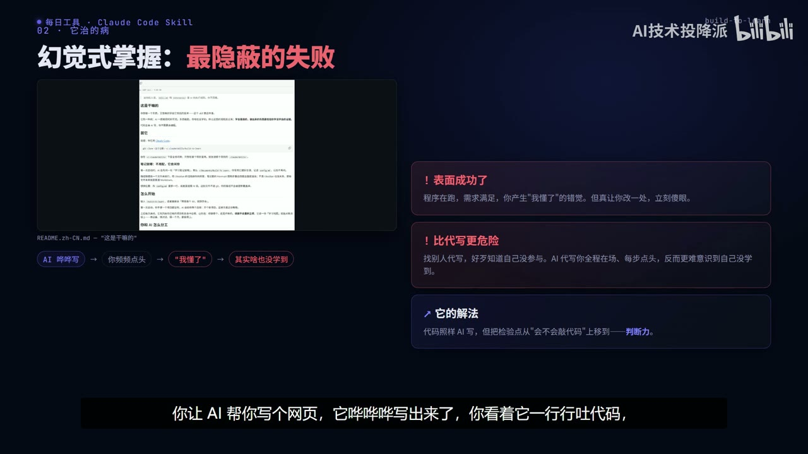
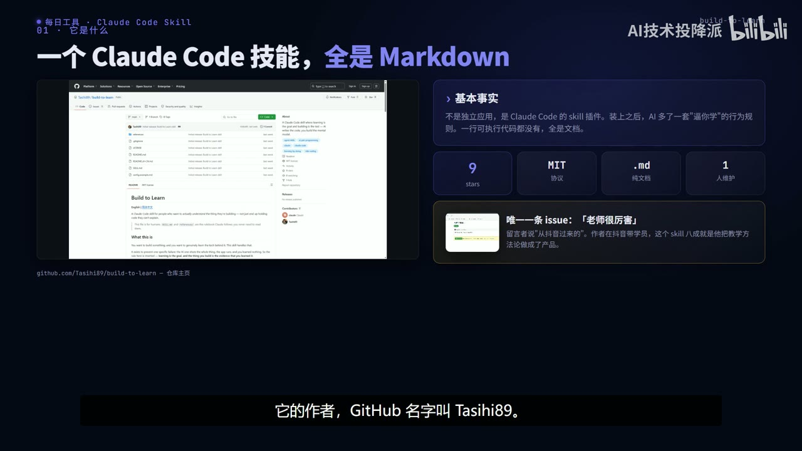
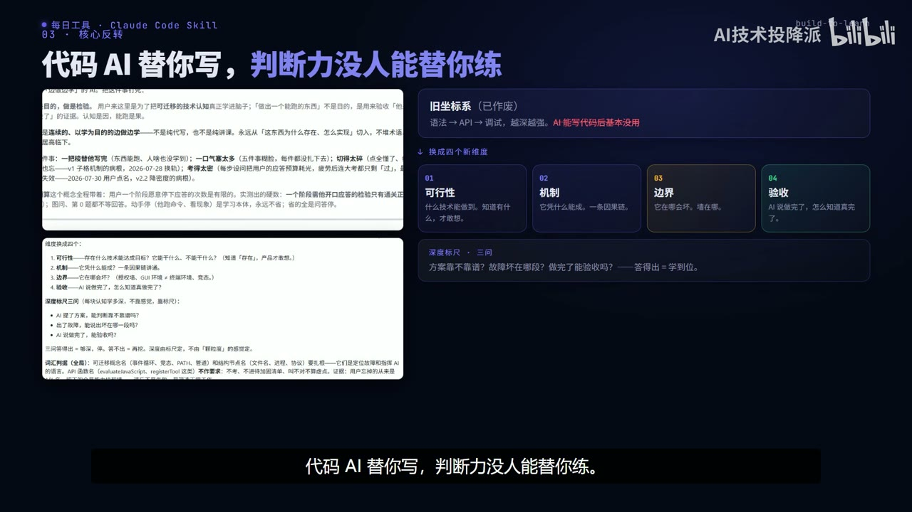
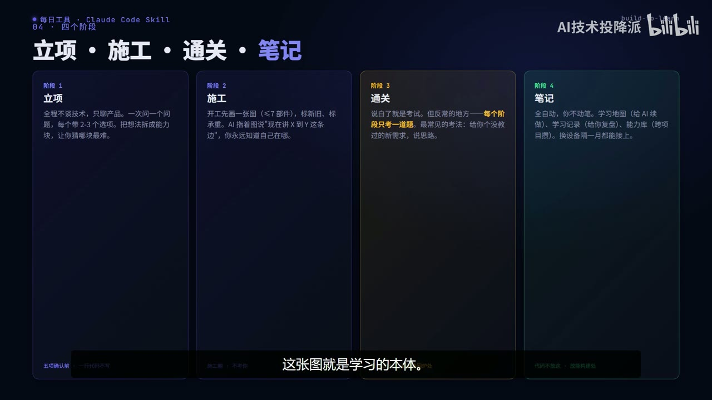
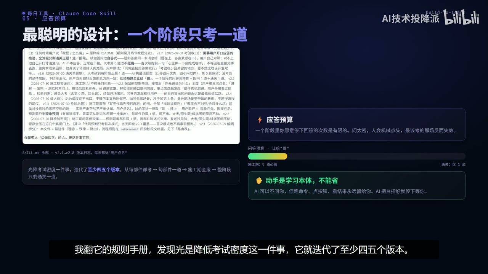
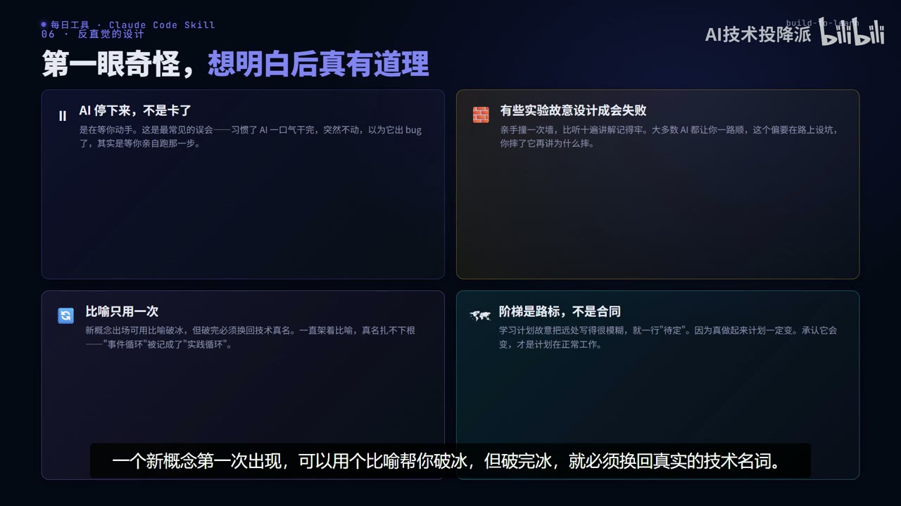
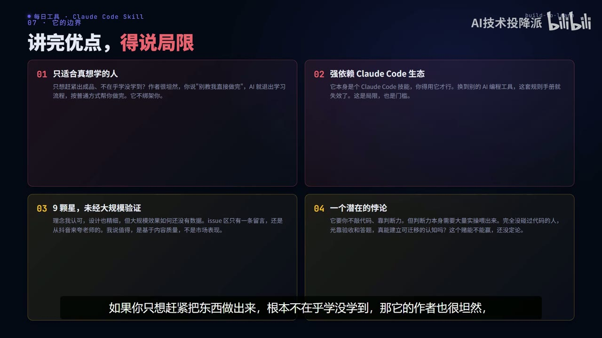

# build-to-learn｜AI 写完代码你却啥也没学到？vibe coding 时代的“幻觉式掌握”怎么治

> UP 主：AI技术投降派 
> 时长：14:49 
> 链接：https://www.bilibili.com/video/BV12suS6rEA8/ 
> BV 号：BV12suS6rEA8 
> 总结强度：standard 
> 证据：本地逐字稿、SRT、转写元数据与审计、24 张时间戳候选画面。转写整体连续；个别专名已结合画面谨慎校正。

## 一句话抓住核心

AI 可以承担代码实现，但“我是否学会”的检验必须落在判断力上：我能否判断方案可不可行、说清机制、识别边界，并验收结果。

## 推理主干

1. AI 写出的程序能运行，容易让我把“看懂了过程”误当成“掌握了能力”。 
2. 这种错觉在 AI 代写中更隐蔽：我全程看着、不断点头，却未必能在换场景后独立判断或修改。 
3. 因此，学习目标从“自己敲出代码”转向“能委托、能追问、能验收”。 
4. Build to Learn 把这种目标落实为四个学习维度、四个工作阶段，以及对提问密度的刻意控制。 
5. 这是一套值得借鉴的学习流程，实际效果与可迁移性仍需更多用户和场景验证。

## 先识别“幻觉式掌握”

vibe coding 指用自然语言描述需求，由 AI 生成代码。[00:00:11] 真正的风险不在于代码由谁写，而在于程序运行、需求看似满足时，人很容易产生“我懂了”的感受；一旦要求自己解释为什么这样设计，或改动一个条件，能力缺口就暴露出来。[00:00:23]

这里的失败很隐蔽：结果成功掩盖了学习失败。传统找人代写时，人通常知道自己没有参与；AI 代写让人全程观看生成过程，反而更容易把认同每一步解释，当作真正掌握。[00:03:23]

*图 01 · 00:02:46：画面将“表面成功”“比代写更危险”“检验点移到判断力”并列，直接呈现运行成功与学习失败的落差。*

Build to Learn 的核心立场是：做出的产品只是学习是否发生的证据，学习本身才是目标。[00:00:54] 它以 Claude Code Skill 的形式出现，画面中的仓库页和说明卡显示，该项目主体是 Markdown 规则文档，强调的是行为流程与教学约束。[00:01:06]

*图 02 · 00:01:32：画面展示 GitHub 仓库页及“一个 Claude Code 技能，全是 Markdown”的说明，支撑其以规则文档驱动流程的定位。*

## 从“写代码的人”变成“委托并验收的人”

这套方法不要求人手写全部代码，却要求人承担委托人的职责：把工作交给 AI，同时判断交付是否可靠。[00:03:45] 可以把它理解成装修：我未必亲自砌墙、布线，但必须知道要验什么、哪里可能出问题。

旧的学习坐标偏向语法、API 与调试熟练度；在 AI 能快速实现代码的情境下，项目把学习重心改为四项：

- **可行性**：有哪些技术能实现目标，哪些做不到。
- **机制**：方案成立依赖怎样的因果链。
- **边界**：在什么条件下会失效。
- **验收**：AI 声称完成后，如何确认它真的完成。

[00:04:41]

*图 03 · 00:04:00：画面以四张卡片列出“可行性、机制、边界、验收”，并把旧坐标系标为已作废。*

学习是否到位，可用三个问题检验：拿到方案时我能判断是否靠谱吗？发生故障时我能定位哪一段出问题吗？AI 说完成后我能设计验收吗？三个问题能答上，才有理由把这项能力视为已掌握。[00:05:08]

## 四阶段：把项目做成一条学习路径

### 1. 立项：先明确产品和未知

立项阶段暂时不讨论技术实现，先通过一次一个问题、每题给出具体选项的方式，明确用户、使用场景、成功标准与要解决的问题。[00:05:47] AI 会把想法拆成能力块，标出已有能力、已有技术、可能撞墙的部分与尚不确定的部分；其中一个关键动作是先猜“哪里最难”，以后真实遇到障碍时再回来核对判断。[00:06:03]

在写代码前，需要确认产品一句话、使用场景、成功定义、学习单位和第一架阶梯；这些未确认，AI 不开始实现。[00:06:29]

### 2. 施工：每一阶段先画图

每个阶段开工先画一张结构图：由哪些部件组成、数据怎样流动，部件数最多七个；图中还区分旧部件和本阶段新增部件。[00:06:43] 后续解释围绕图中的一条具体连接展开，让学习者持续知道“现在在理解从 X 到 Y 的哪一段”。

*图 04 · 00:07:05：画面中的四栏流程“立项、施工、通关、笔记”及“学习地图”说明，支撑阶段化学习与持续定位。*

### 3. 通关：每阶段只保留一道关键检验题

通关就是考试，但每个阶段只保留一道题。[00:07:15] 它背后的设计叫“应答预算”：人愿意停下来认真回答问题的次数有限，问题过密会使回答退化为机械点头，最关键的检验也失去价值。[00:08:03]

项目把检验密度从“每个部件都考”逐步收缩到“整个阶段只留一次通关”，其余内容改为自答式说明，或直接保留动手操作。[00:08:51]

*图 05 · 00:08:57：画面展示应答预算的低容量进度条，以及“动手是学习本体，不能省”的并列规则。*

### 4. 笔记：让学习能跨上下文继续

笔记阶段自动生成三类产物：帮助 AI 找回上下文的学习地图、供人复盘的带图学习记录，以及可跨项目积累的能力库。[00:07:27] 它们的作用是让一次学习在换电脑、换对话或间隔一段时间后仍能续上。

## 两条重要的学习约束

**动手不能外包。** AI 可以搭好环境、说明该点哪个按钮、该运行什么命令，然后停下来等我亲自执行、观察结果并反馈。[00:09:27] AI 的暂停因此可能是教学设计的一部分，提醒我从旁观转为操作。[00:09:55]

**失败可以被设计。** 某些实验故意让人撞墙：先经历现象，再解释原因，记忆与判断才更有锚点。[00:10:17]

此外，比喻只用于新概念第一次出现；破冰后要回到正式技术名词，避免长期记住比喻却记不住概念本身。[00:10:42] 学习计划称为“阶梯”，远处阶段可以保持模糊，因为真实项目推进后计划会变化。[00:11:24]

*图 06 · 00:10:48：画面明确写出“比喻只用一次”与“阶梯是路标，不是合同”，支撑术语回归和计划可调整两条约束。*

## 边界、疑点与时效性

它服务的是愿意学习的人。若目标只是尽快交付，流程允许直接退出教学模式，让 AI 常规完成任务。[00:11:52]

它强依赖 Claude Code 生态；规则能否无损迁移到其他 AI 编程工具，证据不足。[00:12:15] 画面与转写还显示项目当时规模很小，只有少量星标和单人维护；这些数值属于录制时状态，不能推断当前热度或大规模效果。[00:12:36]

*图 07 · 00:12:02：画面将“只适合真想学的人”“强依赖 Claude Code 生态”“未经过大规模验证”“潜在悖论”列为四项局限。*

最值得保留的疑问是：完全不写代码的人，主要依靠验收和回答问题，能否形成可迁移的技术认知？项目选择相信可以，但逐字稿没有提供大规模实证。[00:13:06] 因此，这套方法更适合作为“避免旁观式学习”的流程假设，而非已经被充分验证的通用结论。

## 时间戳导航

- [00:00:11] vibe coding 与“程序能跑、自己却不会”的问题 
- [00:00:54] Build to Learn 的核心主张 
- [00:02:32] “幻觉式掌握”的定义 
- [00:03:45] 代码由 AI 写，检验转向判断力 
- [00:04:41] 四个新学习维度 
- [00:05:08] 判断是否学会的三道检验 
- [00:05:47] 立项阶段与五项确认 
- [00:06:43] 施工阶段的结构图 
- [00:07:15] 通关：每阶段一道题 
- [00:08:03] 应答预算 
- [00:09:27] 动手操作必须保留 
- [00:10:17] 故意失败的实验 
- [00:10:42] 比喻只用一次 
- [00:11:24] 阶梯是路标 
- [00:11:52] 适用对象与四项局限 
- [00:13:30] 回到“人还该学什么”

## 复习与行动清单

- 做下一个 AI 项目前，先写清：谁使用、什么场景、什么结果算完成。 
- 对每个关键方案都追问四件事：能否实现、为何实现、何处失效、怎样验收。 
- 每阶段只留一个真正需要回答的检验题，避免把反思做成机械确认。 
- 把运行命令、点击操作、观察结果留给自己完成，并记录现象与判断。 
- 用正式技术名词沉淀笔记；比喻用于开场即可。 
- 把学习计划当作可调整的路线图，遇到新证据就更新下一步。
