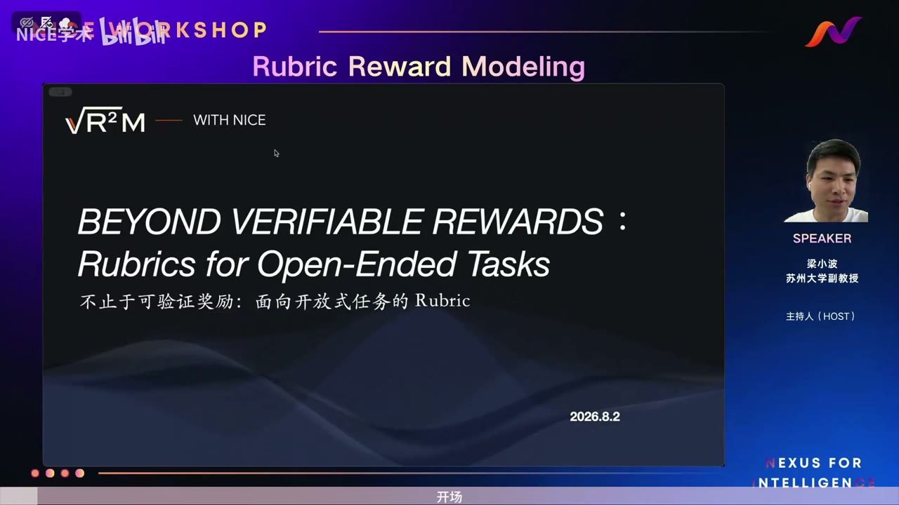

# 不止于可验证奖励：面向开放式任务的 Rubric｜p01 开场

> - **UP 主**：NICE学术
> - **视频时长**：00:01:57
> - **视频 ID**：BV1Pmux6zEqQ
> - **来源链接**：[Bilibili 原视频](https://www.bilibili.com/video/BV1Pmux6zEqQ/)
> - **上传日期**：2026-08-07
> - **总结强度**：deep
> - **证据来源**：Faster-Whisper 中文 ASR（42 段，语言置信度 0.996）＋12 张时间戳画面
> - **证据说明**：本段是整场活动的开场导语，提出议题并介绍讨论阵容，尚未展开具体技术方案。ASR 连续、无明显缺段，但若干英文术语存在误识别，已在下文标明。

## 一句话抓住核心

开放式任务的答案很难只用“对或错”评价，因此需要 Rubric Reward Model：把“好答案”拆成可以定义、评估、优化和解释的具体标准，再将这些标准用于自动评测与强化学习。

## 时间戳导航

- [00:00:01] 主持人梁小波宣布直播正式开始。
- [00:00:04] 本期主题确定为 **Rubric Reward Model**。
- [00:00:10] 说明本期邀请多位嘉宾共同讨论。
- [00:00:15] 引出题目“不止于可验证奖励”。
- [00:00:20] 将讨论对象限定到开放式任务中的 Rubric。
- [00:00:23] 开始交代大模型训练与奖励设计的背景。
- [00:00:26] 提及“SFP”；结合语境可能指 **SFT**，ASR 无法完全确认。
- [00:00:31] 提及“RAM”；结合后文强化学习语境，可能指 **RL**，此处存疑。
- [00:00:34] 指出现有训练较多围绕 **verifiable reward** 展开。
- [00:00:39] 转向开放式任务面临的评价困难。
- [00:00:41] 说明该困难会影响训练和微调。
- [00:00:45] 主持人认为，这类训练往往只能依赖特定任务。
- [00:00:48] 提到 Rubric Reward Model 从“去年”起持续发展。
- [00:00:56] 从技术背景转入答案质量的重新定义。
- [00:01:04] 核心转折：答案并非只有对与错两个状态。
- [00:01:08] 提出“如何定义、评估”的问题。
- [00:01:11] 进一步提出如何优化“好答案”。
- [00:01:13] 特别强调“好答案”带引号，意味着这个概念需要被明确界定。
- [00:01:18] 宣布邀请四位嘉宾参与讨论。
- [00:01:21] 第一条讨论线索：Rubric 构建。
- [00:01:23] 第二条讨论线索：自动评测。
- [00:01:25] 第三条讨论线索：强化学习。
- [00:01:29] 最终目标：理解下一代可解释奖励信号。
- [00:01:42] 介绍嘉宾兼具学术界与企业或工业界经历。
- [00:01:49] 主持人期待这些经验带来有启发性的讨论。

## 核心问题与推理主线

本期开场建立了一条很清楚的推理链：

```text
可验证奖励适合答案容易核验的任务
              ↓
开放式任务缺少唯一、可机械验证的答案
              ↓
单一“对／错”信号无法充分描述答案质量
              ↓
需要把“好”拆成一组明确的评价维度
              ↓
用 Rubric 支撑评价、训练和优化
              ↓
形成更细致且可解释的奖励信号
```

主持人在 [00:00:15]—[00:00:23] 先用“不止于可验证奖励”确定问题范围。这里的“超越”并未否定可验证奖励的作用；重点在于，当任务进入写作、研究、分析或其他开放场景后，答案质量很难由单一结果判定。

随后，[00:00:23]—[00:00:48] 将问题连接到大模型训练：主持人称，现有训练和微调较多围绕可验证奖励展开，这会使开放式任务依赖特定任务或特定评价条件。该论述在开场中只给出了方向，暂未提供实验、数据或具体任务案例。

[00:00:56] 之后，问题被重新表达为：如果答案不再只有对与错，我们怎样定义、评估并优化一个“好答案”？[00:01:13] 主持人特意说明“好答案”要加引号，点明了整场讨论的关键——“好”本身就是待建模对象，不能被当作无需解释的直觉判断。

## 一、为什么开放式任务需要更丰富的奖励信号

### 1. 可验证任务具有清晰的终点

“Verifiable reward”通常意味着结果能够被某种规则、执行器或标准答案核验。按照本段开场建立的语境，这类任务的奖励设计比较直接：输出满足验证条件即可获得正向信号。

这种方式的优势在于反馈清晰，但它依赖一个前提：任务结果确实存在可靠的验证方法。

### 2. 开放式答案存在多个质量维度

主持人在 [00:00:39]—[00:00:48] 指出，开放式任务会给训练和微调带来困难。结合其后“答案不再只有对与错”的表述，可以把这种困难理解为：

- 两个答案都可能事实正确，但清晰度、完整性和推理质量不同。
- 一个答案可能方向合理，却遗漏关键限制条件。
- 一个答案可能结论可用，但论证过程缺乏可解释性。
- 不同任务关心的质量维度不同，统一的单一分数很难说明问题。
- 若只保留最终总分，训练系统无法知道答案究竟在哪个维度表现较好。

这里最后四点是依据主持人问题所作的谨慎展开，本段视频没有逐项列举这些维度。

### 3. 二元结果不足以回答“好在哪里”

[00:01:04]—[00:01:16] 是整个开场最关键的部分：

> “我们现在的这种答案，其实它不仅仅是有对与错……怎么定义、评估，并且优化这种‘好的答案’？”

这句话把奖励建模的任务分成三个连续环节：

1. **定义**：先说清楚何谓高质量答案。
2. **评估**：依据定义判断某个答案满足了哪些条件。
3. **优化**：把评价反馈用于改进模型输出。

Rubric 的价值由此显现：它为“好答案”提供一组可以检查、讨论和修正的显式标准。

## 二、Rubric Reward Model 在这里承担什么角色

主持人在 [00:00:48]—[00:00:56] 提到，Rubric Reward Model 从“去年”起持续发展。封面标注活动日期为 2026 年 8 月 2 日，因此这里的“去年”按录制时间理解大致指向 2025 年；视频没有给出具体论文、机构或技术路线。

画面封面同时展示了 **Rubric Reward Modeling**、英文题目 **Beyond Verifiable Rewards: Rubrics for Open-Ended Tasks**，以及“√R²M — WITH NICE”标识。右侧显示主持人为苏州大学副教授梁小波，封面日期为 2026.8.2。



*图 01 · 00:00:04：封面明确给出 Rubric Reward Modeling 主题、开放式任务方向、主持人梁小波及活动日期 2026.8.2。*

根据开场的表述，Rubric Reward Model 可以被理解为一座桥梁：

| 开放式评价难题 | Rubric 提供的中间结构 | 可能连接的训练环节 |
|---|---|---|
| “好答案”含义模糊 | 明确评价标准 | Rubric 构建 |
| 人工评价难以稳定复用 | 可重复检查的评价维度 | 自动评测 |
| 单一奖励缺少细节 | 分维度或带解释的反馈 | 强化学习 |
| 总分难以说明原因 | 标准与得分之间的对应关系 | 可解释奖励信号 |

表中具体实现方式是对开场议程的结构化整理。视频尚未说明 Rubric 如何生成、如何打分、各维度怎样聚合，也未说明奖励模型的训练数据和损失函数。

## 三、整场讨论准备怎样拆解问题

主持人在 [00:01:18]—[00:01:29] 给出了三条讨论路径。

### 路径一：Rubric 构建

Rubric 构建解决“用什么标准评价”的问题。真正困难的部分通常会落在标准选择、标准表述和标准覆盖范围上。

从主持人的问题出发，Rubric 至少需要让“好答案”变得可操作：评价者应当能够依据标准判断答案是否满足要求，而无需只凭模糊的整体印象。

视频开场尚未回答以下问题：

- Rubric 来自人工专家、模型生成，还是两者协作？
- Rubric 是通用的，还是针对每个任务单独构建？
- 如何发现遗漏、重叠或互相冲突的评价项？
- 如何防止标准只适合少量已知答案？

### 路径二：自动评测

[00:01:23] 明确把自动评测列为第二个方向。它关心的是：已有 Rubric 后，系统怎样稳定地依据它评价模型输出。

自动评测至少涉及两个层次：

- **判定层**：答案对某条标准满足到什么程度。
- **解释层**：评价结果能否指出对应证据与缺陷。

“可解释奖励信号”这一目标意味着评测结果需要保留一定结构，使研究者能够追踪奖励来自哪些标准。不过，这只是由议程推导出的合理理解，开场没有给出具体评测格式。

### 路径三：强化学习

[00:01:25] 将强化学习列为第三个角度。这里的核心问题是：Rubric 产生的评价怎样转化为可以优化模型的奖励信号。

如果评价包含多个维度，后续还需要决定：

- 不同维度是否具有不同权重；
- 维度之间发生冲突时如何处理；
- 是否压缩成单一标量奖励；
- 解释性信息能否保留到训练反馈中；
- 模型会不会迎合 Rubric 的表面措辞，同时损害真实任务质量。

这些属于开场留下的技术问题，视频本段没有给出答案。

## 四、“下一代可解释奖励信号”意味着什么

[00:01:27]—[00:01:34] 将三条路径汇聚到同一个目标：共同探讨“下一代可解释的奖励信号”。

这里的“可解释”至少包含一种直接含义：当模型得到较高或较低奖励时，人能够把奖励追溯到具体评价标准。相比只有一个总分，Rubric 可以让评价结构变得可见。

这一目标可以概括为：

```text
回答质量
├── 评价标准 A：是否满足
├── 评价标准 B：是否满足
├── 评价标准 C：满足到什么程度
└── 综合反馈：哪些方面值得保留，哪些方面需要改进
```

需要注意，本段并未定义“下一代”，也没有比较现有奖励模型与 Rubric Reward Model 的实验表现。因此，“下一代”在这里属于活动议题和研究愿景，尚未形成由本段证据支持的技术结论。

## 五、嘉宾阵容与视角设计

[00:01:38]—[00:01:52]，主持人再次强调本期邀请四位嘉宾，并介绍他们拥有学术界与企业或工业界的工作、学习经历。他期待这种经历组合带来“非常有启发性的讨论”。

嘉宾页可见四张人物卡片，姓名显示为：

- 刘文涵
- 张启源
- 李高棠
- 周阳

画面中的英文卡片标题分别涉及 Rubric 综述、模型生成 Rubric 与人类标准对齐、超越可验证奖励的开放式深度研究智能体，以及高质量 Rubric 的生成和使用。由于卡片正文尺寸较小，本笔记不进一步转录机构、论文细节和个人履历。


*图 02 · 00:01:42：嘉宾页列出刘文涵、张启源、李高棠、周阳四位研究者，并用四张主题卡片呈现各自关注的 Rubric 研究方向。*

这套嘉宾设置与前述三条议程形成对应：既讨论如何定义 Rubric，也覆盖自动评测、强化学习和开放式智能体中的奖励设计。

## 具体案例与原话细节

### 1. “好答案”被刻意加上引号

[00:01:11]—[00:01:16] 的关键措辞是：

> “优化这种‘好的答案’。当然，这个‘好的答案’其实就是打引号的。”

这是本段最值得保留的原话细节。引号提醒听众：“好”并非天然清楚的标签。研究工作必须把它拆解为可说明、可检查、可争论的评价标准。

### 2. 讨论对象从答案结果扩展到评价过程

主持人的表达顺序是“定义、评估并且优化”[00:01:08]—[00:01:13]。这个顺序很重要：

- 没有定义，评估依据会漂移；
- 没有评估，优化缺少反馈；
- 没有可用的优化连接，Rubric 只能停留在描述层。

因此，Rubric Reward Modeling 关注的不只是写出一份评分表，还包括怎样让这份评分表参与评测和训练。

### 3. 开场只提出研究框架

本段没有展示 Rubric 样例、评分过程、奖励模型结构、训练曲线或实验结果。它的功能是把整场活动组织成一个共同问题：

> 当答案不再只有对与错，我们如何定义、评估并优化“好答案”？

这句话也原样出现在嘉宾页中，随后补充了活动路线：“从 rubric 构建、自动评测到强化学习，共同拆解下一代可解释奖励信号。”

## 边界、疑点与时效性

- **内容边界**：这是 p01 开场，主要提供问题背景和议程。任何具体算法、数据集、指标或效果结论都不能由本段推出。
- **术语疑点**：[00:00:26] 的“SFP”可能是 **SFT**；[00:00:31] 的“RAM”可能是 **RL**。ASR 证据不足以完全确认，故保留不确定性。
- **明显 ASR 修正**：“Viru Firewall reward”结合标题与语境，应为 **verifiable reward**；“Rubrik”统一写作 **Rubric**；结尾的“经理”“起发誓”结合语境分别修正为“经历”“启发性”。
- **时间语境**：主持人称 Rubric Reward Model 从“去年”起持续发展。封面活动日期为 2026-08-02，这是一项录制时判断，不能直接当作长期研究史结论。
- **画面密度**：12 张抽帧中，前 10 张均停留在同一封面，后 2 张为同一嘉宾页，因此仅采用两个具有独立说明价值的画面状态。
- **观点归属**：关于现有训练依赖可验证奖励、开放式任务受限以及 Rubric Reward Model 持续发展的说法，均为主持人在开场中的概括，本段没有附带外部证据。
- **人物信息**：嘉宾姓名和主题来自画面；卡片中的小字号履历未作推断性扩写。

## 复习与行动清单

### 核心概念复述

- [ ] 我能解释可验证奖励为什么适合结果容易核验的任务。
- [ ] 我能说明开放式答案为什么难以压缩成“对／错”判断。
- [ ] 我能用“定义—评估—优化”复述本期的推理主线。
- [ ] 我理解 Rubric 的作用是把答案质量展开为明确标准。
- [ ] 我能区分 Rubric 构建、自动评测和强化学习三个环节。
- [ ] 我知道“可解释奖励信号”至少要求奖励能够追溯到评价标准。
- [ ] 我记得本段只完成议题铺垫，尚未提供技术实现和实验结论。

### 后续观看时应重点追踪的问题

1. Rubric 由谁构建，怎样验证其质量？
2. 通用 Rubric 与任务专用 Rubric 如何分工？
3. 自动评测怎样避免评判偏差和自我强化？
4. 多个评价维度怎样组合成训练可用的奖励？
5. Rubric 是否会遗漏难以文字化的重要质量？
6. 模型是否可能学会迎合标准表述，却没有真正提升答案质量？
7. 奖励的可解释性如何被实验验证？
8. 学术方法进入工业任务后，会遇到哪些成本、稳定性和扩展性问题？

### 最小学习卡片

> **问题**：开放式任务为什么需要 Rubric Reward Model？<br>
> **回答**：因为答案质量往往包含多个维度，单一的对错或总分无法充分表达。Rubric 把“好答案”拆成明确标准，使评价能够进入自动评测和强化学习，并让奖励来源更容易解释。
