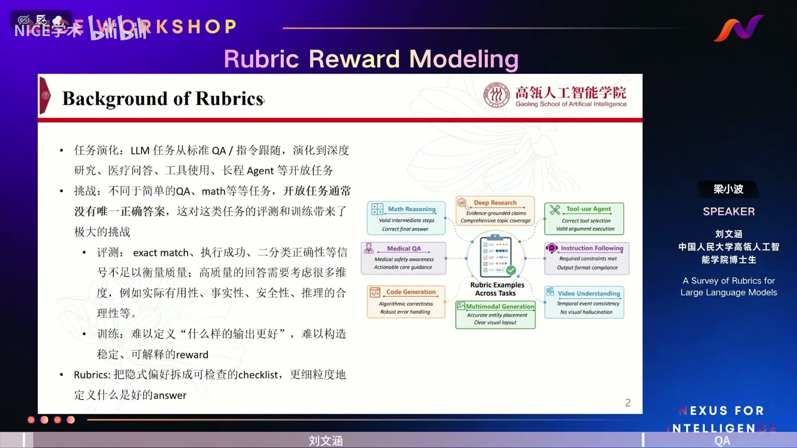
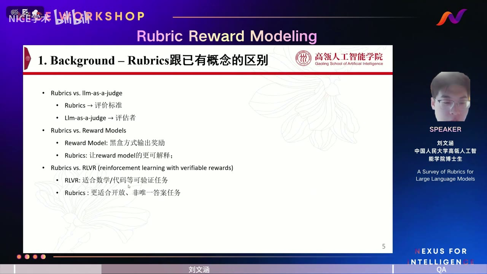
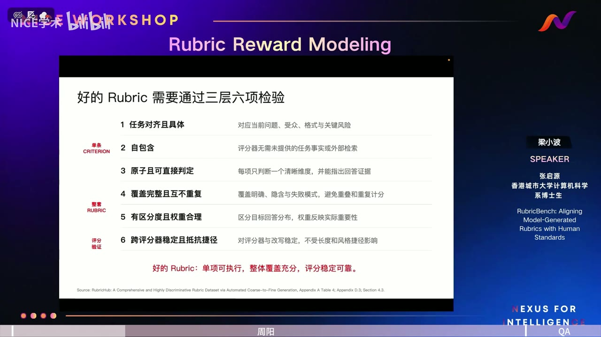
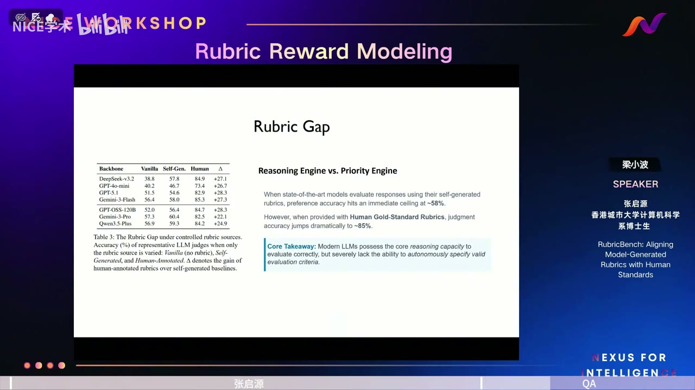
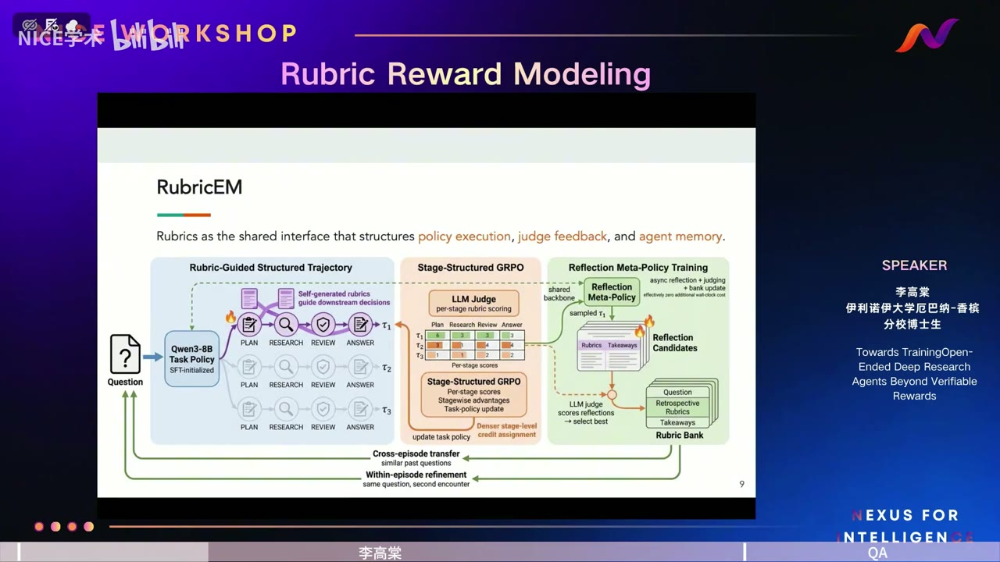
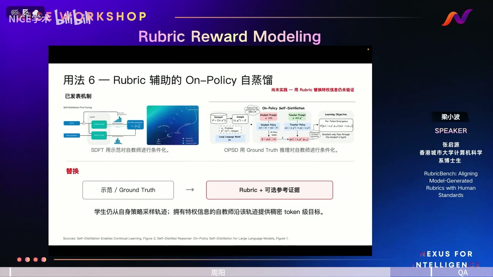

# 不止于可验证奖励：面向开放式任务的 Rubric

> **UP 主：** NICE学术 
> **合集时长：** 02:59:02 
> **视频 ID：** BV1Pmux6zEqQ 
> **来源：** [Bilibili 合集](https://www.bilibili.com/video/BV1Pmux6zEqQ/) 
> **总结强度：** deep（深度） 
> **证据：** 六个分集的本地 `source.json`、连续文本、SRT、转写审计及时间戳画面；共 4,129 个 ASR 片段、72 张画面记录。转写由 faster-whisper-small 生成，少数英文术语、人名和模型名存在同音误识别，本文结合上下文与可见幻灯片谨慎校正。所有时间均为分集内时间。

| 分集 | 内容 | 时长 |
|---|---|---:|
| P01 | 开场：为什么讨论 Rubric Reward Modeling | 01:57 |
| P02 | 刘文涵：A Survey of Rubrics for Large Language Models | 38:49 |
| P03 | 李高棠：面向开放式 Deep Research Agent 的 RubricEM | 38:39 |
| P04 | 张启源：RubricBench 与人机 Rubric Gap | 34:34 |
| P05 | 周阳：如何生成并有效使用高质量 Rubric | 33:02 |
| P06 | PANEL：标准、来源、验证与未来形态 | 31:58 |

## 当模型认真勾完所有框，却给出了更差的答案

假设用户要求程序“处理所有情况”。模型可以照单全收，列出一套看似完整的实现；也可以诚实指出，“所有情况”本身不可穷尽，再给出边界清楚、能够实际落地的方案。RubricBench 中出现了一个反直觉现象：机器生成的标准往往奖励前一种回答，因为它“检查了更多框”；人类标准会先识别指令中的不合理前提，因而偏向后一种更诚实的回答。[P04 00:21:30]

这类错误被概括为 **Value Inversion**：清单越长、表面覆盖越完整，模型越容易奖励自信而失真的答案。问题已经从“模型会不会依据标准打分”推进到了更困难的一层——模型能否先提出真正值得检查的标准。[P04 00:16:11]

整场 Workshop 围绕这条问题链展开：开放式任务为什么需要 Rubric？怎样判断 Rubric 自身的质量？它如何进入训练过程？当 Rubric 和策略模型共同演化时，又该如何防止二者形成自洽却错误的闭环？

## 一句话抓住核心

**Rubric 是把“什么叫好答案”展开成可检查、可诊断、可训练的自然语言接口；它的价值取决于能否抓住当前任务和当前模型真正有区分度的质量差异，并始终接受独立证据与外部目标的约束。**

## 核心问题与推理主线

六个分集共同构成了一条连续的推理路径：

1. **定义问题：** 开放式任务没有唯一答案，单一总分无法解释质量差异。
2. **构造问题：** Rubric 可以直接生成、对比生成、迭代优化或在线演化，但每种方式都有成本和偏差。
3. **评估问题：** 会依据给定标准判断，不代表会自动提出高质量标准。
4. **训练问题：** 长程 Agent 需要把最终奖励拆到计划、研究、审查和回答等阶段。
5. **工程问题：** 高质量 Rubric 需要原子性、自包含、覆盖度、区分度和稳定性，并经真实回答验证。
6. **治理问题：** 自动演化需要外部原则、隐藏测试、独立评估与人工抽检，防止奖励系统与策略模型共同偏航。

开场把问题凝结成一句话：答案已经无法只用对错来描述，我们需要定义、评估并优化带引号的“好答案”。四位报告人分别从综述、强化学习、基准评测和工程实践进入同一个问题。[P01 00:00:59]

*图 01 · P01 · 00:01:52：开场页列出四位报告人及其互补主题：综述、RubricEM、RubricBench 与高质量 Rubric 的生成和使用。*

## 一、为什么开放式任务需要 Rubric

### 1. 从唯一答案走向多维质量

数学题、代码执行等任务常有明确结果，可以采用 exact match、测试用例或执行成功率。Deep Research、医疗问答、工具型 Agent、长报告等任务通常同时涉及：

- 事实是否正确；
- 证据是否充分；
- 推理是否合理；
- 输出是否安全；
- 是否真正回应用户意图；
- 形式是否专业；
- 建议是否可执行。

这些维度很难压缩成一个稳定、透明的标量奖励。刘文涵给出的定义是：**Rubric 把隐含的答案偏好拆成可检查的 checklist，每项描述一个具体质量维度，并可带有权重。**[P02 00:01:46]

*图 02 · P02 · 00:01:37：综述报告用数学推理、医疗问答、代码生成、工具 Agent、视频理解等任务说明 Rubric 的跨任务适用性。*

Rubric 还要和三个邻近概念区分：

- **Rubric 与 LLM-as-a-Judge：** 前者是评价标准，后者是执行评价的评估者。
- **Rubric 与 Reward Model：** Reward Model 输出奖励；Rubric 使奖励的依据更透明、更容易诊断。
- **Rubric 与 RLVR：** RLVR 适合结果可验证的任务；Rubric 更适合答案不唯一、质量维度复杂的任务，同时也能用于可验证任务的中间过程。[P02 00:06:49]

*图 03 · P02 · 00:08:05：幻灯片明确区分了 Rubric、LLM-as-a-Judge、Reward Model 与 RLVR 的角色和适用范围。*

### 2. 从标准到分数：三种聚合方式

给定若干条标准后，还要把逐项判断转成训练或评测可用的结果。综述归纳了三种方式：[P02 00:05:25]

| 聚合方式 | 做法 | 适用条件 | 主要风险 |
|---|---|---|---|
| 平均聚合 | 各项等权平均 | 各维度重要性接近 | 关键约束被普通项目稀释 |
| 加权聚合 | 依据权重求和 | 维度优先级明确 | 静态权重无法适应任务与训练阶段 |
| 隐式聚合 | 把全部标准和答案交给模型综合判断 | 希望降低调用次数 | 逐项贡献难以解释，复现性较弱 |

简单加权尤其容易掩盖项目之间的逻辑关系。医疗场景中的安全约束可能应当成为否决条件：一旦违反，其他项目得分再高也无法弥补。[P02 00:17:17] 因此，Rubric 不能总被理解为一组相互独立、线性相加的分数。

### 3. Rubric 的四级构造谱系

综述把构造方式组织成逐渐增强的四类：[P02 00:08:19]

1. **直接生成：** 把问题、参考答案或背景证据交给专家或模型，一次生成标准。高效、易扩展，质量高度依赖提示词或专家水平。
2. **对比生成：** 加入高低质量回答，让模型从差异中提取标准。区分性更强，仍然缺少生成后的质量闭环。
3. **迭代优化：** 生成后用偏好判断准确率、原子性、覆盖率等指标反复修订。
4. **在线演化：** 根据当前策略模型的 rollout 和失败模式动态更新 Rubric。

在线演化可以避免静态标准迅速过时，也带来新的代价：需要持续调用生成模型，会拖慢训练；Rubric 还可能与特定策略模型过度耦合，迁移到其他模型时失效。[P02 00:11:46]

## 二、好的 Rubric 必须先经得起自身评估

### 1. “看起来完整”远远不够

P02 提出了三类基础评估：[P02 00:13:50]

- 与专家标准的一致性或相似度；
- 用于下游偏好判断时的准确率与区分度；
- 对关键质量维度的覆盖率。

P05 把这套原则进一步整理成三层六项检验：[P05 00:04:30]

| 层级 | 检验项 | 实际含义 |
|---|---|---|
| 单条标准 | 任务对齐且具体 | 紧扣当前问题、受众、格式与关键风险 |
| 单条标准 | 自包含 | Judge 无需临时搜索或猜测外部事实 |
| 单条标准 | 原子且可直接判定 | 一项检查一个清晰维度，并可指出证据 |
| 整套标准 | 覆盖完整且互不重复 | 覆盖显式要求、隐含约束和失败模式 |
| 整套标准 | 有区分度且权重合理 | 能区分相近回答，权重反映真实重要性 |
| 评分验证 | 跨 Judge 稳定且抵抗捷径 | 改写措辞或更换模型后，判断仍较稳定 |

*图 04 · P05 · 00:06:53：周阳将好 Rubric 总结为三层六项检验，并强调单项可执行、整体覆盖充分、评分稳定可靠。*

“完整、正确、有帮助”之类的表述适用于几乎所有任务，因此很难告诉模型究竟要改什么。自包含则要求把判定所需事实写入标准：若要检查某个数字，就应给出目标数字，让 Judge 直接核验，避免依赖它的记忆或临时猜测。[P05 00:04:46]

原子性要求拆开混合条件。例如“结论准确、论证充分、表达清晰”包含三个维度；合并后，Judge 遇到部分满足时很难稳定打分。拆分之后，每个缺陷才能转化为清晰的训练信号。[P05 00:06:22]

### 2. 评测 Rubric 与训练 Rubric 有不同生命周期

PANEL 给出了整场最重要的分歧之一：

- **用于 Benchmark 或长期评测时，** Rubric 应追求全局覆盖，能够区分旧模型、当前模型和未来更强模型，还要深入用户意图与隐含质量要求。
- **用于 RL 时，** Rubric 只需抓住当前策略的可学习差异；标准过难、所有 rollout 都得零分，同样无法产生梯度。[P06 00:06:03]

所以，深刻不等于可训练。某条标准即使触及任务最深层的要求，只要当前模型完全无法达到，它在这一阶段仍然缺乏训练价值。[P06 00:07:09]

训练 Rubric 很可能是消耗品。周阳指出，一套标准帮助当前模型补齐缺口之后，区分度便会降低；下一轮模型需要新的、更细的标准。用于 SFT 数据构造或长期评测的 Rubric 则更适合沉淀复用。[P05 00:30:56]

### 3. “Rubric Gap”：模型会判断，却未必会定义标准

RubricBench 的核心发现可以概括为 **Reasoning Engine 与 Priority Engine 的分离**：现代模型得到人类高质量 Rubric 后，判断能力相当不错；让它自行提出标准时，准确率出现显著下降。[P04 00:16:11]

报告所示结果中，自生成 Rubric 的偏好判断大约停留在五十多分，而人类标准把多种模型推到八十分以上。讲者据此判断，模型已经具备相当的判别推理能力，主要缺口集中在“自动发现有效评价维度”。[P04 00:14:54]

*图 05 · P04 · 00:27:22：Rubric Gap 页面显示：自生成标准的偏好准确率约有 58% 的天花板，使用人类金标准后可跃升至约 85%。*

增加采样次数也没有自然解决问题。机器反复生成更多 Rubric，收益很小；让模型自行迭代改写，结果甚至可能下降。人类标准随着有效项目增多却能持续提升判断效果。[P04 00:17:24]

模型常把评价预算花在字数、格式、代码语法等显眼特征上，遗漏受众、真实意图、诚实性和不可满足约束。张启源把它称为注意力错置及认知层面的 misalignment。[P04 00:19:51]

### 4. RubricBench 如何建立人类参照

RubricBench 覆盖 Chat、Instruction Following、Code、STEM 与 Safety 五类任务。它从已有偏好数据池中筛选高复杂度输入、具有挑战性的输出及真实推理失败，再进行双人标注和专家合并，最终得到 1,147 个样本。[P04 00:09:06]

标注者只依据指令写 Rubric，避免查看待比较的回答，以降低针对某个答案量身定制标准的风险。[P04 00:12:25]

这套方法仍把人类标准当作实用参照，并不意味着人类判断天然无偏。P02 已经提醒：Rubric 的写法、Judge 模型和领域专家本身都可能带来偏差。[P02 00:27:44]

## 三、从“给答案打分”到“组织整个智能体”

### 1. 长程任务真正缺少的是信用分配

如果一个 Deep Research Agent 经历计划、搜索、工具调用、证据整理和长报告写作，最后只收到一个总分，系统只能知道整条轨迹有问题，却无法定位问题出现在哪一段。即使最终答案失败，前面的搜索方向也可能完全正确。[P03 00:03:38]

RubricEM 因此把 Rubric 定义为三类活动的共享接口：

- 组织策略执行；
- 承载 Judge 反馈；
- 保存可复用经验。[P03 00:02:14]

*图 06 · P03 · 00:08:03：RubricEM 总览图把结构化轨迹、阶段式 GRPO 与反思元策略连接成同一训练系统。*

### 2. 先把轨迹切成有语义的阶段

RubricEM 让任务策略遵循四个阶段：[P03 00:11:41]

1. **Plan：** 分析任务、显式需求和隐含限制，生成任务 Rubric 与研究计划。
2. **Research：** 调用搜索工具，判断结果是否真正推进任务；信息不足时继续搜索或更新计划。
3. **Review：** 回看证据覆盖情况，检查原始 Rubric 是否满足，并形成报告提纲。
4. **Answer：** 根据前面建立的标准与证据完成最终报告。

这里的结构并非给文本加四个标签。每个阶段承担不同功能，从而为后续阶段评分和信用分配提供语义边界。

### 3. 睡眠与认知衰退：Rubric 如何改变搜索方向

报告中的问题是“睡眠模式如何影响老年人的认知衰退”。普通搜索容易找到“睡眠差与认知衰退同时出现”的相关性结论，却不足以回答因果关系。[P03 00:14:28]

Plan 阶段生成的 Rubric 会要求区分深度睡眠、睡眠时长等组成因素，讨论因果方向，并寻找机制证据和纵向研究。标准由此直接改变 Research 阶段的查询与证据选择。[P03 00:14:49]

如果计划和搜索都做对了，最终报告却漏掉关键机制，阶段式 Judge 可以只惩罚 Answer 阶段。传统 answer-only reward 会把负反馈广播到整条轨迹，连已经正确的计划与研究也一并压低。[P03 00:17:20]

### 4. Stage-Structured GRPO：让标准跟随当前失败模式

训练初期，模型的差异可能是“有没有完成任务、有没有事实错误”；训练后期，大多数回答已经满足基础要求，区分点转向证据整合、推理深度和细微遗漏。固定标准很快会失去方差。[P03 00:18:30]

RubricEM 让 Judge 对当前策略生成的多条轨迹进行比较，产生 on-policy、stage-wise Rubric。这里的 on-policy 意味着：标准针对模型现在真正会犯的错误生成，而非在训练开始前永久写死。[P03 00:19:02]

哪些标准值得保留？其判断与 GRPO 的需求直接相关：如果一条 Rubric 能让不同 rollout 获得明显不同的分数，即分数标准差较高，它具有区分能力；若所有轨迹得分接近，它无法提供有效梯度。[P03 00:19:46]

### 5. 反思元策略：参数更新之外的文本更新

一条轨迹结束后，还会留下可迁移经验：哪些搜索策略有效、哪些错误容易忽略、哪些标准对类似任务普遍有用。Reflection Meta-Policy 把这些经验总结成 retrospective Rubric，并按两项标准筛选：

- 能否帮助同一问题的再次尝试；
- 能否迁移到相似的新问题。[P03 00:22:07]

得分高的反思进入 Agent Rubric Bank。系统于是同时发生两种学习：

- 通过策略梯度更新参数；
- 通过 Rubric Bank 保存文本化经验。[P03 00:23:36]

Judge Rubric Buffer 保存“如何区分训练轨迹”，Agent Rubric Bank 保存“策略以后怎样做得更好”。两者服务对象不同，尽管都使用自然语言 Rubric 作为载体。

报告中的实验以 Qwen3-8B 为基础模型；讲者称其在四个 Benchmark 上接近部分闭源搜索系统，并在较少训练步数下超过对比方法。消融实验显示，阶段式奖励、反思策略和经验复用均带来增益。[P03 00:24:44] 这些数字属于报告中的实验陈述，不能直接外推到其他模型、Judge 或任务分布。

## 四、高质量 Rubric 怎样构造

### 1. 从真实能力差距出发

只让专家根据理想答案凭空写标准，容易得到专家想象中的失败模式，和当前模型真正会犯的错误并不一致。P05 建议准备两类回答：[P05 00:10:10]

- 当前待训练模型的回答，代表真实能力与失败模式；
- 经人类确认更优的回答，代表目标方向。

只有在人类能明确判断后者更好时，这个回答对才进入标注。标注者比较“好回答做到了什么、当前回答漏掉了什么”，由差异提炼 Rubric，再设置权重，并用更多回答检验能否稳定区分质量。[P05 00:11:16]

一个简短诗歌案例说明了粗标准的局限：只检查“是否与秋天有关、结构是否完整连贯”，普通答案也能轻易满分。高质量标准需要继续区分意象、表达和更细的完成质量。[P05 00:03:26]

### 2. 自动生成要经历由粗到细的演化

一次提示词生成的 Rubric 往往表面完整，内部夹杂空泛、重复和无法判定的项目。RubricHub 采用的自动流程大致是：[P05 00:12:17]

1. 整合任务数据，并结合任务原则生成初始标准；
2. 用不同模型分别生成，再聚合互补项目；
3. 用强回答挑战标准；
4. 如果强回答普遍满分，继续细化以增加区分度；
5. 检查一致性、饱和、长度偏置、格式偏置和模板捷径；
6. 通过验证后才进入训练。

报告提到，较强 Judge 执行生成 Rubric 时得到约 0.9 的 F1 和约 0.74 的 Kappa，但讲者同时强调：这些数值只能证明 Judge 大体看懂了标准，不能证明标准本身适合训练。[P05 00:13:46]

PANEL 还给出一项工程警告：自动 Rubric 可能提升内部 Benchmark 分数，同时增加幻觉、降低事实性，最终无法上线。机器生成适合承担初步设计和补充，人类在当前工业实践中仍负责纠偏和质量把关。[P06 00:10:37]

## 五、Rubric 的七种用法：奖励只是起点

### 1. 直接作为奖励

最直接的方式是逐项打分、加权聚合，再用于 RL。这保留了各项诊断信息，但若最终仍压成一个总分，很多结构价值会再次丢失。[P05 00:14:51]

### 2. 引导 rollout 探索

弱策略可能完全不知道高质量方向，采不到正向样本。可以让不同 rollout 看到不同子集的 Rubric：有的看到关键风险，有的看到执行步骤，有的看到较完整标准，以扩大探索多样性；最终仍用同一完整标准评分，保证可比较性。[P05 00:15:35]

随着策略变强，提示中的特权 Rubric 应逐步减少，避免模型形成依赖。[P05 00:16:48]

### 3. 合成更贴近模型分布的 SFT 数据

让人完整书写 Agent 的思考、工具调用和长轨迹，成本高、风格差异大。另一种流程是：

> 问题与 Rubric → 模型生成候选 → 逐项评分 → 找出缺口 → 修复或重生成 → 得到 SFT 数据。[P05 00:18:02]

这样生成的回答更接近模型自身分布，也可能出现同源盲点与风格收缩，需要更换模型或提示方式打破模板化。

### 4. 反向规划长程 Agent 轨迹

Deep Research 报告的最终要求可以反推所需证据，再反推搜索计划和工具路径。Rubric 在这里成为轨迹脚手架：它规定要搜集什么证据、何时检查覆盖、怎样组织报告。[P05 00:20:49]

人工标完整搜索路径几乎不可行，因为一次任务可能包含十几次甚至平均二十余次搜索，且有效路径不唯一。由最终标准反向构造轨迹更容易扩展。[P05 00:21:23]

### 5. 模拟用户反馈并训练多轮改进

若第一轮回答漏掉预算约束，可以把未满足的 Rubric 改写成自然追问：“如果考虑预算，方案该怎么调整？”模型第二轮据此改进，再用同一套标准计算得分增量。[P05 00:22:33]

这种方法同时训练初次回答能力和接受反馈后的修订能力。

### 6. Rubric 辅助的 On-Policy 自蒸馏

周阳提出一个尚未实证的设想：学生模型只看到原问题，教师侧额外看到完整 Rubric，从而产生更好的 token 分布，学生再向该分布靠近。由于样本来自学生当前策略，它比固定离线蒸馏更贴近 on-policy 分布。[P05 00:24:40]

风险在于特权上下文过强，教师和学生分布差距过大，反而难以学习。讲者明确说明这一用法仍处于构想阶段。

*图 07 · P05 · 00:26:09：On-Policy 自蒸馏设想以“Rubric 加可选参考证据”替代示范答案，为自教师提供特权信息。*

### 7. 为 PPO 的 Critic 提供结构化特权信息

Actor 正常回答问题；Critic 在价值估计时额外看到 Rubric、参考证据或反馈，以更早识别轨迹何处满足或违反关键要求。即使最终奖励只落在最后一个 token，较好的价值估计仍可改善长程信用分配。[P05 00:26:20]

这里同样存在信息泄漏：若把最终逐项得分直接告诉 Critic，它可能走捷径，价值预测失去意义。特权信息需要控制强度。[P05 00:28:00]

## 六、四个案例揭示 Rubric 的真正边界

### 案例一：安全约束不能只是普通加分项

医疗回答的安全性一旦未满足，其他维度得分再高也无法弥补。Rubric 需要表达否决条件、依赖关系或层级结构，单纯线性加权会产生危险结果。[P02 00:17:41]

### 案例二：所有 rollout 都错时，相对差异仍有价值

在极难任务中，结果奖励可能全为零，模型得不到梯度。Rubric 仍可区分“方向更合理”“证据更多”“错误较少”的轨迹，以相对差异提供训练信号。[P03 00:37:43]

### 案例三：有最终答案，不等于中间过程无需评估

单轮数学题若有可靠结果验证器，Rubric 的增益可能有限。Coding Agent、SWE、开放式数学研究等任务即使最终结果可验证，中间仍包含文件查找、工具调用、假设选择和长程证明，阶段 Rubric 可以改善信用分配。[P03 00:34:06]

### 案例四：标准越多，效果未必越好

机器生成更多表面标准可能导致 checklist bloat。模型因为“勾中更多项目”而奖励冗长、自信或格式漂亮的回答，诚实指出边界的答案反而吃亏。[P04 00:17:43]

这一点提醒我们：Rubric 的目标是捕捉重要质量差异，项目数量只是成本变量。

## 七、PANEL：共识、分歧与尚未解决的问题

### 1. 共识：区分度是贯穿评测与训练的核心

PANEL 将好 Rubric 归纳为几项共同要求：

- 与具体任务及用户意图相关；
- 自包含、原子、可判定；
- 覆盖关键要求；
- 在真实回答上有区分度；
- 跨次运行、跨 Judge 较稳定；
- 能抵抗长度、格式和关键词捷径；
- 在长程任务中可定位到具体阶段。[P06 00:01:31]

*图 08 · P06 · 00:06:39：PANEL 以多人讨论形式比较了评测 Rubric、训练 Rubric、人工标准与动态标准的差异。*

李高棠因时间冲突未参与实时 PANEL，其观点由主持人转述：高质量训练 Rubric 应与当前策略、当前阶段和当前失败模式共同演化，并为中间过程提供稠密信号。[P06 00:02:47]

### 2. 分歧：Rubric 应由谁生成

当前实践更接近人机协作：

- 人类定义高层原则、不可突破的安全边界和价值优先级；
- 模型分析当前 rollout，提出细粒度、query-specific 或 domain-specific 标准；
- 人类或独立系统负责过滤、合并和纠偏。[P06 00:17:00]

张启源进一步指出，人类标注者本身也会使用模型生成参考回答、寻找灵感并反复汇总。真正值得自动化的是这套协作流程，而非只替换最后的人工填写动作。[P06 00:15:25]

完全依赖人工无法支撑自提升与持续学习；完全依赖模型又容易得到模板化、浅层且迅速失去区分度的标准。自动化重点应放在生成候选、搜索反例、发现饱和、聚合分歧和请求人工裁决。

### 3. 验证 Rubric 需要四层证据

PANEL 综合出了四层验证方式：[P06 00:17:53]

1. **语义有效性：** 是否描述了任务真正重要的质量维度。
2. **判别有效性：** 是否能区分当前策略产生的不同 rollout，并定位到具体阶段。
3. **执行一致性：** 不同 Judge、不同措辞或重复运行时，评分是否稳定。
4. **训练有效性：** 用作训练信号后，能否在独立 Benchmark 或外部评价中带来提升。

此外，Rubric 应在真实偏好对上验证，不能只凭“读起来合理”通过；还应更换不同家族的 Judge，检查是否对生成它的模型存在家族偏向。[P06 00:19:31]

### 4. 最大风险：自洽却错误的共同演化

关于未来形态，讨论没有形成单一答案。有人期待 Rubric Model 与 Policy Model 一体化训练，让同一个模型生成标准、评价轨迹并提升自己；也有人强调评价与生成目标过度同源，会形成自洽却偏离真实目标的闭环。[P06 00:27:10]

主持人转述李高棠的警告：共同演化需要系统外部的固定约束，例如高层人类原则、不可被策略重写的任务目标、隐藏 Benchmark、独立评估模型和专家抽检。[P06 00:28:45]

这构成整场 Workshop 的最终边界：

> Rubric 可以持续演化，价值锚点不能完全交给被训练的系统自行改写。

## 八、边界、疑点与时效性

1. **ASR 不确定性：** 转写中 Rubric、Reward、GRPO、Judge、Policy 等术语存在多种误写；人名和模型名也有同音错误。本文优先采用分集标题、幻灯片可见文本和语义稳定的表述。
2. **Benchmark 会过时：** RubricBench 报告人明确表示，排行榜未包含最近一两个月出现的部分方法，适合用来理解研究问题，不能视为长期有效的模型排名。[P04 00:13:16]
3. **Judge 依赖尚未充分消除：** RubricEM 默认使用较强 Judge。报告没有完成多种 Judge 的系统消融，讲者认为更强 Judge 通常更好，同时资源成本限制了验证范围。[P03 00:29:34]
4. **人类 Rubric 是参照，并非绝对真理：** 专家之间存在价值判断与领域偏差。医疗、教育、法律、道德推理等领域尤其需要记录分歧和优先级。[P02 00:28:24]
5. **在线 Rubric 有耦合风险：** 它更贴近当前模型，也更容易只适配某个模型家族，牺牲跨模型泛化。[P02 00:13:22]
6. **部分用法仍是设想：** P05 的 Rubric 辅助 On-Policy 自蒸馏被明确标记为尚未实践，不能与已完成实验的方案等量看待。
7. **时间背景：** 开场画面标注 Workshop 日期为 2026-08-02，B 站记录上传日期为 2026-08-07。模型、论文与排行榜陈述反映该场分享时的状态。

## 时间戳导航

- [P01 00:00:18] Workshop 的主题：从可验证奖励走向开放式任务 Rubric
- [P01 00:00:59] “好答案”不再只有对错，需要被定义、评估和优化
- [P02 00:01:46] 开放式任务为何让传统评测与训练信号失效
- [P02 00:04:51] Rubric 的 checklist 定义与权重
- [P02 00:06:49] Rubric、Judge、Reward Model 与 RLVR 的区别
- [P02 00:08:19] 四类 Rubric 构造方法
- [P02 00:13:50] 如何评估 Rubric 本身
- [P02 00:17:17] 线性加权的局限与安全否决条件
- [P02 00:26:28] Reward Hacking、偏差、泛化、个性化与安全
- [P03 00:02:14] Rubric 作为策略、反馈与记忆的共享接口
- [P03 00:06:03] RubricEM 的三个模块
- [P03 00:11:41] Plan、Research、Review、Answer 四阶段
- [P03 00:14:28] 睡眠与认知衰退案例
- [P03 00:15:44] Stage-Structured GRPO
- [P03 00:19:02] On-policy Rubric 如何跟随失败模式演化
- [P03 00:20:47] Reflection Meta-Policy 与经验复用
- [P03 00:32:14] 长程任务的核心问题：Credit Assignment
- [P03 00:34:06] 结果可验证任务中 Rubric 仍可能有价值
- [P04 00:06:35] 为什么需要专门评估 Rubric 的 Benchmark
- [P04 00:10:26] RubricBench 构造流程
- [P04 00:14:16] 自生成 Rubric 与人类 Rubric 的效果差距
- [P04 00:17:24] 增加生成数量为何没有自然弥合差距
- [P04 00:21:30] “处理所有情况”与 Value Inversion
- [P04 00:25:42] 垂域训练中人工参与的阶段性作用
- [P05 00:04:30] 高质量 Rubric 的六项检验
- [P05 00:09:09] 人工构造 Rubric 的对比式流程
- [P05 00:12:17] 自动 Rubric 的由粗到细演化
- [P05 00:15:35] Rubric 引导 rollout 探索
- [P05 00:18:02] 用 Rubric 合成 SFT 数据
- [P05 00:20:49] 用最终要求反向规划 Agent 轨迹
- [P05 00:22:33] 用 Rubric 模拟用户追问
- [P05 00:24:40] On-Policy 自蒸馏设想
- [P05 00:26:20] Rubric 辅助 PPO Critic 的价值估计
- [P06 00:01:31] PANEL：好 Rubric 的共同标准
- [P06 00:10:37] 人工 Rubric 与自动 Rubric 的现实取舍
- [P06 00:17:53] Rubric 的三层验证，加上下游训练验证
- [P06 00:21:39] 单模型自提升与蒸馏范式之争
- [P06 00:28:45] 共同演化中的错误闭环及外部约束

## 复习与行动清单

### 设计前

- [ ] 先明确 Rubric 用于长期评测、当前阶段 RL、数据构造，还是 Agent 过程监督。
- [ ] 写清用户、任务、受众、交付形式和不可突破的约束。
- [ ] 收集当前模型的真实失败回答，以及经人工确认的更优回答。
- [ ] 决定哪些项目是加分项、权重项、依赖项或否决项。

### 编写单条 Criterion

- [ ] 是否针对当前任务，避免“正确、完整、有帮助”这类空泛描述？
- [ ] 是否把判定所需事实写在标准或证据中？
- [ ] 是否只检查一个主要维度？
- [ ] Judge 能否直接给出满足与否及对应证据？
- [ ] 正向要求和负向禁区是否都足够具体？

### 检查整套 Rubric

- [ ] 是否覆盖显式要求、隐含意图、关键风险和常见失败模式？
- [ ] 是否存在重复计分或相互矛盾的项目？
- [ ] 权重是否反映真实优先级？
- [ ] 强回答是否普遍满分，导致标准饱和？
- [ ] 极难标准是否让所有 rollout 都得零分？
- [ ] 是否过度关注长度、格式、模板和关键词？

### 上线训练前

- [ ] 在真实偏好对上测试区分准确率。
- [ ] 更换不同 Judge，检查评分稳定性和模型家族偏向。
- [ ] 用措辞改写测试敏感性。
- [ ] 用强回答、诚实拒绝、格式漂亮但事实错误的回答进行对抗测试。
- [ ] 检查 Rubric 改善的是独立外部指标，还是只提高内部 Benchmark 分数。
- [ ] 为在线演化保留隐藏测试、独立评估模型和人工抽检。
- [ ] 当区分度衰减时更新训练 Rubric，同时保留不可被策略自行改写的高层目标。

### 值得继续追问

1. 如何把人类的“品味、优先级和隐含意图”转化为可规模化学习的标准？
2. Rubric Model 与 Policy Model 应共享多少参数、数据和记忆？
3. 如何检测二者已经进入自洽却错误的共同演化？
4. 怎样在不泄漏最终答案的前提下，为 Critic 提供足够的结构化特权信息？
5. 哪些 Rubric 应作为一次性课程，哪些应沉淀为长期 Benchmark 或 Agent Memory？
6. 当所有候选都失败时，怎样保证相对差异反映真正进步，而非更隐蔽的 Reward Hacking？
