# Multica 基础入门：把多个 Agent 组织成可追踪、可协作、可自动运行的工作流

> UP 主：NeviQing 
> 时长：15 分 59 秒 
> 链接：https://www.bilibili.com/video/BV1cv7Y6gEg7/ 
> BV 号：BV1cv7Y6gEg7 
> 总结强度：standard 
> 证据：本地逐字稿、时间戳字幕与 24 张界面候选画面；语音识别中的 “Motica / Multica” 统一记为 Multica。

## 一句话抓住核心

Multica 的价值在于：把人、任务、运行在本机或服务器上的 Agent、可复用的 Skill、分工协作的小队和定时自动化放进同一工作台，使一次临时协作能逐步沉淀为可观察、可迭代的流程。

## 推理主干

1. 先用 Issue 把工作表达成可分配、可追踪的任务。
2. 再把本机或服务器可用的 Agent 注册为运行时，并据此创建具备角色和指令的 Agent。
3. 在 Issue 中通过提及或直接委派触发 Agent，结果、状态与执行日志留在同一上下文。
4. 用 Skill 给 Agent 提供按需加载的专业操作指南，让能力可以复用。
5. 当多个 Agent 需要反复接力时，用小队的 Leader 接管协调。
6. 当流程有固定触发条件时，再交给自动化按计划重复运行。

## 先把工作变成 Issue

Issue 是工作的最小管理单元：它承载一个要完成的任务，可设置负责人、优先级和状态，并出现在看板中。[00:00:26] 状态可以通过拖拽流转，团队成员因而能看见任务当前处于待办、进行中、审核或完成等哪个阶段。[00:00:57]

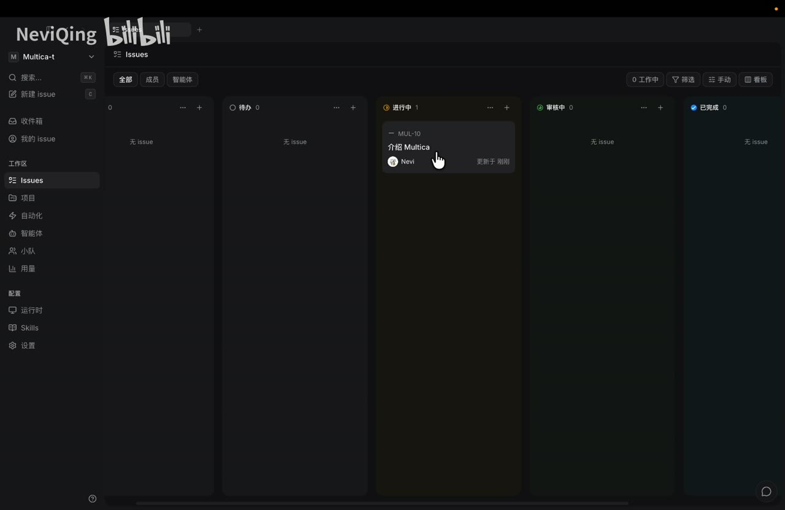

*图 01 · 00:00:59：看板以待办、进行中、审核中、已完成等列展示 Issue 状态，卡片“介绍 Multica”位于进行中。*

这解决的首先是协作可见性：人做的工作和 Agent 做的工作都以同一种任务对象出现。任务状态、回复、附件、执行记录不必散落在多个聊天窗口或终端里。

## 运行时、Agent 与指令：先明确谁能做，再明确怎样做

运行时指已经安装在某台电脑或服务器上的 Agent 能力入口。Multica 启动后扫描可用的 Agent，并把它们注册为运行时；有运行时，才可以创建工作区里的 Agent。[00:01:08]

创建 Agent 时，需要选定运行时与模型，也可以设置头像、可见范围和指令。[00:01:38] 其中指令相当于该 Agent 的长期系统提示：定义它的语气、工作规则与边界。一个好的 Agent 配置应当把稳定约束写进指令，把单次需求留给 Issue。

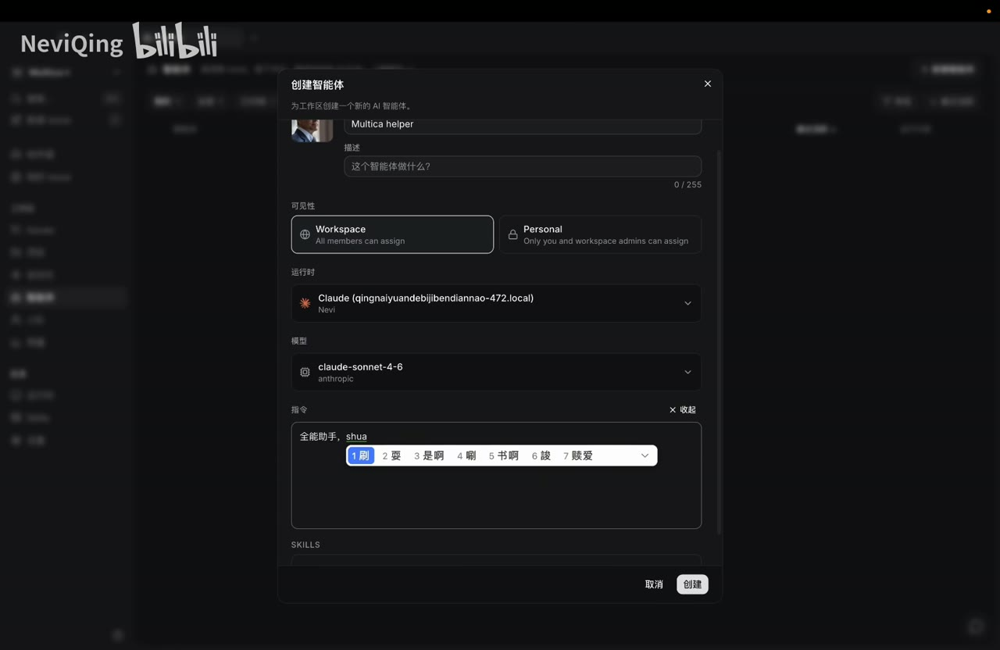

*图 02 · 00:02:19：“创建智能体”窗口包含名称、可见性、运行时、模型和指令输入区，显示了配置一个 Agent 的关键字段。*

## 在 Issue 中触发 Agent：提及与委派

对已有 Issue，有两种基本触发方式：

- 在评论中 `@` 某个 Agent，并附上要求；Agent 能读取当前 Issue 的上下文后开始工作。[00:02:34]
- 直接把 Issue 指派给 Agent；创建后任务即可开始执行。[00:03:17]

执行过程中可以查看日志、当前状态，也可以取消任务。[00:02:55] Agent 的回复、状态变化和最终附件会回到该 Issue；收件箱还会聚合这些更新。[00:03:48]

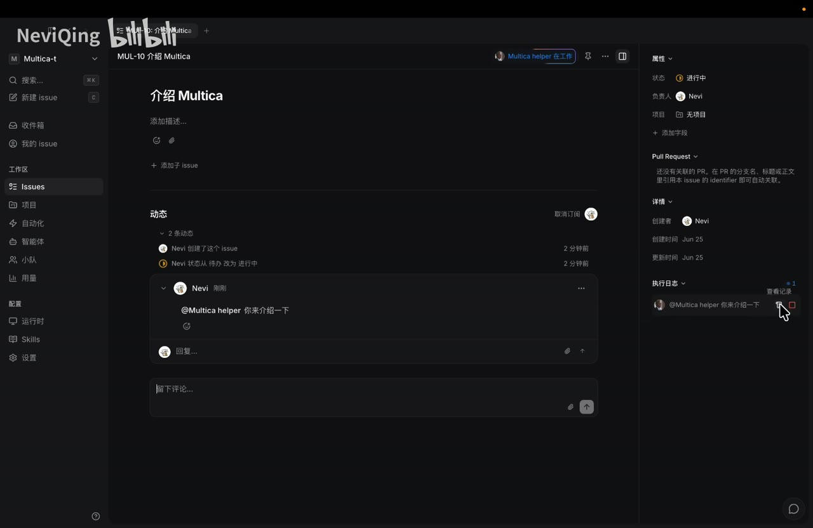

*图 03 · 00:02:59：Issue 详情页的评论区出现“@Multica helper 你来介绍一下”，右侧执行日志显示该 Agent 已被触发。*

聊天入口适合追问与排障。通过 `@` 当前 Issue 或 Agent 发问，Agent 能获得关联任务的上下文，因此可用于解释细节、核对结果和修改自己的配置。[00:04:33]

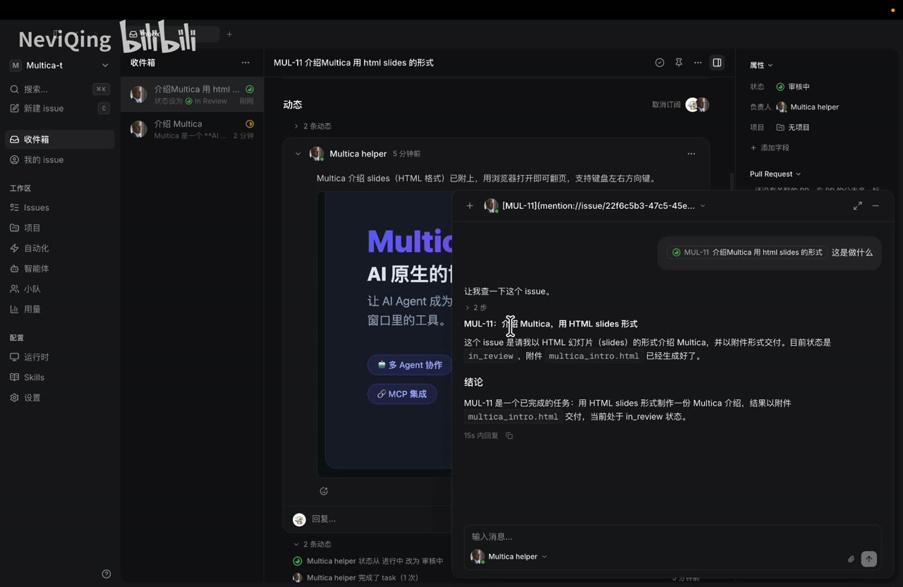

*图 04 · 00:04:59：收件箱中的 Issue 展示 Agent 回复、HTML 附件预览和侧边属性栏，说明交付物与任务上下文被放在一起。*

## Skill：把专业做法变成可复用能力

Skill 是按需加载的操作指南，不必把全部规则一次塞入 Agent 上下文。[00:05:10] 它可以手动创建，也可以从 URL 导入；示例中导入了一个用于制作 HTML Slides 的 Skill。[00:05:26]

这层能力的意义在于分离“通用执行者”和“领域做法”：前者负责理解任务、调用工具和协作，后者提供特定交付物的工作步骤、格式要求和质量标准。

随后可直接通过聊天要求已有 Agent 创建“HTML Slides 专家”，并为其绑定该 Skill。[00:05:45] 这减少了重复手填配置的负担，也便于将同一种专业能力交给多个任务复用。

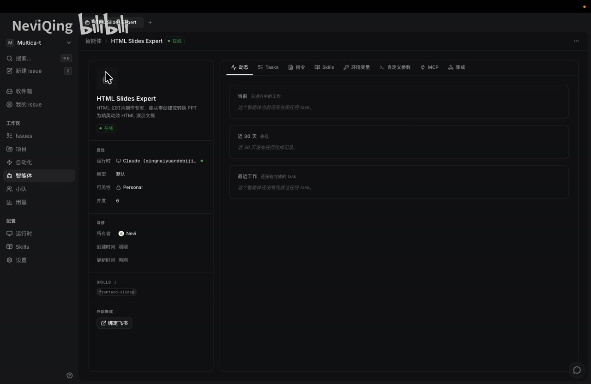

*图 05 · 00:06:19：“HTML Slides Expert”详情页显示其运行时、模型、个人可见性及已绑定的 frontend-slides Skill。*

## 交付要看结果，也要看过程

示例中，HTML Slides 专家交付了带动画、交互、字体和配色改进的幻灯片；相较初始结果，成品质量更高。[00:07:00] 但该次执行约 15 分钟，并额外打开了浏览器。[00:06:53]

这个案例体现了一个关键工作习惯：把“产物是否合格”和“过程是否符合偏好”分开检查。成品可以合格，执行方式仍可能浪费时间或产生不需要的动作。

通过聊天查询执行原因后，发现耗时与生成后打开、下载等步骤有关。[00:07:46] 因此可以更新专家 Agent 的指令，例如限制执行 `open` 之类的打开浏览器命令，让它生成完成后直接上传附件。[00:07:57]

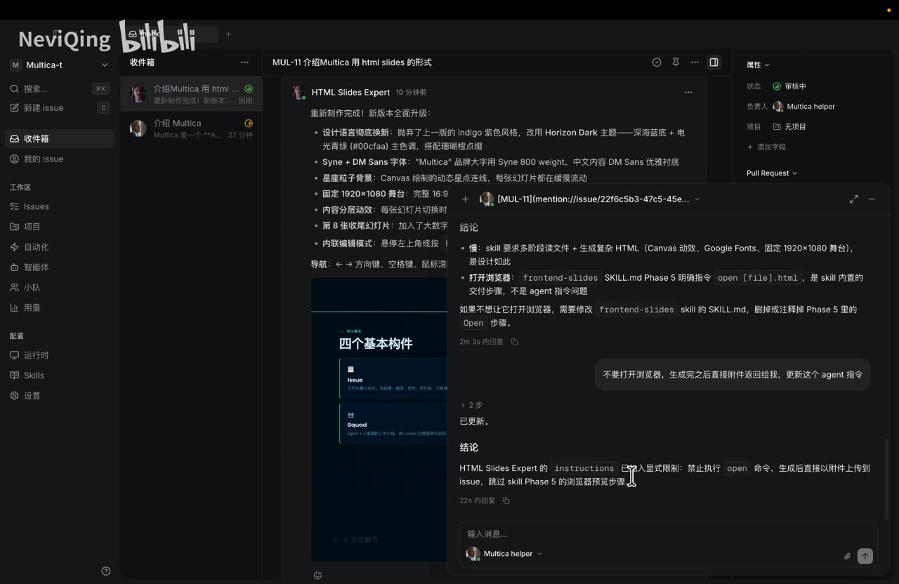

*图 06 · 00:08:19：对话中的结论明确写入“禁止执行 open 命令、生成后直接将附件上传到 issue”的限制。*

这里的迭代对象是 Agent 的长期行为：每遇到一次重复的偏差，就将清晰、可验证的约束加入指令。下一次同类任务便可少走一次弯路。

## 一个最小工作流：新闻搜集 → Slides 交付

可以建立两个专业 Agent：

1. AI Daily News：搜集并整理当天的 AI 新闻。
2. HTML Slides Expert：将已整理的信息制作成 HTML Slides。

先把“搜索今天的 AI 新闻”委派给新闻 Agent；完成后它把结果放回 Issue，并将状态更新为 `in review`。[00:09:27] 接着在同一个 Issue 中提及幻灯片专家，让它基于现有上下文制作 Slides。[00:09:36]

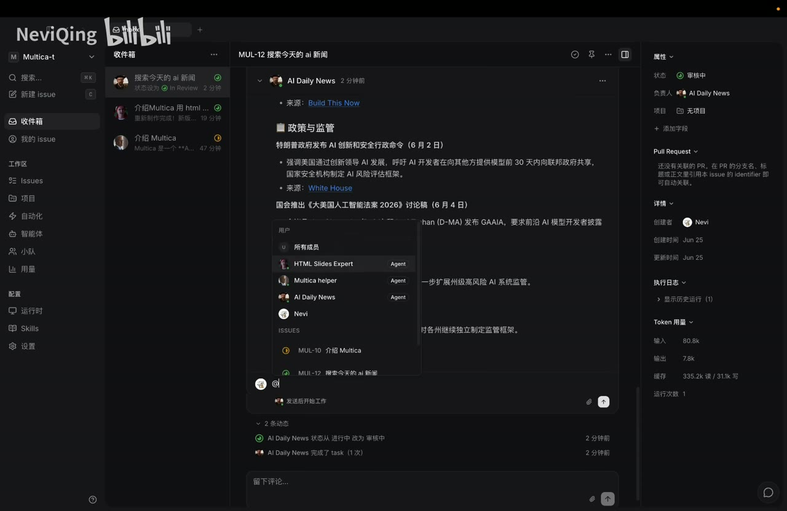

*图 07 · 00:09:39：新闻 Issue 的正文展示分类新闻内容，负责人为 AI Daily News，状态为审核中。*

这样做的直接收益是上下文不用由人手工复制搬运：新闻、指令、状态、附件和后续制作要求都留在同一 Issue。[00:09:45] 第二次制作仍需约 12 分钟，但已遵循“不要打开浏览器”的新约束。[00:10:00]

风格不满意时，也可以继续在 Issue 中描述期望风格，再通过同一套“执行—验收—修订指令”的方式迭代。[00:10:20]

## 小队：把“传话协调”交给 Leader

当流程固定为多个 Agent 的接力，人若每一步都要转述“现在轮到谁做什么”，注意力会被频繁打断。[00:10:28] 小队的作用就是承接这类协调职责。

一个小队包含成员和 Leader。Leader 的重点是判断何时委派哪个 Agent、等待上一步结果并推动任务完成；它负责协调，不承担每一种具体专业工作。[00:10:52]

示例将新闻 Agent 和幻灯片专家组成“AI 新闻 slides”小队，并指定 Multica helper 为 Leader。[00:11:15]

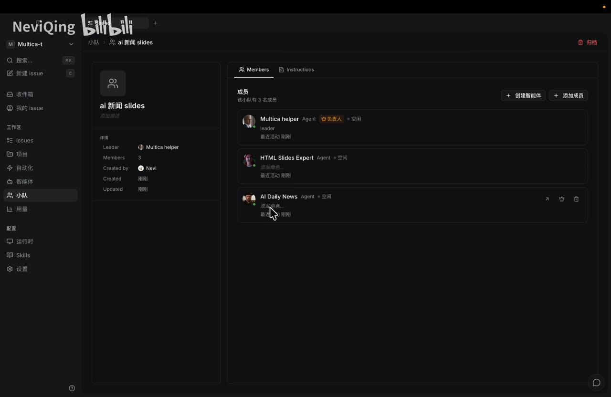

*图 08 · 00:11:39：小队成员页列出 Leader“Multica helper”以及 HTML Slides Expert、AI Daily News 两位成员。*

小队指令需要写成可执行的流程，例如：

1. Leader 先提及 AI Daily News，搜集过去 24 小时 AI 新闻并整理。
2. 结果完成后，Leader 再提及 HTML Slides Expert，生成 HTML Slides 并上传附件。
3. 汇报完成情况；若步骤失败，在 Issue 中说明原因。

这份指令会进入 Leader 的系统提示，使它知道怎样推进成员协作。[00:12:46]

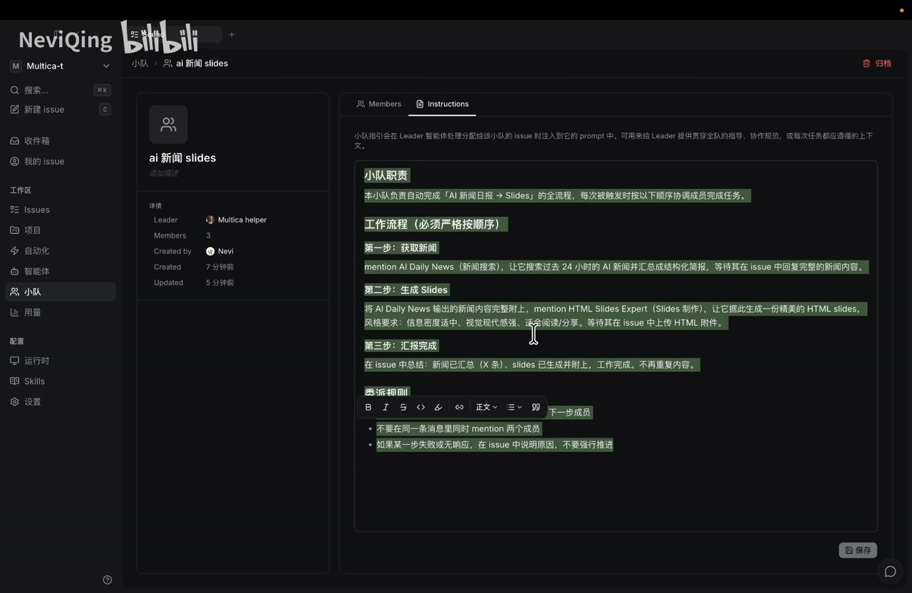

*图 09 · 00:12:59：小队 Instructions 页写有“获取新闻—生成 Slides—汇报完成”的三步流程及顺序约束。*

将新 Issue 委派给小队后，Leader 会把任务改为进行中、提及新闻 Agent、等待结果、再协调幻灯片专家，最终将 Issue 更新为完成。[00:13:04] 这让重复流程从“人盯着每一棒”变成“人只定义目标与验收标准”。

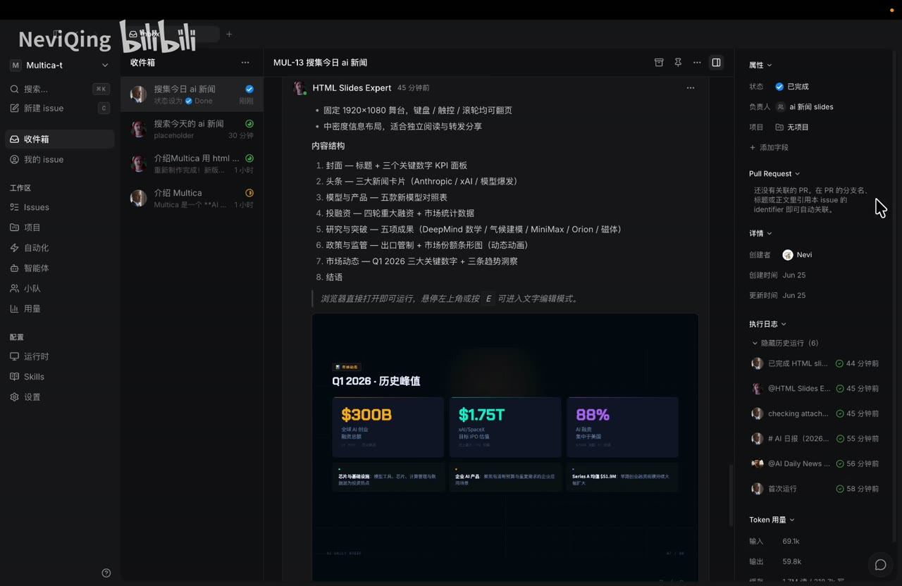

*图 10 · 00:13:39：完成的 Issue 显示 HTML Slides Expert 的交付内容，右侧状态为“已完成”，负责人为“ai 新闻 slides”小队。*

## 细节修改时，及时把任务交接给执行者

小队适合端到端流程，但当主体流程完成，只剩“调整字体样式”这类局部修改时，继续经由 Leader 会增加一次无必要协调。[00:13:56] 此时可以把负责人改为 HTML Slides 专家，让它直接完成后续微调。[00:14:18]

这是一条实用边界：跨角色、跨步骤的任务交给小队；单一专业域的收尾交给真正执行该领域工作的 Agent。这样既保留协同能力，也避免协调层吞没简单修改。

## 自动化：让已验证流程按时触发

当小队流程稳定后，可以创建自动化任务，例如在上海时间每天早上 9 点触发“AI 新闻”小队。[00:15:00] 自动化需要选择执行对象、名称、描述与时间表；创建后，小队会按既定流程重复运行。[00:15:23]

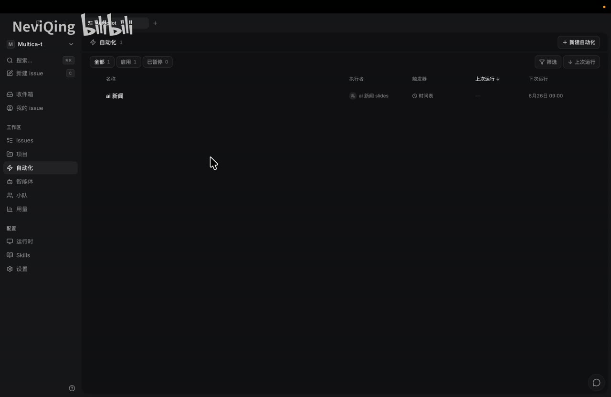

*图 11 · 00:15:39：自动化列表中“ai 新闻”由“ai 新闻 slides”小队执行，触发器为时间表，下一次运行时间显示为上午 09:00。*

自动化适合已经明确输入、步骤、交付物和异常处理方式的工作。流程仍在频繁调整时，先通过 Issue 和小队验证；约束稳定后再定时运行，维护成本会更低。

## 边界、疑点与时效性

- 画面演示的是一套录制时可见的 Multica 界面和配置，具体模型列表、运行时支持范围、执行时长及功能细节可能随版本变化。
- “约 15 分钟”“约 12 分钟”仅代表演示中的两次执行，不能作为所有任务的性能承诺。[00:06:53] [00:10:00]
- Agent 能否正确接力，取决于 Issue 上下文、成员指令、Skill 内容和小队流程是否清晰；自动化会放大稳定流程的收益，也会重复不清晰的规则。
- 逐字稿中个别产品名与术语存在语音识别误差，本文仅在与界面和上下文可相互印证时采用相应含义。

## 时间戳导航

- [00:00:00] Multica 的定位：人和 Agent 协作的统一工作台
- [00:00:26] Issue 的任务、状态、优先级与看板
- [00:01:08] 运行时如何连接本机或服务器的 Agent
- [00:01:38] 创建 Agent：模型、头像、指令
- [00:02:34] 在 Issue 中提及 Agent 并查看执行状态
- [00:03:17] 直接委派 Issue 给 Agent
- [00:04:33] 通过聊天基于 Issue 上下文追问
- [00:05:10] Skill 的按需加载机制
- [00:05:45] 用 Skill 创建专业 Agent
- [00:07:14] 从执行日志排查耗时与多余动作
- [00:08:35] 新闻搜集到 Slides 的两 Agent 工作流
- [00:10:52] 小队与 Leader 的协调职责
- [00:12:46] 将协作流程写入小队 Instructions
- [00:13:56] 将局部修改交接给具体执行 Agent
- [00:14:46] 为稳定流程配置定时自动化

## 复习与行动清单

- 先用 Issue 描述目标、负责人、状态和验收标准，让每项工作有可追踪的落点。
- 为每个 Agent 固定角色与长期约束；单次任务要求放在 Issue 里。
- 交付验收同时检查产物、日志、耗时和额外动作，把反复出现的偏好写回 Agent 指令。
- 遇到“搜集 → 加工 → 交付”这类固定链路，建立小队并把顺序、交接条件、失败处理写成 Leader 的流程。
- 当只剩专业细节修改时，将负责人切换给对应执行 Agent。
- 只有在流程已跑通、输出标准稳定后，才用自动化定时触发。
