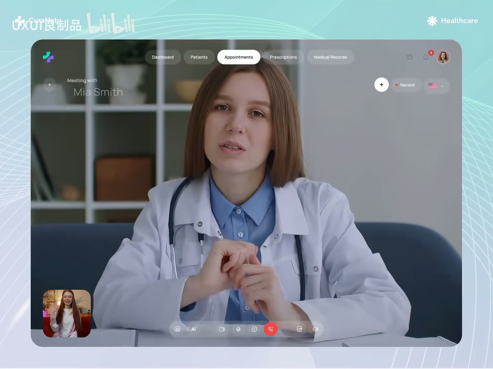
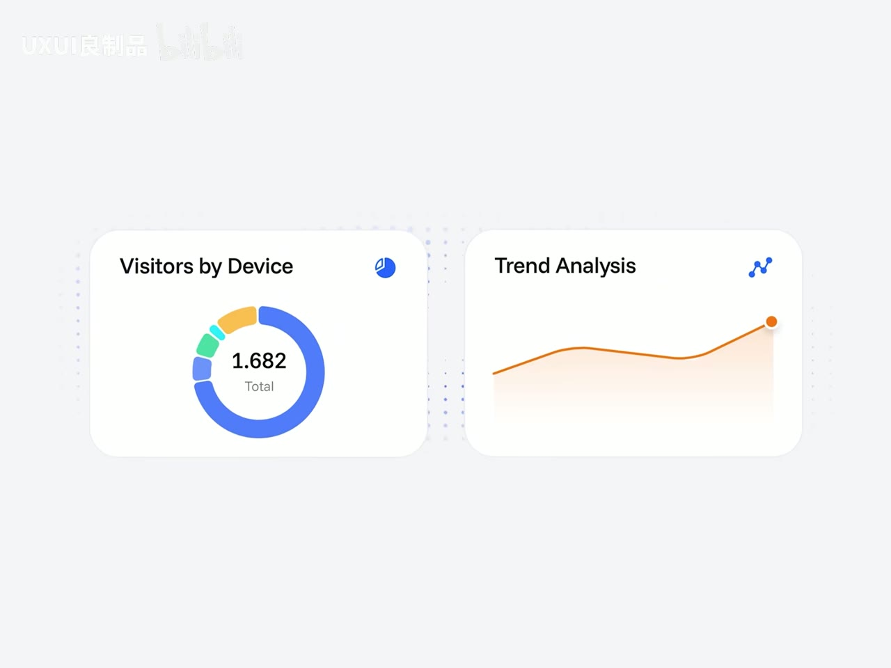
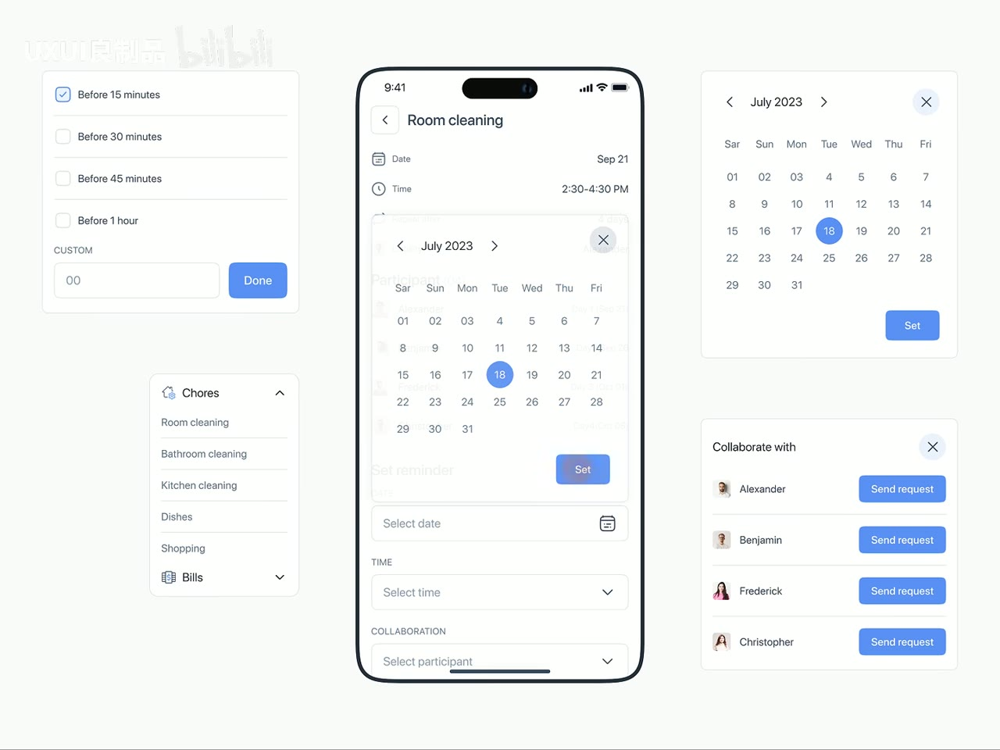
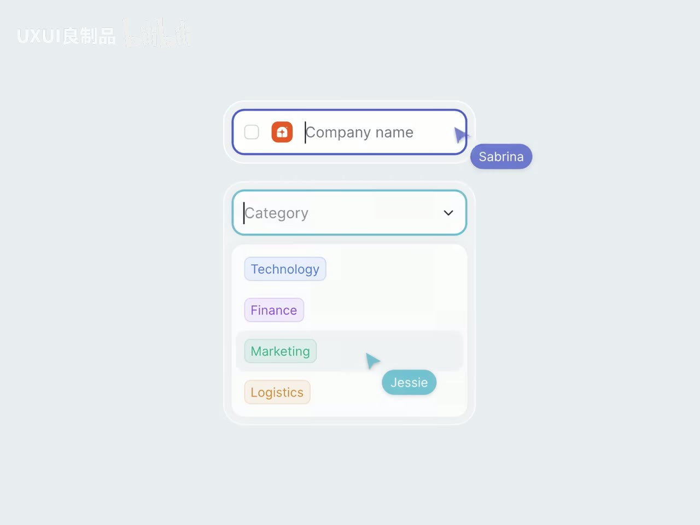
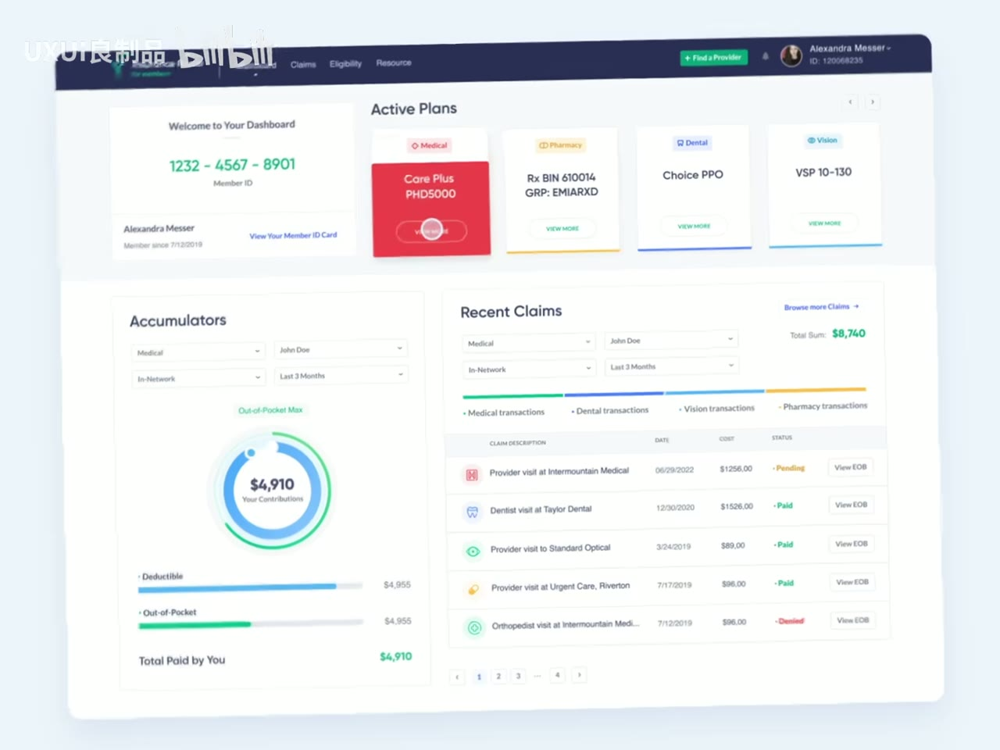
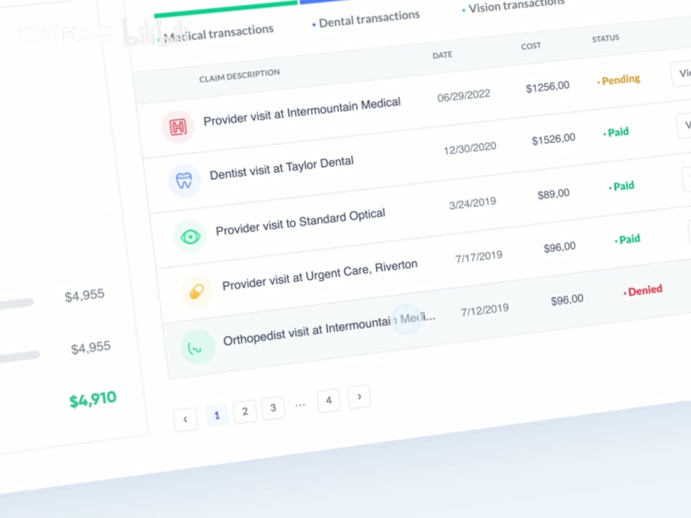
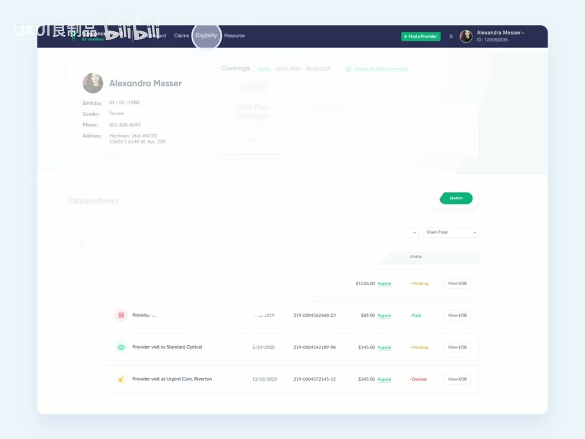
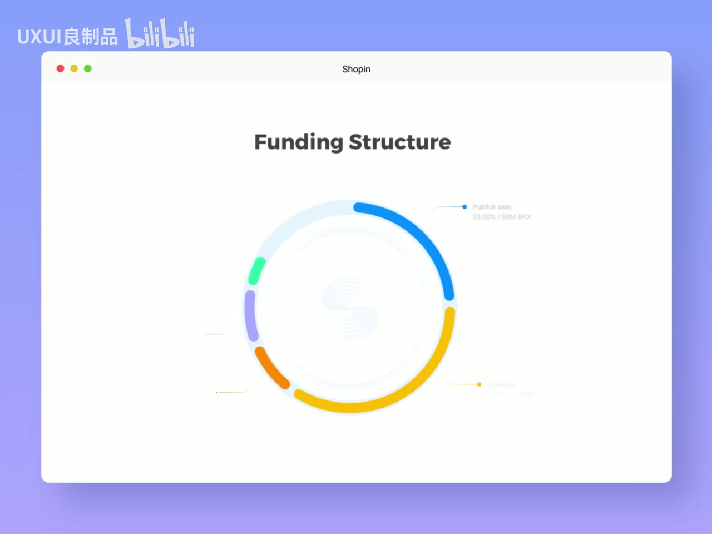
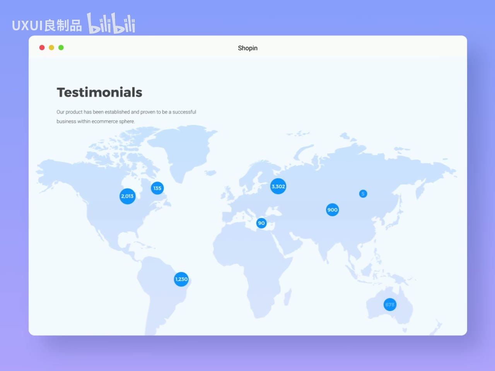

# 这才是UI设计该有的“呼吸感”

> **上传者**：UXUI良制品<br>
> **时长**：01:37<br>
> **视频链接**：https://www.bilibili.com/video/BV15LKH6PETX/<br>
> **视频 ID**：BV15LKH6PETX<br>
> **总结强度**：standard<br>
> **证据来源**：10 张时间戳画面；元数据显示未检测到语音。以下内容以画面观察为依据，关于设计意图与交互效果的部分均作谨慎推断。画面采样间隔约 10 秒，不能据此还原每一段完整动效。

## 一句话抓住核心

这组 UI 案例共同呈现出一种“呼吸感”：让内容拥有足够的留白、层级间有明确距离、状态变化获得独立舞台，并借由柔和的光影、圆角和渐隐来减轻界面的压迫感。

## 时间戳导航

- [00:00:04] 医疗视频会诊界面：大画面承载主任务，控件退到边缘。
- [00:00:14] AI Assistant：卡片栅格与输入框分层。
- [00:00:24] 数据概览：两个图表卡片之间留出明显呼吸区。
- [00:00:34] 移动端日历：弹层覆盖后仍保留任务上下文。
- [00:00:43] 表单选择：焦点描边、下拉面板与协作指针同时出现。
- [00:00:53] 健康保险仪表盘：模块被大块留白组织为清晰区域。
- [00:01:03] 表格局部：行高、分隔线与状态色承担阅读秩序。
- [00:01:12] 明细页：大面积淡化背景，强调当前导航状态。
- [00:01:22] 融资结构图：中心图形周围保留宽阔空域。
- [00:01:32] 地图展示：信息点稀疏分布，避免地图沦为噪声背景。

## 核心问题与推理主线

从画面序列可观察到，视频并未将“呼吸感”收窄为单一的留白技巧。它呈现的是一套组合关系：

```text
空间留白
  + 清晰主次
  + 低干扰的容器与边界
  + 对状态变化的聚焦
  = 更从容的视觉节奏
```

这里的关键在于：留白本身不直接等于舒适。留白需要服务于任务层级。主任务要有足够大的视觉面积；次级操作要靠近相关对象；临时状态要出现得明确，同时避免把原有上下文完全抹去。

## 1. 先给主任务足够大的舞台

[00:00:04] 的远程医疗界面把医生的视频画面放在中央，占据绝大部分窗口。顶部导航、右上角操作、底部通话工具条均以较小尺寸贴近边缘。画面中的背景和控件使用半透明、低对比处理，视觉注意力自然集中到人物脸部这一主任务上。

可见事实：导航项、录制入口、通知与头像都存在，但它们不与视频主体争夺面积。<br>
谨慎推断：这是一种以空间比例建立优先级的方式；用户首先能理解“正在会诊”，再处理工具与设置。



*图 01 · 00:00:04：中央视频画面占据主要面积，导航和通话工具以半透明小控件退到窗口边缘。*

这也提示一个实用判断：当页面只有一个明确核心任务时，优先扩大任务对象，避免为了“信息齐全”把所有能力放到同一视觉权重上。

## 2. 让组件之间保留可识别的边界

[00:00:14] 的 AI Assistant 将四个功能入口置于两列卡片中，下方另设一条独立的输入区域。功能卡片内部有大号图标、简短名称和充裕内边距；输入框以蓝色描边突出当前焦点，附件、语音和发送按钮沿右侧排列。

可见事实：功能选择区和输入区之间有明确纵向间隔，控件未彼此贴紧。<br>
谨慎推断：这种分组有助于用户区分“选择预设能力”和“直接输入请求”两类动作。


*图 02 · 00:00:14：四张功能卡片与下方输入框分成两层，焦点输入框用蓝色轮廓独立突出。*

[00:00:24] 的数据卡片进一步说明，呼吸感不需要依赖巨大页面。两个并列卡片各自拥有标题、角标图标与图形主体；图表周围留出空白，尤其环形图的中心保持干净，折线图也未塞入密集坐标和标签。



*图 03 · 00:00:24：两个数据卡片之间留有宽间距，图形周围保留空白，标题与图表形成清楚层次。*

可复用的检查方式：

- 同一组组件内部距离应稳定。
- 两个不同模块之间的距离，应大于模块内部元素的距离。
- 图表、按钮和输入框要有可感知的“安全边界”，避免视觉元素贴着容器边缘。

## 3. 临时界面出现时，保留上下文并建立焦点

[00:00:34] 展示一个移动端“Room cleaning”任务编辑界面。日期选择器位于页面中部，以浮层形式覆盖原表单；背景字段仍可隐约识别。右侧还展示了独立日历弹窗与协作者列表，左侧是提醒时间和任务分类面板。

可见事实：日历弹层使用白色面板、圆角、阴影和浅色背景遮罩；当前选中的“18”以蓝色圆形强调。<br>
谨慎推断：画面意在表达一种渐进式操作状态——用户正在处理日期，却仍能感知它属于当前任务编辑流程。



*图 04 · 00:00:34：日期选择器以居中浮层覆盖任务表单，背景字段仍隐约可见，已选日期以蓝色圆点标识。*

这种做法的重点是“焦点转移”：弹层需要足够醒目，让用户知道当前该操作哪里；背景信息仍应保留适量可见性，帮助用户理解自己从哪里进入、操作完成后会回到哪里。

## 4. 用状态样式表达交互，不靠堆叠说明文字

[00:00:43] 的表单画面同时呈现文本输入、下拉选择、多人协作。上方“Company name”输入框有深蓝焦点描边和文本光标；下方“Category”下拉框以青色描边显示激活状态；下拉列表中，“Marketing”所在行有灰色悬停底色。右侧出现带名字的协作指针标签。

可见事实：不同状态以边框颜色、行底色、光标和指针标记区分。<br>
谨慎推断：界面将“正在编辑”“当前焦点”“候选项悬停”“另一位协作者的位置”拆成可迅速扫读的视觉信号。



*图 05 · 00:00:43：输入焦点、下拉展开、悬停选项和协作指针同时以不同轮廓与颜色呈现。*

值得注意的是，状态反馈也需要“呼吸空间”。焦点描边、标签和悬停底色各占一个明确层次；若同时出现过多强色边框、动效与提示气泡，用户反而难以判断当前真正需要回应的状态。

## 5. 信息密集页面依靠分区和行距保持从容

[00:00:53] 的保险仪表盘包含会员信息、计划卡片、累计金额图、筛选器与理赔表格，信息量明显增大。画面仍通过大块区域切分：顶部导航独立成深色横栏；“Active Plans”作为一组横向卡片；下方再分为左侧统计和右侧理赔明细。



*图 06 · 00:00:53：仪表盘以顶部导航、计划卡片、累计图和理赔表格分区组织，模块之间保留大面积空白。*

[00:01:03] 放大到表格局部后，能看到每一行拥有较充足高度，图标、理赔名称、日期、金额、状态与操作按钮沿固定列排列。浅色分隔线存在，但对比度较低；“Pending”“Paid”“Denied”使用黄、绿、红显示差异。

可见事实：表格用对齐、行距、细分隔线和有限状态色建立秩序。<br>
谨慎推断：在高密度信息中，呼吸感来自稳定的节奏与克制的强调，未必来自把信息删到很少。



*图 07 · 00:01:03：表格通过较高行距、固定列对齐、浅色分隔线和少量状态色维持可读节奏。*

## 6. 淡化非当前内容，让页面具备景深

[00:01:12] 的保险明细页中，顶部“Eligibility”导航项被圆形高亮强调；页面主体整体呈浅淡状态，仍可辨认个人资料、筛选控件和理赔记录。基于单帧画面，无法确认这是否为实际转场中的渐隐阶段，或是视频后期叠加的展示效果。

可见事实：当前导航有更高对比和清晰边界，其他区域明显更淡。<br>
谨慎推断：这种对比构成了“前景—背景”的景深关系，可用于引导注意力进入当前步骤。



*图 08 · 00:01:12：顶部 Eligibility 处于高亮状态，页面主体被显著淡化，形成前景与背景的层级关系。*

在实际设计中，应谨慎使用大范围模糊或降低对比：若背景内容仍需阅读或操作，过度淡化会损害可用性。适合降低背景权重的场景包括弹层、引导、焦点切换与过渡状态。

## 具体案例与画面细节

[00:01:22] 的“Funding Structure”页面使用非常宽松的构图：标题位于上方中央，环形图置于页面中部，彩色环段与说明线散布在外围，中心和四周都留有大量白色空间。窗口外层的蓝紫渐变背景与内层白色内容面形成明确分层。



*图 09 · 00:01:22：环形融资结构图置于宽阔白色画布中央，标题、引线和色块之间都保留大量空域。*

[00:01:32] 的“Testimonials”地图页面同样使用低密度分布。标题、说明文字和浅蓝世界地图占据背景，少数蓝色圆点标记承载数值；标记彼此相距较远，地图轮廓也使用很淡的蓝色。

可见事实：地图作为承载层，数值节点被控制在少量且明显的位置。<br>
谨慎推断：通过降低底图存在感、限制标记数量和保留空白，信息点更容易成为视觉焦点。



*图 10 · 00:01:32：浅蓝世界地图作为低对比背景，少量蓝色数值点稀疏分布，焦点集中在数据标记上。*

## 边界、疑点与时效性

- 该视频未检测到语音字幕，因此无法确认作者对“呼吸感”的原始定义、评价标准或具体设计规则。
- 画面仅为 10 个时间点采样。可观察到静态 UI 状态与构图，不能确认任意两个画面之间的真实动效曲线、时长、触发条件或完整操作路径。
- 多个案例带有视频水印和展示性背景，部分淡化、模糊、倾斜及渐变效果可能属于视频呈现方式，未必是产品界面的原生交互效果。
- 文中关于“帮助理解”“引导注意力”等表述是基于画面结构的谨慎设计推断，不构成用户测试结论。

## 复习与行动清单

- [ ] 先写下每个页面唯一的主任务，确认它是否拥有最大的视觉面积。
- [ ] 检查模块间距是否大于模块内部间距，避免所有元素等距挤在一起。
- [ ] 为输入、悬停、选中、禁用和协作状态分配清晰且数量受控的视觉信号。
- [ ] 设计弹层时，确认焦点内容突出，同时仍保留足够的来源上下文。
- [ ] 审视表格和数据图：行高、对齐、图表空白与状态色能否建立稳定节奏。
- [ ] 对大面积模糊、淡化和渐变做可读性检查，尤其关注文字对比度与操作可达性。
- [ ] 复看问题：页面中的每一块留白，究竟在服务层级、分组、聚焦，还是只是在填补空缺？
