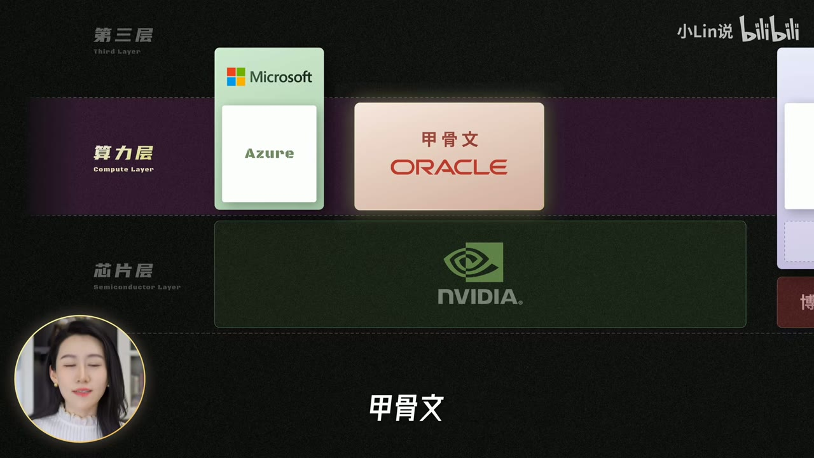
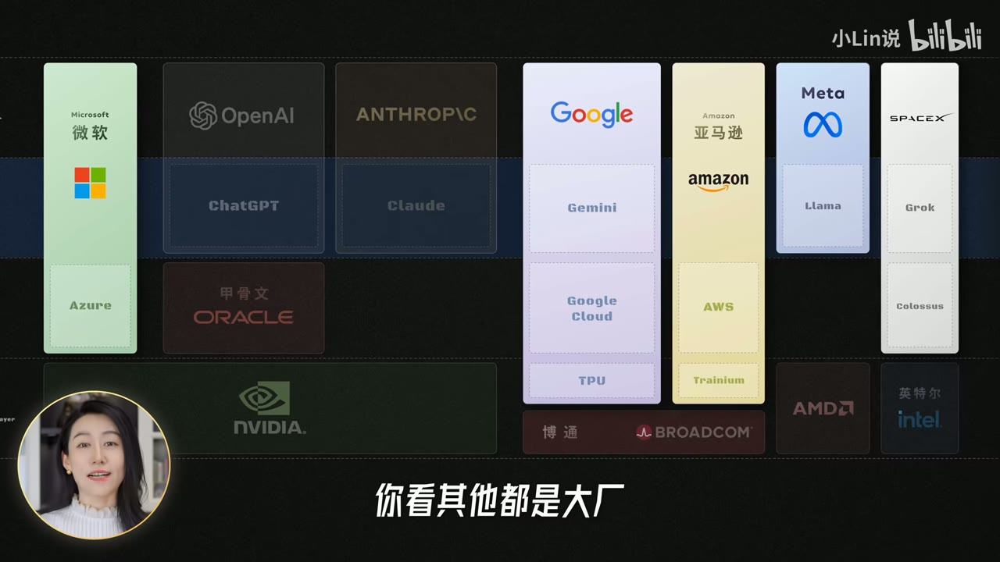
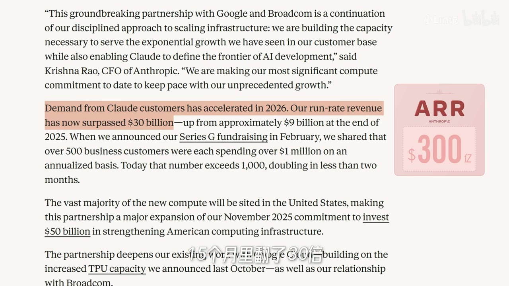
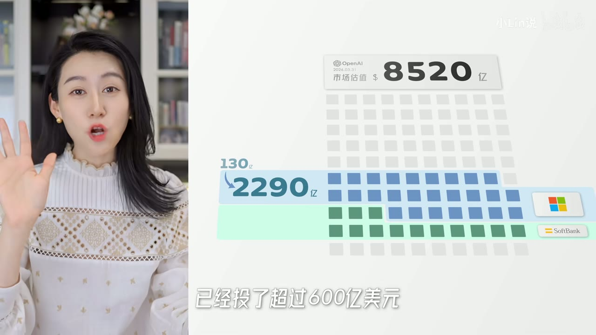
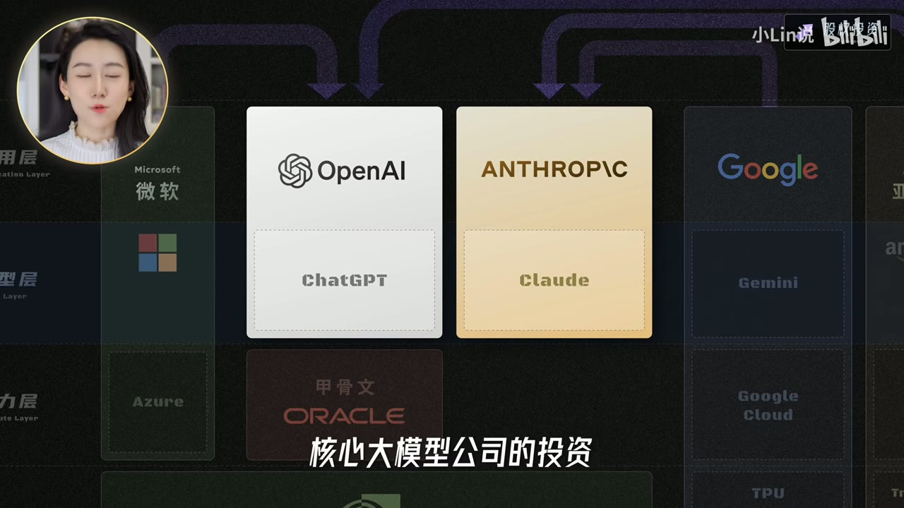
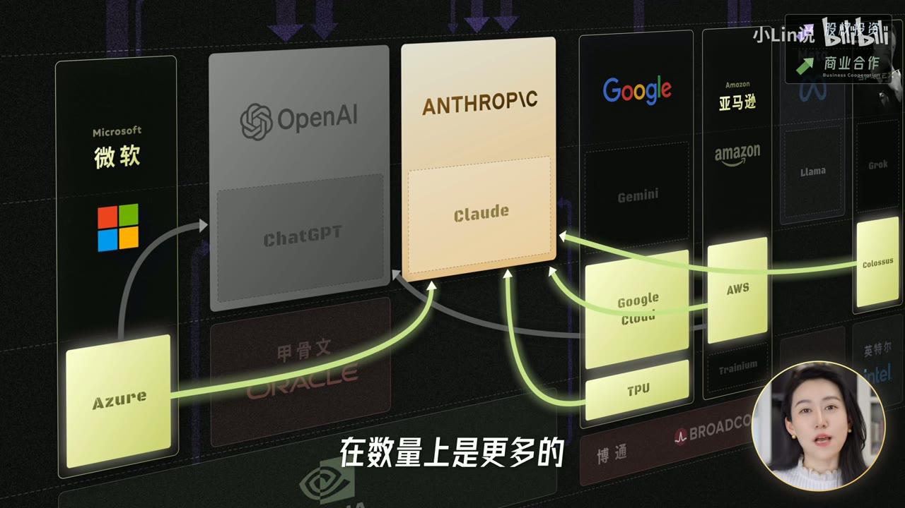
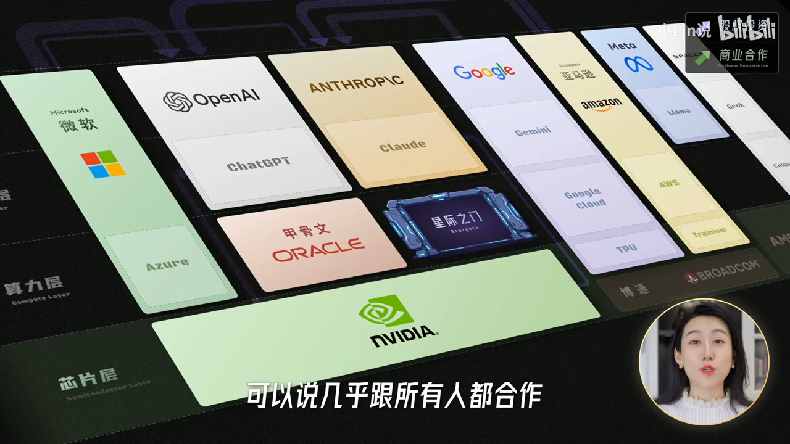
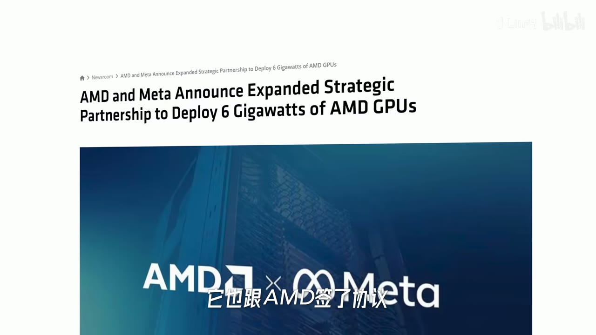
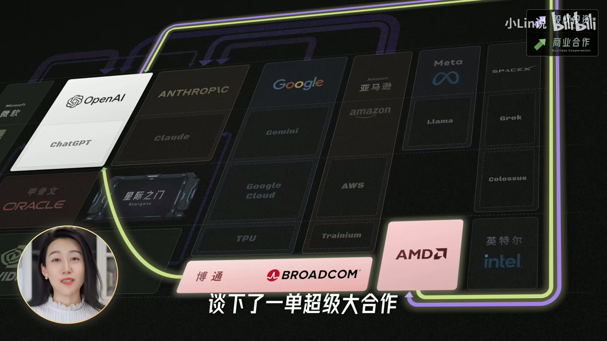
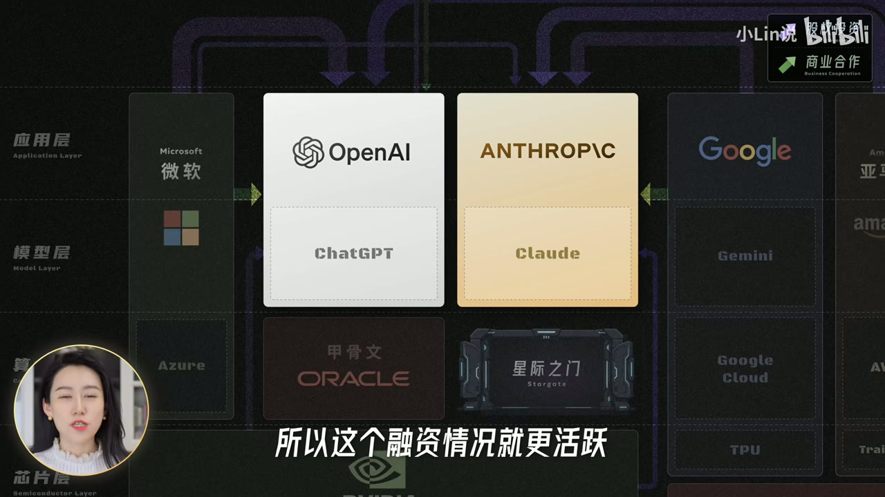

# AI巨头们之间的资本混战，到底是个什么情况？

> **UP主：** 小Lin说 
> **视频ID：** BV1V4Te6MEAu 
> **时长：** 19分28秒 
> **发布日期：** 2026-07-01 
> **链接：** https://www.bilibili.com/video/BV1V4Te6MEAu/ 
> **总结强度：** deep 
> **证据来源：** 本地归档视频、faster-whisper 中文逐字稿、24 张时间戳候选画面；逐字稿存在少量专有名词同音误识别，本文结合上下文和画面谨慎校正。所有金额、估值、市场份额、合作状态均保留片中截至录制时的口径，未作联网核验。

## 一句话抓住核心

美国 AI 资本网络的基本结构是“同层竞争、跨层捆绑”：芯片商、云厂商和大模型公司一边互相防范，一边用投资、算力订单和股权安排把彼此锁在一起，从而分散单家公司的经营风险，同时积累更大的行业系统性风险。

## 推理主干

1. **先按产业链分层。** 芯片、算力、大模型、应用四层决定了谁与谁直接竞争，谁又必须互相采购。
2. **资本集中流向独立大模型公司。** OpenAI和Anthropic兼具前沿模型能力与巨大资金缺口，成为整个网络的中心节点。
3. **投资常与算力采购绑定。** “最多投资多少亿美元”通常带有里程碑、采购量或合作条件，不能直接等同于无条件到账的现金。
4. **云厂商逐渐减少单边押注。** 微软、亚马逊、谷歌都在扩展第二条合作路线，以免被某一家模型公司或某一种芯片绑定。
5. **芯片供应商也在资本化客户关系。** 英伟达投资下游以扩大行业需求，AMD和博通则通过定制芯片、权证等方式争取进入核心订单。
6. **交叉捆绑改变风险形态。** 单家公司多了资金、客户和供应商，但算力需求一旦低于预期，风险可能沿投资与采购承诺同时传导。

## 先把牌桌摆清楚：AI产业链的四层

理解这些资本关系，第一步是区分横向竞争与纵向合作。[00:01:43]

最底层是**芯片层**，包括GPU、CPU、存储芯片和面向AI训练的定制加速器。片中将英伟达视为这一层的主导者，并给出约80%的AI加速器市场份额；AMD、英特尔构成通用芯片方向的替代供应商，谷歌有TPU，亚马逊有Trainium，博通则参与TPU及其他ASIC定制芯片的合作生产。[00:01:50]

再往上是**数据中心与云计算层**。严格说来，数据中心资产和云服务不是同一概念，片中为了分析资本关系把它们合并处理：微软Azure、亚马逊AWS、Google Cloud是传统云计算巨头，甲骨文近年积极扩张数据中心，马斯克旗下体系也通过Colossus等设施建设算力。[00:02:33]

第三层是**大模型层**。片中把OpenAI、Anthropic和谷歌Gemini列为市场领先的三家。最上方则是**应用层**，各家把模型包装为面向个人或企业的产品与服务。[00:03:02]

*图 01 · 00:02:50：画面把微软Azure、甲骨文与英伟达分别放入算力层和芯片层，直观呈现上下游关系*

这张分层图只标出各公司的核心、已经形成规模的业务。谷歌和亚马逊既经营云平台，也拥有自研芯片和模型；Meta也有自研芯片。它更适合用来识别主要利益关系，不能当作完整业务边界。[00:04:04]

*图 02 · 00:04:27：全景图将微软、OpenAI、Anthropic、谷歌、亚马逊、Meta等公司分布在应用、模型、算力和芯片四层*

## 为什么资本围绕OpenAI和Anthropic旋转

OpenAI和Anthropic是牌桌上少数独立、纯粹的大模型公司，模型能力处于第一梯队，同时没有谷歌那样完整的现金流、云基础设施和自有芯片体系。因此，它们必须持续融资和采购算力，也就成了资本、云服务和芯片订单交汇的中心。[00:04:18]

谷歌Gemini同样具备很强的模型能力，但Gemini属于谷歌内部业务。谷歌有现金、Google Cloud和TPU，也没有明显动力向外部投资人开放核心股权。所以外部资本更容易围绕OpenAI和Anthropic形成交易。

### Anthropic为什么突然变得重要

片中用ARR解释资本市场如何评估大模型公司。ARR是Annual Recurring Revenue，即年化经常性收入，可以粗略理解为按当前收入速度推算出的年度收入规模。

按照片中口径，Anthropic的ARR在15个月内增长约30倍，2026年4月约为300亿美元，5月达到约470亿美元。这里的关键不只是用户数量，也包括企业客户付费能力与收入增长速度。[00:03:23]

*图 03 · 00:03:38：画面高亮Anthropic客户需求与ARR超过300亿美元的文字，并标出“15个月里翻了30倍”*

这解释了一个看似矛盾的现象：谷歌一面经营直接竞争产品Gemini，一面又与Anthropic合作甚至投资。对谷歌来说，完全押注自己的模型意味着承担单一路线风险；Anthropic增长越快，建立资本和算力关系的保险价值就越高。

## 第一轮站队：微软押OpenAI，亚马逊扶Anthropic

微软是OpenAI最著名的早期投资人。片中称微软前后投入约130亿美元，持股约27%；按OpenAI约8500亿美元估值计算，这部分权益价值约2290亿美元，账面回报达到约17倍。[00:04:46]

软银投入OpenAI的时间更晚。片中称其累计投入超过600亿美元，约获得13%的股权。两相比较，微软用更少的早期资金取得了更高的权益比例，说明前沿技术投资中，入场时点会极大影响最终成本。[00:05:12]

*图 04 · 00:05:16：估值方格图标出OpenAI约8520亿美元估值、微软约2290亿美元权益和软银约13%的持股区域*

当微软已经深度绑定OpenAI后，亚马逊选择扶持竞争者Anthropic：2023年投资40亿美元，2024年继续投入40亿美元。这形成了早期最容易理解的阵营——微软连接OpenAI，亚马逊连接Anthropic。[00:05:40]

然而这种单边站队很快松动。按照片中所述，亚马逊在新一轮融资中承诺向OpenAI最多投入500亿美元，同时向Anthropic追加最多250亿美元。亚马逊的策略从选择一个赢家，转向同时覆盖两个最有可能产生巨量云计算需求的客户。[00:05:59]

这里需要区分两种收益：

- **股权收益**来自大模型公司的估值上涨或上市。
- **产业收益**来自AWS、Azure、Google Cloud、GPU、TPU等长期算力订单。

云厂商同时投资两家模型公司，未必只是对模型胜负没有判断；它们也可能在争夺未来的算力消费入口。

## 谷歌的转向：竞争对手也可以成为大客户

谷歌早期已经投资Anthropic，但规模较小，重心仍在自研Gemini。随着Anthropic和Claude Code快速增长，谷歌开始把关系从小额财务投资推进到大规模算力合作。[00:06:33]

片中称，谷歌与Anthropic先达成最多提供100万颗定制TPU、增加超过1吉瓦算力的合作；随后又宣布最多投资400亿美元，并计划在未来五年提供5吉瓦算力。[00:07:18]

这类交易同时完成三件事：

1. 谷歌为竞争风险购买一份保险；
2. Google Cloud和TPU获得一个重要外部客户；
3. Anthropic获得英伟达GPU之外的算力来源。

所以，产品竞争与基础设施合作可以同时存在。Gemini与Claude争夺企业用户，Google Cloud和TPU仍然可以承接Claude的训练与推理需求。

## 英伟达：从卖芯片升级为投资整个生态

英伟达与OpenAI签下片中所称的300亿美元战略合作意向书，前提是OpenAI部署相应规模的英伟达GPU。对Anthropic，片中提到过最多100亿美元的战略投资意向，但当时尚未敲定。[00:07:40]

“战略合作意向书”的重点在条件：投资金额、芯片采购和项目进度彼此关联。英伟达投入的钱可能通过OpenAI的算力采购重新转化为英伟达收入。

围绕OpenAI和Anthropic形成的网络因此不能只看股权箭头，还要同时看资金流和订单流：

\[
\text{芯片商投资模型公司}
\rightarrow
\text{模型公司扩大算力采购}
\rightarrow
\text{芯片商获得收入}
\]

*图 05 · 00:07:42：资本关系图突出OpenAI和Anthropic，顶部多条箭头指向两家公司，甲骨文位于OpenAI下方*

片中还列举英伟达投资英特尔、SpaceX以及CoreWeave、Figure AI等公司，并称当年承诺投资总额约400亿美元。英伟达希望从AI产业的设备供应商，进一步变成整个产业链的股东。[00:12:42]

这种策略的目标是扩大整张牌桌：模型公司越多、数据中心越多、算力竞争越激烈，整个市场对加速器的需求就可能越大。

## 股权阵营会变，算力生意更少讲阵营

到了云服务和算力采购层，早期的股权阵营迅速模糊。

微软既为OpenAI提供云服务，也可以服务Anthropic；AWS与两家模型公司都有合作，片中还提到AWS与OpenAI签订八年云服务合同；Google Cloud及TPU主要加深了与Anthropic的关系。[00:09:10]

马斯克与Anthropic的关系尤其能说明商业合作的弹性。片中称，马斯克在2026年2月公开严厉批评Anthropic，约70天后，其旗下企业又宣布与Anthropic合作，计划提供22万颗GPU。巨大的算力订单足以压过此前的公开冲突。[00:09:33]

结果是Anthropic同时连接微软、AWS、Google Cloud和马斯克旗下算力体系，在云供应商数量上更加分散。

*图 06 · 00:10:08：关系图用多条高亮路径把Azure、Google Cloud、AWS和Colossus连接到Anthropic，显示其多云算力来源*

OpenAI的外部云合作看起来相对集中，一个重要原因是它试图通过“星际之门”建立更庞大的专属基础设施体系。

## 星际之门：宏大联盟为何退回双边合同

星际之门被设想为超大型AI基础设施计划。片中称，该计划目标是在美国建设总规模5000亿美元、约10吉瓦的数据中心集群；初始股权承诺包括软银190亿美元、OpenAI 190亿美元、甲骨文70亿美元和阿联酋MGX 70亿美元。[00:10:22]

问题随即出现：OpenAI希望获得设计权和长期使用权，甲骨文认为自己承担主要建设工作，软银则关心投资回报率。片中明确说明，对三方各自动机的拟人化描述带有讲述者自己的推测。[00:11:27]

按照片中转述的消息，OpenAI后来实质上淡化了统一的星际之门联盟，转向与甲骨文、AWS等供应商分别签订双边合同。相关数据中心项目仍可能继续建设，受阻的是由多方共同治理的宏大联盟结构。[00:11:53]

*图 07 · 00:12:34：产业图中“星际之门”被画成独立模块，位于OpenAI下方并与甲骨文、英伟达等节点相邻*

这个案例说明，钱和技术并不足以保证联盟落地。超大型基础设施项目还需要明确回答：

- 谁拥有设计权？
- 谁承担融资和建设风险？
- 谁获得长期使用权？
- 算力空置时由谁承担损失？
- 项目升值后收益怎样分配？

参与方越多，治理成本越容易吞噬联合建设带来的规模优势。

## 下游如何摆脱英伟达单点依赖

英伟达越强，下游模型公司越需要维持良好关系；同一份垄断力量也会刺激客户寻找替代供应商。[00:13:12]

Anthropic的路线相对清晰：使用谷歌TPU和亚马逊Trainium，形成较明显的非英伟达算力倾向。OpenAI主要依赖英伟达GPU和星际之门类数据中心，但也与博通合作研发定制芯片，并引入AMD。[00:13:29]

片中同时强调，Anthropic属于特殊案例。行业大部分AI算力需求仍然依赖英伟达，因此替代路线的出现不能直接推导出英伟达统治力已经消失。[00:13:48]

### AMD用股权换核心订单

片中称，AMD承诺在未来几年向OpenAI提供总计6吉瓦算力，同时向OpenAI发行最多1.6亿股权证，行权价为每股0.01美元。讲述者将其粗略概括为AMD可能牺牲接近10%的股权空间，换取OpenAI的大额订单。[00:14:08]

权证带有具体生效条件和里程碑，不能简单理解成当天无偿交付全部股份。但其经济含义非常直接：AMD愿意分享未来股权价值，以换取进入最核心AI客户供应链的机会。

紧接着，Meta也与AMD签下片中所称的相似协议，同样以约6吉瓦算力安排对应潜在的10%股权权益。[00:14:51]

*图 08 · 00:15:00：AMD官网页面标题明确写有与Meta扩大战略合作并部署6吉瓦AMD GPU*

这反映出供应链中的权力分布：最稀缺的资产未必只有芯片，也可能是能长期消化数吉瓦算力的超级客户。AMD要挑战英伟达，既需要产品竞争力，也需要用资本条款争取标杆订单。

*图 09 · 00:14:11：关系图高亮博通和AMD，并以环形路径连接上方模型、云与芯片节点，表现多供应商布局*

## 牌桌上的角色与各自算盘

片中用一张牌桌概括各类玩家的位置。[00:15:07]

- **OpenAI与Anthropic**像高速成长的创业者：模型能力强、估值上升快、资金和算力需求巨大，天花板与风险都很高。
- **微软、谷歌、亚马逊、Meta**像资金雄厚的成熟巨头：一边发展自有模型与芯片，一边投资外部领先者，避免错过下一代平台。
- **英伟达**掌握关键供应能力，更关心整张牌桌是否继续扩大，因为几乎所有扩张都会转化为芯片需求。
- **博通**凭借定制芯片能力连接多家巨头，在自研ASIC浪潮中获得位置。
- **甲骨文、AMD、英特尔**需要付出较高资本或商业代价，才能争取进入核心项目。
- **马斯克旗下体系**拥有另一套资本、产品和基础设施路径，与主流网络的连接较少，但具备形成强竞争关系的潜力。

这个牌桌比喻是片中明确标注的主观理解，不能当作严格的公司估值或实力排名。画面中的卡片面积也没有完全按市值绘制。[00:15:30]

## 三条主线：复杂关系最终如何化简

### 1. 英伟达投资行业，锁定未来GPU需求

英伟达把部分芯片利润重新投入模型公司、数据中心和其他AI企业。只要行业总算力继续扩大，投资对象之间谁赢谁输，对英伟达的影响可能小于整个市场是否增长。[00:17:07]

### 2. 云厂商和芯片商投资模型公司，争夺算力订单

OpenAI与Anthropic需要融资，投资方则需要数年期的大客户。资金流向模型公司，采购承诺反向流向云平台和芯片商。[00:17:17]

*图 10 · 00:17:26：图中OpenAI和Anthropic处于中心位置，多条投资与合作箭头从上下游指向两家公司*

### 3. 融资同时制造长期负债式承诺

这些交易中的“最多投资”往往取决于模型公司是否采用投资方的算力、达到项目里程碑或完成一定采购规模。因此，融资额不能脱离采购义务单独理解。[00:17:33]

按照片中的粗略估算，OpenAI融资约1100亿美元的同时，已经承诺超过1万亿美元的未来订单。这个比较意在说明其资金与采购承诺不对称，并非经过本文独立审计的财务结论。[00:18:01]

可以用一个简化关系表示：

\[
\text{净融资自由度}
\approx
\text{取得的资金}
-
\text{附带条件所锁定的未来支出与选择空间}
\]

钱进入公司后，供应商、芯片架构和云平台路线也可能随合同被提前确定。

## 个体风险下降，系统性风险上升

交叉投资给单家公司增加了多条退路：模型公司获得更多资金和算力来源，云厂商同时覆盖多个模型，芯片商拥有更多下游客户。这降低了单一合作失败带来的冲击。[00:18:17]

代价是整个网络越来越像绑在一起的船队。模型公司靠融资兑现算力订单，云厂商靠订单建设数据中心，芯片商又根据数据中心需求扩产。只要最终AI需求持续增长，这套循环可以让参与者共同受益。

如果算力需求低于预期、电力和基础设施无法按期交付，或某个核心公司发生财务问题，订单、融资和估值便可能沿同一张网络传导。原本用于分散风险的关系，反而成为系统性风险的传播通道。[00:18:29]

## 边界、疑点与时效性

1. **所有事实均为片中截至录制时的口径。** 该领域的估值、融资、上市计划和合作意向变化极快；片中也指出，关系图在半年内已经发生明显变化。[00:18:56]
2. **“承诺最多投资”不等于资金已经全部到账。** 其中可能包含分期支付、采购条件、里程碑和监管前提。
3. **股权投资、战略合作、云服务合同和权证是不同交易。** 它们的风险、现金流和控制权含义不能混为一谈。
4. **星际之门三方诉求的具体分配带有讲述者推测。** 可以用来理解治理冲突，不能当作谈判原文。
5. **产业分层图有意简化。** 它标示核心业务，没有穷尽各公司的芯片、云、模型和应用布局；卡片面积也没有严格对应市值。
6. **画面只能证明当时展示的图表或页面状态。** 候选帧无法单独证明合作从提议到签约、交付之间的完整过程。
7. **逐字稿含少量识别错误。** 本文校正了Gemini、Claude、Azure、Trainium、Colossus、Stargate、warrant等明显专有名词；无法由上下文可靠还原的细节没有扩写。
8. **片尾涉及上市计划。** 片中称SpaceX已经上市、OpenAI与Anthropic计划年内上市；这些属于高度时效性的片中陈述，本文未作外部确认。[00:19:00]

## 时间戳导航

- [00:00:09] AI为何像吸收全球资金的“资本黑洞”
- [00:01:11] 纳入牌桌的三项标准：前沿、资本活跃、规模足够大
- [00:01:50] 芯片、算力、大模型、应用四层产业链
- [00:03:23] ARR指标与Anthropic的增长叙事
- [00:04:18] OpenAI和Anthropic为何成为资本中心
- [00:04:46] 微软早期投资OpenAI的账面回报
- [00:05:40] 亚马逊从扶持Anthropic走向两边下注
- [00:06:33] 谷歌从小额投资转向TPU与资本合作
- [00:07:40] 英伟达对模型公司的战略投资逻辑
- [00:09:10] 股权阵营之外的多云算力合作
- [00:10:22] 星际之门的规模、参与者与初始资金
- [00:11:27] 多方联盟的治理冲突
- [00:13:12] 下游寻找英伟达替代方案
- [00:14:08] AMD以权证和算力换取OpenAI订单
- [00:15:30] 牌桌比喻中的各类玩家
- [00:16:59] “同级竞争、跨级捆绑”的三条主线
- [00:17:33] 融资背后的算力采购承诺
- [00:18:17] 个体风险与系统性风险的反向变化

## 复习与行动清单

### 记住五个判断

- [ ] AI资本关系必须与产业链位置一起看。
- [ ] OpenAI和Anthropic的核心地位来自模型能力、独立性和巨大算力需求。
- [ ] 战略投资经常兼具销售合同和客户锁定功能。
- [ ] 多云、多芯片路线既是技术选择，也是供应链风险管理。
- [ ] 交叉持股能保护单家公司，也可能放大整个行业的共同波动。

### 以后看到一笔AI大交易，依次追问

1. 钱最终流向谁，已经到账多少？
2. 投资附带哪些采购、算力或里程碑条件？
3. 谁是股东，谁是供应商，谁又是客户？
4. 合同锁定了哪一种云平台或芯片架构？
5. 订单规模以GPU数量、吉瓦还是美元计量？
6. 供应商为获得订单让出了多少股权或定价权？
7. 如果AI需求低于预期，谁承担数据中心闲置和芯片扩产成本？
8. 这笔交易是在分散一家公司的风险，还是在增加全行业的共同风险？
