# UI 设计教程：2026 设计师 AI 使用报告解读｜老外设计师都怎么用 AI？

- **UP 主：** 新像素
- **视频 ID：** BV1mcV86cE1e
- **时长：** 26:08
- **发布：** 2026-05-29
- **来源：** [Bilibili 原视频](https://www.bilibili.com/video/BV1mcV86cE1e/)
- **总结强度：** deep
- **证据：** 本地视频逐字稿与 24 张时间戳候选画面；转录语言置信度 99.66%，共 803 个片段。部分工具名存在 ASR 同音错误，已依据画面谨慎校正。

## 一句话抓住核心

AI 对设计师真正重要的变化，是设计工作从“挑选现成软件”逐步转向“组合模型、设计工具和代码能力，并为具体问题现场制造工具”；决定最终质量的依然是设计师对需求、交互、细节和品位的判断。

## 推理主干

1. AI 已经渗透构思、原型、文案等多个设计环节，但不同任务的成熟度差异很大。
2. 单一工具很难完成完整工作，设计师开始围绕任务组合模型、Figma、MCP 和编程代理。
3. Figma、开发环境与新型代码画布正在重新分配探索、生成和精修的职责。
4. AI 编程让设计师从工具使用者走向微型工具制造者，个人实践可以进一步沉淀成团队基础设施。
5. 工具越多，学习、筛选和返工成本越高，因此稳定输出、工作流适配和审美把关比追逐新品更重要。

## AI 最先吃下的是探索、原型和文案

2026 年第一季度的海外调研显示，AI 使用最集中的三个设计场景是构思与概念探索 76%、原型制作 74%、UI 文案与内容写作 70%。随后出现明显落差：用户研究与综合分析 56%，文档与规范、代码生成与前端实现均为 50%，图像或视频生成 44%，线框图 43%，设计系统与组件 33%。[00:01:31]

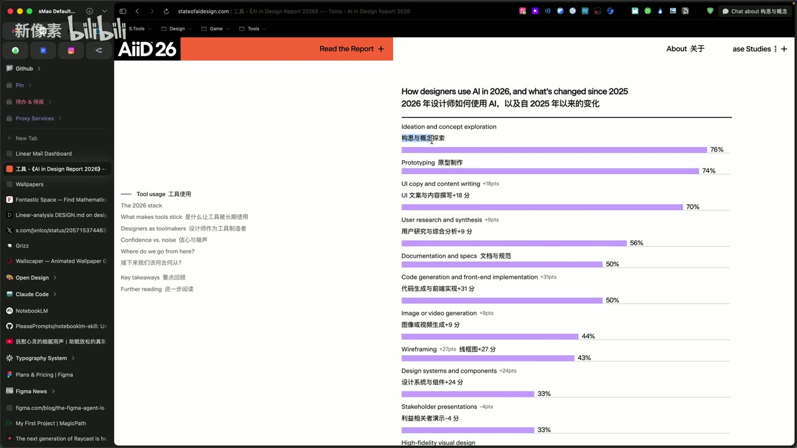

*图 01 · 00:01:37：报告柱状图显示构思探索、原型制作和 UI 文案分别以 76%、74%、70%位居前三，后续任务出现明显落差*

这组排序可以用任务容错率解释。构思阶段追求方向数量和启发，允许结果粗糙；原型阶段优先验证流程和交互，视觉还原可以暂时让位；文案替换、翻译和批量改写又具有输入清楚、结果易检查的特点。设计师可以把 PRD、信息架构或现有页面交给 AI，让它补充方案、探索交互路径或替换整套界面文案。[00:01:47]

研究、规范和正式代码的比例较低，意味着这些任务仍然具有更高的上下文门槛与验证成本。AI 能够生成结果，却未必理解组织内的历史决策、用户证据、组件约束和生产环境。任务越接近正式交付，错误带来的返工也越重。

因此，“使用比例较低”不能直接解释为能力缺失，更接近一个综合结果：产出稳定性、接入成本、团队规范和责任风险共同限制了落地。

## 工作流的单位已经从软件变成工具组合

报告里的一个排版审计案例展示了新的工作方式：Baseline Design 创始人 Joey Banks 在一个上午内组合 Claude、Figma MCP Server、Claude Design 和 Claude Code，对大型组件库进行排版审计、合并样式，并制作 token 参考站点原型。[00:03:39]

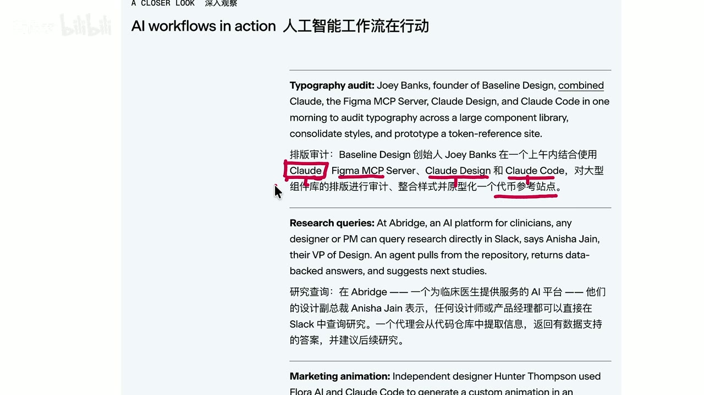

*图 02 · 00:04:53：案例原文同时列出 Claude、Figma MCP Server、Claude Design 与 Claude Code，并说明它们共同完成组件库排版审计和 token 参考站点原型*

这里的关键机制是 MCP 提供的结构化桥梁。只有截图时，AI 主要依靠像素推测页面；接入 Figma 的图层、节点和属性之后，它可以读取更接近设计源数据的结构，理解组件关系、尺寸和样式属性。AI 从“看图模仿”推进到“操作设计对象”，可控性随之提高。[00:05:32]

工作流组合也带来成本问题。高质量模型调用可能非常昂贵，给员工大量额度的公司能够进行更多探索，也更容易积累领先经验；投入本身并不保证收益。视频以公司开始审视 AI 投入产出比为反例，提醒团队观察返工量、交付质量和节省的真实工时，而非只统计调用次数。[00:04:19]

报告称设计师平均使用的现成 AI 工具从上一年的 3 个增加到 7 个。编程类榜单中，画面显示 Claude Code 65%、Cursor 39%、Lovable 19%。工具栈扩张说明设计师正在针对研究、视觉、原型、代码和知识管理选择不同入口。[00:07:03]

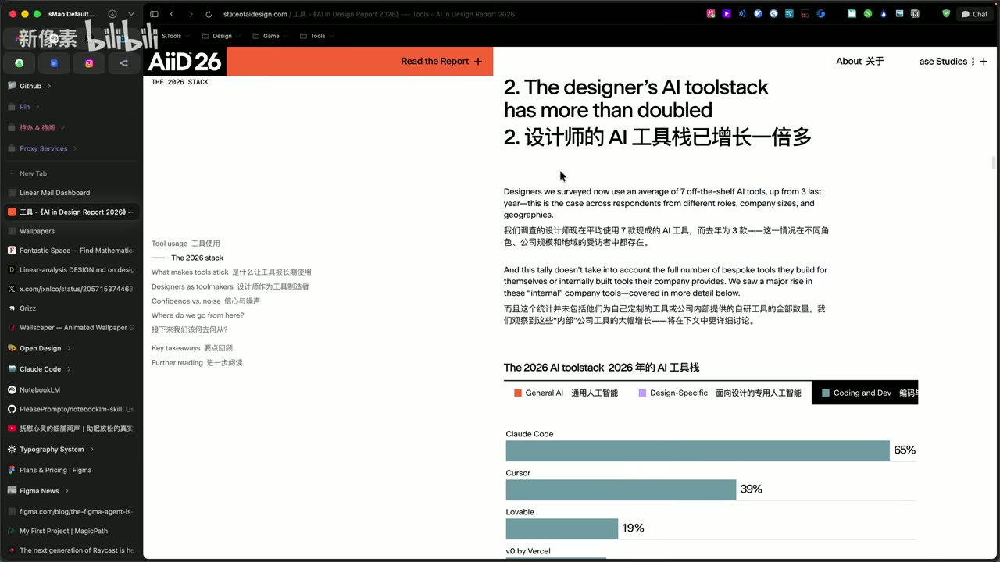

*图 03 · 00:07:04：页面写明设计师平均使用的现成 AI 工具由 3 个增至 7 个，下方编程榜单显示 Claude Code、Cursor 与 Lovable 的采用比例*

## 榜单变化说明入口正在快速重排

通用 AI 工具的同比数据变化很大：Claude 从 52%升至 78%，ChatGPT 从 88%降至 65%，Gemini 从 21%升至 48%，Perplexity 从 34%降至 13%。这些数字反映的是 2026 年第一季度受访者使用情况，不能直接外推到其他地区或后续季度。[00:07:20]

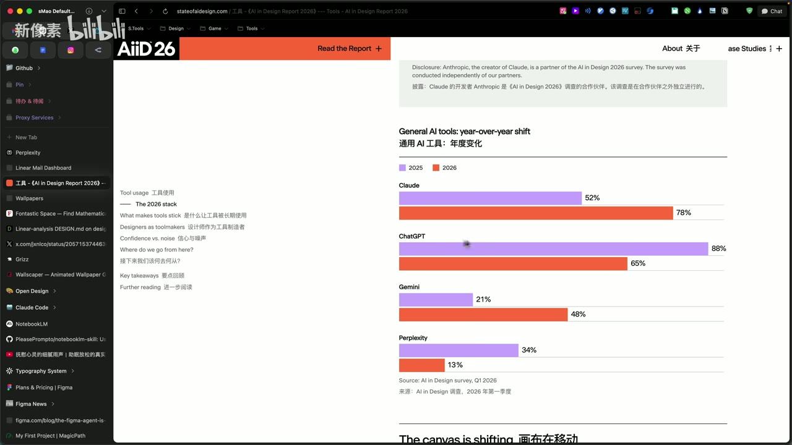

*图 04 · 00:10:20：通用 AI 工具同比柱状图同时呈现 Claude、ChatGPT、Gemini 和 Perplexity 在 2025 与 2026 年的使用比例变化*

视频推测，独立聚合工具的功能容易被大型模型平台吸收，订阅价值因功能重叠而下降。这一解释被明确标为个人猜测，现有本地材料只能确认使用比例变化，无法验证下降原因。[00:08:07]

面向设计的分类中，画面显示 Figma AI / Make 为 68%，图像生成工具为 54%，公司内部工具 18%，视频生成 17%，Adobe AI 16%。设计师需要从这里看到任务入口的变化：传统设计软件正在吸收生成能力，模型平台也在向画布、组件和原型深入，类别之间的边界持续模糊。[00:08:47]

## Figma 的位置：探索画布、精修工具和协作中心

报告归纳了三种正在并存的路径。[00:10:35]

第一种从 Figma 出发。设计师在画布中并排探索多个方向，收集灵感、调整信息结构，再把选定方向交给 AI 深入实现。Figma 的优势在于空间关系清楚：多个版本可以同时展开，流程连线、页面归属和上下游状态一眼可见。

第二种把 Figma 当作“手术刀”。设计师先在开发环境中生成原型，随后回到 Figma 精修圆角、间距和视觉细节。这条路径利用了代码原型的速度，也承认当前生成结果仍需要细粒度控制。

第三种是代码优先。报告提到 Maze 的设计师从第一天就在 Cursor 工作，Watershed 的设计团队已经直接在代码库中工作。此类案例往往依赖团队招聘结构、前端能力、设计系统成熟度和工程流程，不能直接转化成所有设计师都应采用的路线。[00:13:01]

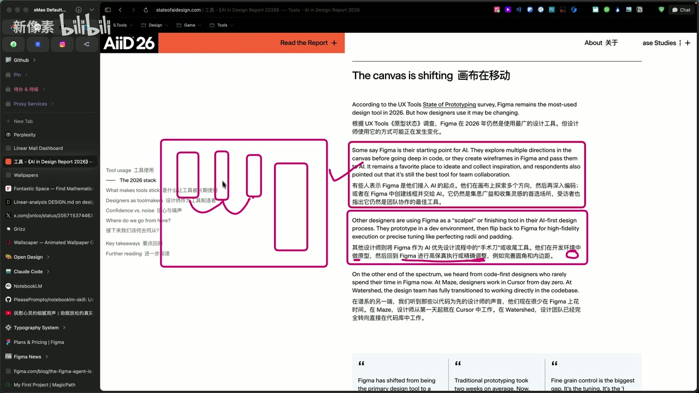

*图 05 · 00:12:31：报告高亮展示两种 Figma 路径：从画布探索后交给 AI，以及先在开发环境做原型再回 Figma 精修；左侧手绘图强调多方向画布*

视频更倾向于从 Figma 开始探索，因为大型项目仍面临设计与代码样式难以完全同步的问题。生成代码后再回 Figma修改，或者先画完再生成代码，都可能产生大量跨页面返工。当前需要解决的核心问题是稳定的设计 token、组件映射和变更同步，而非简单决定在哪个软件起稿。[00:11:09]

与此同时，Paper 一类新工具采用类似设计软件的画布和图层界面，底层更接近 HTML/CSS。视频据此解释其与 AI 协作更顺畅：画布内容和可运行页面处在同一种代码表达中，分享后可直接作为网页打开，减少图像与代码之间的转换摩擦。[00:14:01]

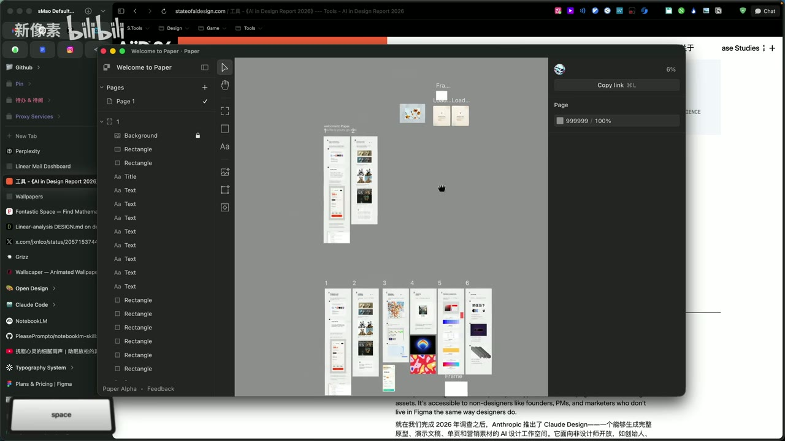

*图 06 · 00:14:41：Paper 演示窗口同时显示图层面板、画布和多组页面原型，呈现类设计工具与可运行页面结合的工作环境*

“Figma 底层是纯图像、Paper 底层就是代码”属于视频为帮助理解所做的概念简化。它适合说明工作流摩擦，却不足以替代对具体文件格式、渲染架构和导出链路的技术分析。

## 长期留下来的工具，先要稳定地产出

报告询问“一款 AI 工具为什么能被长期采用”，排在首位的是可靠且高质量的输出，占 80%；易用且设计良好为 61%，契合既有工作方式为 57%，能与现有工具集成为 54%。独特能力、可信推荐和公司标准化的比例更低。[00:15:14]

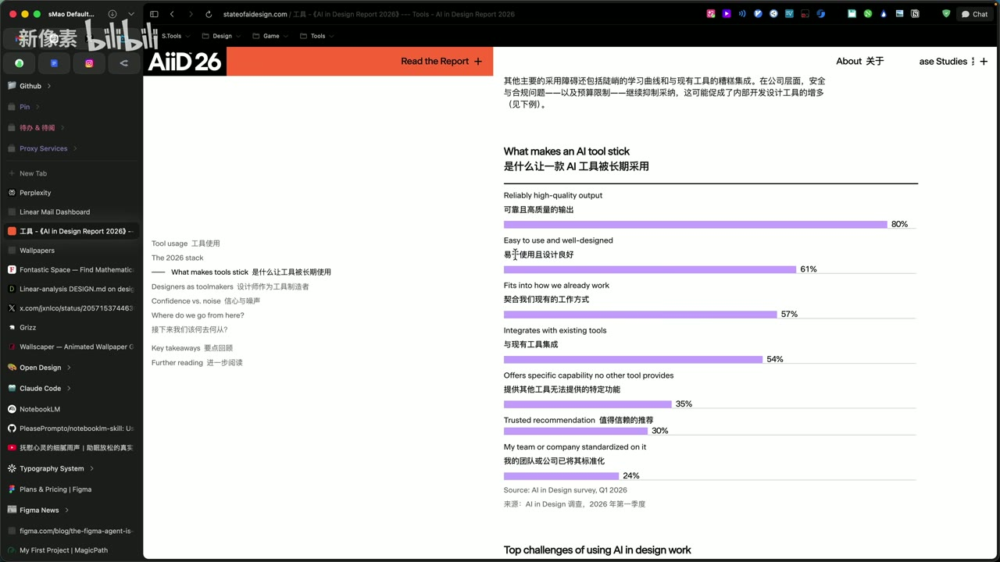

*图 07 · 00:15:47：长期采用因素柱状图显示可靠且高质量输出以 80%领先，易用性、工作流适配和工具集成依次排在后面*

这组数据给工具选择提供了一条清楚的优先级：

1. 同类任务重复执行时，结果是否稳定？
2. 错误能否快速发现、定位和修复？
3. 能否接入现有文件、组件与协作环境？
4. 节省的时间能否覆盖提示、等待、检查和返工？
5. 团队成员是否能够复用这套方法？

报告同时把“不一致的输出”列为设计工作中的首要挑战，视频提到其比例为 62%。生成速度很快，如果每次结果的结构、样式和质量都漂移，设计师会把省下的时间重新花在清理与修补上。[00:15:58]

## 设计师开始制造自己的工具

AI 编程带来的深层变化，是设计师可以围绕一个窄问题制作微型工具：批量切换变量、整理素材、自动处理重复步骤、模拟深色模式、生成特定设备预览，或把团队规范嵌入原型生成流程。[00:16:18]

草帽老师以自己制作多个 Figma 插件的经历说明，这类任务无需先解决完整产品、复杂设计系统或生产级架构。只要一个高频摩擦点足够明确，就可以让 AI 协助写出插件或小程序，先解决眼前问题，再根据真实使用不断调整。[00:16:40]

一个受访者给出了很有代表性的判断：“每次遇到产品或订阅，我会先问，能否用 AI 复制它？”他的实际需求常常只占成熟软件功能的 10%到 20%，因此可以制作更轻、更贴合自己的版本。[00:17:21]

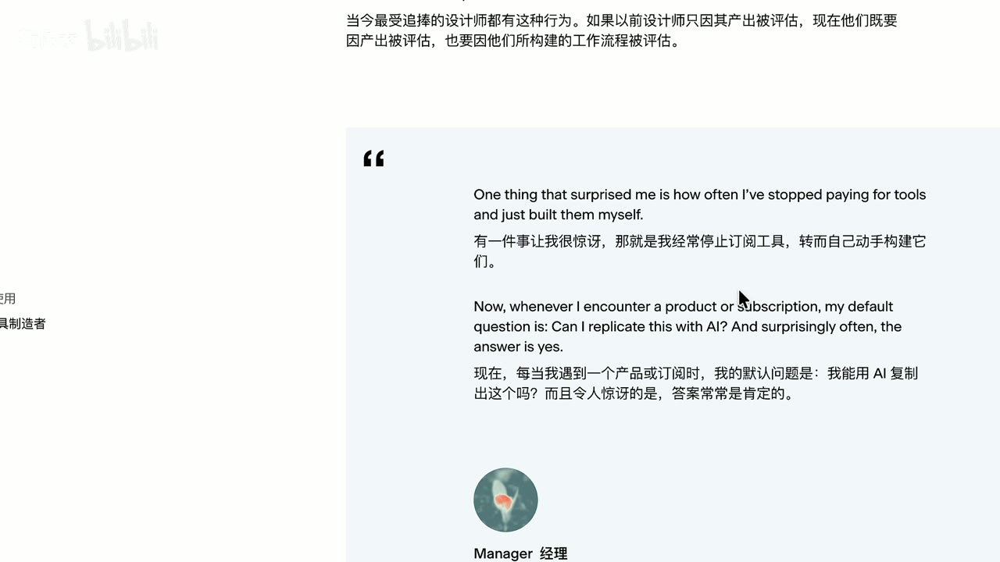

*图 08 · 00:16:52：报告引语明确写出受访者停止为部分工具付费，并在遇到产品或订阅时先询问能否用 AI 自己复现*

这里仍需保留边界。自己制作工具会引入维护、安全、数据处理、兼容性和长期可靠性成本。适合优先自制的通常是目标单一、输入可控、失败可恢复的个人工具；涉及核心数据、多人协作、合规责任和持续运维时，成熟产品仍可能更划算。

设计师在微型工具开发中的优势来自用户体验判断：功能应该放在哪里，操作路径能否缩短，默认值是否合理，反馈是否及时。由于设计者本人就是目标用户，需求和反馈形成短回路，按钮位置、步骤数量和信息层级都可以在使用中连续优化。[00:18:34]

## 从个人工具扩展到团队基础设施

团队级工具开始承担共享规范和跨岗位协作。例如，根据简短想法自动生成多种早期 UI 方向；把字体、颜色和组件规范接入 Claude，使新原型从起点就遵循团队约束；将研究资料、GitHub 自动化和内部知识库连接起来。[00:19:22]

内部工具的采用率随企业规模增大：2000 人以上企业为 74%，随后几个规模区间依次为 48%、34%和 26%；视频说明最小企业区间是 50 人以下。组织越大，流程交接、权限、规范和信息差造成的摩擦越多，也就越有动力建设专用工具。[00:20:02]

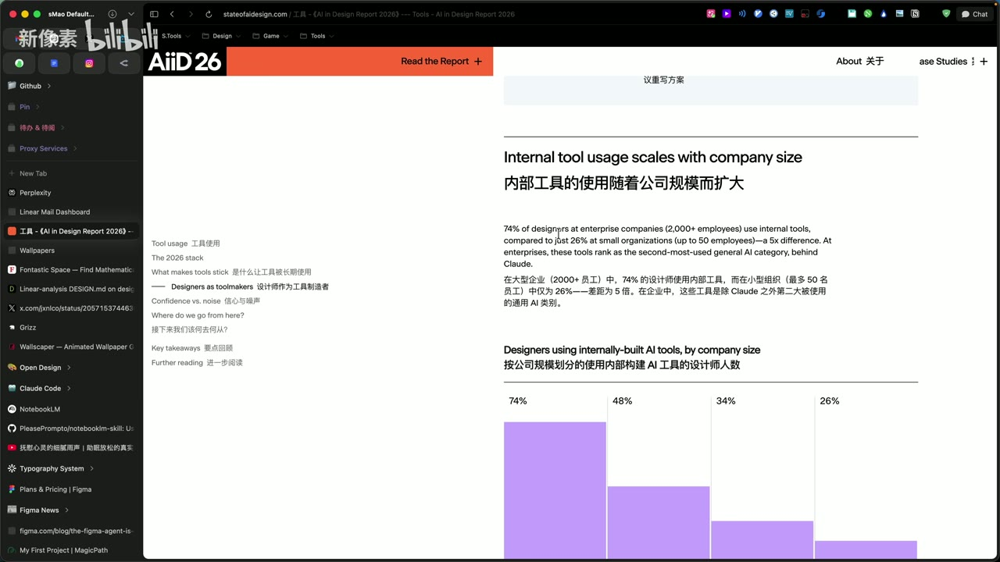

*图 09 · 00:20:08：公司规模统计图显示内部 AI 工具使用率从大型企业的 74%逐级降至较小组织的 26%*

这个关系只能证明规模与采用率相关。企业资源、数据积累、合规需求和内部工程能力也可能同时影响结果，不能把所有差异归结为人数。

## 工具越丰富，确定感和疲劳会同时增加

对于“是否知道不同设计任务该用哪种 AI 工具”，37%的设计师表示明显更有信心，已经为大多数工作流找到固定工具；49%表示稍有信心，掌握了几个工作流，但仍在寻找其他方案；其余受访者认为变化不大、更加迷茫，或上一年尚未使用 AI。[00:20:43]

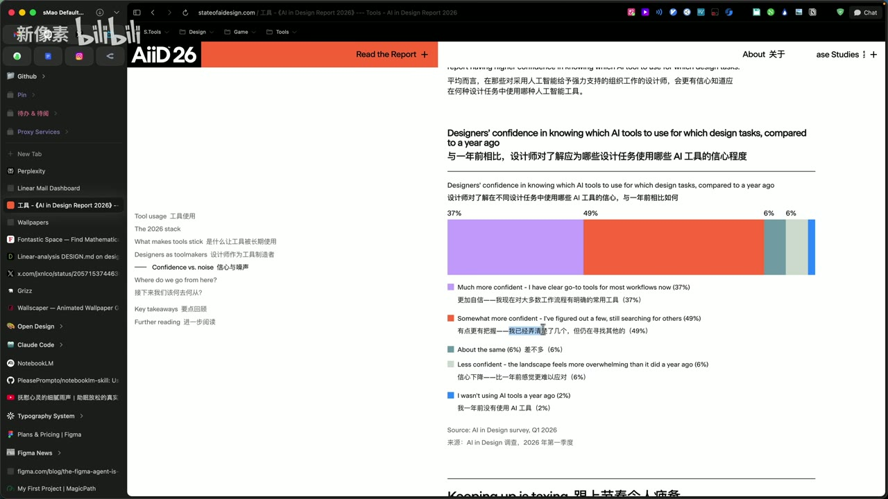

*图 10 · 00:21:13：信心分布图显示 37%已有清晰常用工具，49%掌握部分工作流但仍继续寻找，另有较小比例保持不变或更缺乏信心*

最大的群体仍处于“找到一部分，还在继续找”的阶段。模型和产品高频更新会迫使人持续测试：旧工具还没学透，新版本和新入口又出现。视频由此把 AI 工作量拆成两部分，一部分是完成原任务，另一部分是筛选、学习、迁移和验证工具。[00:21:25]

应对办法是围绕真实项目稳定使用一两个入口。先选择一个能够覆盖主要需求的代码代理或模型，用它完成一件具体作品；当现有工具遇到明确瓶颈时，再补充新工具。这样能够把学习变成项目副产品，避免收藏大量稍后永远不会阅读的资料。[00:22:06]

报告中的从业者也提醒，每天出现的新工具和工作流既令人兴奋，也会制造大量噪音；工作流程若每天变化，很快就难以持续。招聘同样不宜要求候选人已经精通全部新工具，因为技术持续变化，创始人和团队负责人自己也处于探索阶段。[00:22:36]

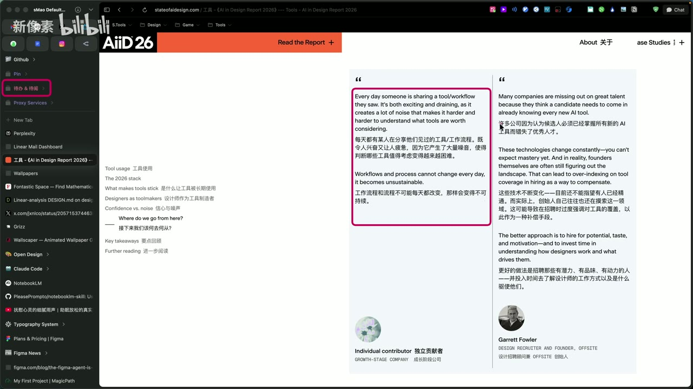

*图 11 · 00:23:24：两栏引语分别指出每日工具分享会制造噪音，以及公司不应把掌握所有新 AI 工具当作招聘前提*

## 品位与细节仍是设计师的责任

AI 可以让缺少设计背景的人快速生成一个“看起来能用”的页面，但产品调性往往取决于更细的判断：字号关系、留白节奏、圆角、对齐、层级、内容密度和整体一致性。单项只差一点，累积后就会显著降低完成度。[00:23:51]

因此，设计师的价值逐渐从亲手绘制每个元素，扩展到定义方向、建立约束、选择方案、发现偏差和完成最后的精修。AI 降低的是产出草案和实现功能的门槛，判断什么值得做、什么已经足够好，仍需要经验与品位。

这也解释了设计师制造工具的优势：编码能力扩大可实现范围，设计能力负责把工具塑造成真正顺手、清楚和一致的产品。

## 边界、疑点与时效性

- 调研对象主要是海外设计师，时间范围为 2026 年第一季度。地区可用性、价格、公司政策和职业结构都会影响排名。
- 页面披露 Anthropic 是该调研的合作伙伴，同时声明调查由合作方独立开展。Claude 相关数字应结合这一披露阅读。
- Claude Design 在调查结束后才发布，因此没有进入本期统计。页面把它列为“后入者”，等待下一份报告观察采用情况。

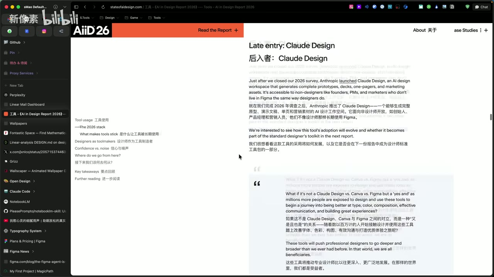

*图 12 · 00:25:35：“Late entry: Claude Design”页面说明该工具在 2026 调查结束后发布，因此未计入本期采用数据*

- 视频中关于模型费用、地区订阅价格、Uber 投入产出和《哈佛商业评论》研究的内容属于录制时转述，本地材料没有提供可独立核验的完整来源。
- Perplexity 使用率下降原因、后续 Codex 排名等属于个人推测，不能当作调研结论。
- 转录存在“Claude”“Cursor”“Figma”等工具名的同音识别错误；可由画面确认的名称已校正，无法确认的品牌和案例细节未继续扩写。
- 候选帧只能证明对应时间点的静态界面，不能单独证明其前后操作过程。

## 时间戳导航

- [00:00:41] 2025 与 2026 年 AI 使用频率变化
- [00:01:31] AI 在不同设计任务中的采用比例
- [00:03:39] Claude、Figma MCP 与 Claude Code 的排版审计案例
- [00:05:32] Figma MCP 如何提供图层、节点和属性
- [00:07:03] 设计师 AI 工具栈从 3 个增至 7 个
- [00:08:47] 通用、设计、编程和知识工具榜单
- [00:10:35] Figma 在 AI 工作流中的三种位置
- [00:13:01] 直接在 Cursor 和代码库工作的设计团队
- [00:14:01] Paper 类代码画布工具演示
- [00:15:14] 什么因素让 AI 工具被长期采用
- [00:16:18] 设计师从工具使用者走向工具制造者
- [00:17:21] “订阅之前先问能否用 AI 自制”
- [00:18:34] 设计师制作微型工具的体验优势
- [00:20:02] 内部工具采用率与公司规模
- [00:20:43] 设计师选择 AI 工具的信心分布
- [00:21:36] 工具更新过快造成额外工作量
- [00:22:06] 选定一个工具，通过真实项目学习
- [00:23:51] 品位、经验和精细化调整仍然重要

## 复习与行动清单

- [ ] 从最近一周的工作中找出一个重复、窄小、失败后容易恢复的摩擦点。
- [ ] 先写清输入、输出、约束和成功标准，再决定使用模型、插件或代码代理。
- [ ] 把构思、原型、文案与正式交付分开，针对不同容错率设置检查强度。
- [ ] 记录每次 AI 任务的生成时间、人工修正时间和可复用程度，观察真实投入产出。
- [ ] 如果使用 Figma 与代码代理协作，优先建立 token、组件命名和结构化节点，减少纯截图转换。
- [ ] 为高频任务固定一套主工具，只有出现明确瓶颈时才引入新入口。
- [ ] 每周完成一个真实的小作品，以产出带动学习，减少无目标的工具收藏。
- [ ] 审查 AI 结果时重点检查信息层级、间距、圆角、对齐、组件一致性和品牌调性。
- [ ] 个人微型工具验证有效后，再考虑权限、数据、安全、维护和团队推广。
- [ ] 把“会用某个热门工具”降为短期能力，把问题定义、审美判断和工作流设计当作长期能力。
