# UI 设计教程：新手 UI 设计师提升审美品位（2026）

> 上传者：新像素 
> 时长：38:34 
> 链接：https://www.bilibili.com/video/BV11zbe61EKp/ 
> ID：BV11zbe61EKp 
> 总结强度：standard 
> 证据：本地逐字稿、SRT 时间轴、转写元数据与 24 张时间戳候选画面。转写整体连续，个别词语有识别误差，以下已按上下文谨慎校正。

## 一句话抓住核心

AI 能快速产出很多界面方案，设计师真正需要建立的是一套可判断、可解释、可反复练习的标准：先用版式原则组织信息，再通过高质量参考建立视觉与交互判断，最后在临摹和改造中沉淀个人能力。

## 推理主干

1. AI 降低了产出门槛，也让“从多个方案中选出更合适的方案”成为更关键的能力。[00:00:08]
2. 审美的基础来自信息层级与视觉秩序，核心练习是对比、重复、对齐、亲密性。[00:03:30]
3. 视觉品位要靠长期接触优秀作品建立内部标尺，并用有目的的浏览替代无目标收藏。[00:17:31]
4. 交互品位需要看已经上线的优秀产品，并理解设计系统为何在特定场景推荐某种做法。[00:29:15]
5. 看案例只能建立输入；真正使判断力稳定下来的，是拆解、临摹、修改和反复比较。[00:35:50]
6. 基础主干稳定后，再向视觉、动效、交互或其他个人兴趣延伸，形成自己的专长。[00:36:26]

## 先把“好看”拆成可判断的结构

### 1. 对比：让用户第一眼知道先看什么

对比服务于层级。标题、正文、按钮、辅助信息应通过字号、字重、明暗、色彩、形状或留白拉开距离；若所有元素都接近同一强度，页面就缺少阅读入口。[00:04:05]

一份“季度设计回顾”的前后对照中，改后将标题显著放大并换成衬线字体，正文保持克制，行动文字用绿色与箭头突出。这里的重点是让标题、说明与行动入口承担不同的视觉权重。

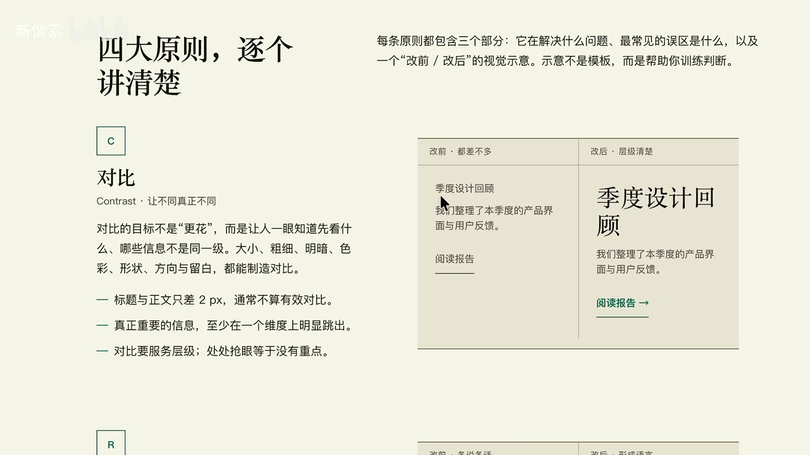

*图 01 · 00:04:01：画面右侧的“大标题、正文、绿色阅读报告”形成清晰的三级信息层级。*

对比也有边界：真正重要的信息必须可读。小字、浅色、装饰字体可以用于弱信息或装饰，不能侵蚀正文与操作信息的可读性。[00:12:22]

### 2. 重复：让同类信息呈现可预期的规律

先对全部内容分组，再让同类元素共享样式。相同层级的标题、日期、图标、按钮或说明文字采用稳定规则，用户就能快速判断结构；每个同类元素都单独加框、换背景或换样式，会制造无意义的噪声。[00:04:30]

重复无需机械到每一个元素完全一样。日文与英文翻译、标题与副标题可以承担不同层级，只要这种对应关系在页面中持续出现，读者就能理解它们的关系。[00:06:31]

### 3. 对齐：用隐形线把分散元素组织成整体

对齐感来自共享的左边缘、中心轴、右边缘或网格线。元素多时，这些隐形线尤其重要：页面的外轮廓和阅读路径会变得稳定，即使局部大小不同也不会散。[00:05:27]

团队周报的示例中，改后用一条橙色竖条、统一的左边缘与一致的文字起点把内容收拢到同一主轴；改前的标题和正文介于居中、左对齐之间，关系模糊。

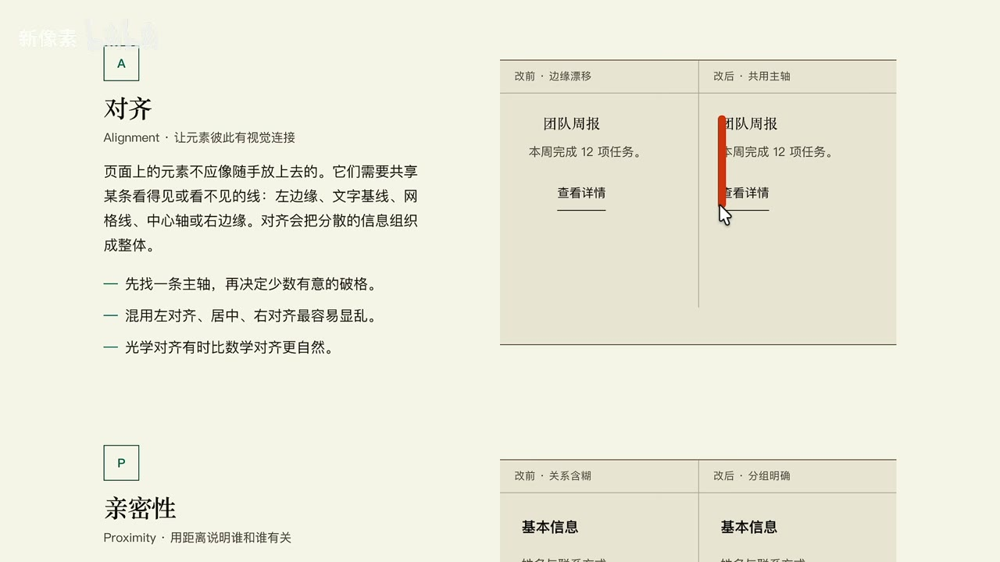

*图 02 · 00:05:37：画面右侧的橙色竖条、标题、正文与链接共享左侧主轴，直接展示对齐如何建立秩序。*

对齐追求的是视觉秩序，不要求把每一处都锁成死板方格。局部错落只要拥有明确的间距和对应关系，也能形成呼吸感。[00:08:43]

### 4. 亲密性：用距离表达“谁和谁是一组”

内容间距本身就是信息语言。组内距离更近，组间距离更大，用户即使不读完文字，也能先判断一组信息的边界和层级。[00:06:52]

练习时可先拿一段真实或虚构的信息：个人资料、教育经历、工作经历、奖项、联系方式。先决定哪些内容属于同一组，再只用间距、对齐、字重和留白组织它们，避免急着添加装饰。[00:08:09]

简历练习画面把姓名、照片、联系信息、经历和教育信息排入不同区域；紫色标记强调了经历条目内部的靠近关系，以及大区块之间的区隔。

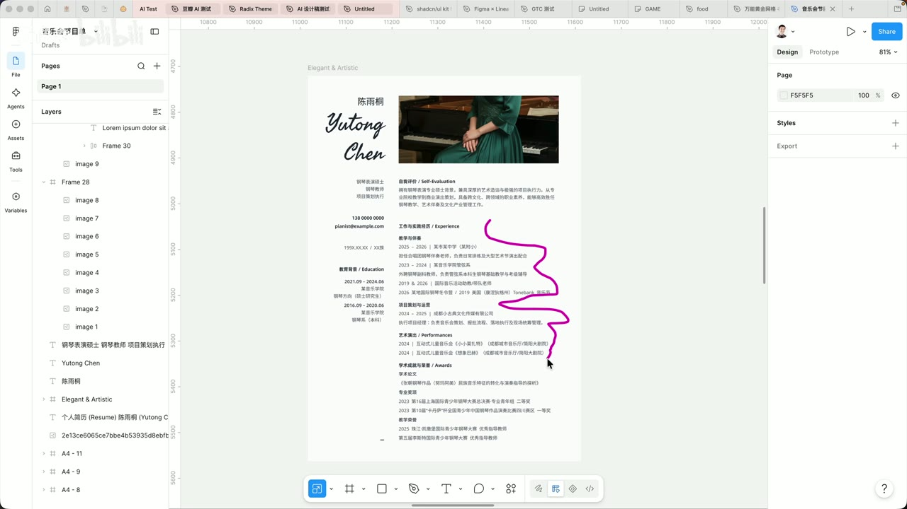

*图 03 · 00:08:50：Figma 中的简历将个人信息、经历和教育分区排布，紫色标记指向条目组内的紧密间距。*

## 形式感：在秩序上加一个有控制的记忆点

形式感是页面里能迅速抓住注意力的视觉组织，例如夸张的英文名、大面积留白、粗大的字、特殊的图片裁切或小型装饰线。[00:09:29] 它建立在前面四项原则之上：先保证结构可读，再让少数弱信息承担夸张表达。

一个实用判断是：把某个元素当作装饰前，先确认它不承担关键阅读和操作任务。装饰文字可以很小，装饰线可以只承担平衡画面的职责；关键内容依然要保留足够清晰的尺寸、对比与位置。[00:12:03]

练习素材适合从信息较少的名片、海报单页、简历或节目单开始。元素少时，每一次调整字号、留白、边缘和文本分组都会更容易被看见，也更容易复盘。[00:14:58]

### 用网格约束自由摆放

“万能黄金网格”在这里被当作初学阶段的摆放约束：先把画面空间划成可对齐的格子，再让标题、图片、数字、装饰和留白与网格发生关系。[00:15:58] 它无法替代判断，却能减少随意摆放带来的失序。

设计稿中显示了密集的红色参考线与多个矩形区域；文本、图形和图片区块沿同一套网格定位，说明网格更像是构图的隐形骨架。

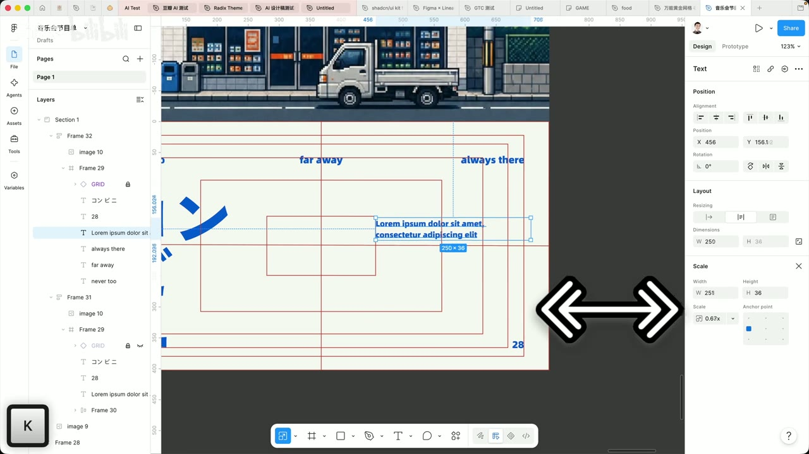

*图 04 · 00:16:52：画面中的红色网格线、矩形参考区与被选中的文本共同呈现了用网格控制版式的位置关系。*

## 建立视觉品位：把浏览变成主动采样

视觉审美的提升依赖“看足够好的作品”。关键不在收藏数量，而在于持续接触高质量案例，逐渐形成对层级、留白、比例、细节和克制程度的内部标尺。[00:18:02]

### 以优秀设计师为锚点，沿关联网络扩展

可先选择与目标方向匹配的成熟设计师作为锚点，观察其作品、转发、关注列表、教程和讨论区，再由此找到更多同类创作者。[00:25:17] 这种“顺藤摸瓜”的方式能避免只停留在平台首页的随机内容里。

按钮案例中，同一类按钮通过阴影强度、描边、发光轮廓、状态色和留白差异表达层次；细节并不多，处理却非常克制，适合拿来拆解“同一组件如何做出不同状态”。

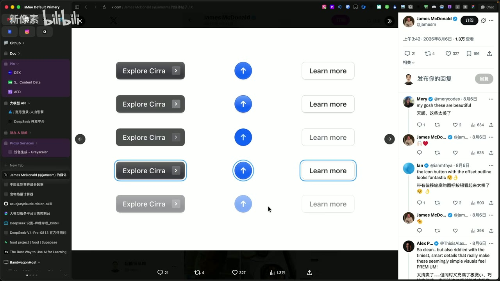

*图 05 · 00:18:28：画面并列展示多组按钮与圆形箭头的常态、强调态和弱化态，可直接观察阴影、描边和明度的细微变化。*

### Pinterest：用画板训练推荐系统

Pinterest 的价值在于相近案例会不断延伸。看到符合目标的版式、印刷设计或视觉风格后，持续保存到主题明确的画板；画板内容越集中，后续推荐越接近自己的需求。[00:20:05]

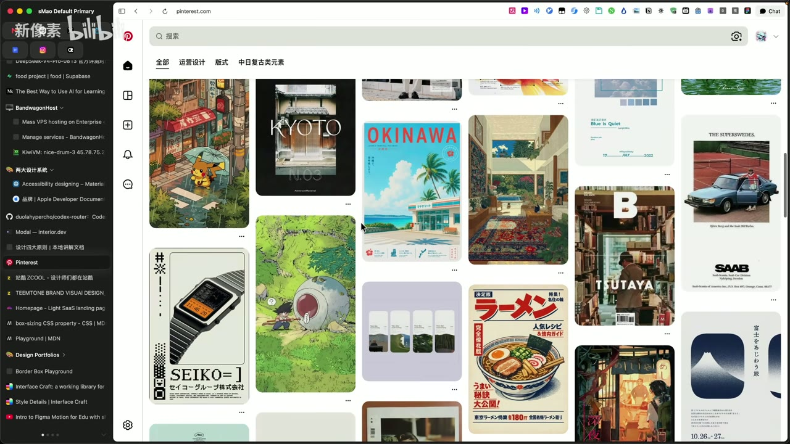

*图 06 · 00:20:05：Pinterest 搜索结果以瀑布流集中呈现日式视觉、海报、杂志与插画案例，适合沿单个偏好继续扩展参考。*

画板应按明确主题维护，例如“中日复古元素”“UI”“运营设计”“版式”。同时定期在推荐设置中移除无关兴趣，让输入流保持聚焦。[00:21:03]

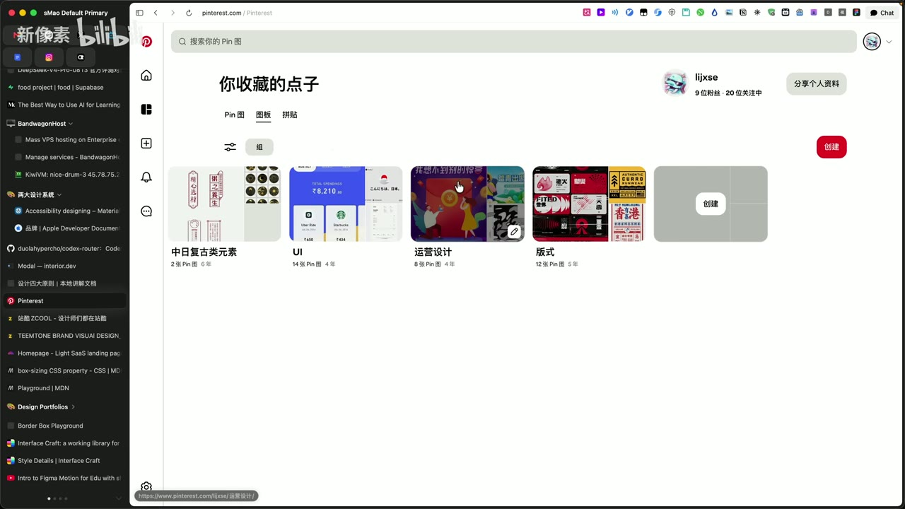

*图 07 · 00:21:41：Pinterest 的收藏页将内容分入“中日复古元素、UI、运营设计、版式”等画板，体现按主题积累参考的方式。*

### 榜单与创作者平台：带着问题看

榜单适合快速接触经过筛选的高质量案例。查看网页、UI、平面、动效等分类时，不只判断“喜欢或不喜欢”，还要带着具体问题：页面如何衔接？大图与下一段如何过渡？文本和图片区块如何对齐？[00:22:42]

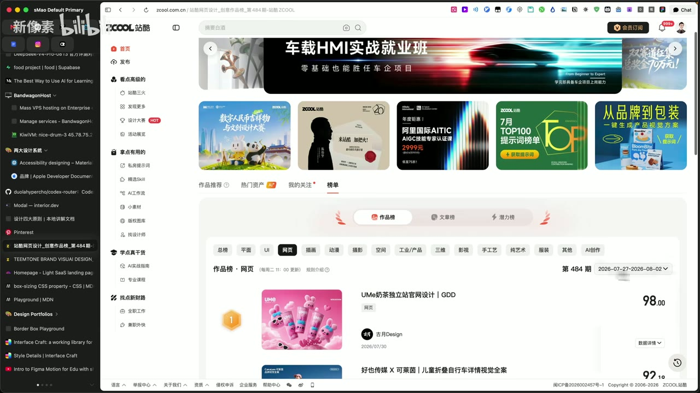

*图 08 · 00:23:18：站酷榜单页面显示网页分类、期数与作品排名，可作为按类别筛选优秀案例的入口。*

Instagram 等以小图为主的平台更适合关注制作技巧、过程拆解和创作者网络；看见感兴趣的创作者后，继续查看其关注对象和相关推荐即可扩展样本。[00:24:42]

## 建立交互品位：从“好看”走到“为什么这样用”

当 AI 同时生成多个界面方案时，真正困难的部分往往是判断哪一个更适合任务、情境和用户行为。[00:29:09] 这种判断需要接触真实产品，理解组件与交互选择解决的具体问题。

### 用精选信息接触已上线的产品

设计周刊或行业精选的作用是从信息洪流中筛出值得进一步打开的产品、文章、案例与工具。优先关注已经上线、可实际体验的产品，再观察它的交互、页面组织、状态反馈和设计取舍。[00:27:58]

### 把 Apple 与 Material Design 当成交互基础课

Apple 人机界面指南与 Google Material Design 都提供了“什么场景适合什么交互、为何推荐、哪些做法应避免”的上下文。[00:29:41] 初次阅读不必逐条背诵，可以先完整浏览一遍，在真实项目遇到问题时回到相应章节复查。

Apple 的设计原则页面把目标感、能动性、责任感、熟悉感、灵活、简洁、匠心和愉悦感排成清晰层级，提示交互设计的判断既包含任务效率，也包含用户对系统的感受。

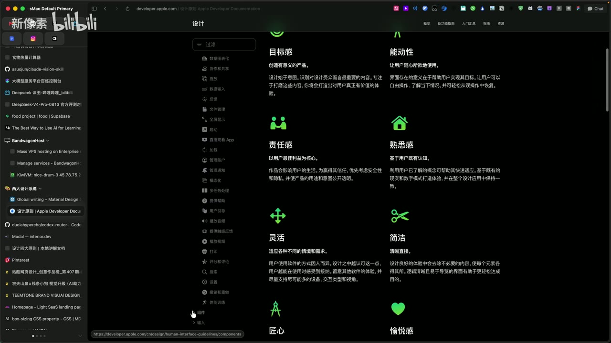

*图 09 · 00:31:20：Apple 设计指南页面以图标和简短说明列出“目标感、能动性、简洁、愉悦感”等原则。*

Material Design 的图标规范通过推荐与不推荐的成对示例说明：小尺寸图标应优先保证轮廓清楚、识别迅速，过于具象和细节繁多会降低可读性。[00:33:01]

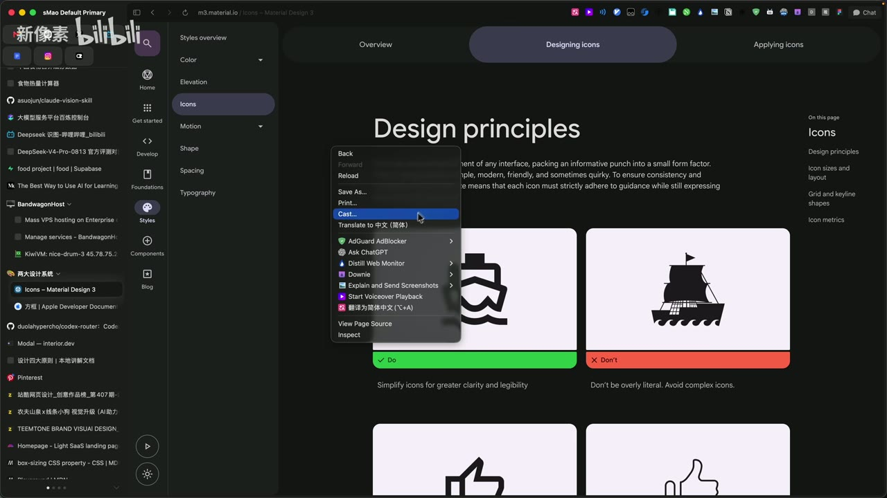

*图 10 · 00:32:56：Material Design 的图标页面用“Do / Don’t”对照展示简化图标与细节过多图标的差异。*

遇到术语、规范或英文解释无法理解时，可以请 AI 用更低门槛的语言解释，再回到原始规范确认其对应的场景和约束。[00:31:38]

## 从看懂到会做：临摹、拆解与迁移

临摹的价值在于逼迫自己做出微观判断：间距差多少、文字该多大、阴影叠几层、光从哪里来、边缘为何要更亮或更暗。[00:35:50] 不必只复制完整作品，也可以抽取一个按钮、一个图标或一段卡片关系反复练习。

图标重建过程展示了先在 Figma 中以基础形状搭出结构，再通过多层深浅、透明材质和高光处理获得最终体积感。练习重点是理解每一层效果承担的角色，再迁移到其他组件。

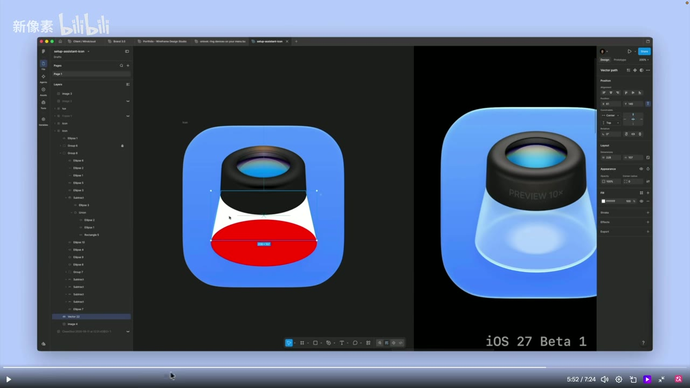

*图 11 · 00:34:33：画面左侧是由基础形状构成的图标结构，右侧是加入透明材质、高光与阴影后的完成效果。*

真正学会一个技巧，意味着换成另一个元素后仍能重建相同的逻辑：知道为什么加内阴影、为什么加外阴影、为什么多一层边缘光，而不只复现某一张图。[00:35:06]

## 边界、疑点与时效性

- 视频中的平台、设计师账号、榜单、周刊、产品页面与付费信息均为录制时的推荐线索，当前可用性、价格、内容与界面可能已变化。
- “优先看 Apple”与“Material 改版频繁”等判断属于讲述者的个人经验，可作为学习路径参考，不应替代项目平台、用户与业务约束。
- 结尾包含线下培训推广；学习方法部分与课程服务信息需分开评估。
- 转写中“审美”“Figma”等词出现过明显识别偏差，笔记只在上下文充分时进行了校正，未能确认的专有名称没有扩写。

## 时间戳导航

- [00:00:08] AI 让方案产出更容易，选择能力更重要
- [00:01:01] 先走学习主干，再发展个人偏好
- [00:03:30] 四大版式原则：对比、重复、对齐、亲密性
- [00:08:09] 用简历信息练习分组、留白与排版
- [00:09:29] 形式感与装饰元素的使用边界
- [00:14:58] 名片、单页适合做版式基础练习
- [00:15:58] 用网格建立摆放约束
- [00:18:02] 看顶尖案例建立审美基准
- [00:20:49] Pinterest 画板如何影响推荐
- [00:23:31] 带着具体问题逛榜单和参考站
- [00:25:17] 从优秀创作者的关注网络继续扩展
- [00:27:58] 用精选周刊获取优质产品与行业信息
- [00:29:41] Apple 与 Material Design 的学习价值
- [00:33:01] 用 Do / Don’t 案例理解图标规范
- [00:35:50] 临摹、反复调节与迁移才会沉淀能力
- [00:36:26] 在基础主干上发展个人专长

## 复习与行动清单

- [ ] 选一页简历、名片或活动单页，先只用四大原则完成一次重排。
- [ ] 为 Pinterest 建 3 个主题清晰的画板，连续一周只收集与当前练习相关的案例。
- [ ] 每周挑 1 个已上线产品，记录它的一个交互选择、适用情境与可能的替代方案。
- [ ] 用 Apple 或 Material 的一个章节校验当前项目中的组件选择。
- [ ] 临摹一个小组件后，立刻换内容、尺寸或平台再做一版，检验自己是否掌握了方法。
