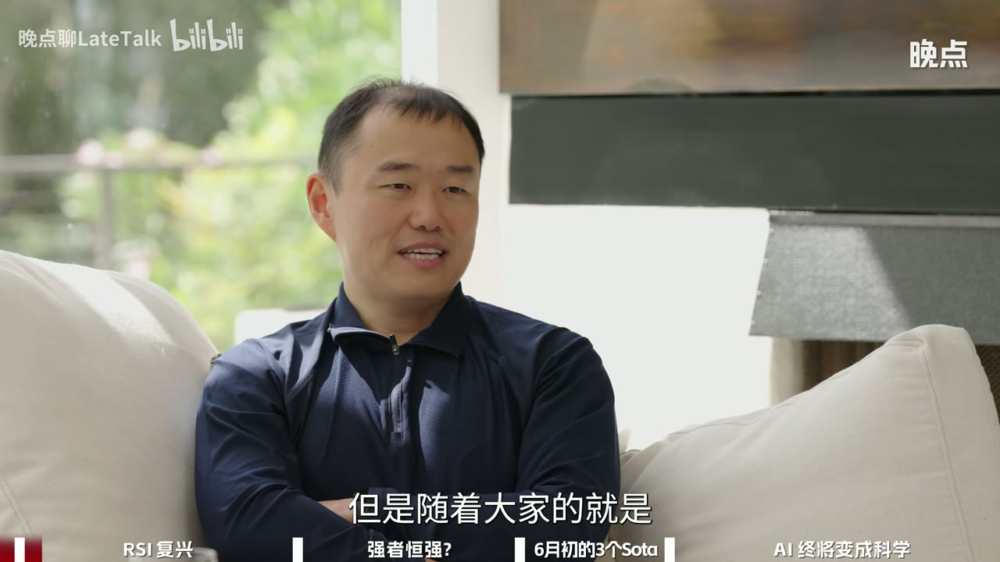
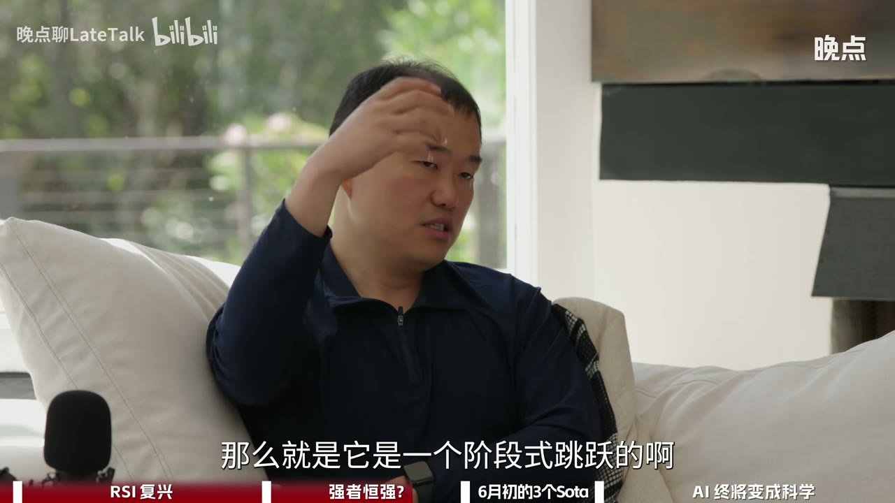
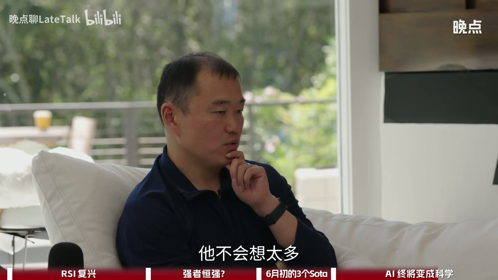
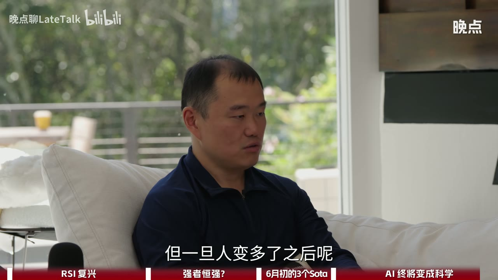

# 对话田渊栋：AI 自进化如何到来【晚点聊 LateTalk】

> - **UP 主：** 晚点聊LateTalk 
> - **嘉宾：** 田渊栋 
> - **时长：** 01:24:28 
> - **视频 ID：** BV1XnuH66EzS 
> - **来源：** [Bilibili 原视频](https://www.bilibili.com/video/BV1XnuH66EzS/) 
> - **总结强度：** deep 
> - **证据：** 本地视频逐字稿、SRT 与 12 张定时画面。转写由 faster-whisper small 生成，中文识别置信度约 99.24%，全片语音覆盖较连续。英文专名、模型版本和公司名存在少量识别误差，本文只做谨慎校正；访谈中的融资、产品进展和性能数字均属录制时陈述，未作外部核验。

## 一句话抓住核心

田渊栋所说的 RSI（Recursive Self-Improvement，递归自进化），核心是一条越来越快的研究闭环：AI 参与发现模型问题、提出方案、写代码、运行实验和读取反馈；改进后的模型再参与下一轮研究。当前可行形态仍需要人类承担问题定义、研究品位和高层判断，距离完全自主的“AI 科学家”还有创造性抽象、跨尺度迁移、评价体系、可解释性与安全等关键台阶。

## 时间戳导航

- [00:02:37] RSI 公司的目标：让 AI 参与改进 AI，探索新模型、新训练逻辑和新范式。
- [00:04:16] RSI 最近升温的直接背景：模型能力和 Coding Agent 同时增强。
- [00:06:00] 田渊栋与 GPT-5 合作研究后，开始感到 AI 已能进入真实科研流程。
- [00:08:42] 高层研究判断必须与亲手实验结合，否则方向容易脱离实际。
- [00:10:30] AI 将一次科研验证从数天压缩到数小时甚至数分钟。
- [00:13:46] 当代 RSI 与十年前 AutoML、架构搜索的根本差异。
- [00:16:01] 递归改进可以先发生，完全自动化仍很遥远。
- [00:17:33] 更强模型参与改进自身，可能形成加速循环。
- [00:19:02] Anthropic 案例在田渊栋看来仍以提效和指标优化为主。
- [00:20:40] Coding Agent 与 AI Research 之间仍有能力鸿沟。
- [00:25:54] RSI 的问题空间、研究难度和潜在路径都远大于代码生成。
- [00:28:34] AI 科学家需要研究品位、方向感、抽象能力和创造力。
- [00:34:15] RSI 具有多级台阶，低级能力也能产生实际价值。
- [00:36:41] “率先进入 RSI 就永远领先”的逻辑及其成立条件。
- [00:37:57] 田渊栋提出“增长—平台—突破—再增长”的阶段式路径。
- [00:39:27] Scaling Law 仍可能有效，但资源投入面临物理与经济上限。
- [00:44:26] RSI 公司公开的第一阶段成果：三个可快速反馈的优化任务。
- [00:48:18] 第一阶段目标很朴素：先让通用系统跑起来并产生可靠结果。
- [00:51:31] 小模型基准上的成果迁移到前沿大模型仍存在明显鸿沟。
- [00:53:03] RSI 当前缺少清晰的数据方法，也高度依赖算力和评价信号。
- [00:54:59] 可解释性可能成为突破 Scaling Law 局限的重要方向。
- [00:56:16] RSI 的安全问题、训练压力、意识与创造力之间的区分。
- [00:57:41] 田渊栋相信神经网络背后存在可理解的统一原理。
- [01:02:24] 他的长期目标：让 AI 从经验工程走向真正的科学。
- [01:06:57] 从 Google 无人车、FAIR 到 RSI 的个人研究路径。
- [01:13:33] 两类研究员：指出大方向，以及进一步拆出实现路径。
- [01:19:02] 大组织的层级、激励和信息损耗为何拖慢 AI 研究。
- [01:21:52] 技术品位的终点：追求美，也接受工程现实的约束。

## 核心问题与推理主线

这场访谈持续追问四个问题：

1. RSI 究竟是什么，为什么在此时成为热门方向？
2. 当前系统已经做到哪一步，距离真正的 AI 科学家还有多远？
3. 先进入 RSI 的团队会不会形成无法追赶的优势？
4. 如果 AI 可以持续改进 AI，人类研究员、科研组织和安全体系将发生什么变化？

田渊栋描述的基本闭环可以压缩为：

> 发现问题 → 提出假设 → 写代码与运行实验 → 获得量化反馈 → 选择有效改进 → 得到更强模型 → 用更强模型进入下一轮

这条闭环有两层反馈：

- **任务层反馈：** 性能、速度、BPP、延迟或算子效率等明确指标是否改善。
- **能力层反馈：** 改进后的模型能否提出更好的研究问题、理解更复杂的现象并加速下一轮实验。

当前系统较擅长第一层。第二层需要模型理解稀缺数据、形成新概念、判断研究方向，并发现已有知识体系之外的解释。田渊栋把这视为真正困难的部分。

## 一、RSI 为什么在此时复兴

RSI 的想法早已存在。最近的变化来自两个条件同时成熟：[00:04:16]

- 模型开始具备一定程度的 AI 知识，能阅读代码、分析模型问题并参与实验。
- Coding Agent 可以把自然语言想法快速转化为代码和可运行的实验。

过去，导师提出方向，学生实现、调试、汇报，一轮反馈往往需要数天，完整项目可能持续数月。AI 加入后，一个较简单的想法可以很快变成实验：研究者提出细节，Agent 编写代码并运行；研究者开完会或喝完茶，结果可能已经返回。[00:09:57—00:11:03]

这种速度变化重新提升了资深研究者的价值。以往许多经理或研究负责人有想法，却缺少亲自实现的时间，团队也无法验证每个设想。Agent 接手部分执行工作后，人类可以把更多精力放在判断、研究品位和方向选择上。[00:12:48—00:13:42]

*图 01 · 00:03:31：画面中的田渊栋正在解释 RSI 从小众概念逐渐成为行业共识的背景。*

田渊栋的个人转折发生在他与 GPT-5 合作完成一项 Grokking 研究时。他发现，自己可以给出细节和方向，让模型提出想法、证明定理，再由代码实验检验。这个闭环开始真正转动后，他产生了“五年后自己也许会被取代”的判断，并给出颇具个人色彩的回应：“与其自己被取代，不如我就开公司。”[00:06:00—00:07:00]

他的经验强调了一个容易被忽略的条件：只有把模型当作研究合作者，拿它解决足够具体、足够困难的问题，才能真实感知能力边界。仅把模型用作聊天对象或简单执行工具，很难察觉科研工作方式正在发生什么变化。[00:07:18—00:08:27]

## 二、从 AutoML 到当代 RSI：AI 开始参与定义问题

十年前的 AutoML、神经架构搜索和 AI-guided optimization，同样在使用算法优化算法。那一代方法通常由研究员预先定义搜索空间、变量和评价方式，AI 只在封闭空间里寻找更优解。[00:13:46—00:14:36]

当代大模型带来的变化，是模型已经能够理解部分高层知识和架构语义。因此，它有机会参与下列工作：

- 改写问题定义；
- 扩大或重构搜索空间；
- 选择工具和实验；
- 综合外部知识；
- 从实验反馈中提出下一步方向。

这使搜索空间更大，也更智能。但由此产生的新难点是：怎样让模型自己发现有价值的空间结构，避免在庞大空间中机械搜索。[00:14:37—00:15:24]

### 递归改进与完全自动化是两个维度

田渊栋判断，递归改进可能先于完全自动化发生。[00:16:01]

AI 能力提升后，低层工作逐渐由模型完成，人类转向更高层的问题定义、方向判断和结果审查。人的操作时间可能减少，认知负担和判断要求反而提高。因此，未来一段时间更可能出现“人处于更高层闭环”的结构。

真正的递归性来自能力回流：模型改进后，能够理解更深的问题，形成更强的 Agent 或 AI Scientist，再进一步寻找自身缺陷。[00:17:33—00:18:04]

*图 02 · 00:17:35：字幕“让自己变得越来越强”对应 RSI 的能力回流：改进后的模型继续参与下一轮改进。*

## 三、Coding Agent 距离 AI 科学家还有多远

Coding Agent 的核心角色偏向执行：目标和验收条件相对清楚，它负责实现、调试和完成任务。RSI 面对的研究空间更开放，连正确问题、评价方式和实现路径都可能未知。[00:20:40—00:21:24]

例如，从头写一个操作系统或编辑器虽然繁重，整体目标和工程路径已有历史经验可循；真正困难的 AI Research Problem 可能连人类也不知道该怎样解决。模型需要发现新概念、新机制和新理论，无法单靠已有模式的重组完成。

田渊栋认为，AI 科学家至少需要四类能力：[00:28:34—00:30:30]

1. **研究品位：** 判断什么问题重要，什么方向值得长期投入。
2. **抽象能力：** 从纷繁表象和少量样本中抽取核心结构。
3. **创造力：** 将抽取出的概念迁移到未出现过的新问题。
4. **Agent 能力：** 调用工具、搜集知识、设计实验并把复杂步骤组织成任务链。

今天的大模型依赖海量数据，在常见任务和重复性工程上表现强大。开创性科学问题的数据天然稀缺，每次实验还会暴露新问题。模型必须用极少证据形成精准联系，这正是人类顶尖研究员仍然占优的区域。

*图 03 · 00:24:38：双人访谈画面中，主持人继续追问 RSI 从小众方向走向行业热点的过程。*

### RSI 是一座多级台阶

田渊栋并未要求第一阶段系统立刻成为牛顿或爱因斯坦式科学家。RSI 可以逐级产生价值：[00:34:15—00:35:09]

- 优化既有算法、速度和资源效率；
- 改进预训练、后训练和系统结构；
- 发现新的架构或训练方法；
- 最终从少量样本中形成深层理论。

低层台阶已经有工程价值。最高台阶极难，却不影响中间成果被应用。

## 四、“强者恒强”是否必然成立

硅谷围绕 RSI 的一个诱人假设是：最早实现递归自进化的组织会获得更强模型；更强模型又能更快研究下一代模型，于是领先优势持续扩大，后来者逐渐失去入场机会。[00:36:27—00:36:47]

田渊栋认可这种可能性，同时给出一个关键修正：AI 进展可能呈阶段性跳跃，而非持续平滑增长。

他设想的轨迹更接近连续的 S 型曲线：

1. 新范式出现，性能快速增长；
2. 现有范式逐渐逼近上限，进入平台；
3. 新理论、新架构或新训练逻辑带来突破；
4. 系统跃迁到下一层，再经历增长和平台。

如果增长完全由 Scaling Law 平滑推动，拥有最多算力、数据和领先模型的大公司确实更容易一路领先。若发展依赖范式突破，平台期就为新团队留下机会。[00:37:23—00:39:27]

*图 04 · 00:38:42：字幕明确写出“它是一个阶段式跳跃的”，对应增长平台与范式突破的判断。*

Scaling Law 仍可能成立，但横轴投入通常按指数增长。为了得到有限提升，可能需要十倍数据、算力和能源。全球电力、芯片供应、资金和组织能力都会形成现实边界。[00:39:27—00:40:08]

因此，创业公司的机会来自对新范式的判断。如果团队只相信扩大现有路线，留在资源雄厚的大公司更合理；创业需要看到某个主流路线之外、尚未被充分验证的差异。

## 五、从 AI for AI 到更大的科学愿景

RSI 公司首先选择 AI for AI，因为 AI 研究拥有可执行的代码、可重复实验和较快的反馈。若系统能发现新架构、新理论或新训练算法，说明它已经对一个复杂问题形成较深理解。届时，同类能力才有机会迁移到其他自然科学领域。[00:43:38—00:44:08]

田渊栋对更远未来抱有强烈个人想象：当超越人类的智能广泛存在，物质欲望可能被高度满足，疾病等现实痛苦可能得到解决。但丰裕也会削弱人的行动动力。他提到自己的科幻小说曾通过“重启虚拟社会、重新引入价格系统”等设定，讨论享受便利与保持社会动力之间的矛盾。[00:41:40—00:43:17]

这部分属于嘉宾的科幻想象，并未被表述为公司的近期路线图。

## 六、第一阶段成果：先让闭环跑起来

RSI 公司在访谈所述的 6 月 11 日公开了三个方向的初步成果：[00:44:12—00:44:58]

| 任务 | 评价重点 | 访谈中的结果描述 |
|---|---|---|
| nanoChat 五分钟训练 | 固定算力和时间下的模型效果 | BPP 低于社区已有成绩 |
| nanoChat Speedrun | 完成训练所需时间 | 在社区长期优化的成绩上继续缩短约两秒 |
| GPU 算子优化 | 训练与推理基础设施效率 | 在 NVIDIA 新基准上找到优于既有 SOTA 的算子 |

三个任务由同一套系统完成。它们共同具备一个重要性质：反馈快、评价明确，系统可以迅速知道一次改动是否有效。[00:46:33—00:48:07]

*图 05 · 00:45:45：主持人以“为什么要去做这件事”追问算子基准的选择依据和实际价值。*

田渊栋特别强调算子优化结果。按他的陈述，团队缺少传统 GPU 专家，却依靠通用 RSI 系统，在该基准上超过由专业 GPU 工程师组成的 WAI 团队约 10%。他把这视为通用研究系统可以跨越专业经验门槛的初步证据。[00:49:09—00:50:44]

nanoChat Speedrun 的绝对变化看起来只有约两秒，但此前约 79 秒的成绩已经是社区持续优化两年的结果。在接近局部上限时，继续缩短到约 77 秒具有不同于早期大幅改进的难度。[00:50:51—00:51:31]

### 这些结果尚未证明什么

三个 SOTA 说明系统能在明确指标和快速反馈的任务上寻找有效改进。它们暂时无法证明系统已经具备开放式科学创造力，也无法证明同样的方法可直接迁移到前沿大模型。

当前 nanoChat 测试大致处于 GPT-2 级别的小模型规模。田渊栋明确承认，迁移到更大模型和更复杂架构仍有鸿沟，团队还在继续探索。[00:51:31—00:52:01]

第一阶段的目标因而很克制：让系统跑起来，确认它能在多个任务上产生初步结果，再逐渐扩展到预训练、后训练和更广泛的问题。[00:48:18—00:48:54]

*图 06 · 00:52:47：画面字幕提到 OpenAI 的阶段路线图经历多年形成，衬托 RSI 当前仍处于早期探索期。*

## 七、RSI 当前最缺什么

### 1. 评价信号

递归优化必须知道什么叫“更好”。当前最可靠的反馈仍是分数：性能、速度、延迟、BPP、正确率或资源消耗。没有可信指标，系统很难筛选改进。[00:19:18—00:20:12]

指标也可能限制探索。系统容易优化可测量的局部结果，却难以判断一个新理论是否真正重要。

### 2. 数据

田渊栋表示，RSI 应该使用什么数据、怎样构造数据、遵循什么准则，行业尚无定论。容易获取的数据未必有效，高质量数据可能昂贵或难以生成。[00:53:03—00:53:56]

### 3. 算力

RSI 本身需要大量探索、训练和实验。团队必须同时解决两个方向：

- 降低每轮探索的计算成本；
- 让相同算力产生更多有效发现。

访谈提到公司首轮融资 6.5 亿美元，田渊栋认为足以支持早期工作，但距离前沿大厂的资源规模仍有差距。[00:53:57—00:54:34]

### 4. 跨尺度迁移

小模型上的发现是否适用于前沿模型，需要实际检验。规模扩大后，训练动态、系统瓶颈和最优结构都可能变化。

### 5. 可解释性

田渊栋将可解释性视为 Scaling Law 之外的重要方向。理解模型为何形成某种能力，可能提供新洞见，减少盲目搜索，并同时改善性能和安全。[00:54:44—00:55:20]

## 八、安全：创造力、意识与控制需要分开讨论

面对“AI 自我进化后会不会脱离人类控制”的问题，田渊栋提出两层回答。

第一层是训练压力。他用驯化犬类作类比：人类持续奖励服务、协作和解决问题的行为，模型在这种选择压力下发展，并不天然需要形成与人类相同的权力欲或自我意识。[00:56:16—00:56:42]

第二层是能力拆分。科学创造力与主观意识、权力欲望可以彼此分离。他以专注数学或物理、对世俗权力兴趣有限的天才作类比，说明高水平认知能力并不自动推出控制欲。[00:56:44—00:57:17]

这些属于嘉宾的判断，访谈没有给出足以验证该安全结论的实验。驯化类比也无法覆盖目标错配、欺骗行为、分布外失效和系统级竞争等全部风险。

更坚实的安全路线仍落在可解释性：知道模型调用了什么能力、哪些结构在起作用、怎样得到结果，才能减少对黑箱的恐惧，并为监测和干预提供基础。[00:57:19—00:57:37]

*图 07 · 00:59:49：田渊栋说明自己对训练机制和模型学习方式的分析已经持续多年。*

## 九、AI 最终会从工程经验变成科学吗

田渊栋自称属于少数派：他相信复杂神经网络背后存在可以理解的原理。找到这些 principle，一方面可能让模型更强，另一方面可能让模型更安全。[00:57:41—00:58:10]

他的历史类比是：

- 炼金术逐渐转化为化学；
- 第谷积累观测；
- 开普勒总结规律；
- 牛顿提出统一原理。

当前 AI 更接近大量实验、经验定律和工程技巧共同推动的阶段。深度学习从 2013—2014 年起曾被重整化群、自旋玻璃、神经正切核、高斯过程等不同理论解释，但尚未形成令人普遍满意的统一框架。[00:31:47—00:33:19]

AI 的工程发展并未因此停下。可真正称作 AI 科学家的系统，最终还要能研究“模型为什么学会”“涌现怎样产生”“哪些机制可以跨问题复用”等开放问题。

田渊栋用“术”和“道”区分两个层次：[01:05:40—01:06:30]

- **术：** 通过搜索和模式变换，少做一次矩阵乘法、降低延迟或提高某项指标。
- **道：** 发现新的理论、逻辑链条或解释框架，让人看到此前未被理解的结构。

访谈提到 AlphaEvolve 改进矩阵乘法作为“术”层面的有趣成果。它具有实用价值，也能呈现精巧结构；更高层目标仍是发现新的理论。

田渊栋甚至设想，完成下一次科学统一的人可能是人类、AI，或人机共同组成的系统。若 AI 成为持续产生新知识的 discovery system，传统奖项是否颁给某个系统反而会失去重要性。[01:03:19—01:04:03]

## 十、个人经历怎样塑造 RSI 方法论

田渊栋在 2013 年进入 Google 无人车团队。虽然无人驾驶愿景宏大，他当时承担的工作偏工程，数据又十分稀少，许多问题只能手工编写规则。他较早意识到，无人车存在大量长尾案例，并且安全要求使产品缺少宽容的中间状态：系统必须接近全面可靠，才可能大规模部署。[01:06:57—01:10:31]

*图 08 · 01:06:52：主持人把话题转向田渊栋早期从 Google 无人车工程工作进入 FAIR 的职业选择。*

转入 FAIR 后，他早期仍大量写代码，亲手搭建蒙特卡洛树搜索和分布式强化学习系统。访谈提到，团队后来完成 OpenGo，并以 10:0 战胜韩国职业棋手。从 2019 年到 2022 年，他逐渐形成自己的研究品位，同时保持亲手实现和撰写一作论文的习惯。[01:11:16—01:13:07]

这段经历支持了他对“hands-on”的强调：如果研究者长期只给方向，可能逐渐无法区分一个问题究竟容易、困难，还是尚无可行路径。亲手实现迫使人面对每个环节，从而建立更精确的难度判断。[01:13:09—01:14:13]

### 两种优秀研究者

田渊栋区分了两类研究者：

- 第一类善于提出重要问题、抓住关键方向，吸引许多人共同探索。LeCun 对自监督学习的推动是他给出的例子：反馈数据足够丰富这一判断，为后续研究打开了空间。
- 第二类除了指出方向，还会拆解实现路径，说明达到目标需要完成哪些步骤，并持续追踪机制。

两类都可能产生杰出成果。田渊栋自己的偏好更接近第二类：既要知道做什么，也要理解怎样做成。[01:14:23—01:16:42]

*图 09 · 01:13:54：字幕“他不会想太多”对应对纯高层研究者的讨论：提出方向后，具体实现往往交给其他人。*

## 十一、AI 时代的组织为何需要更小、更直接

田渊栋认为，当前 AI 研发高度依赖实际使用者的即时感受：亲手使用模型、发现毛刺、验证想法，才能快速校正方向。一旦形成“决策者—管理层—执行者”的多级结构，信息会在传递中损耗，反馈周期也会变慢。[01:19:02—01:20:05]

他将这一点类比为传统导师和学生的科研结构：

- 导师无法完整理解学生遇到的所有细节；
- 学生也未必完整理解导师的原始设想；
- 双方依赖汇报同步，周期自然拉长。

他还提出“约 150 人是组织关系发生变化的临界点”，并以若干大型模型项目作为个人经验例证。人数增加后，成员无法彼此认识，只能通过组织架构获取信息，协调成本和激励偏差随之上升。[01:20:31—01:21:31]

这一数字属于嘉宾的经验判断，不能直接当作普遍组织定律。更值得保留的原则是：核心研究团队应尽量缩短“发现问题的人、提出方案的人、完成实验的人”之间的距离。

*图 10 · 01:20:56：字幕“但一旦人变多了之后呢”对应团队规模扩大后关系和信息流发生变化的讨论。*

## 十二、技术品位：追求美，也接受现实

访谈最后，田渊栋把自己的技术品位概括为对数学结构和“美”的偏好。他喜欢精巧、统一、能够揭示机制的解释，同时意识到对美的追求可能形成幻觉。[01:21:52—01:22:43]

工程现实要求研究者完成一些有用、可运行、能为公司或社会创造价值的工作，即使方案暂时不够优美。理想与现实应当持续碰撞：先承认现实约束，再在约束中寻找更深的统一结构。

这也解释了 RSI 公司的双层目标：

- 近期让系统在明确任务上跑起来，持续产生可验证成果；
- 长期让 AI 研究从经验搜索走向可解释、可迁移的科学。

## 具体案例与原话细节

- **“与其自己被取代，不如我就开公司。”** [00:06:52—00:07:00] 
  这句话浓缩了田渊栋创办 RSI 公司的个人动机。

- **把科研反馈从数天压缩到数分钟。** [00:10:00—00:11:03] 
  AI 的近期价值首先体现为闭环速度，未必立刻体现为完全自主。

- **“爷的青春又回来了。”** [00:12:53—00:13:07] 
  他用这句话描述多年不写代码的资深管理者重新借助 Coding Agent 实现想法。

- **“RSI 比 Coding Agent 要大得多。”** [00:25:54—00:26:24] 
  大在问题空间、研究难度和可能路径，也包含更广泛的商业价值。

- **“阶段式跳跃。”** [00:38:28—00:38:44] 
  这是他反驳线性领先逻辑的关键：平台期会等待下一次范式突破。

- **“前途是光明的，道路是曲折的。”** [00:40:55—00:41:11] 
  他认为智能空间仍极其广阔，人类目前只看到黎明前的一点光。

- **“以后终将变成科学。”** [01:02:24—01:03:06] 
  长期目标是找到 AI 背后的统一原理，使其摆脱单纯依赖经验和规模投入的状态。

- **“术和道是不一样的。”** [01:05:40—01:06:30] 
  局部优化属于“术”，新理论和新解释框架更接近“道”。

## 边界、疑点与时效性

1. **定量成果仍处于早期。** 三个 SOTA 主要来自小规模、反馈明确的任务，无法直接外推到开放科学研究或前沿大模型。
2. **“递归”程度尚有限。** 现有证据表明系统可以自动搜索和优化，暂未展示模型因改进自身而获得更强科研能力，再用该能力完成多代跃迁。
3. **人类角色仍然关键。** 问题选择、指标设计、方向判断和成果解释都高度依赖研究者。
4. **安全论证仍是观点。** 训练压力、意识与创造力分离等判断具有启发性，但访谈未提供完整安全证明。
5. **行业信息具有录制时效。** OpenAI、Anthropic、模型版本、融资金额、估值和公司进展均为视频中的当时信息。
6. **专名可能受 ASR 影响。** nanoChat、Grokking、Scaling Law、SOTA、FAIR、模型版本及部分人名经过语义校正，细节仍应回到原视频确认。
7. **画面证据较稀疏。** 12 张画面以访谈人物和字幕为主，没有展示系统界面、实验日志或基准图表，因此技术结果主要依据逐字稿还原。

## 复习与行动清单

### 记住这五个判断

- RSI 是“改进能力回流到下一轮研究”的闭环。
- 递归改进可以在人类仍参与高层决策时先行发生。
- 当前最成熟的部分是有明确指标、反馈快速的局部优化。
- 真正 AI 科学家的瓶颈在少样本抽象、研究品位、创造力和新理论发现。
- 领先优势能否固化，取决于发展是平滑扩张，还是被平台和范式突破分段。

### 把 RSI 思路用于自己的研究或工程

- [ ] 选择一个结果可测、反馈较快的任务。
- [ ] 明确定义评价指标，同时记录指标遗漏了什么。
- [ ] 让 Agent 完成代码、实验、日志整理和初步比较。
- [ ] 由人承担问题选择、异常判断和下一轮方向设计。
- [ ] 记录每次失败，区分实现错误、搜索不足和假设错误。
- [ ] 遇到平台期时，检查现有范式的上限，避免只增加搜索次数。
- [ ] 在小任务取得结果后，测试跨数据、跨规模和跨架构迁移。
- [ ] 为关键结论保留可解释证据，避免只留下一个更高分数。
- [ ] 把安全约束和性能指标同时放入闭环。

### 值得重看和继续追问的问题

1. 什么证据才能证明一个系统已经进入真正的递归自进化？
2. 如何评价缺少标准答案的新科学理论？
3. 小模型上的机制发现怎样迁移到前沿大模型？
4. 可解释性是否能够形成可预测、可复用的统一原理？
5. 人类退出低层执行后，怎样保持对真实实验细节的理解？
6. 如果 AI 发现了人类难以理解的新理论，人类应如何验证和使用？
7. 小团队怎样在保持直接反馈的同时，获得大规模算力和工程能力？
