# 【中文配音】Kimi K3 如何将 MoE 发挥到极致而不崩溃

> 上传者：狡猾的哈基 
> 时长：17:38 
> 链接：https://www.bilibili.com/video/BV1XqgL6bEeg/ 
> BV 号：BV1XqgL6bEeg 
> 总结强度：standard 
> 证据：本地 `source.json`、逐字稿、转写元数据与审计记录、24 张带时间码的候选画面。逐字稿由 faster-whisper 生成；个别术语已结合画面中的公式与英文标注谨慎校正。

## 一句话抓住核心

Kimi K3 用细粒度 MoE 扩大总参数与专家容量，再用潜变量通信、路由分支归一化、有界门控激活和分位数负载均衡，把“参数更多、每个 token 计算近似可控、训练仍稳定”同时落到架构上。

## 推理主干

1. Transformer 的 FFN 集中了大量参数；直接加宽 FFN 会让每个 token 都付出更高计算与显存成本。 
2. MoE 把一个大 FFN 拆成很多专家，路由器只为每个 token 激活少量专家，于是总容量可以大幅增加。 
3. 专家数量和激活数增大后，跨 GPU 传输完整 token 表示会成为瓶颈；LatentMoE 先压缩再分发。 
4. 压缩—专家计算—回投影形成连续矩阵乘法，低精度训练中激活值可能逐步放大。 
5. RMSNorm 稳住聚合后的路由分支，SiTU-GLU 给专家内部的两条分支加软上限。 
6. 大量专家还会发生“强者越强”的路由塌缩；分位数平衡直接从一批路由分数中算出各专家偏置，让负载快速接近目标。

## 从稠密 FFN 到细粒度 MoE

Transformer block 交替堆叠 Attention 与 FFN，并通过残差通路传递信息。模型宽度扩展的主要参数落在 FFN 的“输入投影—隐藏层—输出投影”中；若单纯增大隐藏维度，每个 token 都要调用整套更大的权重。[00:01:01]

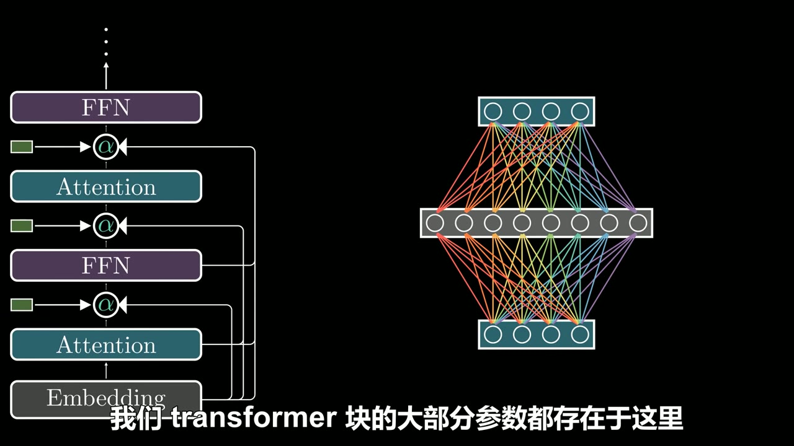

*图 01 · 00:01:06：右侧全连接前馈网络示意显示，FFN 的两次投影连接了大量参数。*

MoE 的改法是把大 FFN 切成多个较小的专家网络。路由器先为每个专家产生分数，经 Softmax 得到概率，再选出 top-\(k\) 专家；被选中的专家独立处理同一个输入，输出按路由权重加权求和。这样改变的是每个 token 走向哪几位专家，模型主体参数可以保持在更大的专家池中。[00:02:08–00:02:59]

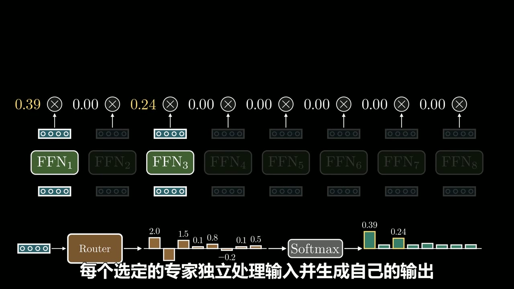

*图 02 · 00:02:34：Router、Softmax、FFN₁ 到 FFN₈ 与顶部 0.39、0.24 权重共同展示了 top-2 选择和加权输出。*

细粒度 MoE 继续把专家池做大。转写内容给出的 Kimi K3 配置是每层 896 个路由专家、每个 token 激活其中 16 个，并额外保留 2 个始终激活的共享专家。共享专家承接广泛通用模式，路由专家可以形成更细的专长分工。[00:03:11–00:03:44]

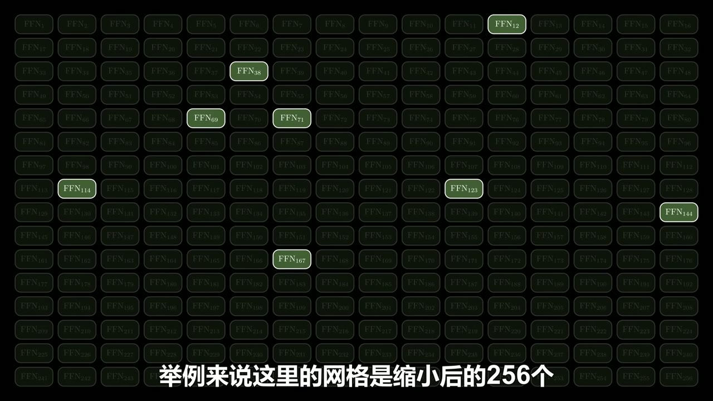

*图 03 · 00:03:18：256 个缩小绘制的 FFN 网格中只有少数亮起，直观对应“大专家池、稀疏激活”。*

## LatentMoE：先把通信对象变小

专家分布在多张 GPU 上时，扩大激活专家数意味着每个 token 要把高维表示发送到更多位置。画面给出的例子中，token 嵌入维度为 \(d=7168\)；若将完整向量发给多个路由专家，通信会迅速膨胀。[00:03:45–00:04:16]

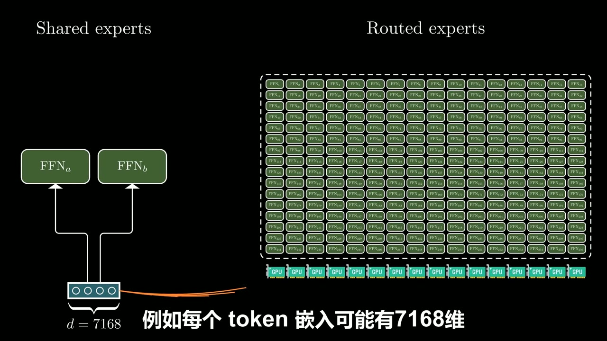

*图 04 · 00:04:02：共享专家与跨多张 GPU 排布的路由专家之间连着完整的 \(d=7168\) token 向量，支撑通信压力的来源。*

LatentMoE 在进入路由专家前使用一个共享的 \(W_{\downarrow}\)：

\[
h=xW_{\downarrow},\qquad 7168\rightarrow3584
\]

同一个压缩后的潜变量 \(h\) 被发送给所有选中的路由专家，专家在紧凑空间中运行。聚合专家输出后，经 RMSNorm 和 \(W_{\uparrow}\) 投回原始表示空间，再与共享专家输出相加。[00:04:17–00:05:14]

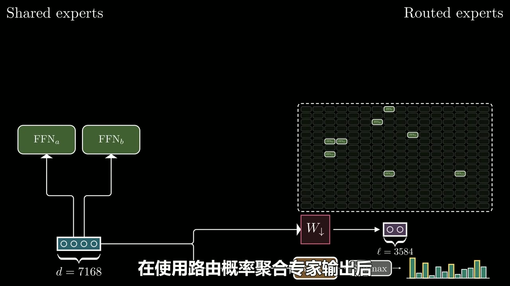

*图 05 · 00:04:46：图中 \(W_{\downarrow}\) 将 token 表示压到标注为 \(\ell=3584\) 的潜变量，再送入路由专家网格。*

这节省了路由分支的通信与参数开销，资源可用于更多专家或更高的每 token 激活数；代价是数值路径变长：下投影、专家 FFN、上投影连续相乘，数值尺度可能在低精度格式中越过可表示范围。[00:05:16–00:05:43]

## 两层数值稳定器：RMSNorm 与 SiTU-GLU

第一层稳定器位于“按路由权重聚合专家输出”和“向上投影”之间。不同 token 选中不同专家，聚合和的尺度会波动；RMSNorm 先把这一中间结果归一到稳定尺度，再交给 \(W_{\uparrow}\)。转写还说明，这一改动改善了验证损失和下游表现。[00:05:47–00:06:18]

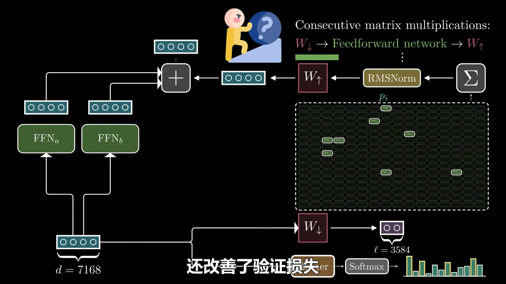

*图 06 · 00:06:14：路由专家输出汇总后先经过 RMSNorm、再进入 \(W_{\uparrow}\) 的位置被明确画出。*

第二层稳定器放在专家内部的门控激活。GLU 可以写成“内容分支乘门控分支”：

\[
a=(xW_V)\odot G(xW_G)
\]

其中 \(xW_V\) 提供内容，\(G(xW_G)\) 决定各维内容能通过多少。学习到的 \(W_G\) 让门控依赖输入的线性组合，因此门控可以利用跨维特征，而非只观察单个维度。[00:07:27–00:08:00]

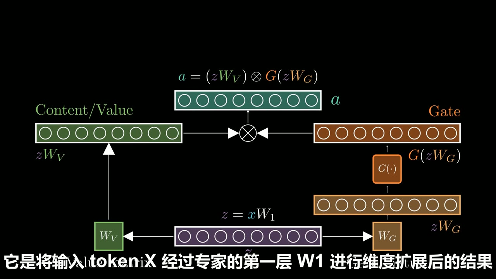

*图 07 · 00:08:27：内容向量 \(xW_V\) 与门控向量 \(G(xW_G)\) 在逐元素乘法节点汇合，画面同时给出完整公式。*

风险来自两个线性项都可能无界。对较大的正输入，SwiGLU 的乘积增长很快，转写将其描述为可达平方量级；在低精度训练里，这会放大溢出风险。[00:09:00–00:09:27]

Kimi K3 将 softcap 函数施加到两个分支：

\[
\operatorname{softcap}(u,\beta)=\beta\tanh(u/\beta)
\]

门控分支使用 \(\beta_1=4\)，内容分支使用 \(\beta_2=25\)，于是两分支相乘的幅度上界为 \(4\times25=100\)。靠近原点时，softcap 近似恒等映射，局部行为仍贴近 SwiGLU；输入变大后输出平滑饱和。这一有界变体在画面中命名为 SiTU-GLU。[00:09:57–00:10:46]

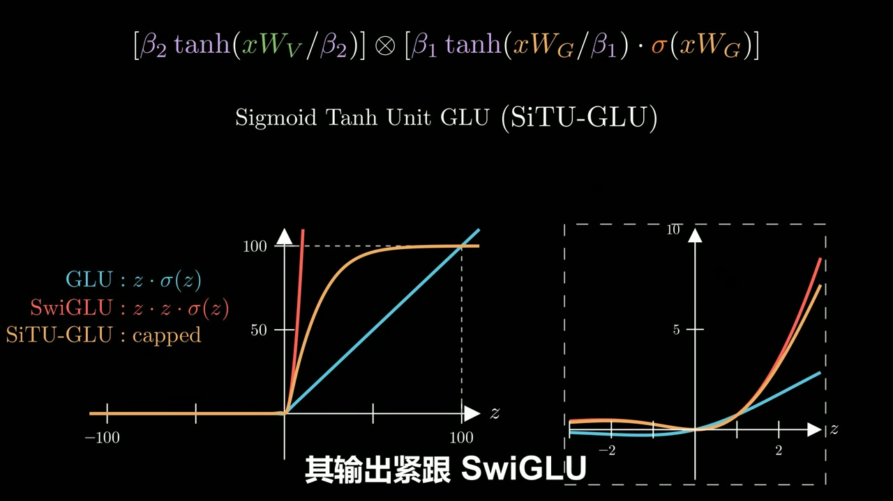

*图 08 · 00:10:39：画面将 SwiGLU 的持续增长曲线与 capped 的 SiTU-GLU 饱和曲线并列，并给出两条 softcap 的乘积公式。*

## 不靠辅助损失的负载均衡

稀疏专家有一个自我强化问题：训练初期专家权重都接近随机，若路由器偶然多选中少数专家，它们更新更多、表现更好，后续又会收到更多 token；长期未被选中的专家会变成“死专家”。[00:10:55–00:11:38]

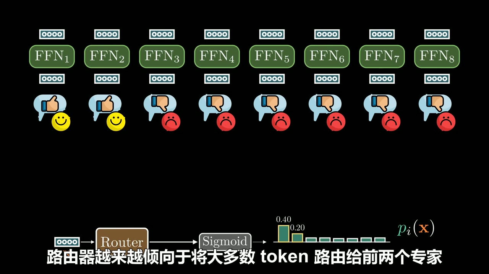

*图 09 · 00:11:23：8 个专家下方的点赞与差评符号、以及偏向前两位专家的概率柱，呈现了早期路由偏置。*

常见辅助损失会惩罚不均匀路由，但它会与语言建模目标共同拉动模型参数。这里采用 DeepSeek-V3 所述的无辅助损失思路：路由器对各专家 logit 独立做 Sigmoid，随后加上动态偏置 \(b\) 仅用于决定 top-\(k\) 的赢家：

\[
\text{selection score}=\sigma(xW_r)+b
\]

真正组合专家输出时，仍使用未加偏置的 \(\sigma(xW_r)\) 作为权重。偏置影响“谁入选”，不篡改“入选后的原始权重”。[00:12:05–00:13:44]

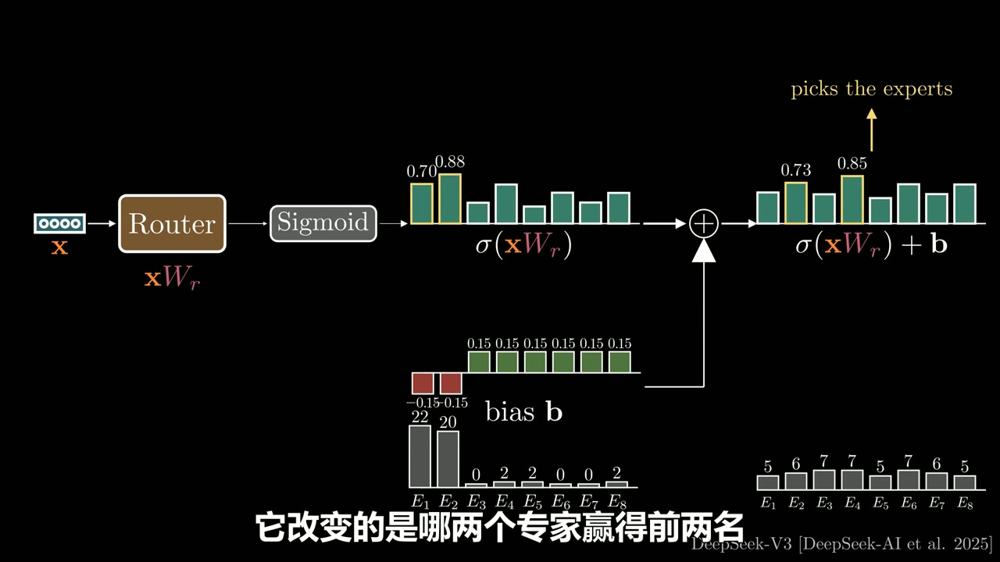

*图 10 · 00:13:36：加偏置前后两组柱状分数并列，绿色箭头标明原始 Sigmoid 分数用于加权，黄色箭头标明偏置后的分数用于挑选专家。*

逐步增减偏置在 896 个专家上可能很慢，也依赖步长等超参数。分位数平衡改为直接计算每个专家该取的偏置。对每个 token \(i\)，先找出 top-\(k\) 截断线 \(\alpha_i\)：在 top-2 情况下，它是该 token 的第三高分数。再计算每个专家 \(j\) 的边际：

\[
m_{ij}=s_{ij}-\alpha_i
\]

边际表示该专家分数高于或低于 token 入选线的距离，消除了不同 token 整体分数偏高或偏低带来的干扰。[00:14:50–00:15:30]

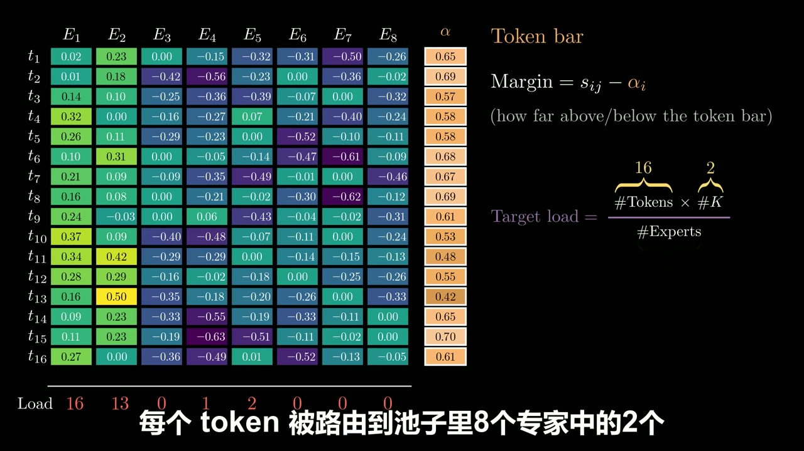

*图 11 · 00:15:48：矩阵右侧明确给出 Token bar、\(Margin=s_{ij}-\alpha_i\) 与目标负载公式。*

目标负载为：

\[
L=\frac{\#\text{tokens}\times k}{\#\text{experts}}
\]

例子里有 16 个 token、8 个专家、top-2 路由，所以 \(L=4\)。对某一专家，把这一批 token 的边际从高到低排序，取第 \(L+1\) 个边际作为应从该专家分数中减去的量；对所有专家重复即可得到完整偏置向量。下一批 token 使用该偏置后，画面示例中 6 位专家恰好达到目标，另 2 位只差 1。[00:15:31–00:17:13]

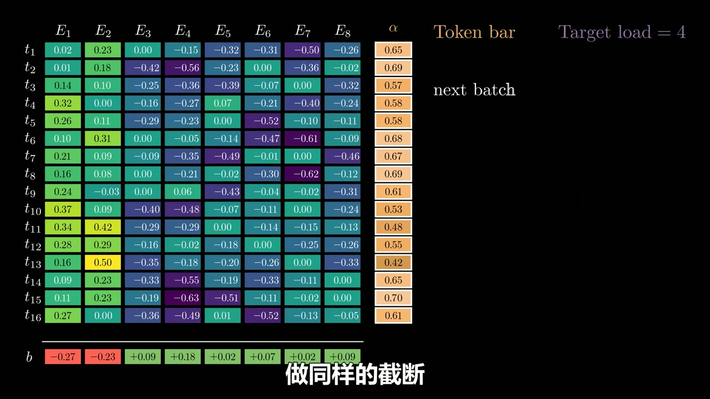

*图 12 · 00:16:32：各专家对应的偏置向量 \(b\) 已在矩阵下方组装完成，右上角标注下一批 token 与目标负载 4。*

## 边界、疑点与时效性

- 2.8 万亿参数、896 路由专家、每 token 激活 16 位专家、共享专家数量、7168 到 3584 的压缩维度，均来自本地逐字稿与配套画面，应视为该材料所叙述的 Kimi K3 配置。 
- 转写文本存在少量术语误识别，例如 Softmax/Sigmoid、SwiGLU、LatentMoE、\(W_{\uparrow}\) 与 \(W_{\downarrow}\)；笔记以画面中可见英文、公式和上下文做了有限修正。 
- 分位数平衡讨论的是批次统计下的路由校正机制；它改善负载接近程度，不能推出任意数据分布下每一批都严格均匀。

## 时间戳导航

- [00:00:22] Transformer 的 Attention、FFN 与残差通路 
- [00:01:01] FFN 为什么是参数大头 
- [00:01:35] MoE：拆专家、top-\(k\) 路由、加权汇合 
- [00:03:11] 细粒度专家、共享专家与路由专家 
- [00:04:17] LatentMoE 的下投影和通信节省 
- [00:05:47] RMSNorm 为什么插在聚合与回投影之间 
- [00:06:24] 从 Swish/GELU 到内容—门控视角 
- [00:07:27] \(W_V\)、\(W_G\) 构成可学习门控 
- [00:09:00] 无界乘积为何会引发低精度不稳定 
- [00:09:57] softcap 与 SiTU-GLU 的有界激活 
- [00:10:55] 专家塌缩、死专家与负载均衡需求 
- [00:12:05] 动态偏置如何避开辅助损失 
- [00:14:50] Token bar、边际与分位数平衡 
- [00:17:16] 三项关键技术的收束

## 复习与行动清单

- 先记住 MoE 的交换：用稀疏激活换取更大的总参数容量。 
- 用“通信、数值、负载”三类问题检查任何大规模 MoE 设计。 
- 写出 LatentMoE 的数据流：\(x\rightarrow W_{\downarrow}\rightarrow\) 路由专家 \(\rightarrow\) 加权聚合 \(\rightarrow\) RMSNorm \(\rightarrow W_{\uparrow}\)。 
- 写出门控核心式 \(a=(xW_V)\odot G(xW_G)\)，再理解 SiTU-GLU 如何限制两个因子的幅度。 
- 区分两种路由分数用途：加偏置的分数负责 top-\(k\) 选择，原始 Sigmoid 分数负责专家输出加权。
