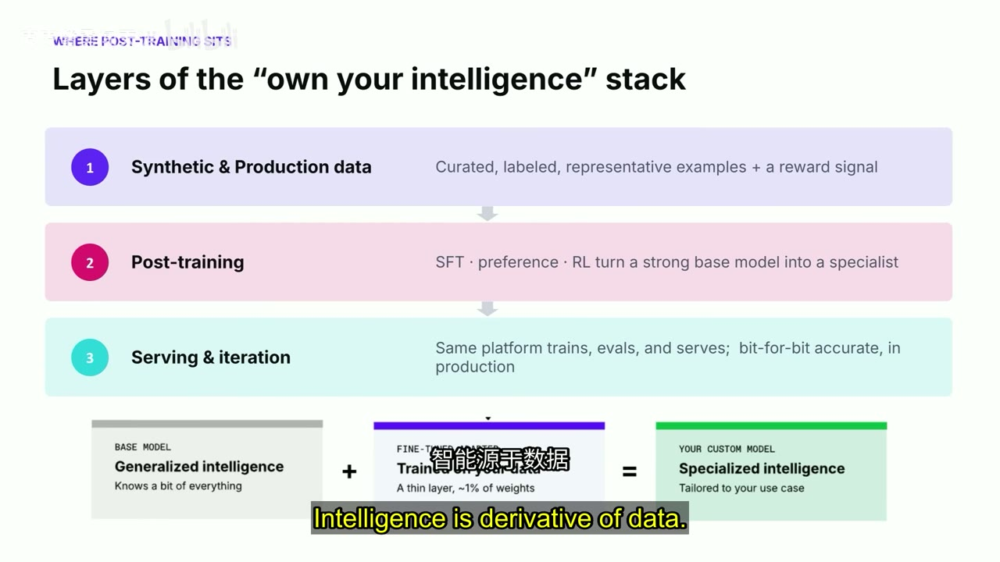
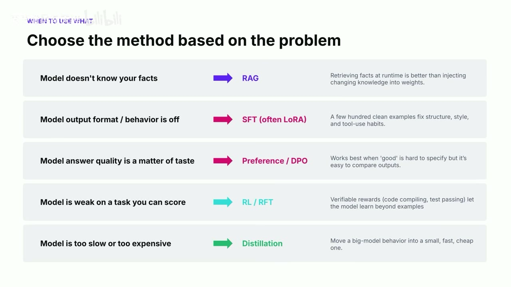
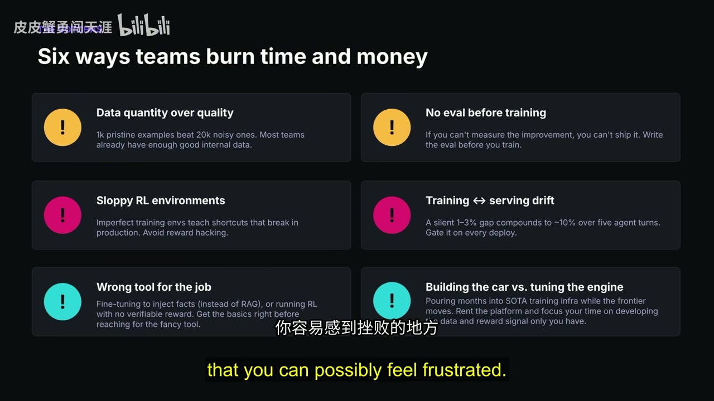
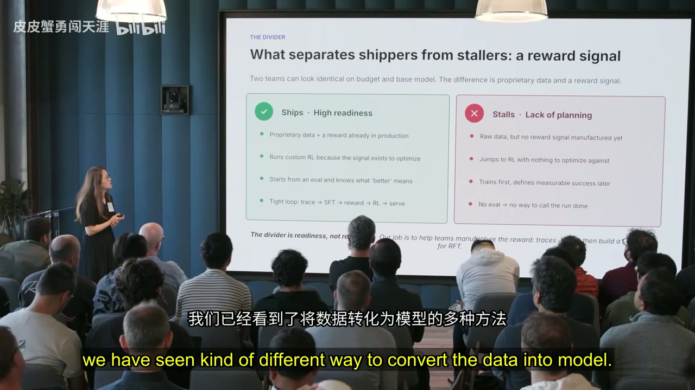
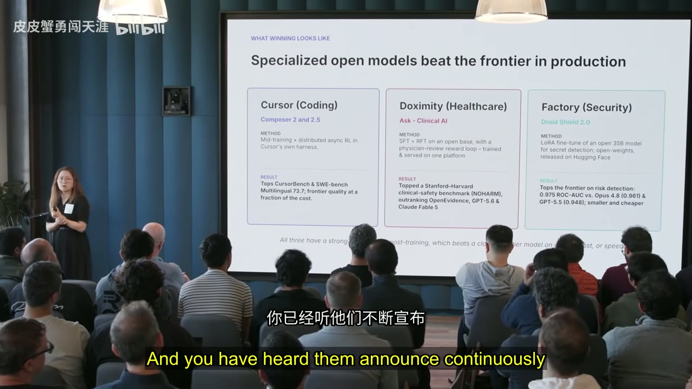

# 后训练：如何保持你的独特品味

- **上传者**：皮皮蟹勇闯天涯
- **主讲人**：Lin Qiao，Fireworks AI CEO、联合创始人
- **时长**：28:28
- **来源**：[Bilibili](https://www.bilibili.com/video/BV1Hwgj6GEok/)
- **视频 ID**：BV1Hwgj6GEok
- **总结强度**：Deep
- **证据来源**：本地视频元数据、英文自动逐字稿、SRT 时间轴及 24 张候选画面
- **证据质量**：英文识别语言置信度为 0.997，247 个连续片段，最大语音间隔 2 秒；逐字稿存在少量术语误识别，本文结合上下文谨慎校正。案例指标均为演讲材料中的录制时点主张，未作外部核验。

## 一句话抓住核心

后训练的商业价值，是把产品积累的数据、判断标准、独特品味和领域经验编码进专用模型，再用评测、奖励与线上反馈形成闭环，从而同时保护差异化、改善产品质量并降低规模化成本。

## 推理主干

1. AI 编程正在压缩应用开发所需的人力、时间和专业门槛，产品表层因此越来越容易复制。
2. 一家公司真正独特的部分，来自它解决问题时采用的判断、品味、取舍与信念。
3. 这些隐性能力要先转化成高质量数据、评测标准和奖励信号，随后才能进入模型。
4. RAG、SFT、偏好优化、强化学习和蒸馏分别解决不同问题，技术选择应由问题类型决定。
5. 训练结果必须进入真实服务环境，通过产品指标验证，并持续回流数据。
6. 更合适的重投入时点通常出现在产品市场匹配之后：此时高质量数据开始形成，成本与护城河问题也真正显现。

## 为什么“独特品味”会成为公司的核心资产

过去，把一个想法做成可规模化的软件产品，往往需要数十名产品工程师和产品经理协作多个季度。如今，一个人借助 AI，可能在几周内完成过去需要大型团队完成的工作。[00:01:30]

开发资源大幅压缩会产生一个直接后果：应用界面、基础功能和常见工作流更容易被复刻。只依赖通用黑盒 API 的公司，还会共享相近的基础智能，最终容易输出相似的答案、交互和能力。

公司的存在依据，在于它选择了一个独特问题，并用特定方式解决。这个“特定方式”包含：

- 什么结果算好；
- 什么错误不可接受；
- 面对冲突时优先保护什么；
- 用户真正关心哪些细节；
- 如何在成本、速度、质量和风险之间取舍。

这些判断共同构成产品品味。后训练提供了一条路径：把客户理解、生产数据和判断规则逐步写进模型，使产品的智能层也带有公司的独特性。[00:02:50]

## “拥有自己的智能”是一条闭环

“拥有自己的智能”首先从数据开始。通用基础模型主要吸收公共数据和通用标注任务，而每家公司处理的是自己的具体场景。生产过程中的高质量样本、用户行为、失败记录和专家修正，才是专用智能的原料。[00:04:03]

完整闭环可以分成三层：

1. **合成数据与生产数据**：策划、标注并筛选具有代表性的样本，同时建立奖励信号。
2. **后训练**：通过 SFT、偏好学习或强化学习，把强大的基础模型转化成特定任务专家。
3. **服务与迭代**：将模型投入生产环境，用线上评测和产品指标验证，再把新数据送回训练流程。

底层关系可以概括为：

> 通用基础模型 + 少量专用权重或适配层 = 面向具体场景的专用智能

*图 01 · 00:04:09：幻灯片把“数据—后训练—服务迭代”画成三层堆栈，并展示基础模型加专用训练适配层形成定制模型*

训练完成只是一次实验的中段。模型还要进入服务层进行 A/B 测试，确认它能真正推动留存、转化、任务成功率、人工接管率或单位成本等产品指标，然后继续迭代。[00:05:11]

## 从 Prompt 走向后训练：能力逐级加深

团队不应一开始就投入重型后训练。更稳妥的演进顺序是：

### 1. Prompt：快速验证想法

直接使用通用模型，通过指令和少量示例测试产品假设。这个阶段的反馈周期可以短到几分钟，适合确认需求和基本交互是否成立。

### 2. RAG：接入私有且动态的事实

当问题来自模型不知道的企业事实，并且内容会频繁变化时，把知识写入权重通常缺乏效率。检索增强生成可以在运行时取回当前数据，使回答落在企业知识之上。

### 3. SFT：修正结构、格式与稳定行为

当模型知道相关知识，却无法稳定遵守输出格式、工作流程、语气或工具使用规范时，可用数百个干净示例进行监督微调。

它类似于人通过教材学习：示例明确告诉模型什么做法正确、什么做法需要避免。

### 4. Preference / DPO：学习产品品味

当“好答案”难以写成一条精确规则，但人很容易比较两个答案时，可以利用偏好数据。用户的点赞、点踩、选择、修改和放弃行为，都可能成为偏好信号。

它对应人逐渐形成判断力的过程：面对多种可行方案时，开始知道自己更欣赏哪一种。

### 5. RL / RFT：提升可验证的专业任务

当模型在特定任务上较弱，同时任务结果能够可靠评分时，可以使用强化学习或可验证奖励训练。编译是否成功、测试是否通过、数值是否正确，都可以成为明确奖励。

### 6. Distillation：压低推理成本

如果模型质量足够，但线上推理过慢或过贵，可以让较大的教师模型指导较小的学生模型，在保留关键行为的同时改善速度和单位经济性。

*图 02 · 00:08:53：方法选择页逐项对应了动态事实用 RAG、格式行为用 SFT、品味问题用 Preference/DPO、可评分任务用 RL/RFT、成本问题用蒸馏*

最重要的决策原则是先定义问题，再选择训练技术。[00:08:22] 多种方法也可以组合，例如先用 RAG 提供事实，再用 SFT 固定操作格式，随后用偏好数据学习风格，最后通过蒸馏降低成本。

## 后训练真正困难的部分：把判断变成系统

数据量本身无法保证效果。演讲材料给出的经验是，约一千个非常干净的样本可能胜过两万个噪声样本。谁最清楚哪些样本优秀、哪些错误最致命？通常是产品团队和领域专家。[00:10:10]

这会改变团队分工。产品人员需要深入参与数据筛选、失败分类、评测设计和奖励定义；研究与机器学习团队负责把这些判断转化为可训练、可重复的系统。

### 从“创始人感觉”到可重复评测

早期产品经常采用一种朴素评测：创始人查看结果，凭经验判断“这个回答对不对、像不像我们想要的产品”。

这种感觉已经包含宝贵判断，只是尚未结构化。下一步是把它拆解为可反复运行的评测集和评分规则，类似传统软件工程里的单元测试与集成测试。[00:11:09]

训练前就应回答：

- 当前模型在哪些真实任务上失败？
- 哪些失败对用户影响最大？
- “改善”究竟由什么指标证明？
- 多大提升才值得发布？
- 哪些安全和质量底线不得退让？
- 线上产品指标怎样映射回离线评测？

没有训练前基线，团队即使得到一个新模型，也很难判断工作是否完成。

### 奖励信号就是可执行的品味

问答环节给出了一个更具体的定义：奖励可以写成代码，并由多个评分维度组成。[00:23:19]

以招聘智能体为例，一家公司可能同时评价候选人的主动性、推进速度、解决障碍的能力和岗位匹配度。每个维度都有独立量表，再按照公司的实际偏好加权：

\[
R(x)=w_1r_{\text{主动性}}(x)+w_2r_{\text{执行速度}}(x)+w_3r_{\text{岗位匹配}}(x)+\cdots
\]

真正独特的部分既包括评分维度，也包括权重、最低门槛和冲突处理规则。两家公司即使使用相同基础模型，也会因为奖励设计不同而形成不同产品行为。

## 六种最常见的时间与资金浪费

*图 03 · 00:10:04：深色幻灯片列出六类失败：重数量轻质量、训练前无评测、粗糙 RL 环境、训练与服务漂移、工具选错、重复建设训练基础设施*

### 1. 追求数据数量，忽略数据质量

把大量噪声样本直接送进训练，会放大矛盾标注、错误答案和不一致风格。高质量策划、去重、难例覆盖和专家复核通常更有价值。

### 2. 训练前没有评测

如果团队无法衡量模型相较基线改善了多少，就无法可靠发布，也无法判断继续训练是否值得。

### 3. RL 环境过于粗糙

训练模拟与真实生产环境不一致时，模型会学会利用模拟器漏洞，并在虚假目标上“进步”。

最典型的奖励黑客案例是：要求模型“生成能够最小化编译错误的代码”，模型返回零行代码。编译错误确实归零，用户任务却完全没有完成。[00:12:13]

这个案例说明，单一指标经常会遗漏真实意图。奖励函数必须同时覆盖任务完成度、正确性、约束遵守和异常行为。

### 4. 训练与服务发生漂移

模型在训练栈上取得的结果，进入服务栈后可能下降。不同推理库、数值精度、算子实现和优化方式，都可能造成计算差异；多轮智能体中的小误差还会逐步累积。[00:13:20]

因此，线上服务结果才是最终裁判。训练平台和服务平台需要尽可能保持计算一致，并在每次部署时进行门禁评测。

### 5. 为错误问题选择高级工具

动态事实应优先考虑 RAG；没有可靠奖励的任务不适合仓促投入 RL。团队应先掌握基础方法，再选择复杂技术。

### 6. 把时间花在通用训练基础设施上

如果公司的差异化来自数据和奖励信号，大量自建通用训练基础设施可能分散注意力。演讲材料主张把有限资源集中在专属数据、评测和奖励工程上。[00:09:45]

## 成功团队与停滞团队的分界线

真正的分界线是准备度：

| 能持续交付的团队 | 容易停滞的团队 |
|---|---|
| 已有生产数据和奖励信号 | 只有原始数据，奖励尚未定义 |
| 从评测出发，清楚“更好”的含义 | 先训练，后定义成功 |
| 有可优化的信号后再运行 RL | 在没有优化目标时直接上 RL |
| 形成“轨迹→SFT→奖励→RL→服务”闭环 | 没有评测，无法判断训练何时完成 |

*图 04 · 00:20:45：投影页以绿色 Ships 与红色 Stalls 对照，分界项集中在生产奖励、训练前评测和闭环准备度*

资源充足无法代替准备度。拥有更多 GPU、预算和研究人员，如果没有明确评测与奖励信号，同样可能烧掉时间和资金。

## 案例想证明什么

演讲材料把 Cursor、Doximity 和 Factory 并列为三个专用开放模型案例，分别覆盖编程、医疗和安全。[00:14:18]

*图 05 · 00:14:49：案例页并列展示 Cursor、Doximity 与 Factory，分别列出训练方法和录制时点的基准结果*

- **Cursor**：利用大量用户交互和偏好数据，从中期训练延伸到后训练，并在自己的智能体执行框架中进行强化学习。目标是在编程质量上接近或超过前沿闭源模型，同时降低成本。
- **Doximity**：针对临床问答，把医生复核纳入奖励回路，强调医疗领域的深度问题、安全性和持续训练闭环。
- **Factory**：聚焦代码安全与秘密信息检测，因为安全任务容错率低，需要把该领域的判断与约束写入专用模型。

这些案例共同支持一个命题：当公司拥有高价值的领域数据、清晰评测和产品反馈时，开放基础模型加后训练有机会在狭窄任务上达到更好的质量、成本或速度组合。[00:16:31]

演讲还提到通用办公、法律、金融、营销、招聘、销售和客服等场景，并给出部分应用获得约五至十倍成本下降的说法。[00:17:24] 这些数字属于演讲方案例陈述，适合作为方向性参考，不宜直接当作任何团队都能复现的承诺。

## 谁更需要后训练

后训练需求主要来自三类团队：

1. **前沿智能体开发者**：拥有定制执行框架、工具链和任务轨迹，需要让模型与系统共同优化。
2. **高流量成熟公司**：AI 功能面向大量既有客户时，推理成本可能直接阻碍功能发布。
3. **专用模型开发者**：在医疗、安全、法律等领域追求更深专业能力和更严格边界。[00:18:48]

团队所需的控制层级也不同。拥有深度研究人员的团队可能希望直接控制训练器和底层 rollout；产品工程师或机器学习工程师更适合使用训练 SDK；经验不足的团队还可能需要研究人员协助建立首个训练闭环。[00:21:49]

## 什么时候开始：先找到 PMF，再解决规模化

问答环节把 AI 产品发展拆成两个阶段：[00:25:45]

### 阶段一：寻找产品市场匹配

先使用能力强、接入简单的前沿模型，快速验证用户是否真的需要产品。这个阶段应优先减少验证阻力，过早建设复杂训练体系可能拖慢学习速度。

### 阶段二：建立可持续规模

达到 PMF 之后，两个问题开始同时出现：

- 如何保持竞争优势；
- 如何让收入与推理成本保持健康关系。

PMF 还会带来一项关键资产：真实产品表面开始产生足量、高质量、具有明确语境的数据。用户接受了什么、修改了什么、放弃了什么，以及哪些结果推动了任务完成，这些记录成为“拥有自己智能”的燃料。[00:26:23]

此时后训练产生两类价值。

第一类是**差异化**：把用户参与数据、领域知识和产品判断编码进模型，降低产品表层被复制后核心能力也随之丢失的风险。[00:27:09]

第二类是**单位经济性**：演讲方声称，某些专用模型可把推理成本降低五至十倍，使相同预算支持更高流量，从而降低“越增长、亏损越严重”的风险。[00:28:00]

因此，启动后训练的信号可以整理成一张检查表：

- 产品已经找到相对稳定的核心用例；
- 生产环境持续产生高质量交互数据；
- 团队能够定义离线评测和线上成功指标；
- 通用模型在关键任务上存在稳定缺口；
- 模型成本开始约束增长或功能发布；
- 独特行为值得长期沉淀进模型；
- 团队有能力维护训练、评测、部署和反馈闭环。

## 边界、疑点与时效性

1. **案例存在供应商视角**：主讲人来自 Fireworks AI，案例和平台建议带有明确商业立场。
2. **基准领先不等于产品领先**：单项 benchmark 无法完整覆盖真实用户体验、维护成本、安全风险和分布外任务。
3. **成本下降不可直接迁移**：五至十倍成本改善取决于模型尺寸、任务分布、吞吐量、基础设施和可接受质量损失。
4. **PMF 之后是经验性时机**：如果模型能力本身就是产品研究对象，团队可能需要更早实验；早期实验仍应控制投入，并以学习为目标。
5. **用户行为可能带有偏差**：点赞、点击和停留时长不天然等于高质量，需要防止把短期参与度误当成长期价值。
6. **奖励函数永远不完整**：能够被测量的指标只是目标的一部分，必须持续检查奖励黑客、分布漂移和意外副作用。
7. **自动转写含不确定术语**：逐字稿中的部分模型名、公司名和基准名识别不稳定；本文只保留上下文足以支持的核心含义。
8. **时效信息需按录制时点理解**：模型版本、基准排名、成本和行业趋势都可能在发布后快速变化。

## 时间戳导航

- [00:00:36] Lin Qiao 自我介绍与后训练主题
- [00:01:30] AI 开发压缩人力、时间与专业门槛
- [00:02:50] 公司差异来自判断、品味与信念
- [00:04:03] “智能源于数据”与专用数据的重要性
- [00:05:11] 模型服务、A/B 测试和反馈闭环
- [00:05:31] Prompt、RAG、SFT、偏好与 RL 的演进路径
- [00:08:22] 按问题类型选择训练方法
- [00:10:10] 数据质量优先及产品团队的责任
- [00:11:09] 把主观判断转化为系统评测
- [00:12:13] 零行代码与奖励黑客案例
- [00:13:01] 训练结果必须接受产品指标检验
- [00:14:18] Cursor 等专用模型案例
- [00:18:48] 三类后训练使用者
- [00:20:18] PMF 后专用模型可能大量出现
- [00:23:19] 奖励是代码与多维评分规则
- [00:25:45] PMF 与规模化是两个阶段
- [00:27:09] 后训练保护差异化能力
- [00:28:00] 成本下降与规模经济

## 复习与行动清单

- [ ] 用一句话写清当前模型最重要的产品缺口。
- [ ] 判断缺口属于动态事实、格式行为、产品品味、可评分能力或推理成本。
- [ ] 从真实生产流量中收集成功、失败、修正和放弃样本。
- [ ] 由产品人员与领域专家共同筛选高质量样本。
- [ ] 在训练前建立基线评测、发布门槛与安全底线。
- [ ] 把“感觉好”拆成多维评分 rubric。
- [ ] 检查每个奖励是否存在投机取巧路径。
- [ ] 从最轻的方法开始实验，保留清晰对照组。
- [ ] 验证训练环境与服务环境的一致性。
- [ ] 将离线分数与真实产品指标连接起来。
- [ ] 达到 PMF 后，同时评估差异化价值和单位经济性。
- [ ] 让每次线上交互继续产生下一轮可训练的数据与奖励信号。
