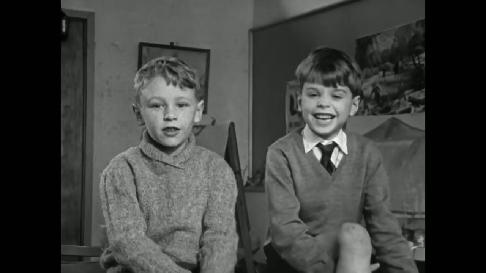
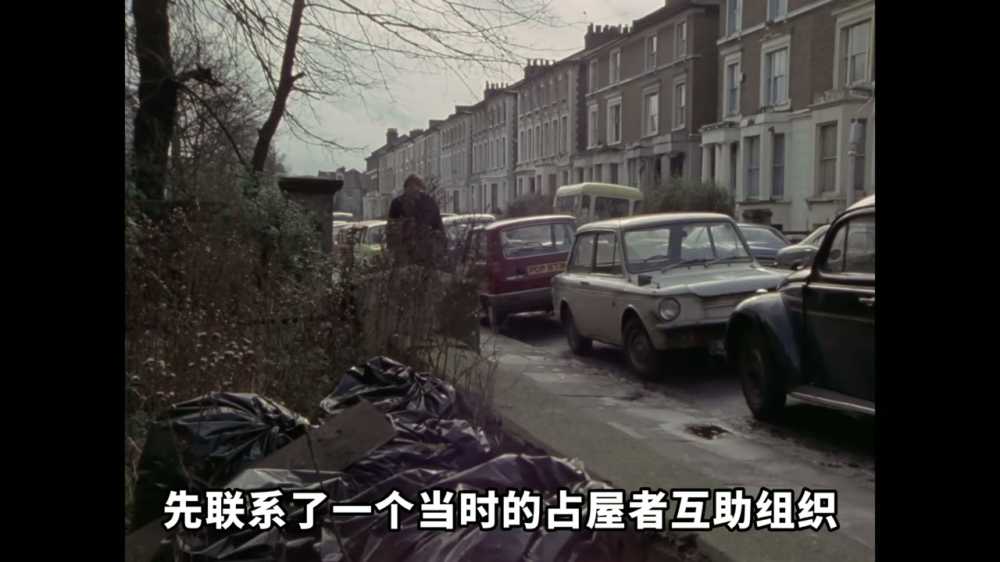
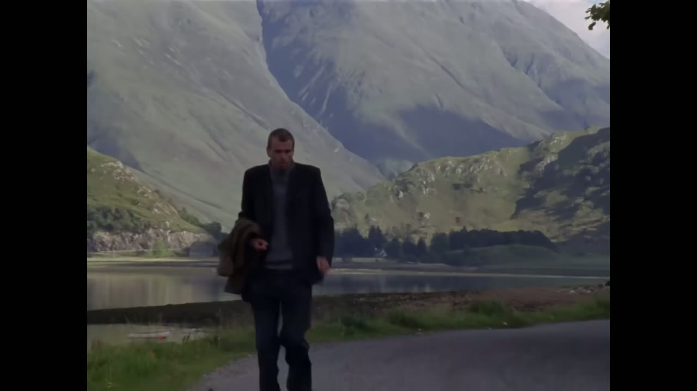
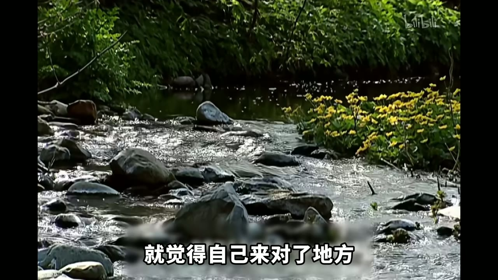
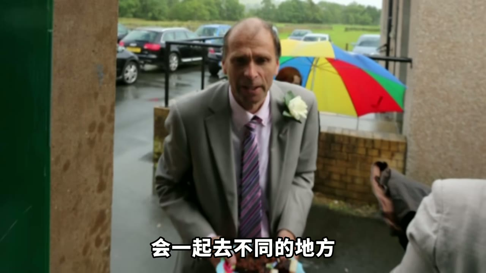

# 人生的容错率，比你想的高很多【人生70年】#1

> 上传者：看见Real 
> 时长：30:12 
> 链接：[Bilibili](https://www.bilibili.com/video/BV1irGF6tEvz/) 
> ID：BV1irGF6tEvz 
> 总结强度：standard 
> 证据：本地逐字稿、SRT、24 张时间戳候选画面。逐字稿整体可用，少数人名、地名及后段口述存在识别错误，以下对含义不清处降低断言强度。

## 一句话抓住核心

人生的容错率，来自一个人仍能在偏离原定轨道很久以后，逐步找到可居住的环境、可承担的角色和可与人连接的生活；它不保证圆满，却允许重建。

## 推理主干

1. Neil 从小被放进“聪明、勤奋、将来拥有体面职业”的期待里，却长期承受焦虑、霸凌与不适应。
2. 他试图靠离家、旅行、退学、漂泊摆脱窒息感，却没有因此获得稳定。
3. 真正的转折并非一次成功，而是固定住所、安静环境、小社区与戏剧活动慢慢提供了支点。
4. 他仍然觉得自己未实现写作和更大公共抱负，却在地方政治、邻里事务、婚姻与乡村生活中形成了真实责任。
5. 因而，人生并不由少年时的预测一次性定稿；迟到的关系、位置和行动，仍能改变生活的质地。

## 从“好孩子”到难以安顿的人

Neil 七岁时想当宇航员，也想开长途巴士，把乘客带到乡村和海边，并介绍沿途的地方。[00:00:00] 六十年后，他既没有去太空，也没有开大巴，甚至经历过没有工作、没有稳定收入和没有固定住处的阶段。[00:00:15]

这种落差构成了问题的起点：出生、性格和家庭期待，究竟会把一个人推向怎样的人生？《人生七年》从不同阶层儿童的长期跟拍中给出的，并非一道简单的因果题；Neil 的一生尤其显示，外部条件、精神状态、关系网络与所处环境会反复交织。

*图 01 · 00:01:53：黑白画面中年幼的 Neil 坐在室内接受拍摄，直接对应他后来人生与童年期待之间的巨大时间跨度。*

Neil 出生于利物浦郊区的中产教师家庭。读书、礼貌、宗教和职业体面被当作理所当然的方向；他聪明、好奇、爱文学，也擅长迅速回应镜头。[00:01:30] 可是，顺从这条路线并没有让他安稳。进入综合学校后，他成绩很好，却持续紧绷、遭遇霸凌，并在十六岁左右出现焦虑、低落与反复抑郁状态；逐字稿没有提供可确认的医学诊断，因此只能确认他当时的困扰已相当严重。[00:02:34]

这里最重要的区别是：学习能力能让人通过考试，却无法自动提供安全感、应对粗暴关系的能力，或对自己生活的掌控感。父母和老师看见的是“应该上大学、进入体面职业”的孩子；Neil 感受到的，是自己在真实环境里很脆弱、很难放松。[00:03:15]

## 理想世界、逃离与漂泊

文学曾给 Neil 开出另一扇门。少年时期读到描绘牛津与贵族青年生活的小说后，他被其中的艺术、宗教、古老建筑、古怪人物和不受既定路线约束的气氛吸引。[00:04:10] 对一个在学校紧张、又在家庭期待中感到窒息的人而言，这种想象提供了一个解释：问题也许不在于自己彻底失败，而在于尚未抵达适合自己的世界。

*图 02 · 00:04:24：校园草地上，青年们围着橄榄球活动，画面呈现了 Neil 向往的大学社交与自由生活想象。*

他申请牛津未果，随后进入阿伯丁大学学习语言和法律。学校本身并不差，可在他的体验里，它更像替代选项。[00:05:26] 他先选择离家半年，靠搭便车旅行，把自己放进陌生人、陌生地点和不可预期的生活里，希望磨掉自身的脆弱。[00:06:05] 这让他见识更广，也让他具备了在陌生环境中生存的经验，却没有解决精神上的不稳定。进入大学后，他又遭遇紧张、排外的宿舍政治氛围，第一个学期便退学。[00:07:01]

二十一岁时，他在伦敦靠工地看守和零工生活，住进长期空置的房子。当地存在占屋者互助网络：人们通过朋友、组织和前居住者的线索，进入闲置房屋；他将此理解为让无处可去的人获得栖身处。[00:07:39] 这并不等于生活终于被安顿下来。他仍回避父母所期待的“恢复正常”，也仍缺少真正可持续的工作、住所和心理支持。

*图 03 · 00:08:10：街边堆放的垃圾袋、密集旧车和阴暗住宅，直接支撑他通过占屋网络寻找临时住处的生活背景。*

## 一个人的困境，首先需要可落脚的地方

1984 年拍摄时，摄制组花了约三个月寻找 Neil：他没有电话、固定住处或稳定雇主，在英国各地搭便车，住几天、打零工、再离开。[00:11:02] 最后，他们在苏格兰高地找到他。他睡在废屋、棚子或别人临时提供的地方，靠救济金和随身的一只包过活。[00:12:14]

*图 04 · 00:13:12：Neil 独自沿着湖边道路行走，背后是荒凉山地；画面直接呈现无固定居所时期的孤立与漂泊。*

Neil 能清楚讨论政治、宗教、教育与尊严，也能准确描述自己的感受；可“说得明白”没有自动转化为“过得稳定”。这提醒我，理解自己的问题很重要，获得持续的住所、收入、关系和支持同样重要。一个人不能只靠意志力从长期的不安中抽身。

他在二十八岁时仍想象未来会有满意的工作、婚姻、孩子、足够的收入和随时可以联系的朋友。[00:14:18] 当被问及这样的人生是否被浪费时，他承认“也许”，随即又说自己不比别人更好，只是有属于自己的困难与障碍。[00:15:17] 这句话的价值在于：它把“失败者”的单一标签拆开了。每个人都有障碍，差别在于障碍是否被看见、是否有资源应对、是否能找到适配的位置。

## 环境与共同体怎样重新托住一个人

后来的舍得兰群岛提供了三个长期缺失的条件：固定住所、安静环境，以及由熟人组成的小社区。[00:16:26] Neil 仍主要依靠福利，没有因此变成传统意义上的成功者；生活却开始有了结构。邻里、海岛环境和社区戏剧，让他重新与他人发生具体联系。

戏剧特别关键。它不是抽象的“兴趣爱好”，而是一种可见的岗位：参加演出、组织巡演、导演、写剧本、和观众共同完成一场活动。[00:16:42] 他从童年就喜欢表演和舞台工作；在舞台上，他的状态与日常明显不同。他也坦承自己做导演时很坚持预先构想，这会带来摩擦，却说明他终于有机会把内在的审美和组织欲用在真实事务上。[00:17:47]

*图 05 · 00:16:59：社区舞台上有成年人和儿童共同演出，直接支撑戏剧成为 Neil 重建社会连接的通道。*

所谓“找对地方”，并不只是换一个风景优美的住处。它意味着环境的节奏、人与人的距离、可参与的共同事务，恰好能让一个人的敏感和能力有出口。

## 从旁观社会到承担公共事务

接近四十岁时，Neil 开始觉得自己不能只观察和抱怨社会。[00:19:52] 他重返伦敦并逐渐适应大城市，1996 年当选哈克尼区议员。[00:20:47] 后来他又搬往英格兰西北部、湖区附近，在更适合自己的环境中参与自由民主党的地方工作，担任地方议员、参加委员会，并为选区的具体问题奔走。[00:21:34]

*图 06 · 00:22:01：溪流、树木与山地构成他搬到湖区后看见的生活环境，支撑“在适配环境中重新安顿”的转折。*

这条路径很朴素：他没有进入英国国会，也没有实现少年时想象的宏大成就；地方政治却成了他最稳定、最持久的公共工作。[00:22:47] 生活的价值并不只由最高处的结果决定。能处理本地议题、开车去分散村庄、与邻居讨论现实问题，已经使“我该怎样参与世界”获得了实际答案。

他一直写剧本、故事和其他文字，几乎每天都写，却少有出版商、剧院或制作人真正重视其作品。[00:23:23] 因而，重建生活并不会把遗憾消除。他依然渴望更大的写作和社会影响，也依然苛刻评价自己。容错率的含义并非让所有愿望实现；它让未实现的愿望不必吞没已经存在的生活。

## 迟到的关系，也仍然是关系

六十三岁时，Neil 开始更具体地谈父母。母亲患失智症后，对他的要求和判断减少，两人的相处反而有所改善；这段材料只足以说明，他感到自己终于较少被塑造成某种“应当成为的人”。[00:24:34]

他后来通过当地社区戏剧认识一位女性，开始了初恋、散步、聊天、共同出行，随后结婚。[00:25:22] 这段婚姻最终分居，Neil 也承认低落情绪和心理困扰给妻子带来压力。[00:26:16] 可它仍然重要：在长期觉得亲密关系无望之后，他真实地拥有过一段相互靠近的关系。

*图 07 · 00:25:48：Neil 穿着礼服、胸前别着白花走入雨中的婚礼现场，直接支撑他在晚年进入婚姻这一事实。*

之后，他用继承所得在法国乡间买下一栋小房子。他说自己更喜欢乡村，因为那里人与人互相照顾、沟通更直接，也更容易与土地、食物、季节和自然建立细腻联系。[00:27:15] 这并非逃离一切问题；它是他对“什么样的生活能让我活得更有感觉”的长期回答。

## 边界、疑点与时效性

- 本笔记只依据本地材料。关于学校制度、占屋法律背景、地点和节目年份的表述，保留原叙事的范围，未作外部核验。
- 逐字稿中 Neil 被多次误识别为“Neo”，后段还出现“她”的错置；根据前后文统一按 Neil 处理。
- 心理健康相关内容只记录材料中出现的焦虑、低落、抑郁状态和其本人感受，不构成医学判断。
- Neil 的人生没有收束成单一结论：稳定、公共参与、写作欲望、婚姻与失落同时存在。

## 时间戳导航

- [00:00:00] 七岁时的宇航员与长途巴士司机梦想
- [00:01:30] 中产教师家庭的期待与少年性格
- [00:02:34] 学业优秀与长期紧绷、霸凌并存
- [00:04:10] 文学如何塑造对“适合自己的世界”的想象
- [00:06:05] 搭便车旅行：离开安排好的学生生活
- [00:07:39] 伦敦占屋、零工与互助网络
- [00:11:02] 摄制组寻找失去固定行踪的 Neil
- [00:14:18] 对稳定工作、婚姻、朋友与收入的期待
- [00:16:26] 舍得兰提供的固定住所、安静与社区
- [00:17:47] 戏剧导演的控制感与表达欲
- [00:20:47] 当选哈克尼区议员
- [00:22:01] 搬往湖区后参与地方政治
- [00:23:23] 长期写作与未被承认的挫败
- [00:25:22] 社区戏剧带来的初恋与婚姻
- [00:27:15] 法国乡村小屋与重新连接自然

## 复习与行动清单

- 把“人生落后”拆成具体问题：我缺的是收入、住所、关系、环境，还是能参与的事务？
- 不要把一次考试、一次落选或一段漂泊当成最终判决；先为生活建立一个可持续的小支点。
- 主动寻找能持续出现的共同体：社区活动、协作项目、地方事务、兴趣组织都可能成为连接入口。
- 保留未实现的抱负，同时确认已经承担的责任和已经建立的关系。
- 问自己一个更可操作的问题：什么样的环境、节奏和角色，能让我较少耗竭，并愿意长期投入？
