# 带你从“第一性原理”速通大厂技术岗实习！

- **UP 主**：花绿青ovo
- **视频 ID**：BV15cg96BERq
- **时长**：约 39 分 45 秒
- **发布时间**：2026-07-26
- **原链接**：[https://www.bilibili.com/video/BV15cg96BERq/](https://www.bilibili.com/video/BV15cg96BERq/)
- **总结强度**：deep
- **证据来源**：本地视频指纹验证通过；faster-whisper 中文逐字稿，共 998 个语音片段；24 张时间戳候选画面
- **证据提醒**：逐字稿存在少量技术名词和同音词误识别，已结合上下文及画面谨慎校正。求职行情、工具评价、岗位比例和刷题命中率均属于 2026 年录制时的个人观察，未经外部验证。

## 一句话抓住核心

以“通过面试并形成有辨识度的简历”为目标，反向拆出语言、技术栈、算法、项目和八股的最低必要学习路径，再用 AI、实习、面经与持续记录缩短从学习到求职结果的距离。[00:07:18]

## 推理主干

1. **先确定终点**：学习服务于就业，就业的关键关卡是简历筛选与面试。
2. **从招聘结果倒推输入**：观察标准简历和标准面试，找出真正能够改变的变量。
3. **先建立学习基础设施**：掌握 AI 工具、GitHub、信息渠道和与 AI 协作的方法。
4. **按面试权重铺开技术栈**：语言打基础，数据库与核心知识重点掌握，框架和工具依靠实践熟练。
5. **算法与项目并行推进**：算法依靠题型复现，项目依靠真实问题、方案取舍和数据验证。
6. **用八股和面经完成收口**：把零散理解转化为能够清晰表达、经得住追问的答案。

这套路线追求的是求职效率。它适合目标明确、愿意自学并准备尽早进入开发岗位的人；对于研究型算法、强学历门槛岗位或仍在探索方向的人，需要重新评估目标函数。

## 一、本科就业是一项带前提的个人决策

选择本科就业的背景包括：均分接近保研线、对考试型竞争缺乏兴趣、已经确定要走开发路线，同时担忧三年之后开发行业被 AI 改造成什么样。开发高度依赖实践和经验，提前准备就业能够较早积累项目与实习；继续冲击保研则可能面临绩点、论文、考研和求职同时不足的局面。[00:01:55]

这里真正可迁移的方法，是先列出自己的约束条件，再选择失败概率更低、可持续投入的路线。不能直接复制“本科就业”这个结论。

选择前至少回答四个问题：

- 我是否已经确定要走开发或工程路线？
- 我能否在缺少课程约束时持续自学？
- 我的目标岗位是否具有研究生学历或论文门槛？
- 如果当前路线失败，我还保留哪些退路？

UP 主明确列出了不适合直接本科就业的情况：自驱力和自学能力不足；希望进入学历筛选严格的央国企总部或省级单位；目标是推荐、LLM、Agent、AI Infra 等研究型算法岗位；或者目标公司对学历存在强约束。[00:03:45]

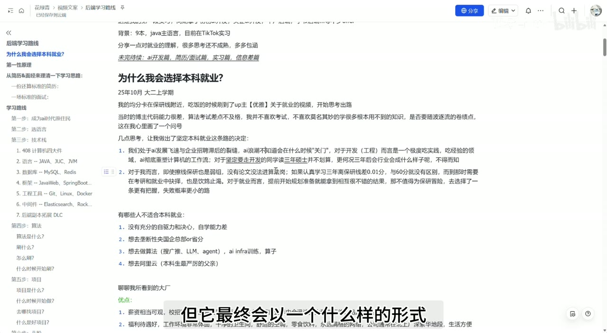

*图 01 · 00:02:29：页面列出本科就业决策的前提，以及自驱力、算法岗和学历门槛等不适配情形*

大厂开发岗位的吸引力被归纳为薪资、工作环境、人才密度和职业流动性；代价则包括强度、加班、不稳定和行业变化。职业流动性是其中容易被忽略的一项：当业务、团队或管理方式不合适时，市场化技能能够提供重新选择的可能。

这些判断具有明显的个人经验色彩。薪资差距、组织氛围和稳定性会随公司、团队、城市与经济周期变化，不能只凭公司类别作决定。

## 二、第一性原理：从面试结果反推学习

整条路线的核心命题是：

> 学习的目标是就业，就业的必要关卡是通过面试。

由此得到两个直接任务：

- 提高通过面试的概率；
- 写出具有辨识度、能够经受追问的简历。

“面试造火箭，工作拧螺丝”揭示了招聘与日常工作的错位：短时间面试无法观察一个人的全部能力，只能依赖简历、项目叙述、基础问答、算法题和现场表达形成判断。[00:08:24]

因此，学习不能只用“课程看了多少”“代码敲了多少”衡量。真正需要检验的是：

- 能否解释一个知识点解决了什么问题；
- 能否说明技术方案的选择理由；
- 能否识别极端条件下的失败方式；
- 能否比较备选方案；
- 能否把思考过程说清楚。

“确保简历上的每一句话都不会被问穿”是这套方法最重要的检查标准。自己完整敲过代码，也可能回答不了设计理由；能够解释场景、约束、取舍和故障边界，才说明形成了可用于面试的理解。[00:08:30]

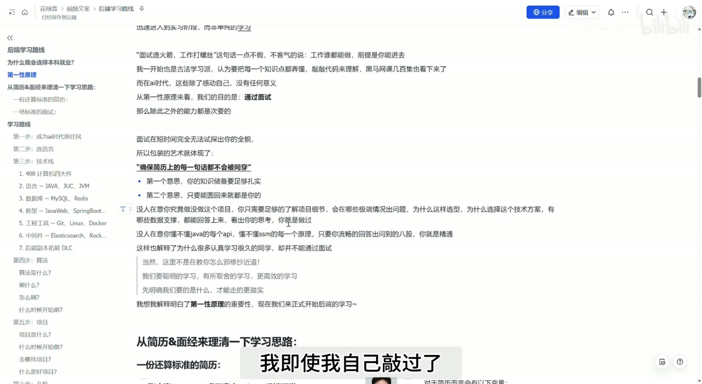

*图 02 · 00:09:06：页面突出“确保简历上的每一句话都不会被问穿”，并列出知识扎实与完整解释两层要求*

页面中的“只要能圆回来就是你的”是一种带有挑衅性的表达，容易被误读。更稳妥的执行边界是：可以借鉴公开项目、复现方案并深入研究，但不能捏造亲历、指标或职责；一旦简历声称自己完成了某项工作，就应当能够提供真实过程和可核查细节。

## 三、从标准简历和标准面试倒推可控变量

一份后端简历通常包含四部分：

1. 教育背景；
2. 实习经历；
3. 项目经历；
4. 技能与奖项。

教育背景在短期内很难改变。实习和项目可以持续积累，技能表述则需要与项目和面试回答相互印证。视频给出的辨识度排序大致是：**学历、实习、ACM 高水平成绩，高于普通项目和常见竞赛奖项**。[00:10:28]

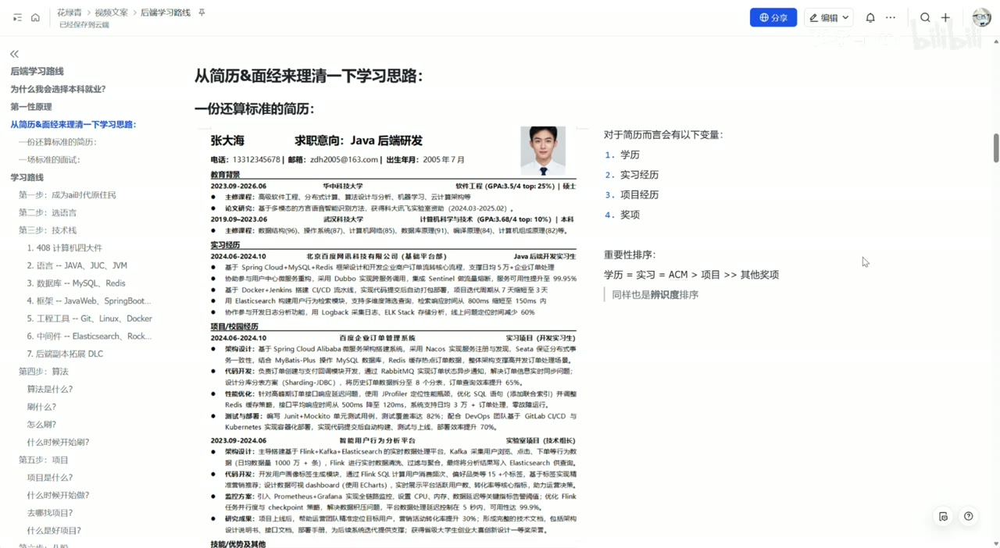

*图 03 · 00:10:45：画面展示标准 Java 后端简历，并在右侧列出学历、实习、项目、奖项四类变量及其重要性排序*

一场典型面试通常沿着以下路径推进：

1. 一到两分钟自我介绍；
2. 追问实习；
3. 追问项目；
4. 结合项目考察基础知识；
5. 场景题或智力题；
6. 一到两道算法题；
7. 候选人反问。

由此可以看出，项目、基础知识和算法构成了面试主干；实习决定了简历的可信度和辨识度；表达能力把所有材料连接起来。单纯增加技能表里的名词，收益通常有限。

## 四、先成为 AI 时代的学习者

进入具体技术栈之前，需要先搭好学习环境。[00:13:50]

视频给出的准备包括：

- 建立稳定的信息访问和检索环境；
- 注册并熟悉 GitHub；
- 深度使用 Codex、Claude Code、ChatGPT、Gemini 等 AI 工具；
- 学习 Vibe Coding 和 Spec Coding；
- 建立第一手信息收集渠道；
- 与同伴、社区和招聘信息保持连接。

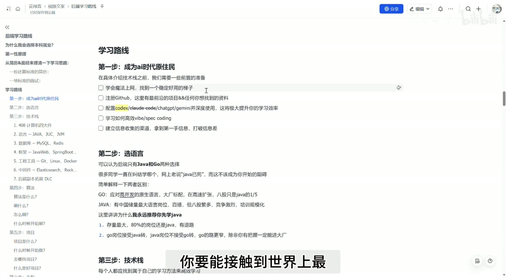

*图 04 · 00:14:04：页面以清单形式列出 GitHub、Codex 等 AI 工具、Vibe/Spec Coding 和信息渠道建设*

Vibe Coding 侧重通过自然语言对话推动实现；Spec Coding 会先准备产品说明、技术设计或规范文档，再让 AI 依据约束工作。后者通过显式边界减少沟通偏差和生成幻觉。

AI 也可以充当学习校验器：先用自己的语言解释刚学到的概念，再让 AI 指出漏洞、反例和缺失条件。这个方法的价值在于尽早发现错误根基，避免后续知识建立在误解之上。

但 AI 只能提供反馈，不能自动保证正确。有效的闭环应当是：

> 自己复述 → AI 追问 → 查阅资料或运行验证 → 修正理解 → 重新复述。

信息渠道同样属于技术能力。牛客、B 站、社交平台、同行和学习伙伴能够提供招聘节奏、面经和工具变化。只埋头写代码，很容易错过岗位开放时间、真实考点和行业变化。

## 五、语言选择：先建立一个可就业的主栈

视频把后端入门语言缩小为 Java 和 Go，并建议多数初学者优先选择 Java。[00:16:45]

给出的理由是：

- Java 岗位存量较大，资料和培训体系成熟；
- Go 在高并发和云原生场景中发展较快，需要记忆的传统八股相对较少；
- 部分 Go 岗位能够接受 Java 开发者转语言；
- Java 岗位通常更倾向已有 Java 经验的人。

这是一种求职覆盖面策略。视频中“约 80% 岗位是 Java”等数字属于个人估计，不宜视为精确统计。真正的选择依据应当是目标城市、目标公司和近期岗位描述。

语言学习强调语境和使用条件。Java SE 可以先完成一轮系统学习；JUC 和 JVM 随后扩展。纯背 API 的收益有限，更重要的是知道某个机制在什么条件下使用、解决什么问题、会产生什么代价。

## 六、技术栈：按面试权重分层学习

### 1. 408 基础

数据结构、计算机网络、操作系统和计算机组成原理构成计算机基础。建议顺序是：

1. 数据结构；
2. 计算机网络；
3. 操作系统；
4. 计算机组成原理。

前三项在开发面试中的出现频率更高。对于大一、大二学生，可以投入较完整的时间打基础；大三且即将求职的人，需要根据剩余时间取舍。[00:20:14]

这四类教材有较高门槛，刚入门时直接啃完整教材容易打击信心。视频建议至少完成基础语言学习后再进入，并先理解概念在场景中的作用。遇到暂时无法理解的细节，可以保留问题继续向后学习，等知识网络扩大后再回来补齐。

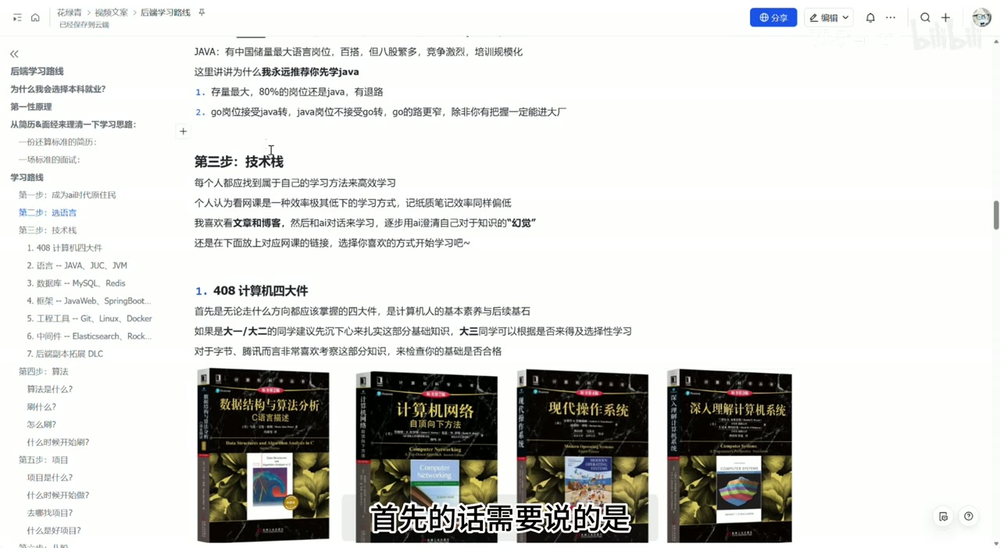

*图 05 · 00:19:02：画面展示数据结构、计算机网络、操作系统和计算机组成原理四本教材及建议学习顺序*

### 2. Java、JUC 与 JVM

Java SE 提供语法和常用 API；JUC 是并发工具体系；JVM 负责 Java 程序的运行机制。学习重点落在使用场景和机制联系上。[00:22:50]

推荐节奏是先完成 Java SE，进入后续项目；JUC 和 JVM可以在具备实践语境后继续深入。语言是后续数据库、框架和项目的承载层，值得多停留一段时间，但无需等到掌握全部底层细节才继续前进。

### 3. 数据库与缓存

MySQL 和 Redis 被列为后端面试的重点：前者主要承担持久化数据，后者常用于内存缓存和高性能访问。[00:24:00]

视频同时提出，可以根据方向把 MySQL 换成 PostgreSQL，理由包括向量数据和向量检索生态。这是一项面向 AI 应用的个人建议。对于一般 Java 后端岗位，仍应先查看岗位描述和项目依赖。

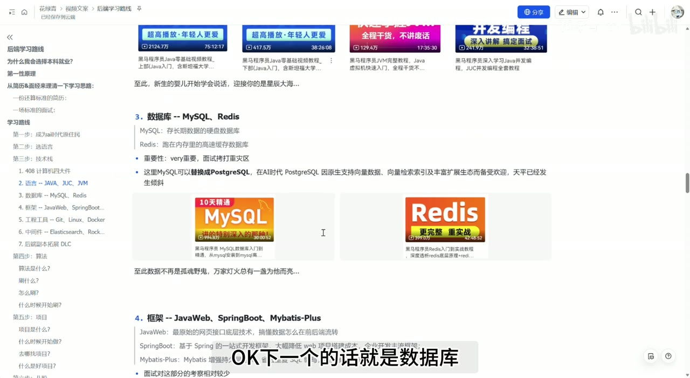

*图 06 · 00:24:00：页面并列展示 MySQL 与 Redis 学习入口，并强调数据库属于面试重点*

### 4. 框架与工程工具

Java Web、Spring Boot 和 MyBatis-Plus 主要服务于项目开发。视频判断这部分单独考察较少，因此建议以“会使用、能完成项目、理解关键路径”为阶段目标，再依据项目问题深入原理。

Git、Linux 和 Docker 的面试曝光度未必最高，却直接影响真实开发：

- Git 管理版本、分支、合并与协作；
- Linux 用于服务部署、日志排查和基础运维；
- Docker 打包运行环境，减少环境差异并简化部署。[00:26:00]

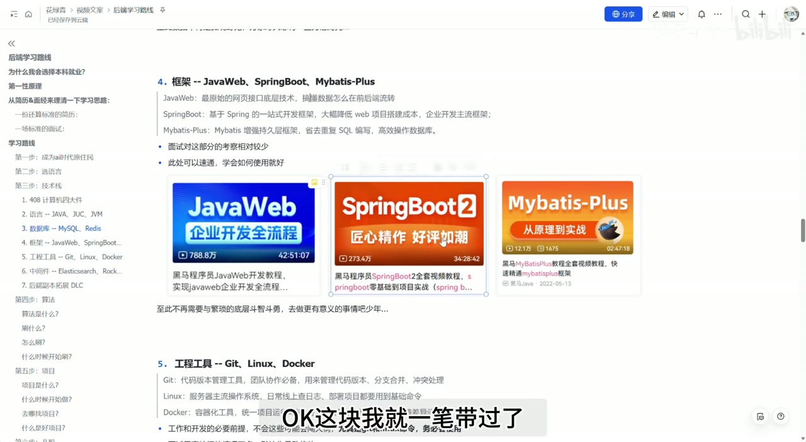

*图 07 · 00:25:40：画面列出 Java Web、Spring Boot、MyBatis-Plus，并衔接 Git、Linux、Docker 工程工具模块*

这些工具应通过实际操作学习。尤其是 Git，错误操作可能直接影响团队代码；仅观看教程难以建立操作判断。

### 5. 中间件与扩展项

核心中间件包括 Elasticsearch 和消息队列。消息队列可以从 RocketMQ、Kafka、RabbitMQ 中选择项目实际使用的一种。项目用了什么，就重点学习什么；无需为了扩充技能表同时堆满多个相似组件。

JDBC、Maven、传统 SSM、Nginx、Nacos、Spring Cloud、DDD、ZooKeeper、MongoDB、MinIO 和向量数据库等被放在扩展层。基础技术栈已经足够启动项目和准备面试，扩展项依据业务需要逐步补充。

## 七、算法：把“现场创造”改造成“题型复现”

算法题常出现在面试开头或结尾，一般为一到两道。形式可能是核心代码模式，也可能是需要自己处理输入输出的 ACM 模式。[00:28:35]

看到一道陌生题无法立即写出，属于正常现象。算法面试很大程度依赖题型经验；多数人的可行路线是积累母题、识别变化、重复复现，逐渐获得迁移能力。

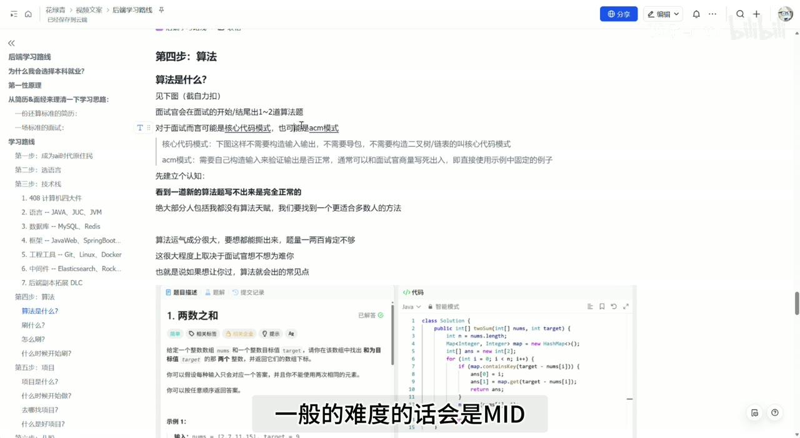

*图 08 · 00:28:58：画面展示“两数之和”的题面、Java 代码编辑器和测试通过状态，直观呈现核心代码答题模式*

准备方式分成两类：

- **时间充足**：跟随完整题单，按模块从母题向变体延伸，理解题目之间的细小差异。
- **面试临近**：集中训练 Hot 100 和 CodeTop 高频题，优先 Easy、Medium 与常见题型。

视频估计高频题能够覆盖相当比例的面试原题，并给出“70%—80%”的个人判断。这个比例缺少统计验证，可理解为强调高频题的投入产出比。

### 三遍刷题法

第一遍快速建立印象：三分钟仍无思路就看题解，找到自己能够理解的版本并保存。

第二遍在次日复现框架：先回忆解题结构，再补代码；遇到遗忘，分析自己漏掉的是状态定义、边界条件还是模板细节。

第三遍独立完成：能够主动说出易错点，并独立写出可通过的代码。随后继续用间隔复习对抗遗忘。[00:31:33]

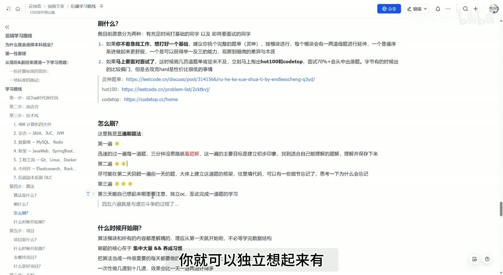

*图 09 · 00:32:17：页面完整列出第一遍看题解建印象、第二遍复现框架、第三遍独立完成的三遍刷题法*

算法与其他技术模块相对独立。确定语言后即可开始，无需等待技术栈全部学完。集中训练和固定时间段有助于形成题型识别速度；每天零散做一两道，可能难以建立连续的模式记忆。

## 八、项目：亮点来自问题、取舍和优化

项目是具有明确目标、能够运行落地并可完整讲述的作品。完成一个图书管理系统可以证明基本开发能力，但缺少足以进入简历的差异化。[00:33:33]

实现框架原有功能只是起点，真正的项目亮点来自：

- 为什么出现这个业务或性能问题；
- 原始方案的数据表现如何；
- 比较过哪些替代方案；
- 为什么选择当前方案；
- 方案引入了哪些新问题；
- 优化后的数据如何；
- 结论在哪些边界内成立。

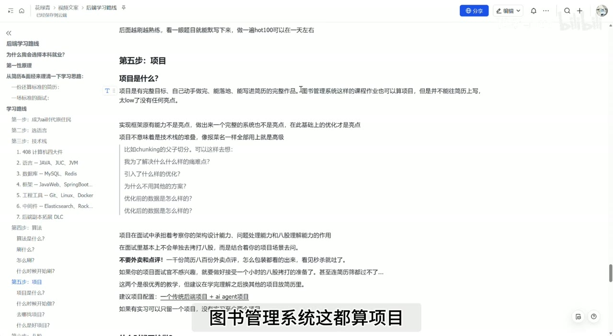

*图 10 · 00:33:56：页面用父子切分示例列出痛点、优化、方案比较以及优化前后数据等项目追问*

技术栈数量不能自动提高项目质量。每引入一个组件，都要说明必要性；讲不清必要性，组件只会扩大系统复杂度和面试追问范围。

一段可靠的项目表达可以沿着这条链展开：

> 业务场景 → 原始痛点 → 基线数据 → 候选方案 → 选择理由 → 实现过程 → 优化数据 → 局限与后续改进

项目还承担着连接八股的作用。面试官通常会从项目中的数据库、缓存、消息队列、并发或部署场景切入，再考察底层理解。因此，项目准备既要覆盖“做了什么”，也要覆盖“为什么这样做”和“失败时怎么办”。

视频建议用一个传统后端项目加一个 AI Agent 项目形成组合；实习内容足够丰富时可以减少项目，没有实习时至少准备两个。这属于录制时的个人配置建议，应根据简历篇幅和岗位要求调整。

启动项目有两条路线：

1. 学完语言后边做边学，用到什么补什么；
2. 完成主要技术栈后再做项目，用项目完成复习和整合。

视频更偏好第一条，因为反馈更快。无论采用哪条路线，项目都需要完整文档、测试样例、必要的压测和真实数据，指标不可凭空编造。

## 九、八股：把知识组织成可追问的表达

“八股”指技术面试中的高频基础问题。答案看似固定，实际仍能通过场景、边界、取舍和表达深度拉开差距。[00:37:08]

准备时间可以靠近面试期。更激进的路线会直接通过八股目录建立技术栈框架，但底层理解容易变薄，适合时间极少且能够主动验证的人。

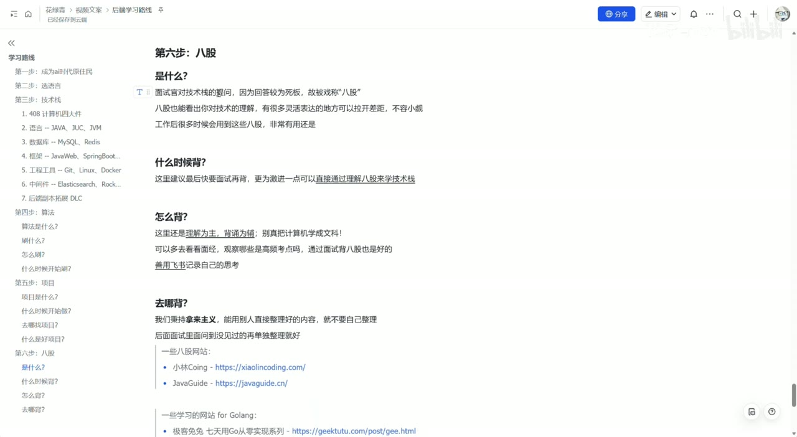

*图 11 · 00:37:15：页面解释八股的含义、准备时间、理解优先的背诵方式和资料来源*

有效准备强调理解优先：

1. 先说清楚概念解决什么问题；
2. 给出真实使用场景；
3. 说明常见实现或执行过程；
4. 补充失败条件和权衡；
5. 用项目经历连接答案；
6. 根据面经持续修正高频问题。

可以直接利用已经整理好的 JavaGuide、小林 Coding 等资料，减少重复汇总。个人笔记更适合记录自己的错误、项目细节、面试遗漏和独特理解，而非再次复制公共知识库。[00:38:47]

## 边界、疑点与时效性

### 1. 这是一条面试导向路线

路线把“通过面试”放在最高优先级，可以有效压缩学习范围。长期工程能力仍需要代码质量、调试、测试、协作、系统维护和线上责任。面试通过只是进入实践环境的门票。

### 2. 本科就业结论依赖个人条件

学历门槛、学校背景、目标岗位、家庭承受能力和个人自驱力都会改变选择。开发岗位与算法研究岗位不能共用同一套学历判断。

### 3. AI 工具评价变化很快

关于 Codex、Claude Code 的可用性、额度和性价比，属于 2026 年录制时的个人判断。工具策略应关注可获得性、任务效果、隐私边界和费用，避免依赖单一产品。

### 4. 岗位比例和题目命中率缺少统计支持

Java 岗位占比、高频题覆盖率、大厂与央国企薪资差距等数字都应视为经验估计。它们可以帮助形成假设，不能代替对目标岗位的实际调查。

### 5. “简历不被问穿”需要真实性约束

深入理解复现项目具有学习价值，伪造职责、经历和指标会带来诚信风险。简历中的每项成果都应能够追溯到真实行动、代码、文档或测试结果。

### 6. 广度优先需要补深度机制

暂时跳过难点可以维持学习速度，但必须保留问题清单，并在项目、面试准备或复习阶段补齐。持续跳过会形成无法解释的知识空洞。

## 时间戳导航

- [00:00:09] AI 快速发展时期，后端应该怎样学习
- [00:01:55] 选择本科就业的个人原因
- [00:03:45] 决策依赖的前提与不适配人群
- [00:07:18] 用第一性原理确定学习终点
- [00:08:24] 面试无法观察候选人的全部能力
- [00:10:28] 从标准简历反推可控变量
- [00:13:50] 成为 AI 时代的原住民
- [00:16:45] Java 与 Go 的选择
- [00:19:00] 技术栈与个人学习方法
- [00:20:14] 408 四类计算机基础
- [00:22:50] Java、JUC 与 JVM
- [00:24:00] MySQL、Redis 与 PostgreSQL
- [00:26:00] Git、Linux 与 Docker
- [00:28:35] 算法题的形式与基本认知
- [00:31:33] 三遍刷题法
- [00:33:33] 项目的定义与亮点来源
- [00:37:08] 八股的作用与准备方法
- [00:38:47] 学习资料和个人记录体系

## 复习与行动清单

### 决策

- [ ] 写下自己的目标岗位、学历门槛和求职时间点。
- [ ] 评估自驱力、可投入时间和失败后的退路。
- [ ] 查看真实岗位描述，再决定 Java、Go 或其他主语言。

### 学习基础设施

- [ ] 建立 GitHub、面经、招聘信息和技术资料入口。
- [ ] 选择至少一种 AI 工具，练习复述、追问和验证。
- [ ] 为知识疑点保留清单，避免跳过后永久遗忘。
- [ ] 建立个人记录系统，只保存错误、洞见和真实经验。

### 技术栈

- [ ] 完成 Java SE 或目标语言基础。
- [ ] 补数据结构、网络、操作系统和组成原理。
- [ ] 重点掌握数据库、缓存及其常见面试问题。
- [ ] 用项目练习 Spring Boot、Git、Linux 和 Docker。
- [ ] 依据项目选择 Elasticsearch 或一种消息队列。

### 算法

- [ ] 选定语言后立即开始。
- [ ] 时间充足时按题型和母题推进。
- [ ] 面试临近时集中训练高频题。
- [ ] 对每道重点题执行“看懂—次日复现—独立完成”。
- [ ] 建立错题和易忘边界条件清单。

### 项目与面试

- [ ] 为每个项目写出场景、痛点、方案、数据和局限。
- [ ] 删除无法解释必要性的技术组件。
- [ ] 确保简历每一句话都能回答连续追问。
- [ ] 用项目串联数据库、并发、中间件和系统设计知识。
- [ ] 根据真实面经整理高频八股，并用自己的语言回答。
- [ ] 每次模拟或正式面试后记录失误，进入下一轮修正。
