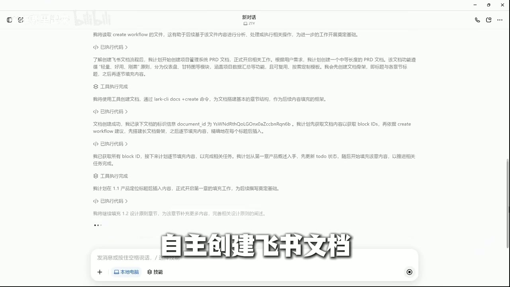
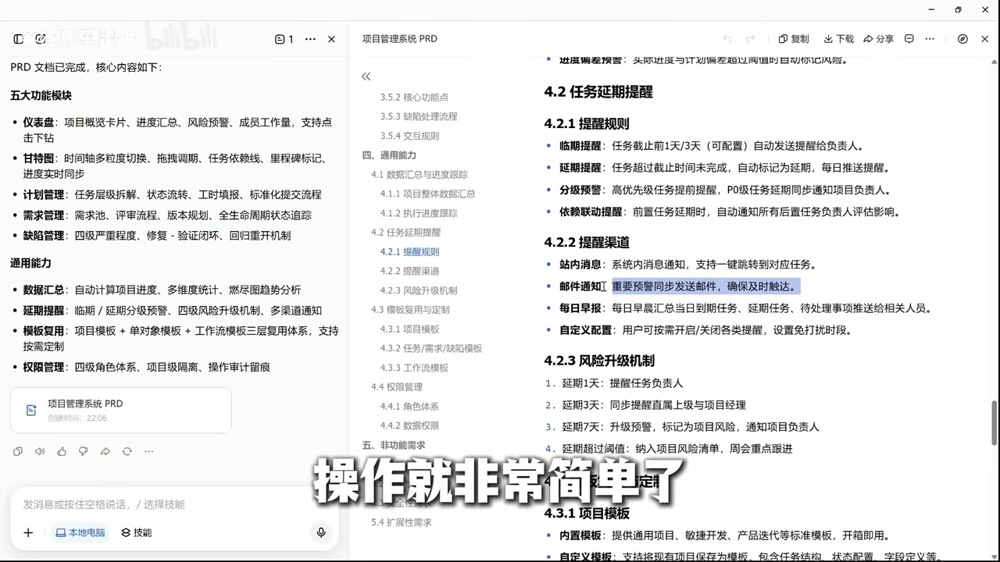
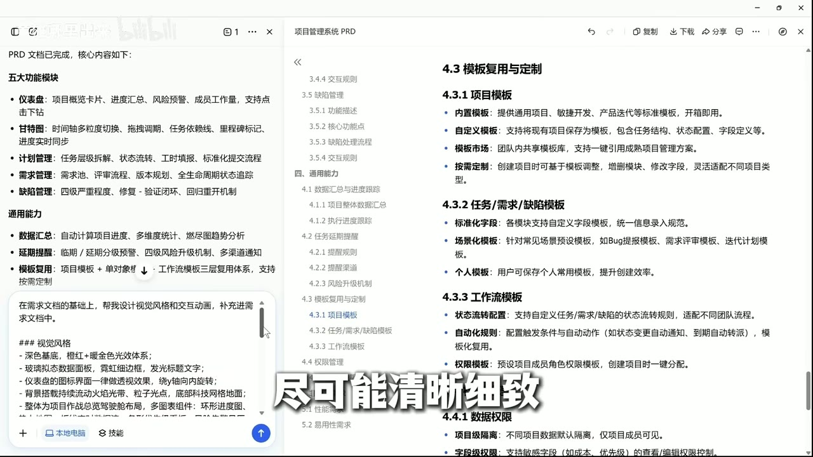
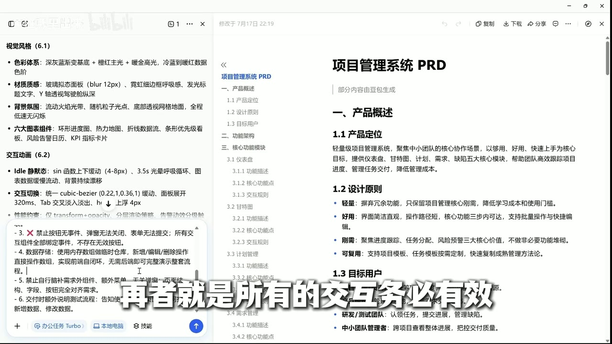
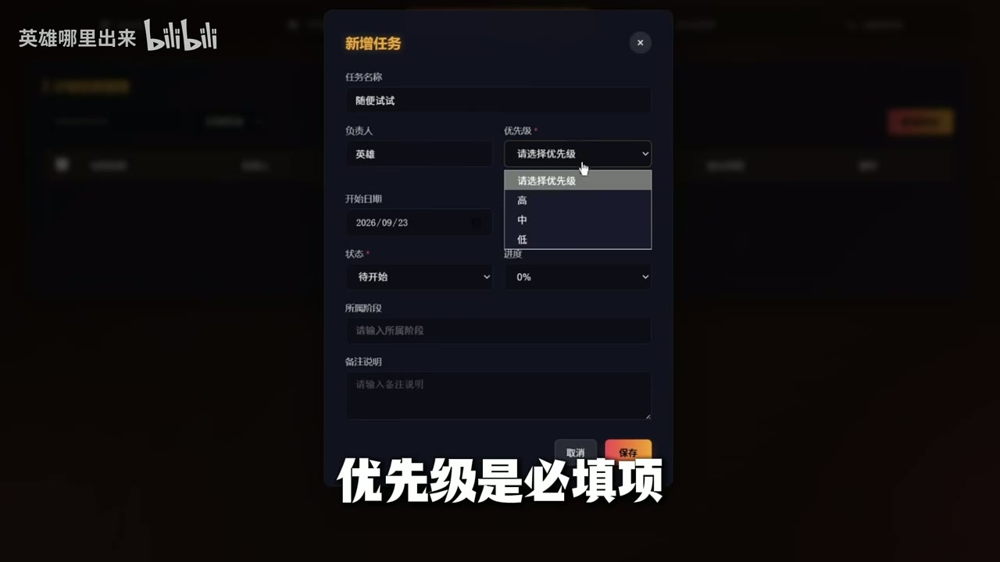

# 2分钟VibeCoding项目管理系统(建议收藏)｜文档见评论区【B站AI创造公开赛】

> 上传者：英雄哪里出来 
> 时长：03:04 
> 链接：https://www.bilibili.com/video/BV1Qfg56sEfb/ 
> BV号：BV1Qfg56sEfb 
> 总结强度：standard 
> 证据：本地逐字稿、字幕审计、8 张带时间码的候选画面。字幕整体可用，个别同音识别已按语境谨慎校正，如“点击”“增删改查”。

## 一句话抓住核心

我可以把 VibeCoding 从“直接让 AI 写一个项目”改成一条可控流程：先让 AI 扩写 PRD，再由我删减范围、补足视觉与交互规则，最后带着明确的真实数据、增删改查和存储要求生成可操作应用。

## 推理主干

1. 并行项目一多，项目管理工具的成本与功能缺口会放大。[00:00:03]
2. 模糊想法先交给 AI 组织成 PRD，减少从零写需求的负担。[00:00:21]
3. AI 扩写后的内容必须由人做减法，因为取舍带有主观目标。[00:00:41]
4. 功能需求无法自然推出理想界面，视觉风格和交互规则需要单列、写细。[00:01:06]
5. 生成应用时要把数据真实性、完整操作、交互有效性、存储方式写成验收条件。[00:02:00]
6. 最后通过实际新增任务和列表呈现检查结果，再继续迭代。[00:02:23]

## 先把模糊目标变成可删改的 PRD

我不必一开始就给出完整需求。先说明大致要做什么，再在“办公任务”中选择本地电脑与文档能力，让 AI 产出项目管理系统的 PRD。[00:00:21] 这一步的价值在于，它会按关键词拆解需求、搭建文档结构，并逐模块填充内容。[00:00:34]

画面中可见 AI 的执行过程：它读取工作流文件后，创建飞书文档、获得文档 block ID，再按章节逐步填充；这让“生成 PRD”落在可检查的文档操作上。

*图 01 · 00:00:34：界面显示 AI 正在创建飞书文档、获取文档结构并逐章填充内容，支撑从关键词生成 PRD 的过程。*

生成出的 PRD 往往很全，项目管理功能可覆盖仪表盘、甘特图、计划管理、需求管理、缺陷管理，以及数据汇总、延期提醒、模板复用、权限管理等。[00:00:41] 这些内容可以作为候选范围，不能自动视为最终范围。

## 人的工作：做减法，决定“我到底要什么”

需求精简是流程中不可省略的一段。[00:00:47] AI 无法替我判断某个模块是否值得做：角色体系、权限或安全设计对团队产品可能重要，对个人自用工具却可能只是负担。[00:01:02]

我可以直接从 PRD 的大标题和模块结构入手，把不需要的章节删除。这样更容易保持产品边界清楚，也能让后面的应用生成少走偏路。

*图 02 · 00:00:57：PRD 页面左侧列出五大功能模块与通用能力，右侧展示延期提醒规则，支撑按章节审阅和删减需求。*

这里的关键判断是：PRD 的完整度不等于项目的合适度。功能数量越多，后续生成、验证与维护的成本也越高；我应保留真正服务于当前使用场景的部分。

## 再补一层：让界面和交互变成明确规则

功能性需求只回答“系统做什么”，并未充分回答“它长什么样、怎么反馈、怎么动”。[00:01:06] 因此我需要追加视觉风格和交互动画要求，写得越具体，结果越接近目标。[00:01:16]

画面中的提示内容把这层要求拆成可执行条目：深色基底、暖色主光、玻璃拟态面板、火焰光带背景、环形进度图等视觉元素；交互上则约束悬浮、切换、性能、按钮与表单反馈等状态。[00:02:07]

*图 03 · 00:01:20：输入框中列出深色基底、暖色主光、玻璃拟态、粒子与火焰背景等具体视觉和交互要求。*

*图 04 · 00:02:07：左侧可见“视觉风格”和“交互动画”的细化规则，右侧 PRD 已形成对应章节，支撑把设计要求写入需求文档。*

如果这一层缺失，生成结果会更接近默认界面。[00:01:23] 我应把视觉语言、页面层级、动效状态、操作反馈和性能边界一起写进文档，再据此生成应用。[00:01:34]

## 生成应用时，把“可用”写成验收条件

进入“应用生成”能力后，需求不能只停留在页面清单。[00:01:51] 我至少要明确四类条件：

- 不要用假数据，或明确哪些阶段允许使用演示数据。[00:02:01]
- 要真正实现增删改查，数据不能只停留在静态展示。[00:02:03]
- 每个可见交互都要有效，按钮、弹窗、表单与筛选都应有真实反馈。[00:02:05]
- 指定数据如何存储，避免界面完成后数据无法留存。[00:02:07]

这些条件让 AI 的工作方向更明确，也把“炫酷页面”推进到“可操作应用”。[00:02:12]

## 用一次真实操作验证生成结果

初始界面即使没有数据，也可以立刻用新增任务来验证：填写负责人、开始与截止时间、任务名称，再保存。[00:02:23] 当保存受阻时，界面显示“优先级”为必填项；补全后才能继续，这种校验直接证明表单存在业务约束。[00:02:30]

*图 05 · 00:02:30：“新增任务”弹窗中优先级带必填星号且下拉菜单展开，直接支撑表单校验与任务字段设计。*

最终的列表界面呈现任务名称、负责人、优先级、进度、状态、截止时间以及编辑和删除入口。[00:02:36] 这能用来核对“任务管理”是否真正落地，而非只生成了一个静态首页。

*图 06 · 00:02:53：计划任务管理页以表格展示负责人、优先级、进度、状态和操作列，支撑任务的查询与管理结果。*

## 编码问题要与生成质量分开排查

中文乱码不必先归因于模型输出。[00:02:41] 本地文件编码也会造成显示异常；素材中给出的排查方向是检查 GBK 与 UTF-8，并尝试转换编码。[00:02:46] 实际项目仍应结合编辑器、终端、文件保存编码和运行环境逐项确认。

## 边界、疑点与时效性

- 这是一段约三分钟的流程演示，证据展示了 PRD、提示要求、表单和任务列表，未提供完整代码、数据库实现或端到端测试记录。
- 画面中的成品功能与样式只能证明该录屏时的界面状态；跨刷新持久化、异常处理、权限安全与多人协作效果仍需自行验证。
- 字幕中“全程只用到豆包”属于录制者的工具与流程选择。[00:00:12] 同样的思路可迁移到其他具备文档和应用生成能力的工具，具体入口与能力会随版本变化。
- 录屏中的日期、任务数据和视觉效果可视作演示样例，不应直接当作真实项目数据。

## 时间戳导航

- [00:00:00] 并行开发为什么需要项目管理系统
- [00:00:08] 现有工具的收费与功能缺口
- [00:00:21] 用模糊想法让 AI 生成 PRD
- [00:00:32] AI 创建飞书文档、拆解并填充需求
- [00:00:41] PRD 过多时需要需求精简
- [00:00:55] 用大标题快速做需求删减
- [00:01:06] 功能需求之外还要描述界面
- [00:01:16] 补充视觉风格与交互动画
- [00:01:34] 带着规则自动生成应用
- [00:02:00] 应用生成的四项关键约束
- [00:02:12] 文档越清楚，生成方向越明确
- [00:02:23] 新增一条任务验证表单
- [00:02:30] 优先级必填的校验反馈
- [00:02:36] 添加效果与数据后的成品
- [00:02:41] 中文乱码的本地编码排查

## 复习与行动清单

- [ ] 先用一句话写清项目目标、使用者和最小功能范围。
- [ ] 让 AI 把粗略描述扩写成 PRD，再逐章删除不需要的模块。
- [ ] 单独补充视觉、交互、状态反馈和性能规则。
- [ ] 在生成指令中写明真实数据、增删改查、有效交互与存储方式。
- [ ] 用一条真实新增数据完成冒烟验证：创建、保存、展示、编辑或删除。
- [ ] 若中文显示异常，先检查文件与运行环境的 GBK、UTF-8 编码设置。
