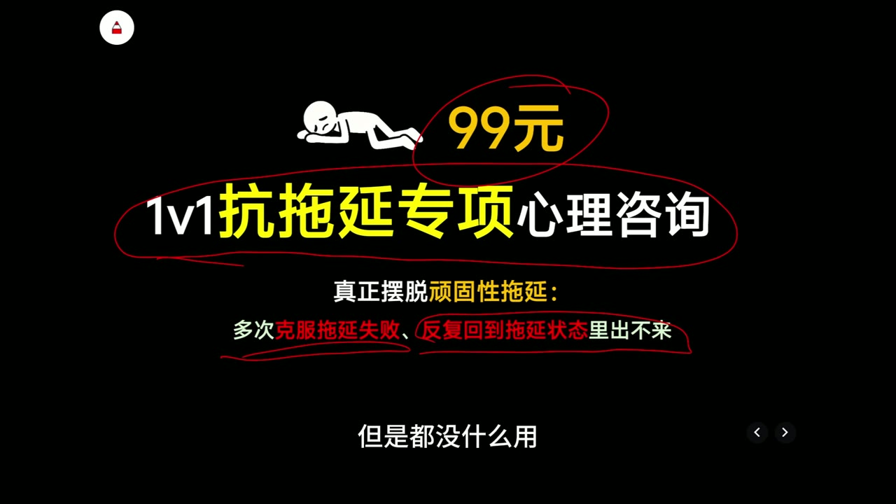
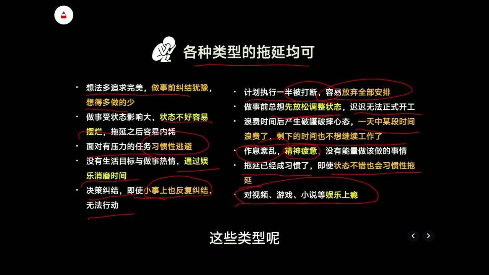
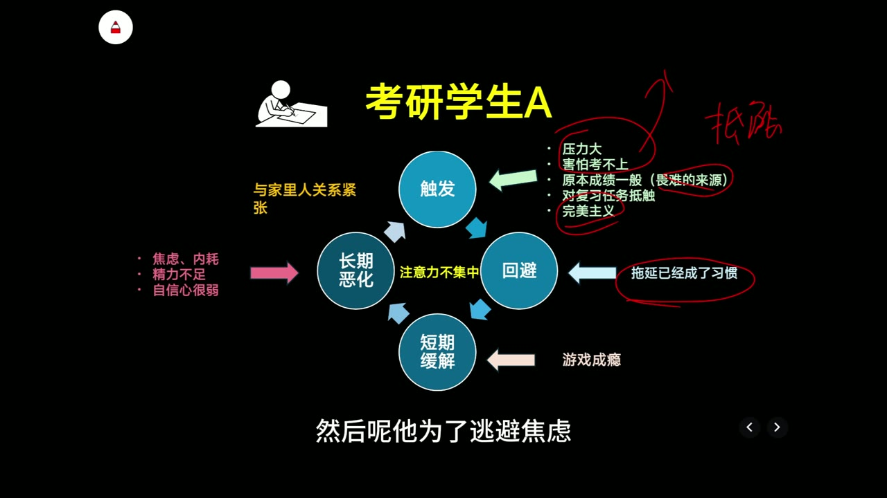
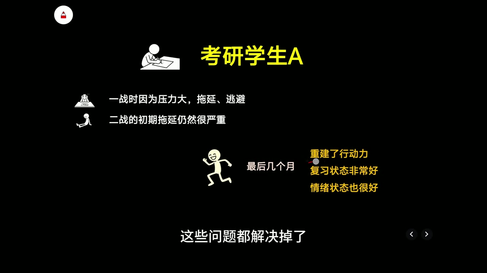
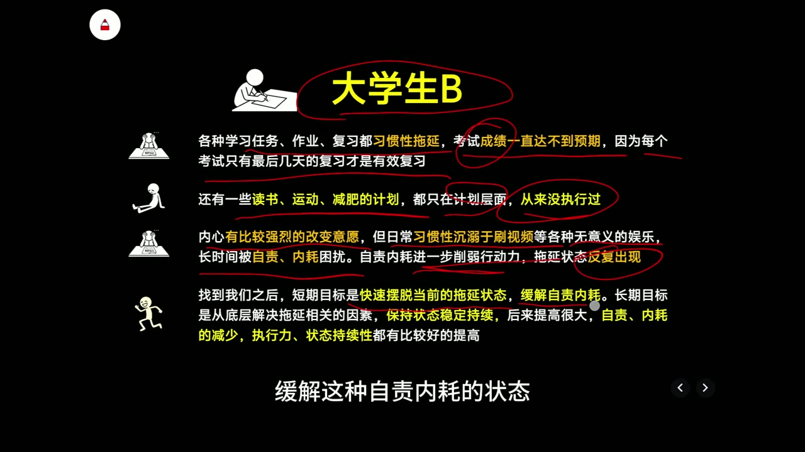
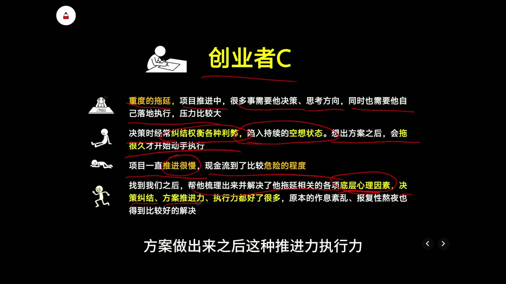
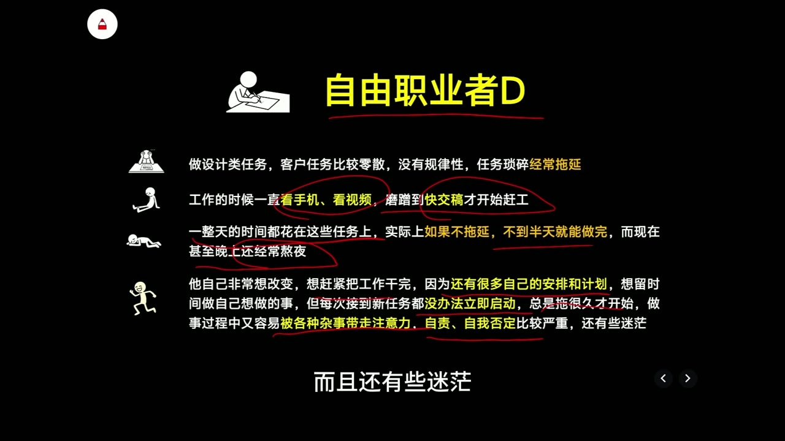
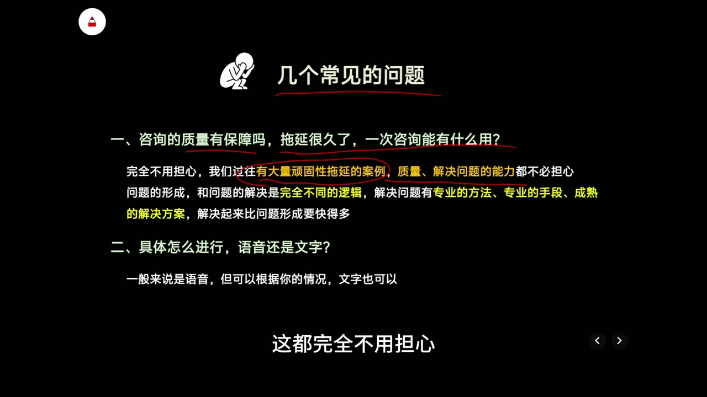
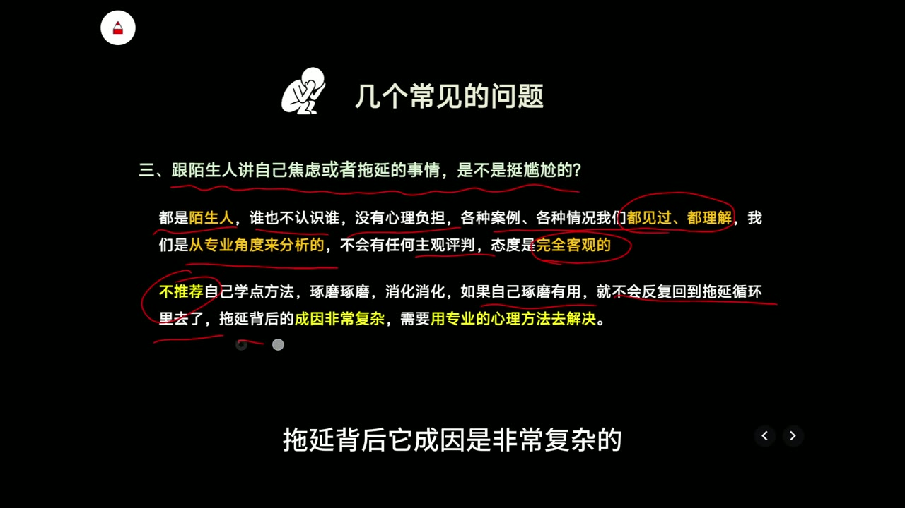

# 拖延久了陷入自我否定，总觉得自己一事无成、人生没希望怎么破

- **UP 主**：陈晓宇KeepGoing
- **时长**：08:30
- **发布日期**：2026-01-18
- **链接**：[BV13DkxBYEKM](https://www.bilibili.com/video/BV13DkxBYEKM/)
- **总结强度**：deep
- **证据来源**：本地视频逐字稿与 17 张时间戳候选画面。逐字稿由 faster-whisper small 生成，共 311 个片段，语种识别概率约 99.88%；部分同音词存在误识别，已结合上下文和画面谨慎校正。
- **内容性质**：以 99 元“1v1 抗拖延专项心理咨询”的服务宣传、匿名案例和常见疑问答复为主。

## 一句话抓住核心

长期拖延可以形成“压力或完美主义 → 回避 → 娱乐带来的短期缓解 → 任务恶化 → 自责、疲惫与注意力下降 → 更强回避”的循环；这套循环模型有助于理解自我否定，但片中没有公开具体干预方法，也没有提供足以独立验证服务效果的证据。

## 推理主干

1. **拖延是可见行为**：迟迟不开始、做到一半放弃、临近截止才赶工。
2. **行为前面有触发因素**：压力、害怕失败、完美主义、决策纠结、状态依赖。
3. **回避会立即减轻不适**：刷视频、玩游戏或反复做计划，让人暂时离开焦虑。
4. **短期缓解制造长期代价**：任务堆积、成绩或项目受损、熬夜赶工。
5. **长期代价反过来削弱行动**：自责、内耗、疲惫和注意力涣散，使启动更加困难。
6. **稳定改变需要拆解循环**：至少要识别触发、回避方式、即时收益、延迟代价和反馈强化五个环节。
7. **服务效果仍需另行判断**：匿名案例可以说明一种解释框架，无法单独证明具体方法、成功率或适用范围。

## “顽固性拖延”在这里指什么

片中把“尝试过一些克服拖延的方法，短暂好转后又反复回到原状态”定义为顽固性拖延。[00:00:08] 它强调的判断线索是**反复性**：一个人可能靠决心坚持几天，但压力、情绪和环境没有改变，很快又恢复原来的回避模式。

开头同时展示了“99元”“1v1抗拖延专项心理咨询”，因此后续内容兼有问题解释和商业推介双重目的。

*图 01 · 00:00:15：画面直接展示“99元”和“1v1抗拖延专项心理咨询”，明确了整段内容的商业服务背景*

片中的核心判断是：“拖延只是表现出来的一个表象”，背后可能有多种复杂因素。[00:00:31] 这一判断与四个案例的叙述一致，但“靠自己没有办法解决”属于服务方立场，逐字稿没有提供对照资料来证明它适用于所有人。

## 拖延可能以哪些形式出现

片中列出的类型横跨认知、情绪、习惯和环境四个层面：[00:01:01]

- **认知层面**：追求完美、想得多做得少、反复纠结小决定。
- **情绪层面**：面对有压力的任务就逃避，状态不好时容易摆烂。
- **启动与持续层面**：行动力弱；计划被打断后干脆放弃；总想先放松一下再开始。
- **全盘放弃**：上午浪费后，觉得整天已经毁掉，下午也不继续工作。
- **身心状态**：作息紊乱、精神疲惫，缺少做事能量。
- **习惯与诱惑**：拖延已成为自动反应；对视频、游戏、小说等娱乐形成依赖。

*图 02 · 00:01:45：画面把完美主义、状态依赖、压力逃避、决策纠结、计划中断、精神疲惫和娱乐上瘾并列呈现，说明“拖延”包含多条可能路径*

这些类型不能直接视为诊断。更有用的做法是询问：**我在哪种任务前最容易拖延？当时最想躲开的感受是什么？我用什么活动获得了即时缓解？**

## 案例 A：考研压力如何发展成自我强化循环

第一位案例是一名准备二战的考研学生。[00:01:50] 一战期间，他因为压力大、害怕考不上而拖延逃避；失败经历又提高了二战的心理压力。

这个案例包含多层触发因素：

- 原本成绩一般，对考试已有畏难情绪；
- 害怕再次失败；
- 完美主义明显；
- 一旦起床晚、学习状态低于预期，就认定“这一天废了”，随后放弃继续学习。[00:02:21]
- 拖延持续较久，回避逐渐习惯化；
- 为了逃避焦虑而沉迷游戏，随后又受到游戏问题影响；
- 家庭关系紧张，额外增加压力。

这些因素可以整理为一条循环：

**考试压力与失败恐惧 → 对复习产生抵触 → 拖延和游戏回避 → 暂时逃开焦虑 → 学习进度下降 → 焦虑、自责与慢性压力增加 → 精力不足、注意力不集中 → 更难投入复习。**

*图 03 · 00:02:45：画面用“触发—回避—短期缓解—长期恶化”四个节点画出循环，并在周围标出压力、完美主义、拖延习惯、游戏成瘾和家庭关系紧张*

这里最值得保留的经验是：**自我否定既是拖延的结果，也可能成为下一轮拖延的触发因素。** 当“今天没做好”被扩大成“我什么都做不好”，任务评价便滑向人格评价，行动成本随之升高。

片中声称，经过一系列“专业心理方法”后，该学生重建了行动力，最后几个月复习和情绪状态良好，并取得满意成绩。[00:03:32]

*图 04 · 00:03:45：画面将该案例概括为前期压力与逃避、二战初期仍严重拖延，随后声称最后几个月重建行动力、复习和情绪状态改善*

这项结果缺少方法名称、咨询次数、成绩变化、随访期限和当事人原始材料，适合记录为**服务方陈述的案例结果**。

## 案例 B：改变愿望很强，执行却长期停留在计划里

第二位案例是一名大学生。他的学习、作业和复习长期拖延，考试前只有最后几天能够有效复习，成绩持续低于预期；读书、运动和减肥计划也一直停留在计划层面。[00:03:56]

他的循环更突出“自责削弱行动”：

**想改变 → 没有执行 → 刷视频获得低成本娱乐 → 自责和内耗 → 行动力进一步下降 → 再次拖延。**

片中给出的服务目标分为两层：

- **短期**：快速摆脱当前拖延状态，缓解自责和内耗；
- **长期**：处理与拖延相关的底层因素，让状态保持稳定和可持续。

*图 05 · 00:04:45：画面完整列出大学生的习惯性拖延、计划从未执行、自责内耗，以及“短期脱离状态、长期处理底层因素”的目标划分*

这一划分有启发性：当人已经陷入严重自责时，先降低内耗、恢复最小行动能力，可能比继续增加宏大计划更容易启动。片中仍未展示如何实现这两个目标。

## 案例 C：决策纠结让创业项目停在空想阶段

第三位案例是一名创业者。项目中的许多事情需要他判断方向、权衡利弊，同时还要亲自落地执行，压力因此集中到同一个人身上。[00:05:04]

他的拖延链条是：

**决策压力 → 反复权衡 → 持续空想 → 即使形成方案也迟迟不动手 → 项目推进缓慢 → 现金流风险升高。**

*图 06 · 00:05:45：画面标出创业者在决策中纠结权衡、陷入持续空想、方案形成后仍拖很久才执行，以及项目和现金流风险*

片中声称，梳理并处理“底层心理因素”后，这名创业者的决策、方案推进和执行力都有改善，作息紊乱与报复性熬夜也得到缓解。由于具体过程没有公开，能够提取的是问题结构，无法据此判断干预效果大小。

## 案例 D：零散任务造成“忙了一天却没做多少”的错觉

第四位案例是一名从事设计工作的自由职业者。[00:05:55] 客户任务零散、缺少规律，他接到任务后不会马上启动，而是看手机、看视频，一直拖到快交稿才赶工。

原本不到半天可能完成的任务，被拉长到一整天，甚至需要熬夜。工作占据了整天，但真正投入任务的时间并不多，原本打算用于自我提升的时间也被挤掉。

随着这种模式重复，他出现了明显的自责、自我否定和迷茫；工作中又容易被杂事带走注意力，使启动困难与持续困难同时存在。

*图 07 · 00:06:45：画面呈现自由职业者看手机和视频、拖到交稿前赶工、简单任务耗费整天，以及自责、自我否定和迷茫的完整链条*

这个案例提示我区分三件事：

- **任务耗时**：真正完成工作需要多久；
- **任务占用**：从收到任务到交付，心理上被它占据了多久；
- **有效投入**：期间有多少时间真正用于推进任务。

拖延可能没有增加任务本身的工作量，却显著扩大了任务占用，并吞掉休息和个人安排。

## 从四个案例抽出的自查模型

基于片中的案例，可以得到一张用于观察自身模式的表。它是对本地材料的谨慎整理，不等同于片中未公开的咨询方案。

| 环节 | 自查问题 | 案例中的表现 |
|---|---|---|
| 触发 | 哪类任务一出现，我就开始不安？ | 考试、重要决策、客户交稿 |
| 预期与解释 | 我给任务附加了什么要求？ | 必须达到完美状态；再次失败无法接受 |
| 回避行为 | 我具体做了什么来推迟接触任务？ | 游戏、刷视频、空想、反复权衡 |
| 即时收益 | 回避当下替我减轻了什么？ | 暂时避开焦虑、压力与失败感 |
| 延迟代价 | 几小时或几天后发生了什么？ | 进度落后、熬夜、成绩或项目受损 |
| 反馈强化 | 后果如何推动下一轮拖延？ | 自责、疲惫、注意力下降、任务抵触增强 |

实际记录时，一次只分析最近发生的一轮。例如：“收到任务后担心做不好 → 刷视频四十分钟 → 当下轻松 → 晚上赶工 → 睡眠不足 → 第二天更难启动。”具体链条比“我就是没用”更接近可处理的问题。

## 商业论证中的关键跳跃

在常见疑问部分，片中依次回应了咨询是否有效、一次咨询是否有用、语音还是文字、向陌生人倾诉是否尴尬。[00:06:58]

*图 08 · 00:07:15：画面列出“咨询质量是否有保障、拖延很久一次咨询有什么用、采用语音还是文字”三个购买疑问*

其中可确认的服务信息只有：

- 标价为录制时展示的 99 元；
- 一般采用语音，也可以根据情况使用文字；
- 服务方声称会从专业角度分析、不作主观评判。

片中用“问题的形成和问题的解决是完全不同的逻辑”说明长期问题可能较快改善，并声称自己拥有专业方法、手段和成熟方案。[00:07:20] 这属于服务方承诺，材料没有展示咨询流程、资质、方案内容、失败案例或效果统计。

结尾进一步主张，自己琢磨若有效，就不会反复进入拖延循环；拖延成因复杂，需要专业心理方法处理。[00:08:03]

*图 09 · 00:08:15：画面强调“不推荐自己学点方法”和“拖延成因非常复杂，需要专业心理方法”，这是服务方对自助与咨询关系的直接主张*

最后一句把“再想一想是否购买”也归入拖延，并催促立即行动。[00:08:19] 这是一种强推动式销售表达。对购买服务进行资质、隐私、适配性和退款条件核查，仍然属于合理决策过程，不能仅凭犹豫就判定为拖延。

## 边界、疑点与时效性

1. **标题与实际内容有落差** 
   标题提到“一事无成、人生没希望怎么破”，逐字稿主要讨论拖延循环和咨询服务，没有专门分析绝望感，也没有提供针对严重情绪危机的处理信息。

2. **案例全部匿名且由服务方转述** 
   四个案例没有当事人原话、可核验结果、量表变化、咨询次数或长期随访。

3. **具体方法没有公开** 
   “专业心理方法”“底层心理因素”“成熟解决方案”反复出现，但材料没有说明方法名称、操作步骤、适应证或风险。

4. **服务资质与保障信息缺失** 
   本地证据没有出现咨询者资质、机构主体、隐私政策、退款规则、危机转介机制和服务边界。

5. **价格具有录制时效性** 
   99 元是视频画面展示的录制时价格，不能据此确认其他时间仍然有效。

6. **转写存在少量错误** 
   审计显示语音连续、无明显长段缺失，但若干词语发生同音误识别。学习笔记只对能结合上下文或画面确认的内容作了校正。

## 时间戳导航

- [00:00:08] “顽固性拖延”的定义：反复回到拖延状态
- [00:00:31] 核心立场：拖延是表面行为，背后可能有复杂因素
- [00:01:01] 完美主义、压力逃避、决策纠结等拖延类型
- [00:01:50] 考研学生案例开始
- [00:02:21] 完美主义与“今天已经废了”的全盘放弃
- [00:02:45] 游戏回避、焦虑内耗、疲惫和注意力下降
- [00:03:32] 服务方对考研案例干预与结果的陈述
- [00:03:56] 大学生的计划、自责和拖延循环
- [00:05:04] 创业者的决策纠结与项目推进困难
- [00:05:55] 自由职业者拖到交稿前赶工
- [00:06:58] 咨询服务常见疑问
- [00:08:19] 将购买犹豫解释为拖延并催促行动

## 复习与行动清单

### 我需要记住

- 拖延可能承担着“暂时逃离压力”的功能。
- 自责会消耗精力，并可能推动下一轮回避。
- “一天没按计划开始”不等于余下时间失去价值。
- 同样的拖延表现，可能来自失败恐惧、完美主义、习惯、疲惫、环境压力或娱乐依赖。
- 匿名成功案例能提供理解线索，不能替代对方法、资质和效果的核验。

### 我可以立即做的观察

- [ ] 选择最近一次真实拖延，写下触发任务。
- [ ] 写下开始回避前最明显的想法和情绪。
- [ ] 记录具体回避行为及其带来的即时缓解。
- [ ] 记录它造成的延迟代价。
- [ ] 把“我一事无成”改写成可观察事实，例如“今天计划学习三小时，实际完成四十分钟”。
- [ ] 找出循环中最容易改变的一个节点，只验证一次小变化。
- [ ] 若考虑购买相关服务，先核对人员资质、方法边界、隐私保护、费用、退款和危机处理机制。
