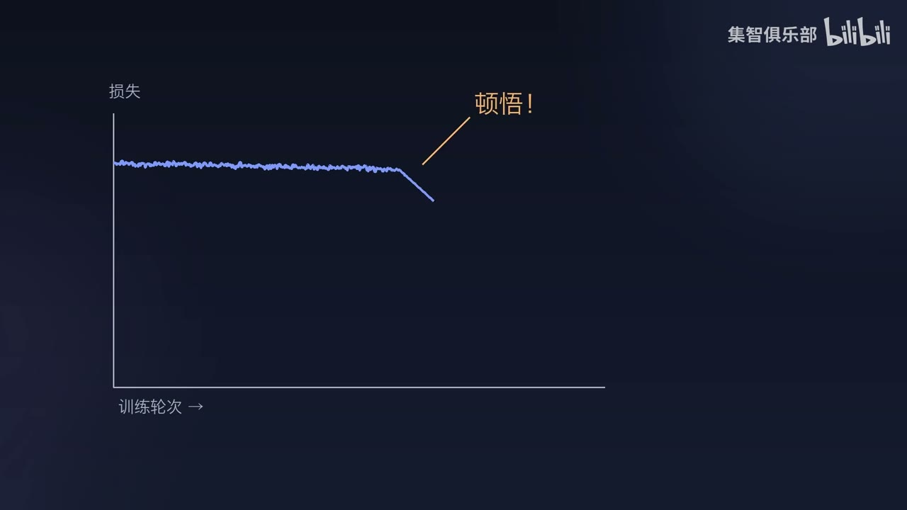
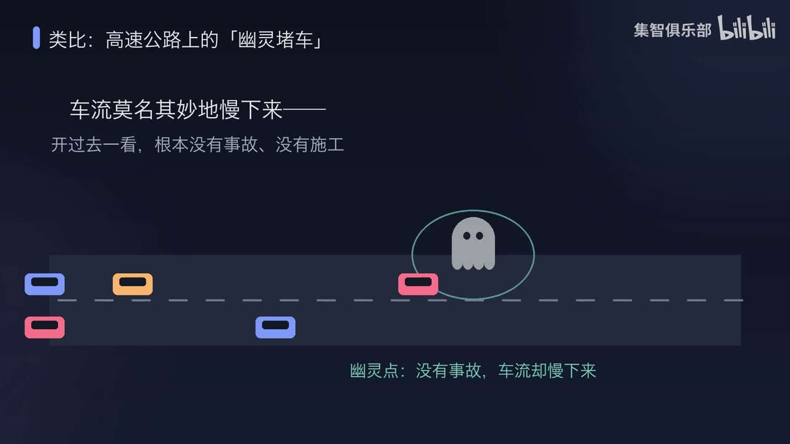
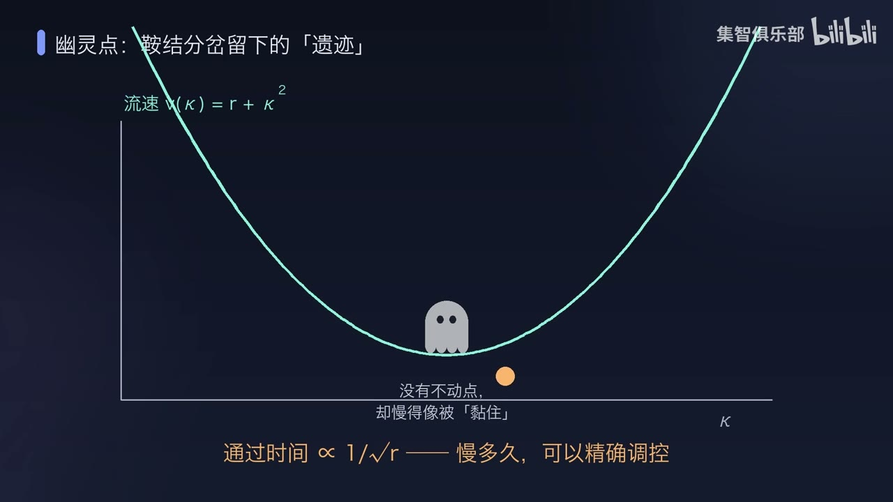
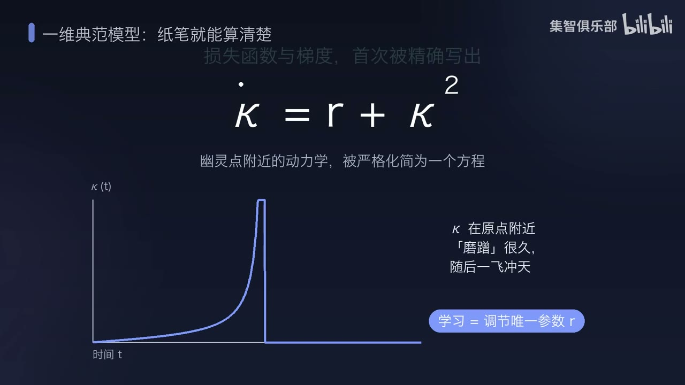
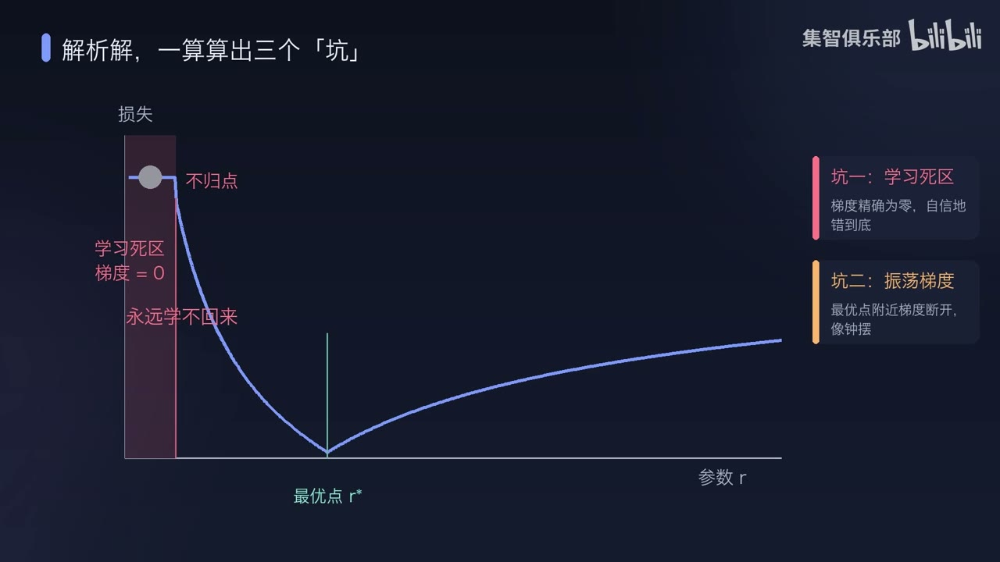
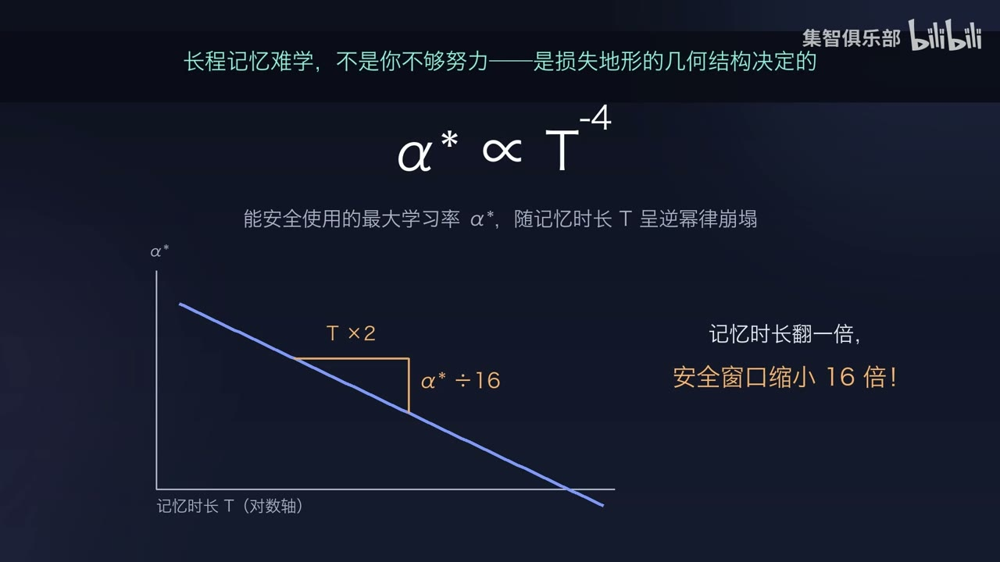
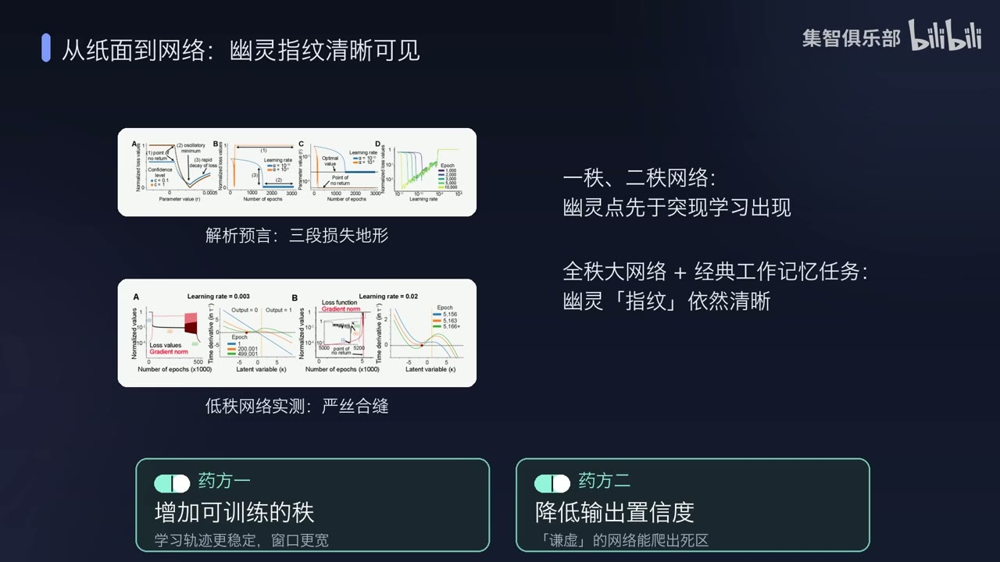

# AI 为什么会突然“开窍”？——高中生与 AI 爱好者版

- **发布者：** 集智俱乐部
- **时长：** 05:15
- **来源：** [Bilibili 原视频](https://www.bilibili.com/video/BV1obuu62Eh2/)
- **视频 ID：** BV1obuu62Eh2
- **总结强度：** 深度，但按高中生与普通 AI 爱好者的阅读门槛讲解
- **证据：** 完整时间戳逐字稿与 11 张候选画面。自动转写中的同音字已按画面和上下文谨慎校正。

## 一句话抓住核心

AI 看起来像突然开窍，可能因为它先在内部悄悄造出了一条“减速带”来等待；减速时间一旦调准，原本持续答错的网络会突然答对，训练曲线便像在某一刻发生了顿悟。[00:00:52]

## 先把六个词翻译成人话

| 正式说法 | 先这样理解就够了 |
| --- | --- |
| 损失 | AI 的答错分数，越低越好 |
| 梯度 | 老师给 AI 的纠错箭头：下一步往哪边改 |
| 学习率 | AI 每次沿纠错箭头走多大一步 |
| 状态 | AI 此刻保存在内部的工作记忆 |
| 状态空间 | 把 AI 所有可能的内部状态画成一张地图 |
| 幽灵点 | 地图上一段看不见的减速带：没有墙挡住，经过时却会慢下来 |

后面出现“梯度消失”，就把它读成“老师突然不给方向了”；出现“学习率过大”，就把它读成“每一步迈得太远了”。

## 整个故事只有四步

1. 网络看到一个信号，必须等一段时间再反应。
2. 外界没有钟，网络只好在内部造一个计时器。
3. 这个计时器可以是一段让内部状态慢慢经过的“幽灵减速带”。
4. 训练就是调节减速带的强弱；等待时间调准的一刻，表现会突然起飞。

先抓住这四步，视频最重要的意思就已经接住了。

## “突然开窍”只是我们从外面看到的样子

训练开始后，AI 的答错分数可能很久都没有明显下降，随后突然快速变小。曲线看起来像一条平路尽头突然出现下坡。[00:00:00]

*图 01 · 00:00:14：损失曲线长时间停在平台，随后突然下降；“顿悟”首先是一种从外部看到的训练曲线形状*

这不代表前面的训练毫无作用。网络可能一直在内部搭建计时结构，只是等待时间尚未调准，所以最终答案仍然算错；当它跨进正确范围，分数才会集中体现出来。

可以把它类比成密码锁：前三位已经调对时，锁依然打不开；最后一位对上的瞬间，结果从“完全失败”跳到“成功”。内部改进是逐步发生的，外部成绩却可以突然变化。[00:00:24]

## 为什么网络需要一只“内部秒表”

研究中的任务很像这样：先给网络看一个信号，让它等待 (T) 秒，时间到了再作出反应。[00:00:57]

*图 02 · 00:01:11：任务由“信号—延迟期 T—反应”组成；延迟期没有持续提示，网络必须自己保存信号并计算等待时间*

假如我让你闭眼十秒后举手，又不准看钟，你会在心里数数。循环神经网络也需要某种内部变化来表示“已经过去多久”。如果内部状态完全不动，它只能保存信息，很难知道何时该行动；如果变化太快，记忆又会提前消失。

它需要一种刚刚好的运动：先慢慢走，等够时间，再迅速离开并触发反应。

## 幽灵点就是一条看不见的减速带

想象高速公路上没有事故、没有施工，车流经过某一段时仍然会整体减速。车辆没有停死，过一会儿仍能驶出，这就是“幽灵堵车”的直观感觉。[00:01:53]

*图 03 · 00:01:40：公路没有实际障碍，车流经过幽灵标记的位置却会减速；幽灵点也让网络的内部状态暂时慢下来*

网络内部也可以形成这样的区域。代表内部状态的小球滚到这里时，速度会变得很慢，于是它能在附近停留一段可控的时间；随后小球继续向前，网络便知道等待结束了。[00:02:00]

*图 04 · 00:02:09：曲线最低处代表移动最慢的区域；橙色状态点没有被固定，却会在这里停留很久*

“幽灵点”听起来神秘，实际含义很朴素：这里没有真正挡住状态的固定点，却保留了一个会让状态减速的结构。它的正式来源叫“鞍结分岔留下的遗迹”；第一次阅读可以先记住“无形减速带”。

## 公式到底说了什么

视频把幽灵点附近极其复杂的网络，压缩成一个简单方程：[00:02:18]

\[
\dot{\kappa}=r+\kappa^2
\]

先不用推导，只翻译三个符号：

- \(\kappa\)：内部状态小球现在走到了哪里。
- \(\dot{\kappa}\)：小球此刻走得多快。
- \(r\)：减速带的调节旋钮，也是训练主要改变的量。

当小球靠近中心时，\(\kappa^2\) 很小，速度主要由 \(r\) 决定。\(r\) 越小，小球爬得越慢，网络等待得越久；小球离开中心后，\(\kappa^2\) 会变大，它便迅速加速离开。

*图 05 · 00:02:37：上方是一维方程，下方轨迹显示状态先缓慢移动、随后迅速离开；学习的关键被压缩成调节旋钮 r*

通过减速区的时间大约与 \(1/\sqrt r\) 成比例。它表达的直觉是：想延长等待，就要把 \(r\) 调得更小。比如 \(r\) 缩小到原来的百分之一，等待时间大约会增至原来的十倍。

所以，这段数学真正要说的是：一个拥有成百上千神经元的网络，在关键位置附近可能只剩一个重要旋钮；旋钮调准前，它一直答错，调准后，它突然答对。

## 为什么训练会卡住：三个很生活化的坑

### 坑一：做错了，老师却不给纠错方向

网络可能掉进“学习死区”。此时答案明明错误，梯度却等于零，也就是纠错箭头消失了。普通梯度下降不知道下一步往哪里走，网络会保持错误且很自信。[00:02:43]

这像学生把一道题做错后，老师只说“继续”，既不指出错处，也不给方向。练习次数再多，也很难离开原地。

### 坑二：已经靠近正确答案，每一步却迈得太远

正确参数附近的梯度可能从左右两边给出不同方向。如果学习率太大，参数会一步跨过最佳位置，下一步又跨回来，像钟摆一样左右摇摆；摆动越来越大时，它甚至会掉进旁边的学习死区。[00:03:01]

*图 06 · 00:03:06：横轴是参数 r，曲线最低处是最佳位置；左侧红色区域是失去纠错方向的学习死区*

### 坑三：想记得更久，每一步就必须小很多

能安全使用的最大学习率 \(\alpha^*\) 与等待时间 \(T\) 有这样的关系：

\[
\alpha^*\propto T^{-4}
\]

无需计算负四次方，只记住视频给出的结果：等待时间翻倍，安全学习率会缩小到原来的 \(1/16\)。[00:03:20]

*图 07 · 00:03:35：画面直接把“记忆时长翻倍”对应到“安全学习率缩小 16 倍”，显示长时记忆训练为何格外挑步长*

这像走一条越来越窄的独木桥：任务要求的记忆越长，参数允许落脚的范围越窄，每一步也必须越小。单纯延长训练时间未必能解决问题，步长太大仍会从正确区域跨出去。

## 这套解释为什么值得认真看

研究者先在结构简单的循环网络中观察到：幽灵点先形成，网络性能随后才突然提升。这个先后顺序说明，幽灵点有可能参与了“开窍”的形成过程。[00:03:43]

换成结构更复杂的网络后，类似特征依然能找到。理论还给出两个直接的改进方向：

- **增加可训练的秩：** 可以先理解为给网络增加几只独立的方向盘，让它有更多办法调整内部路线，训练会更稳定。
- **降低错误答案的置信度：** 让网络对错误答案少一点“死心塌地”，纠错信号便更有机会保留下来，掉进死区后也可能重新爬出。[00:04:01]

*图 08 · 00:04:03：画面汇总了简单网络与复杂网络中的证据，并给出“增加可训练的秩、降低输出置信度”两种干预方向*

## 我应该怎样理解它与大模型的关系

这项工作直接分析的是循环神经网络的工作记忆任务。它清楚解释了一个特定模型怎样学会等待，也展示了一种“内部逐步形成、外部突然成功”的机制。

大模型的涌现能力、长上下文学习和人类灵光一闪，都可以借这幅图产生新的问题；现有本地证据还不足以证明它们都由同一种幽灵点造成。[00:04:43]

*图 09 · 00:04:32：画面把工作记忆机制延伸到大模型长程依赖；这是值得检验的方向，当前直接证据仍来自循环网络任务*

因此，最稳妥的收获有两层：

1. **已经讲清的部分：** 某类循环网络可用幽灵减速区完成计时，这套结构会带来突然学习和三类训练困难。
2. **仍待研究的部分：** 大模型或大脑是否也通过类似结构形成长时记忆与顿悟。

## 只要回答三问，就算看懂了

1. **为什么要有幽灵点？** 因为网络需要在没有外部时钟时，制造一段可调的等待。
2. **为什么表现会突然变好？** 因为内部旋钮 \(r\) 可以逐渐变化，但只有等待时间落进正确范围，最终答案才会从错变对。
3. **为什么长时记忆更难训练？** 因为允许使用的学习率会快速缩小；等待时间翻倍，安全步长可能只剩 \(1/16\)。

把整段视频压成一句更口语的话：**AI 的“突然开窍”，可能只是我们终于看见了它此前一直在内部慢慢调准的那只秒表。**

## 边界与证据提醒

- 本页依据约五分钟视频、完整逐字稿和画面重建，没有论文全文与完整推导，公式的成立条件仍需阅读原论文核对。
- 视频直接给出的对象是循环神经网络工作记忆任务，不能直接推广成所有神经网络的共同规律。
- 大模型长上下文与人脑工作记忆属于研究方向或预测，当前页面没有对应的直接实验证据。
- 来源画面标注论文为 *Physical Review X* 16, 021058（2026）；本页没有联网核验书目信息。

## 时间戳导航

- [00:00:00] 什么叫“突然开窍”
- [00:00:57] 网络为什么需要内部秒表
- [00:01:53] 用幽灵堵车理解幽灵点
- [00:02:18] 一条公式怎样压缩复杂网络
- [00:02:43] 学习死区：答错却没有纠错方向
- [00:03:01] 学习率过大为什么会来回振荡
- [00:03:20] 等待时间翻倍，安全步长缩小 16 倍
- [00:03:43] 幽灵点先出现，表现随后起飞
- [00:04:01] 两种改进方法
- [00:04:43] 与大模型和大脑的联系有多远

## 复习与行动清单

- [ ] 我能用“无形减速带”解释幽灵点。
- [ ] 我知道公式中的 \(r\) 是控制等待时间的旋钮。
- [ ] 我能区分“没有纠错方向”和“每一步迈得太大”。
- [ ] 我记得等待时间翻倍时，安全学习率会缩小 16 倍。
- [ ] 我能说清哪些结论来自循环网络实验，哪些仍是对大模型和大脑的延伸猜想。
