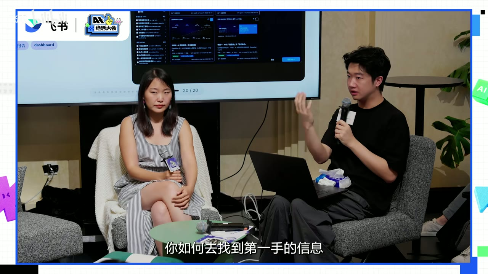
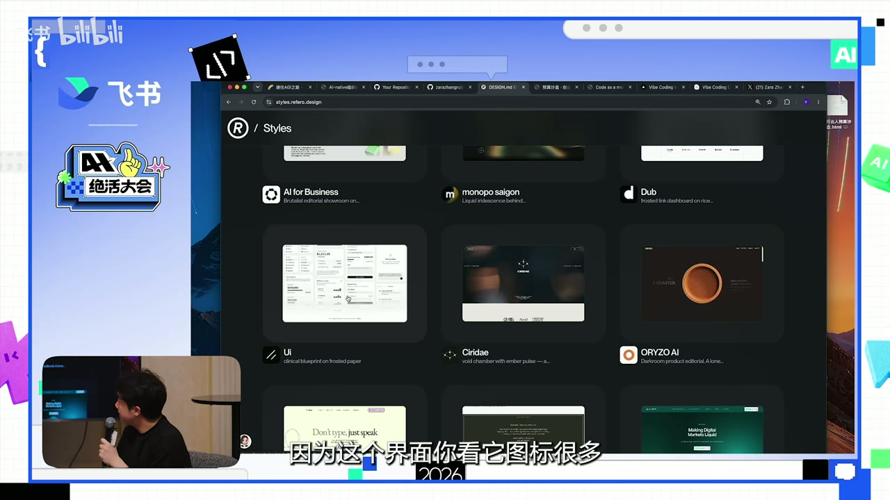
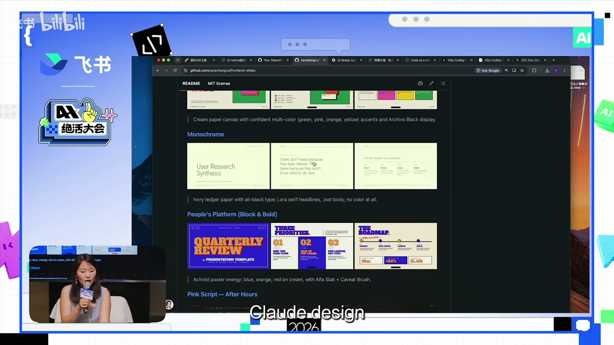
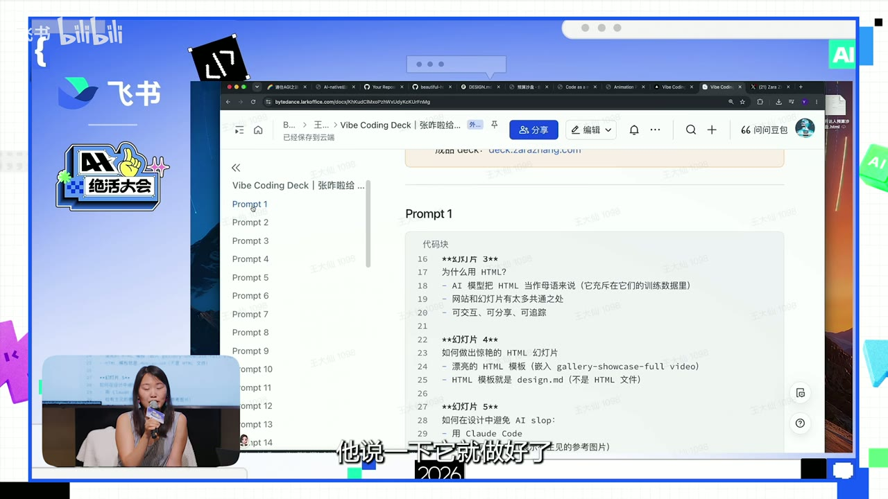
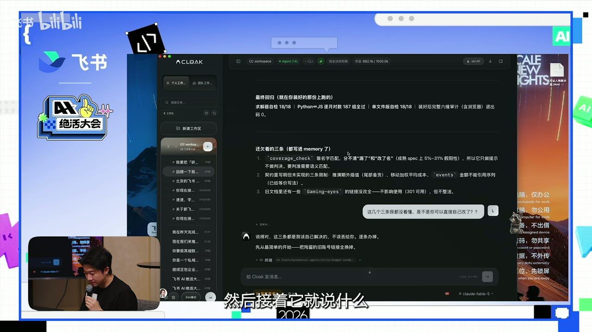
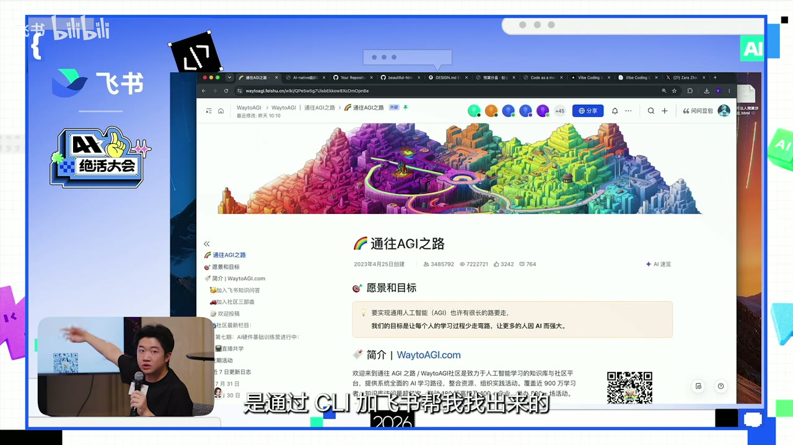
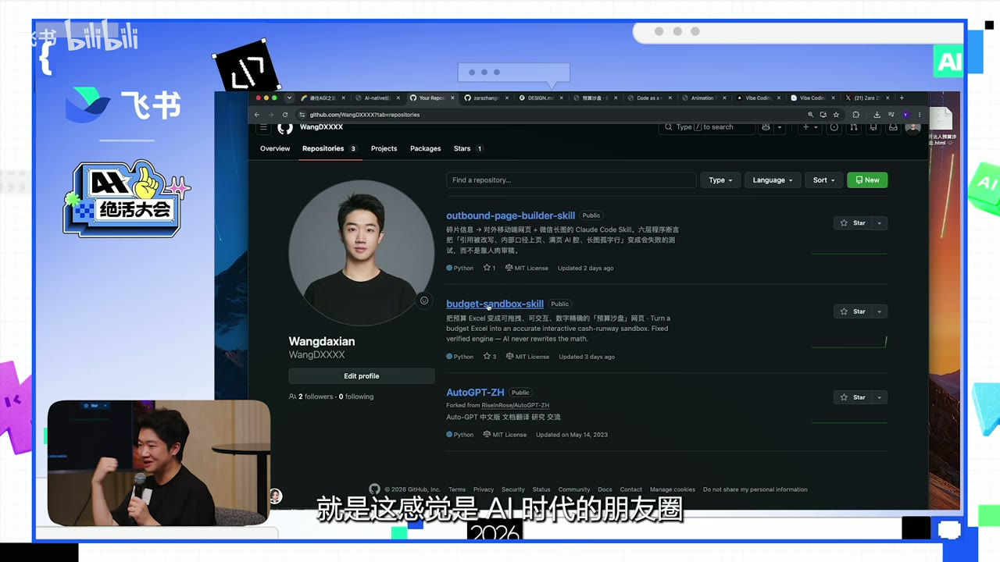

# 【绝活大会】同一个 Skill，为什么别人做出来就是比你好看？

> 上传者：飞书<br>
> 时长：23 分 16 秒<br>
> 来源：[Bilibili](https://www.bilibili.com/video/BV1bLMX6HE7b/)<br>
> 视频 ID：BV1bLMX6HE7b<br>
> 总结强度：standard<br>
> 证据：本地 Whisper 中文逐字稿 + 12 张带时间戳画面。逐字稿中部分产品名、英文词可能存在 ASR 误识，以下对不确定名称保留谨慎表述。

## 一句话抓住核心

同一个 Skill 做出的作品有美丑差异，关键通常不在 Skill 本身，而在于你是否提供了清晰内容、可复用的视觉规范、足够具体的反馈，以及把成果沉淀成能被继续改造和传播的资产。

## 时间戳导航

- [00:00:18] 招 AI 人时，作品要看实际价值：提效、推广范围、收入或留存。
- [00:01:37] 以 Ramp 的 “We only hire builders” 为例，人人都应能在岗位上构建工具。
- [00:02:08] 招聘可分两轮：先看专业基本功，再现场使用 Agent 完成真实任务。
- [00:03:34] AI 团队将 HTML 用作 slides、数据看板与客户材料的常见载体。
- [00:05:07] HTML 内容组件化、入库、打标、统计使用情况，像拼积木组装客户方案。
- [00:06:53] “品味”可以通过优秀案例、设计规范和模板被部分外化、复用。
- [00:08:10] 用 `design.md` 为网页生成提供具体的视觉参考。
- [00:10:28] 从喜欢的图片、配色中提取设计语言，再生成可复用模板。
- [00:11:19] 真正可迁移的模板是描述色彩、字体和风格的 `design.md`，而非固定 HTML 成品。
- [00:13:07] 公司应把现有品牌模板和设计规范转成适合 Agent 消费的设计描述。
- [00:14:57] 高质量 HTML slides 来自清楚的 brief、内容规划与后续交互，不会靠一句话自动完成。
- [00:17:00] 把协作文档作为 Agent 的 brief，承载文字、图片、视频、页序与评论。
- [00:17:50] 获取一手信息的路径，是追随真正做产品的人和开源项目。
- [00:19:12] 文科背景也能借助 Agent 将一个具体需求封装、上传并分享。
- [00:20:49] GitHub 上的 Skill 值得拆解、改造并喂入自己的模板和业务流程。
- [00:22:30] Build in public：先做出东西，再用公开链接与录屏展示它。

## 核心问题与推理主线

视频从一个更宽的判断开始：AI 时代值得看重的能力，并非“是否调用过某个工具”，而是能否把工具推进到真实结果。发言者举的判断维度很直接：对内工具有没有带来效率提升、覆盖多少团队；对外工具有没有带来曝光、收入、拉新或留存。[00:00:43]

这一标准也解释了“同一个 Skill，为什么别人做得更好看”：Skill 是能力的起点，成品质量取决于上游输入、设计约束、内容判断和反复反馈。把 AI 当成一次性生成器，往往只能得到一个可运行的初稿；把 AI 放进完整工作流，才有机会得到可展示、可传播、可复用的成果。

## 1. 先有 Builder 能力，再谈 AI 作品

发言者引用 Ramp 的招聘口号 “We only hire builders”，用来强调客服、运营等传统上不被视作“构建者”的岗位，同样可以通过 AI 为自身工作制作小工具、工作流或产品化方案。[00:01:37]

她提出的招聘方法也很具体：

1. 第一轮先脱离 AI，聊候选人的专业基本功、既有作品与文化匹配。
2. 第二轮给电脑、Agent 和 token，让候选人围绕未来真实工作完成现场任务，例如做网页、App 或工作流。
3. 同时考察成品与“和 Agent 对话的过程”。

这里的隐含判断是：模型能力降低了制作门槛，领域能力却决定了任务怎么被定义、结果能否被验收。发言者将自身这一代人的系统训练称为在 AI 时代仍然重要的“手艺活”。[00:03:05]

## 2. HTML 的价值：从静态交付物变成可互动的工作界面

视频将 HTML 视为 AI 时代办公产物的重要载体：它可读、可交互，也更容易由 Agent 快速生成。[00:03:34] 因此 slides、数据看板、客户材料、产品方案都可以从传统文件形态迁移到网页形态。

以数据看板为例，HTML 可以让用户拖动参数、查看不同情景（scenario）的变化；这使汇报材料从“展示结论”扩展为“允许探索结论”。同时，视频也保留了现实限制：在部分现场屏幕比例不匹配时，HTML 展示可能出现适配问题。[00:04:42]

更进一步的做法，是将客户案例、行业方案等内容变成可检索的 HTML 页面组件：团队产出后入库、打标、记录调用次数；面向新客户时，用户像往购物车里选组件一样拼装，再调整页序、替换页面内容，效果好的版本回流入库。[00:05:07]



*图 01 · 00:06:47：投影中展示的是一个包含多张页面缩略图和界面内容的 HTML 方案画面，发言围绕组件化组装客户材料展开。*

这套思路的重点不只是“把 PPT 换成网页”，还包括：

- 把高频内容从一次性交付变成积木；
- 让素材来源、使用次数、原创与微调状态可追踪；
- 让客户方案有可组合的生产方式；
- 让有效版本能回流为组织知识。

## 3. 好看可以被外化：从参考图到 `design.md`

视频对“审美差距”的回答很务实：审美固然有差异，但优秀设计可以被封装成 AI 可读取的约束。[00:06:53] 发言者举了 `design.md` 的例子：从风格案例中选择契合任务的视觉参考，再把相应文件交给 Agent，以此生成网页或视觉战报。



*图 02 · 00:08:43：浏览器展示风格案例库的深色网格页面，每个卡片以网站缩略图、名称和简短风格描述区分不同视觉方向。*

选择参考时，任务类型应影响选择。例如，视频中提到图标丰富的界面更适合数据可视化复盘场景。[00:08:37] 这体现的是“先选视觉语境，再交给模型排版”的顺序：模型并不需要从空白处猜测审美，输入已经告诉它该靠近什么样的层级、配色和组件语言。

发言者演示的实际工作流是：

1. 先把活动群消息、作品等原始内容整理到文档中；
2. 人工审核内容；
3. 选定一个 `design.md` 参考及相关文件；
4. 将内容与设计参考一起交给 Agent，要求转成网页；
5. 继续检查和修改展示结果。[00:09:01]

这套流程的价值，是把“内容是否正确”和“视觉如何呈现”分开处理，避免让 Agent 在信息混乱时同时猜内容、猜结构、猜风格。

## 4. 模板的本体是设计说明，不是固定页面

视频中很重要的一个纠偏是：可复用模板不应停留在一套固定 HTML 页面上。[00:11:03] 固定 HTML 容易让模型把每页内容硬塞进原来的框架，造成发言者所说的 overfit——风格被机械套用，内容结构失去弹性。

更适合作为模板的是 `design.md`：用 Markdown 明确描述颜色、字体、视觉风格、间距、组件与画布信息。这样，Agent 能在保持设计语言一致的前提下，为不同内容重建页面结构。


*图 03 · 00:12:36：代码仓库中打开了一个 `design.md`，页面以表格列出颜色、字体、字号、间距、画布尺寸和组件说明，显示模板被写成结构化设计规范。*

视频给出的沉淀路径是：

```text
喜欢的图片 / 书封 / 网站配色
        ↓
交给具备视觉理解能力的 Agent，生成若干页视觉样稿
        ↓
提炼为 design.md：色彩、字体、风格、版式与组件规则
        ↓
用于 HTML、SVG、海报、活动物料等不同载体
```



*图 04 · 00:10:40：GitHub 页面展示多组演示模板缩略图，包含单色研究汇报、粗体海报风和其他不同风格方向，体现素材库覆盖多种视觉语言。*

对组织而言，这意味着现有 PPT、海报与品牌规范也可以进一步转成 Agent 可消费的设计描述。[00:12:51] 视频的观点是：传统 guideline 更偏向给人阅读；面向大量 Agent 参与制作的环境，公司需要自己的 `design.md`。

## 5. 高质量成品靠清楚的 brief 与迭代

发言者针对“一句话做 slides”给出明确反对意见。[00:16:45] 她认为，同一个 Skill 做得丑，常见原因是用户只发出一次 prompt，看到初稿不满意便停止；而一份高质量 deck 的前提是，创作者已经想清楚每页放什么、想让观众经历什么。

视频中的高质量英文 deck 有交互元素：点击后放大、出现内容或跳转链接，页面内还包含有创意的导航系统。[00:15:05] 这说明 Agent 在承担排版、实现和局部创意时，前提是创作者给了足够准确的内容架构。



*图 05 · 00:16:29：飞书文档中按“Prompt 1、Prompt 2”等章节组织了幻灯片内容说明，正文包含每页要求与实现提示，画面体现了详细 brief 的写法。*

对于 slides，视频建议把飞书文档作为 Agent 的 brief：把每页文字、图片、视频、媒体资源和位置要求放进一个表或文档；Agent 可读取并下载资源，按对应位置嵌入。成品不符合预期时，用户可在文档的对应位置直接评论，Agent 再读取评论做定向修改。[00:17:20]



*图 06 · 00:20:21：Agent 工作界面中显示对需求、待办和反馈的文本讨论，画面对应“读取文档与评论后继续修改”的协作方式。*

因此，较好的使用方式可以概括为：

- 先写内容事实、页序和每页目的；
- 再提供明确的视觉参考或 `design.md`；
- 生成后逐项指出问题：层级、密度、字数、图片、交互、导航；
- 将改好的结构和规范沉淀为下一次的起点。

## 6. 找一手信息：让 AI 帮你读巨大的知识库

视频将“影响力”拆成两个问题：如何得到一手信息，以及如何在平台上形成自己的声量。[00:17:47] 对于快速变化的 AI 领域，发言者更建议追随真正构建产品的人、产品创始人的公开表达和开源项目，而非把“上课”当作唯一学习入口。

她以“通往 AGI 之路”知识库为例：内容越积越多，人很难完整读完；可以把知识库交给 Coding Agent，让它围绕一个已发现的条目继续搜索“还有哪些类似的好东西”。[00:13:55] 在她的案例里，Agent 从知识库中找到了一个用于邀请文案的开源 Skill。



*图 07 · 00:14:32：浏览器打开“通往AGI之路”知识库主页，顶部有大幅彩色城市插画，页面呈现知识库作为可交给 Agent 检索的原始资料库。*

这里的可复用方法是：把大知识库视为待查询的资料源，先由人提出具体目标，再让 Agent 归纳、检索、找关联条目；人仍要回到原文验证关键结论。

## 7. GitHub：公开作品、二次创作与 Build in Public

视频后段用一个“预算 Excel 变交互式沙盘”的 Skill 说明：输入预算表后，工具可按不同档位推演未来结果，也能开关变量。[00:19:12] 发言者将自己的 Markdown 形式 Skill 上传到 GitHub，过程中让 Agent 处理上传和兼容性问题；她强调，即使没有传统技术背景，也能先把目标、输入、输出与限制讲清楚，再让 Agent 执行工程动作。



*图 08 · 00:22:18：GitHub 个人仓库页列出多个公开项目，其中包含预算沙盘和落地页构建相关 Skill，画面直观呈现将能力公开为可访问仓库的结果。*

更有价值的一点是，GitHub 上的 Skill 用途不止“下载即用”。视频鼓励用户拆解已有 Skill，再把自己的公司品牌模板、业务流程与素材输进去，改造成更贴近场景的版本。[00:20:49]

最后，发言者把这些行动串成一句话：成为 builder 需要 build in public——先做出某个具体东西，再通过 GitHub 链接、录屏演示和内容分享让别人看见并使用它。[00:22:30]

## 具体案例与原话细节

- 关于 AI 作品的价值判断：[00:00:43] “如果这是一个对内的提效工具，它有没有带来切实的效率提升？”对外则看曝光、收入、拉新与留存。
- 关于 HTML 的采用：[00:03:39] 发言者观察到，自己参与的活动中，PPT 已大量转成 HTML；这属于录制时的个人观察。
- 关于模板：[00:11:27] `design.md` 用文字描述颜色、字体与视觉风格，因而能迁移到 HTML 以外的载体，例如 SVG。
- 关于视觉素材的来源：[00:12:25] 日常收集喜欢的图片和配色，放入文件夹，再交给有视觉能力的 Agent 复刻为模板。
- 关于 AI 生成的预期：[00:15:37] “你不能指望你第一次发给它做出来的东西就符合预期。”
- 关于公开 Skill：[00:20:49] “GitHub 上面获取 Skill，不是让你拿来用的，是让你拿来改的。”
- 关于技术门槛：[00:22:14] 她把 GitHub 称为“AI 时代的朋友圈”“一种自我表达的媒介”；这是发言者的个人感受与倡议。

## 边界、疑点与时效性

- 视频中的产品名、站点名、仓库名多由自动语音识别转写，存在同音或拼写误差。学习其方法即可，使用前应回到项目原文确认名称、许可证、安装要求和安全边界。
- “HTML 已 100% 渗透”“一句话上传 GitHub”等属于现场表达或个人经验，不能直接视为通用事实。
- `design.md` 的效果依赖输入参考、内容结构、模型视觉能力和具体实现；它能降低风格传递成本，不能替代对内容、品牌和可用性的审查。
- 让 Agent 读取知识库、文档和素材前，应确认访问权限、敏感信息范围及产物发布权限。

## 复习与行动清单

- [ ] 下次评价 AI 项目时，写下实际指标：节省了什么、谁在用、产生了什么结果。
- [ ] 为一个高频工作准备内容 brief：目标、受众、页序、每页信息、素材与验收标准。
- [ ] 收集 10 个自己真正喜欢的视觉参考，按场景归档。
- [ ] 从其中一个参考提炼颜色、字体、间距、组件与语气，形成自己的 `design.md` 初稿。
- [ ] 用“内容文档 + 设计规范”驱动一次 HTML 或 SVG 产出，并至少完成一轮针对性反馈。
- [ ] 在现有开源 Skill 中选一个与工作最相关的项目，先拆解其结构，再加入自己的流程和品牌约束。
- [ ] 选一个可公开的小成果，补上说明、链接和演示，让它成为下一次协作的可复用起点。
